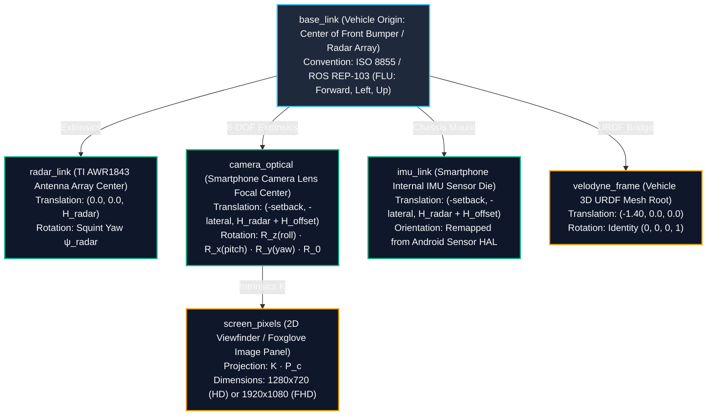

# RoadSense — Master Coordinate Transforms & Sensor Reference Manual

> **Document Name:** `Coordinate Transforms.md`  
> **Location:** `intel/Coordinate Transforms.md`  
> **Purpose:** Authoritative, single source of truth for all spatial coordinate frames, sensor axes, transformation matrices, and zero-copy projection pipelines across the entire RoadSense platform (Android App, Python Tooling, Foxglove Studio, and Perception Pipelines).  
> **Maintainers:** Autonomous AI Coding Agents & RoadSense Perception Engineering Team  
> **Last Updated:** October 2026  

---

## Table of Contents
1. [Spatial Architecture & Coordinate Frame Tree](#1-spatial-architecture--coordinate-frame-tree)
2. [Sensor-by-Sensor Coordinate Frame Specifications](#2-sensor-by-sensor-coordinate-frame-specifications)
   - [2.1 Vehicle Base Frame (`base_link`)](#21-vehicle-base-frame-base_link)
   - [2.2 TI AWR1843 mmWave Radar Frame (`radar_sensor` / `radar_link`)](#22-ti-awr1843-mmwave-radar-frame-radar_sensor--radar_link)
   - [2.3 Camera Optical Pinhole Frame (`camera_optical`)](#23-camera-optical-pinhole-frame-camera_optical)
   - [2.4 Smartphone Hardware IMU Frame (`imu_device` / `imu_link`)](#24-smartphone-hardware-imu-frame-imu_device--imu_link)
   - [2.5 Camera Viewfinder / Screen Pixel Frame (`screen_pixels`)](#25-camera-viewfinder--screen-pixel-frame-screen_pixels)
   - [2.6 Vehicle Dynamics & CAN Frame (`can_dynamics`)](#26-vehicle-dynamics--can-frame-can_dynamics)
   - [2.7 Global GNSS / Earth Navigation Frame (`gnss_enu`)](#27-global-gnss--earth-navigation-frame-gnss_enu)
3. [Mathematical Transformation Pipeline](#3-mathematical-transformation-pipeline)
   - [3.1 Base Optical Transform Matrix ($R_0$)](#31-base-optical-transform-matrix-r_0)
   - [3.2 Extrinsic Rotation Matrices ($R_y, R_x, R_z$)](#32-extrinsic-rotation-matrices-r_y-r_x-r_z)
   - [3.3 Complete Base-to-Optical Transform ($R_{\text{total}}$)](#33-complete-base-to-optical-transform-r_texttotal)
   - [3.4 Intrinsic Pinhole Projection Matrix ($K$)](#34-intrinsic-pinhole-projection-matrix-k)
   - [3.5 3D Radar-to-2D Screen Forward Projection](#35-3d-radar-to-2d-screen-forward-projection)
   - [3.6 Inverse 2D-to-3D Road Plane Intersection](#36-inverse-2d-to-3d-road-plane-intersection)
4. [Reverse Landscape Mount & Zero-Copy 180° Inversion Architecture](#4-reverse-landscape-mount--zero-copy-180-inversion-architecture)
5. [Master Axis Cross-Reference Matrix](#5-master-axis-cross-reference-matrix)
6. [Common Traps & Verification Checklist](#6-common-traps--verification-checklist)

---

## 1. Spatial Architecture & Coordinate Frame Tree

All spatial calculations, 3D sensor fusion, and visualizer overlays in RoadSense are organized around a unified ROS-standard TF tree rooted at `base_link`:



---

## 2. Sensor-by-Sensor Coordinate Frame Specifications

### 2.1 Vehicle Base Frame (`base_link`)

The master physical reference frame for the vehicle body.

* **Standard:** ISO 8855 / ROS REP-103 FLU
* **Origin ($O_{\text{base}}$):** Center of the front bumper at the radar transceiver antenna array. When projected onto the road surface, $Z_{\text{base}} = 0$ corresponds to the asphalt ground plane.
* **Axes:**
  * **$+X_{\text{base}}$ (Forward):** Longitudinal axis pointing forward along vehicle driving direction.
  * **$+Y_{\text{base}}$ (Left):** Lateral transverse axis pointing to the vehicle's left (driver side in RHD markets).
  * **$+Z_{\text{base}}$ (Up):** Vertical elevation axis pointing straight up into the sky (opposing gravity).
* **Angular Rotations:**
  * **Roll ($\phi$):** Rotation around $+X_{\text{base}}$ (tilt right = positive).
  * **Pitch ($\theta$):** Rotation around $+Y_{\text{base}}$ (nose up = positive in standard vehicle dynamics; in camera calibration, downward tilt toward road is tracked as $+\theta$).
  * **Yaw ($\psi$):** Rotation around $+Z_{\text{base}}$ (counter-clockwise / turning left = positive, $0^\circ$ = straight ahead).

```
          Vehicle Base Frame (base_link) - ISO 8855 FLU

                             +X (Forward)
                                  ▲
                                  │
                                  │
            +Y (Left) ◄───────────┼───────────► -Y (Right)
                                  │
                                  │
                             -X (Reverse)

                     ⊙ +Z (Up, out of page)
```

---

### 2.2 TI AWR1843 mmWave Radar Frame (`radar_sensor` / `radar_link`)

The native coordinate system output by the TI AWR1843BOOST mmWave DSP firmware (TLV Type 1 point cloud & TLV Type 3 / Type 7 EKF tracker tables).

* **Standard:** TI mmWave Automotive RFU (Right, Forward, Up)
* **Origin ($O_{\text{radar}}$):** Physical center point of the 3 TX / 4 RX microstrip patch antenna array on the radar PCB.
* **Axes:**
  * **$+X_r$ (Lateral Right):** Points to the vehicle's right side ($+X_r = -Y_{\text{base}}$).
  * **$+Y_r$ (Longitudinal Forward):** Direct boresight range pointing ahead ($+Y_r = +X_{\text{base}}$).
  * **$+Z_r$ (Elevation Up):** Vertical height above radar antenna plane ($+Z_r = +Z_{\text{base}} - H_{\text{radar}}$).
* **Firmware Angle Convention:**
  * Azimuth ($\theta_{\text{TI}}$): Clockwise positive ($-90^\circ \dots +90^\circ$).
* **Mapping to Vehicle Frame (`base_link`):**
  Given a target at $(X_r, Y_r, Z_r)$ from radar firmware with mounting squint offset $\psi_{\text{radar}}$:
  $$X_{\text{base}} = Y_r \cdot \cos(\psi_{\text{radar}}) - X_r \cdot \sin(\psi_{\text{radar}})$$
  $$Y_{\text{base}} = -X_r \cdot \cos(\psi_{\text{radar}}) - Y_r \cdot \sin(\psi_{\text{radar}})$$
  $$Z_{\text{base}} = Z_r + H_{\text{radar}}$$
  $$\text{Heading}_{\text{base}} = -\text{Heading}_{\text{TI}} + \psi_{\text{radar}}$$

```
               TI mmWave Radar Native Sensor Frame (RFU)

                             +Y_r (Forward)
                                  ▲
                                  │
                                  │
           -X_r (Left) ◄──────────┼──────────► +X_r (Right)
                                  │
                                  │
                             -Y_r (Behind)

                     ⊙ +Z_r (Up, out of page)
```

---

### 2.3 Camera Optical Pinhole Frame (`camera_optical`)

Standard computer vision optical coordinate system aligned with the camera lens and sensor plane.

* **Standard:** OpenCV / ROS REP-103 RDF (Right, Down, Forward)
* **Origin ($O_c$):** Camera pinhole nodal point (optical center).
* **Axes:**
  * **$+X_c$ (Sensor Right):** Horizontal pixel axis pointing rightward across the image sensor.
  * **$+Y_c$ (Sensor Down):** Vertical pixel axis pointing downward toward the road/ground.
  * **$+Z_c$ (Optical Boresight):** Longitudinal optical axis pointing forward through the lens into the 3D scene.
* **Extrinsic Translation Relative to `base_link`:**
  $$\mathbf{T}_{\text{cam}} = \begin{bmatrix} -\text{setbackM} \\ -\text{lateralOffsetM} \\ H_{\text{radar}} + \text{heightOffsetM} \end{bmatrix}$$
  * *Typical values:* $\text{setbackM} = 0.30\text{ m}$, $\text{lateralOffsetM} = 0.00\text{ m}$, $H_{\text{cam}} = 0.95 + 0.40 = 1.35\text{ m}$.

```
                 Camera Optical Frame (RDF)

                       +Z_c (Optical Boresight Forward)
                                     ▲
                                    /
                                   /
                                  ┌───────► +X_c (Sensor Right)
                                  │
                                  │
                                  ▼ +Y_c (Sensor Down / Ground)
```

---

### 2.4 Smartphone Hardware IMU Frame (`imu_device` / `imu_link`)

The internal MEMS accelerometer, gyroscope, and rotation vector sensor coordinate system defined by the Android Open Source Project (AOSP) Sensor HAL.

* **Standard:** Android Sensor HAL Coordinate System (Screen Portrait Default)
* **Default Orientation (Portrait, Screen Facing Driver):**
  * **$+X_{\text{phone}}$:** Points along the short edge to the right.
  * **$+Y_{\text{phone}}$:** Points along the long edge toward the top (front earpiece).
  * **$+Z_{\text{phone}}$:** Points out of the front screen toward the user.
  * **Rear Camera Boresight:** Points along **$-Z_{\text{phone}}$** (out of the back of the phone into traffic).
* **Reverse Landscape Mount (`Surface.ROTATION_270`):**
  * In vehicular windshield mounts, the phone is clamped in reverse landscape ($270^\circ$ clockwise rotation from portrait) so that the USB-C cable exits cleanly on the left:
    * Phone Top ($+Y_{\text{phone}}$) points to Vehicle **Left** ($+Y_{\text{base}}$).
    * Phone Right ($+X_{\text{phone}}$) points to Vehicle **Down** (or $-X_{\text{phone}}$ points **Up**).
    * Rear Camera ($-Z_{\text{phone}}$) points to Vehicle **Forward** ($+X_{\text{base}}$).
* **Gravity and Pitch Remapping:**
  When resting at rest on level ground, the accelerometer measures normal force $\vec{a} \approx [ -9.8, 0, 0 ]\text{ m/s}^2$. A downward tilt of the camera toward the road manifests as a positive $+Z_{\text{phone}}$ acceleration component ($a_z > 0$).
  $$\theta_{\text{camera\_pitch}} = \arcsin\left(\frac{a_z}{\|\vec{a}\|}\right) = \arcsin\left(R_{\text{world}}[8]\right)$$

```
        Android Sensor HAL (Portrait)           Reverse Landscape Mount (RoadSense)
             +Y_phone (Top)                          +X_phone (Points Downwards)
                  ▲                                               ▲
                  │                                               │
                  │                                               │
   -X ◄───────────┼───────────► +X_phone          +Y ◄────────────┼────────────► -Y_phone
                  │                               (Vehicle Left)  │             (Vehicle Right)
                  │                                               │
             -Y_phone                                        -X_phone (Vehicle Up)

        ⊙ +Z_phone (Towards Driver)                    ⊙ +Z_phone (Towards Driver)
        ⊗ -Z_phone (Rear Camera Boresight)             ⊗ -Z_phone (Rear Camera Boresight -> Forward)
```

---

### 2.5 Camera Viewfinder / Screen Pixel Frame (`screen_pixels`)

The 2D pixel coordinate system of the raw video bitmap, TextureView canvas, and Foxglove Studio 2D Image Panel.

* **Standard:** Pinhole Image Plane / Raster Display Coordinates
* **Origin ($0, 0$):** Top-Left pixel of the image buffer.
* **Axes:**
  * **$+u$ (Horizontal Column):** Points rightward from $0$ to $W-1$ (e.g. $0 \dots 1279$).
  * **$+v$ (Vertical Row):** Points downward from $0$ to $H-1$ (e.g. $0 \dots 719$).
* **Principal Point $(c_x, c_y)$:**
  * Optical axis intersection, nominally $(W/2, H/2)$ (e.g. $c_x = 640.0, c_y = 360.0$ for 720p).

```
  (0, 0) ────────────────────────────────► +u (Columns: 0 -> W-1)
    │
    │               (cx, cy)
    │                  + (Optical Center)
    │
    ▼
   +v (Rows: 0 -> H-1)
```

---

### 2.6 Vehicle Dynamics & CAN Frame (`can_dynamics`)

CAN bus telemetry broadcast by vehicle ECUs and logged by CANedge2 or OBD-II bridges.

* **Vehicle Speed ($V_x$):** Longitudinal velocity along $+X_{\text{base}}$ ($\text{km/h}$ or $\text{m/s}$). Positive forward.
* **Wheel Speeds ($v_{\text{FL}}, v_{\text{FR}}, v_{\text{RL}}, v_{\text{RR}}$):** Angular/tangential velocity of individual tires.
* **Steering Wheel Angle ($\delta_{\text{steer}}$):** Degrees. Counter-clockwise (turning left) is positive; clockwise (turning right) is negative.
* **Yaw Rate ($\omega_z$):** Counter-clockwise angular velocity around $+Z_{\text{base}}$ ($\text{deg/s}$ or $\text{rad/s}$). Turning left is positive.

---

### 2.7 Global GNSS / Earth Navigation Frame (`gnss_enu`)

Satellite positioning coordinates logged at 1–10 Hz.

* **Geodetic Coordinates:** WGS84 Ellipsoid (Latitude $\Phi$, Longitude $\Lambda$, Altitude $h$ in meters MSL).
* **Local Tangent Plane (ENU):**
  * **$+X_{\text{ENU}}$ (East):** Tangent to Earth parallel of latitude.
  * **$+Y_{\text{ENU}}$ (North):** Tangent to Earth meridian of longitude toward True North.
  * **$+Z_{\text{ENU}}$ (Up):** Normal to reference ellipsoid pointing toward zenith.

---

## 3. Mathematical Transformation Pipeline

```mermaid
flowchart LR
    P_base["3D Point P_base<br/>(base_link FLU)"] -->|Translate| P_rel["Relative Point<br/>P_b - T_cam"]
    P_rel -->|R0 (FLU to RDF)| P_c0["Default Optical<br/>P_c0"]
    P_c0 -->|Ry(yaw)| P_c1["Panned Optical<br/>P_c1"]
    P_c1 -->|Rx(pitch)| P_c2["Tilted Optical<br/>P_c2"]
    P_c2 -->|Rz(roll)| P_c["Final Camera Optical<br/>P_c (RDF)"]
    P_c -->|Pinhole Matrix K| Pixels["Screen Pixels<br/>(u, v)"]
```

### 3.1 Base Optical Transform Matrix ($R_0$)

$R_0$ bridges the vehicle body coordinate frame (FLU: Forward, Left, Up) to the camera optical frame (RDF: Right, Down, Forward) at zero orientation:

$$R_0 = \begin{bmatrix} 0 & -1 & 0 \\ 0 & 0 & -1 \\ 1 & 0 & 0 \end{bmatrix}$$

* Row 0: $X_c = -Y_{\text{base}}$ (Camera Right is Vehicle Right)
* Row 1: $Y_c = -Z_{\text{base}}$ (Camera Down is Vehicle Down)
* Row 2: $Z_c = +X_{\text{base}}$ (Camera Forward is Vehicle Forward)

---

### 3.2 Extrinsic Rotation Matrices ($R_y, R_x, R_z$)

Extrinsic rotations are defined in the camera optical reference frame:

1. **Yaw ($\psi$, Pan around Camera $Y_c$ Axis pointing down):**
   $$R_y(\psi) = \begin{bmatrix} \cos\psi & 0 & -\sin\psi \\ 0 & 1 & 0 \\ \sin\psi & 0 & \cos\psi \end{bmatrix}$$
   * Positive $\psi$: Camera pans right $\implies$ targets shift left on screen.

2. **Pitch ($\theta$, Tilt around Camera $X_c$ Axis pointing right):**
   $$R_x(\theta) = \begin{bmatrix} 1 & 0 & 0 \\ 0 & \cos\theta & -\sin\theta \\ 0 & \sin\theta & \cos\theta \end{bmatrix}$$
   * Positive $\theta$: Camera tilts **DOWNWARD** toward asphalt $\implies$ targets shift upward on screen ($v$ decreases).
   * **Boresight Check:** In `base_link`, $\vec{v}_{\text{base}} = R_{\text{total}}^T [0, 0, 1]^T = [\cos\theta, 0, -\sin\theta]^T$. The vertical component $Z_{\text{base}} = -\sin\theta$ is strictly negative for downward tilt.

3. **Roll ($\phi$, Rotation around Camera $Z_c$ Optical Boresight):**
   $$R_z(\phi) = \begin{bmatrix} \cos\phi & \sin\phi & 0 \\ -\sin\phi & \cos\phi & 0 \\ 0 & 0 & 1 \end{bmatrix}$$
   * Corrects mount leveling slant. For reverse landscape mounting, $\phi_{\text{effective}} = \phi_{\text{mount}} + 180^\circ$.

---

### 3.3 Complete Base-to-Optical Transform ($R_{\text{total}}$)

Multiplying the extrinsic rotations in sequence:

$$R_{\text{total}} = R_z(\phi) \cdot R_x(\theta) \cdot R_y(\psi) \cdot R_0$$

For any 3D target $P_{\text{base}} = [X_b, Y_b, Z_b]^T$ in vehicle space:
$$\mathbf{P}_c = \begin{bmatrix} X_c \\ Y_c \\ Z_c \end{bmatrix} = R_{\text{total}} \cdot \left( P_{\text{base}} - \mathbf{T}_{\text{cam}} \right)$$

The inverse transformation (camera optical rays back to vehicle `base_link`):
$$P_{\text{base}} = R_{\text{total}}^T \cdot \mathbf{P}_c + \mathbf{T}_{\text{cam}}$$

---

### 3.4 Intrinsic Pinhole Projection Matrix ($K$)

Camera intrinsics map 3D optical coordinates to 2D pixel coordinates:

$$K = \begin{bmatrix} f_x & 0 & c_x \\ 0 & f_y & c_y \\ 0 & 0 & 1 \end{bmatrix}$$

* **Focal Lengths ($f_x, f_y$):** Derived from Horizontal Field of View ($\text{HFOV}$) and active stream width ($W$):
  $$f_x = f_y = \frac{W}{2 \cdot \tan\left(\frac{\text{HFOV}}{2}\right)}$$
* **Stream Resolution Reference:**
  * **720p HD ($1280 \times 720$):** $f_x = f_y = 991.00\text{ px}$, $c_x = 640.0\text{ px}$, $c_y = 360.0\text{ px}$ ($\text{HFOV} = 65.71^\circ$).
  * **1080p FHD ($1920 \times 1080$):** $f_x = f_y = 1486.50\text{ px}$, $c_x = 960.0\text{ px}$, $c_y = 540.0\text{ px}$ ($\text{HFOV} = 65.71^\circ$).

---

### 3.5 3D Radar-to-2D Screen Forward Projection

For any 3D radar obstacle or point cloud detection $P_{\text{base}}$:

1. Compute camera optical coordinates: $\mathbf{P}_c = R_{\text{total}} (P_{\text{base}} - \mathbf{T}_{\text{cam}})$.
2. Verify front hemisphere: $Z_c > 0.1\text{ m}$.
3. Project to screen pixels $(u, v)$:
   $$u = c_x + f_x \cdot \frac{X_c}{Z_c}$$
   $$v = c_y + f_y \cdot \frac{Y_c}{Z_c}$$

---

### 3.6 Inverse 2D-to-3D Road Plane Intersection

To project a 2D bounding box bottom-center pixel $(u, v)$ (tire contact patch) onto the 3D asphalt road plane ($Z_{\text{base}} = 0$):

1. Compute unit ray in `camera_optical`:
   $$\vec{d}_c = \begin{bmatrix} \frac{u - c_x}{f_x} \\ \frac{v - c_y}{f_y} \\ 1.0 \end{bmatrix}$$
2. Transform ray to `base_link`:
   $$\vec{d}_{\text{base}} = R_{\text{total}}^T \cdot \vec{d}_c = \begin{bmatrix} d_x \\ d_y \\ d_z \end{bmatrix}$$
3. Find intersection scalar $t$ where $Z_{\text{base}} = 0$:
   $$t = \frac{-T_{\text{cam}, z}}{d_z} = \frac{-H_{\text{cam}}}{d_z}$$
4. Compute 3D ground position ($d_z < 0$ guarantees forward intersection):
   $$P_{\text{ground}} = \mathbf{T}_{\text{cam}} + t \cdot \vec{d}_{\text{base}}$$

---

## 4. Reverse Landscape Mount & Zero-Copy 180° Inversion Architecture

### The Hardware Reality
When a smartphone is mounted in a windshield suction bracket with its USB-C port facing left (for ergonomic cable routing to the 12V charger), the phone display rotation is `Surface.ROTATION_270`.
Because mobile camera image sensors are physically oriented for portrait mode:
* The raw H.264 video buffer produced by Android `MediaRecorder` is **upside down ($180^\circ$ inverted)**.
* Re-encoding 40-minute 1080p MP4 files with FFmpeg to physically flip the pixels consumes **~25–40 minutes of CPU time** and degrades video bitrate.

### The Zero-Copy Mathematical Solution
RoadSense utilizes **Zero-Cost Mathematical Orientation Alignment**:
1. **$O(1)$ Container Detection:** The converter reads the 36-byte MP4 `tkhd` matrix in under 1 millisecond. When reverse landscape mounting is detected, rotation is $180^\circ$.
2. **Zero-Copy Video Demuxing:** Raw H.264 NAL units are demuxed directly into MCAP (`/camera/video`) at **>11,500 FPS (~3.4 seconds total)** with 0% GPU load.
3. **Dynamic `/tf` Optical Roll Adjustment:** The converter dynamically folds $180^\circ$ into the `camera_optical` frame's roll angle:
   $$\phi_{\text{effective}} = \left(\phi_{\text{calib}} + 180.0^\circ\right) \pmod{360^\circ}$$
4. **Result in Foxglove Studio:**
   * Foxglove's 3D panel projects the raw inverted camera buffer through the $180^\circ$-rolled camera frustum.
   * In 3D world space, **the video projects right-side-up**, and 3D radar bounding boxes snap onto physical vehicles with zero GPU overhead.

---

## 5. Master Axis Cross-Reference Matrix

| System / Sensor | Frame ID | Convention | +X Axis | +Y Axis | +Z Axis | Yaw / Heading Sign | Primary Code Reference |
| :--- | :--- | :--- | :--- | :--- | :--- | :--- | :--- |
| **Vehicle Body** | `base_link` | ISO 8855 FLU | Forward | Left | Up | CCW positive ($0^\circ$ = Ahead) | [`convert_session_to_mcap.py`](file:///c:/Users/rakadu1.AHEAD/AndroidStudioProjects/RoadSense/tools/convert_session_to_mcap.py) |
| **TI mmWave Radar** | `radar_link` | TI Native RFU | Right | Forward | Up | CW positive ($0^\circ$ = Ahead) | [`RadarPoint.kt`](file:///c:/Users/rakadu1.AHEAD/AndroidStudioProjects/RoadSense/app/src/main/java/com/bajajauto/roadsense/models/RadarPoint.kt), [`RadarTrack.kt`](file:///c:/Users/rakadu1.AHEAD/AndroidStudioProjects/RoadSense/app/src/main/java/com/bajajauto/roadsense/models/RadarTrack.kt) |
| **Camera Optical** | `camera_optical` | OpenCV RDF | Sensor Right | Sensor Down | Forward (Boresight) | Pan Right positive | [`SpatialProjectionEngine.kt`](file:///c:/Users/rakadu1.AHEAD/AndroidStudioProjects/RoadSense/app/src/main/java/com/bajajauto/roadsense/fusion/engine/SpatialProjectionEngine.kt) |
| **Smartphone IMU** | `imu_device` | Android HAL | Phone Right | Phone Top | Screen Out | Azimuth ($0^\circ$ = North) | [`ImuSample.kt`](file:///c:/Users/rakadu1.AHEAD/AndroidStudioProjects/RoadSense/app/src/main/java/com/bajajauto/roadsense/imu/ImuSample.kt), [`ImuManager.kt`](file:///c:/Users/rakadu1.AHEAD/AndroidStudioProjects/RoadSense/app/src/main/java/com/bajajauto/roadsense/imu/ImuManager.kt) |
| **Viewfinder Pixels** | `screen_pixels` | Raster Plane | Column (Right) | Row (Down) | Depth Scale ($Z_c$) | N/A | [`ViewfinderRadarOverlay.kt`](file:///c:/Users/rakadu1.AHEAD/AndroidStudioProjects/RoadSense/app/src/main/java/com/bajajauto/roadsense/ui/components/ViewfinderRadarOverlay.kt) |
| **Vehicle CAN** | `can_dynamics` | Automotive CAN | Longitudinal Speed | Lateral Velocity | Yaw Rate | CCW positive | [`CanSessionRecorder.kt`](file:///c:/Users/rakadu1.AHEAD/AndroidStudioProjects/RoadSense/app/src/main/java/com/bajajauto/roadsense/recording/CanSessionRecorder.kt) |
| **GNSS Satellite** | `gnss_enu` | Geodetic ENU | East | North | Up | Bearing ($0^\circ$ = North, CW) | [`GnssManager.kt`](file:///c:/Users/rakadu1.AHEAD/AndroidStudioProjects/RoadSense/app/src/main/java/com/bajajauto/roadsense/gnss/GnssManager.kt) |

---

## 6. Common Traps & Verification Checklist

1. **The $2\times\theta$ Pitch Inversion Trap (Bug #24):**
   * *Trap:* Writing $R_x$ as $[[1,0,0], [0,\cos\theta,\sin\theta], [0,-\sin\theta,\cos\theta]]$.
   * *Consequence:* Inverts pitch sign, aiming the optical axis into the sky ($Z_{\text{base}} = +\sin\theta$) and creating a $2\times\theta$ angular error.
   * *Rule:* Always ensure row 1 is $[0, \cos\theta, -\sin\theta]$ and row 2 is $[0, \sin\theta, \cos\theta]$.
2. **Radar Axis Swap Trap:**
   * *Trap:* Assuming radar output $+X$ is Forward.
   * *Fact:* In TI firmware, $+X$ is **Right** and $+Y$ is **Forward**. Always map $X_{\text{base}} = Y_{\text{radar}}$ and $Y_{\text{base}} = -X_{\text{radar}}$.
3. **Radar Track Heading Inversion:**
   * *Trap:* Passing TI heading degrees directly to ROS TF.
   * *Fact:* TI heading is **clockwise positive**, while ROS TF quaternions are **counter-clockwise positive**. Negate the angle before converting to quaternion: $\text{heading}_{\text{base}} = -\text{heading}_{\text{TI}}$.
4. **Resolution-Dependent Intrinsics Scaling:**
   * *Trap:* Re-scaling $f_x$ by $1280/1920$ on an already native 720p stream.
   * *Fact:* Intrinsics must match the recording stream pixel dimensions directly ($f_x = 991.0$ for 720p, $1486.5$ for 1080p).
