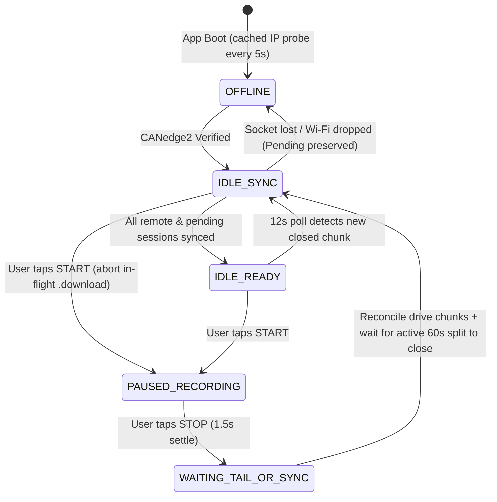

# Plan: CANedge2 Continuous Auto-Sync, Pause-on-Record, Live HUD & RTC Alignment (Phase-Wise)

## Execution Phases

| Phase | Scope | Status |
|---|---|---|
| **Phase 1 (Immediate)** | **Track A — Android Continuous CANedge Sync & HUD Overhaul:** Continuous idle auto-connect/sync loop, auto-pause during recording, auto-resume + tail-chunk completion on stop, zero re-downloads, persistent `"Sync Later"` reconciliation, `File.lastModified()` elimination, `LiveMetricsBar` CAN pill, & JVM unit tests. | **Ready to Implement First** |
| **Phase 2 (Immediate)** | **Track B — PC Desk Verifier & `config-01.09.json` RTC Fix:** Build `scripts/verify_canedge_live.py` (Wi-Fi + ADB), verify Phase 1 on desk setup, and provide the exact `rtc` JSON change content for manual update on CANedge2 SD card. | **Follows Phase 1** |
| **Phase 3 (Separate Stage)** | **CAN MF4 Processing & MCAP Ingestion:** `asammdf` + `VCU.dbc` decoding, Dynamic Protobuf `/can/<MessageName>` topics, completeness & sub-50ms cross-correlation sync audit. | **Deferred (Plan Details Later)** |

---

## Continuous Sync Lifecycle & Improvements Over Basic 1s Polling

Your pre-sync + pause-on-record + post-sync workflow minimizes post-drive wait time (only chunks created *during* the drive—`~2.5 MB/min` at `~400–500 KB/s`, ~2–3 min for a 30–60 min drive—need transfer after Stop).

To make a **1-second watchdog** rock-solid without overwhelming CANedge2's single-connection ESP32 web server (Bug #10), the loop separates **fast 1-second local state checks** from **throttled network probes**:



### Key Refinements Added to This Workflow
1. **1-Second Watchdog Without ESP32 Socket Flooding:**
   - **Every 1 s (local state tick, 0 network traffic when busy/recording):** Enforces pause if recording started, updates live HUD telemetry/ETA, and checks whether a reconnect/sync trigger is due.
   - **Offline Auto-Reconnect (every 5 s, lightweight single probe):** Probes **only** cached IP / `7AC5E17F` (`GET /api/device.json` / `OPTIONS /api/`) — **never** runs a 254-IP subnet sweep in the background loop (full subnet scan remains manual or on Wi-Fi network change).
   - **Connected Idle Poll (every 12 s):** Scans recent folders for newly closed chunks and downloads only missing files.
2. **Pre-Sync vs Post-Drive Tail-Chunk Completion (`WAITING_FINAL_CHUNK`):**
   - When you tap **STOP** at e.g. `14:05:25` while CANedge2 is still powered on, the active 60-second chunk (`14:05:00..14:06:00`) is still open (`UnFinMF ` growing) for another 35 seconds.
   - Instead of stopping after 1 pass and missing the last 25 seconds of CAN data, the session stays `PARTIAL (WAITING_FINAL_CHUNK)` until the next chunk appears OR `stopTimeWallMs + 65 s` elapses with two stable size checks (`>= 3 s` apart). The continuous loop automatically grabs that final chunk as soon as it closes and promotes the session to `COMPLETE`.
3. **Fix `RadarViewModel.stopSessionRecording()` Call Order Bug:**
   - Currently `RadarViewModel.kt` calls `canedgeIngestionManager.onSessionStopped()` on line 811 **before** `sessionRecorder.stopSession()` on line 818 (meaning `session.stopTimeWallMs` was still `null`!). Calling `onSessionStopped(stopped)` *after* `sessionRecorder.stopSession()` ensures exact stop bounds are available immediately.
4. **Live Metrics Bar CAN Indicator (`LiveMetricsBar.kt`):**
   - Adds a compact zero-allocation `CAN` status pill directly on `LiveMetricsCanvasHud` (visible across all tabs, landscape & portrait), with tap-to-open/sync action:
     - `CAN OFF` (gray) — Disconnected, 0 pending sessions
     - `CAN 1 PEND` (red/amber) — Disconnected, pending drive chunks still on logger (reminds user to connect hotspot!)
     - `CAN PAUSE` (cyan) — Intentionally paused during active recording
     - `CAN 12/30` or `CAN 42% (1m40s)` (amber) — Sync/reconciliation in progress (keep phone & Wi-Fi connected!)
     - `CAN WAIT` (amber) — Waiting for final 60s split chunk to close on CANedge2
     - `CAN OK` (green) — Connected & 100% synced (`0` pending)

---

## Empirical Proof: Time Sync Mechanism, NTP Reachability & Before-vs-After Logging

### 1. Is Time Sync HTTP-Based? (Proof From Live CANedge2 `10.225.54.240`)
Probing your live CANedge2 (`7AC5E17F`, FW `01.09.03`) over HTTP proved that **CANedge2's Web Server cannot be used as a live clock-sync or clock-query API**:
- `OPTIONS /api/` returns `Allow: OPTIONS, GET, HEAD` and `Device-id: 7AC5E17F` (**no `Date` header**).
- `GET /api/` returns JSON file listing (**no `Date` header**).
- `GET /api/device.json` returns static metadata (`id`, `fw_ver`, `cfg_crc32`, `space_used_mb`) (**no RTC timestamp**), and the HTTP server is read-only (`OPTIONS, GET, HEAD`).

### 2. Live NTP Reachability & Latency Proof on `M21` Wi-Fi
Measured directly from PC (UDP/123 NTP + ICMP ping) and Android (`adb shell ping`) on `M21`:

| NTP Server | PC Ping | PC UDP/123 NTP RTT | Android Ping | Verdict |
|---|---:|---:|---:|---|
| **`time.cloudflare.com`** | `29 ms` | `48.9 ms` | **`39.0 ms`** | **Best overall (fast on both Android & PC)** |
| **`time.google.com`** | `11 ms` | `62.7 ms` | `1121 ms` | Fast on PC, high jitter on Android 1st ping |
| `time.windows.com` | `4 ms` | `18.0 ms` | — | Fast on PC |
| `pool.ntp.org` (current `*.pool.ntp.org`) | `145 ms` | **`3,619.3 ms`** | `1260 ms` | **3.6s NTP delay — prone to embedded timeout** |

Combined with `"tolerance": 30` in your current `config-01.09.json`, CANedge2 ignored drifts `< 30 s`, causing `-28.4 s` to `-31.51 s` lag. Setting `"tolerance": 1` and `"ntp_server": "time.cloudflare.com"` ensures CANedge2 aligns within `< 1 s` of UTC on boot/Wi-Fi connect **before** logging begins (matching Android, which is within `0.04–0.48 s` of NTP/GPS UTC).

---

## Phase 1: Track A — Android CANedge Continuous Sync & HUD Overhaul

### Concrete Kotlin Changes

#### [MODIFY] [AppPreferences.kt](file:///c:/Users/rakadu1.AHEAD/AndroidStudioProjects/RoadSense/app/src/main/java/com/bajajauto/roadsense/storage/AppPreferences.kt)
- Persist `canedgeLastClockOffsetMs: Long` (`androidUtcMs - canedgeRtcMs`, default `0L`) and `canedgeLastClockMeasuredAtMs: Long`.

#### [NEW] [Mdf4HeaderInspector.kt](file:///c:/Users/rakadu1.AHEAD/AndroidStudioProjects/RoadSense/app/src/main/java/com/bajajauto/roadsense/canedge/ingestion/Mdf4HeaderInspector.kt)
- Binary MDF4 header inspector (`MDF     ` / `UnFinMF `): extracts `HDBLOCK` (`0x40`) `start_time_ns` at exact offset `64 + 24 + linkCount * 8`, eliminating all reliance on `File.lastModified()`.

#### [NEW] [CanedgeSyncManifest.kt](file:///c:/Users/rakadu1.AHEAD/AndroidStudioProjects/RoadSense/app/src/main/java/com/bajajauto/roadsense/canedge/model/CanedgeSyncManifest.kt)
- Per-session manifest (`session_*/can/can_sync_manifest.json`): `syncStatus` (`PENDING`, `WAITING_FINAL_CHUNK`, `PARTIAL`, `COMPLETE`), `sessionStartWallMs`, `sessionStopWallMs`, `clockOffsetMs`, `expectedChunks`, `stagedChunks`, `lastAttemptMs`.
- Pool index (`canedge_pool/pool_index.json`): `localName -> { remotePath, folderName, sizeBytes, lastWrittenEpochSec, hdStartTimeMs }`.

#### [NEW] [CanedgeSyncPlanner.kt](file:///c:/Users/rakadu1.AHEAD/AndroidStudioProjects/RoadSense/app/src/main/java/com/bajajauto/roadsense/canedge/ingestion/CanedgeSyncPlanner.kt)
- Pure-Kotlin, JVM-unit-testable planning engine:
  - **Zero Re-Download Skip:** Evaluates `(localName, sizeBytes)` across **both** `canedge_pool/` and all `session_*/can/` directories before scheduling any HTTP download.
  - **Clock-Offset-Compensated Matching + Sequence Fill:** Compensates session `[startMs, stopMs]` with `clockOffsetMs` (`±90 s` margin, `±150 s` if unmeasured) and fills sequence gaps (`N..M`).
  - **Tail-Chunk Readiness Check:** Recognizes when a session's final chunk may still be open on CANedge2 (`now - stopMs < 65s` and newest remote file) so it transitions `WAITING_FINAL_CHUNK -> COMPLETE` automatically once closed.
  - **Safe Pool Rescue & Pruning:** Uses `pool_index.json` + `Mdf4HeaderInspector` only; protects any chunk overlapping a `PENDING`/`WAITING_FINAL_CHUNK`/`PARTIAL` session.

#### [MODIFY] [CanedgeFile.kt](file:///c:/Users/rakadu1.AHEAD/AndroidStudioProjects/RoadSense/app/src/main/java/com/bajajauto/roadsense/canedge/model/CanedgeFile.kt) & [CanedgeDevice.kt](file:///c:/Users/rakadu1.AHEAD/AndroidStudioProjects/RoadSense/app/src/main/java/com/bajajauto/roadsense/canedge/model/CanedgeDevice.kt)
- Add `CanedgeHudPhase` enum (`OFFLINE`, `OFFLINE_PENDING`, `SCANNING`, `CONNECTED_SYNCED`, `SYNCING`, `PAUSED_RECORDING`, `WAITING_FINAL_CHUNK`, `ERROR`) and `pendingSessionsCount`, `measuredClockOffsetMs` to `CanedgeSyncStats`.

#### [MODIFY] [CanedgeDiscovery.kt](file:///c:/Users/rakadu1.AHEAD/AndroidStudioProjects/RoadSense/app/src/main/java/com/bajajauto/roadsense/canedge/discovery/CanedgeDiscovery.kt)
- Add lightweight `probeKnownHost()` (single cached-IP / `7AC5E17F` check, no 254-IP sweep) for background auto-connect when hotspot comes online, plus `markConnectionLost()` when `CanedgeRepository` hits repeated socket failures so the 5s reconnect probe seamlessly takes over.

#### [MODIFY] [CanedgeRepository.kt](file:///c:/Users/rakadu1.AHEAD/AndroidStudioProjects/RoadSense/app/src/main/java/com/bajajauto/roadsense/canedge/repository/CanedgeRepository.kt)
- Expand `MAX_RECENT_FOLDERS` to `10` (early-stopping once folders predate oldest pending session).
- Fix `isFileStable()`: require a newer sibling file **or** two consecutive size checks (`>= 3 s` apart) with identical non-zero byte length for the newest file in the newest folder.
- Add sequential per-chunk retry with backoff (`1.5 s`, `3 s`).

#### [MODIFY] [CanedgeIngestionManager.kt](file:///c:/Users/rakadu1.AHEAD/AndroidStudioProjects/RoadSense/app/src/main/java/com/bajajauto/roadsense/canedge/ingestion/CanedgeIngestionManager.kt)
- Implement **continuous 1-second watchdog loop** (`startWatchdog()`):
  - Enforces immediate download pause + `.download` cleanup on `onSessionStarted()`, setting `hudPhase = PAUSED_RECORDING`.
  - Auto-probes cached host every 5 s when disconnected (if idle).
  - Polls remote folders every 12 s when connected & idle (and immediately on connect or `onSessionStopped()` + 1.5 s settle).
  - Reconciles all `PENDING` / `WAITING_FINAL_CHUNK` / `PARTIAL` sessions first, then pre-syncs remaining closed remote chunks into `canedge_pool/` (skipping anything already in `canedge_pool/` or `session_*/can/`!), then runs safe `pruneStagingPool()`.
  - Measures `clockOffsetMs` when active file rollovers or `syslog.txt` updates are observed live.

#### [MODIFY] [RadarViewModel.kt](file:///c:/Users/rakadu1.AHEAD/AndroidStudioProjects/RoadSense/app/src/main/java/com/bajajauto/roadsense/ui/RadarViewModel.kt), [LiveMetricsBar.kt](file:///c:/Users/rakadu1.AHEAD/AndroidStudioProjects/RoadSense/app/src/main/java/com/bajajauto/roadsense/ui/components/LiveMetricsBar.kt), [SessionInfo.kt](file:///c:/Users/rakadu1.AHEAD/AndroidStudioProjects/RoadSense/app/src/main/java/com/bajajauto/roadsense/recording/SessionInfo.kt), & [CanedgeDashboardCard.kt](file:///c:/Users/rakadu1.AHEAD/AndroidStudioProjects/RoadSense/app/src/main/java/com/bajajauto/roadsense/ui/screens/CanedgeDashboardCard.kt)
- Fix `stopSessionRecording()` order so `canedgeIngestionManager.onSessionStopped(stopped)` runs **after** `sessionRecorder.stopSession()` sets `stopTimeWallMs`.
- Add `canHudLabel`, `canHudPhase`, `canSyncProgressPct` to `LiveMetricsSnapshot` and render the compact `CAN` pill in `LiveMetricsCanvasHud` (zero Compose layout overhead).
- Record `can.syncStatus` and `can.clockOffsetMs` in `session_metadata.json`; display pending session count & measured RTC offset in `CanedgeDashboardCard`.

---

## Phase 2: Track B — PC Desk Verifier & CANedge2 `config-01.09.json` Change Content

#### [NEW] [verify_canedge_live.py](file:///c:/Users/rakadu1.AHEAD/AndroidStudioProjects/RoadSense/scripts/verify_canedge_live.py)
- Wi-Fi + ADB desk verifier: discovers CANedge2, reads `device.json`/`config-01.09.json`/`schema-01.09.json`/`syslog.txt`, benchmarks NTP servers vs Android & CANedge2 timestamps, audits phone `canedge_pool/` & `session_*/can/` vs CANedge2 SD card, and provides `--watch-sync` to verify pause-during-recording, auto-resume-on-stop, and 0-byte repeat sync.

### Exact `config-01.09.json` Change Content (For Manual Update on CANedge2 SD Card)
```diff
   "rtc": {
     "sync": 2,
     "timezone": 0,
     "adjustment": 0,
-    "tolerance": 30,
-    "ntp_server": "*.pool.ntp.org"
+    "tolerance": 1,
+    "ntp_server": "time.cloudflare.com"
   },
```

---

## Phase 3: Separate Later Stage (Deferred)
- CAN MF4 decoding via `asammdf` + `tools/VCU.dbc`, Dynamic Protobuf `/can/<MessageName>` MCAP ingestion, completeness auditing, and sub-50ms cross-correlation sync — will be planned and executed in detail once Phases 1 & 2 are verified on hardware.

---

## Verification Plan (Phases 1 & 2)

### Automated Tests (Phase 1)
- Add JVM unit tests in `app/src/test/java/com/bajajauto/roadsense/canedge/`:
  - `Mdf4HeaderInspectorTest`: parse `HDBLOCK.start_time_ns` on `MDF     ` and `UnFinMF ` headers.
  - `CanedgeSyncPlannerTest`: verify zero re-download when file exists in `session_*/can/`, clock-offset-compensated matching, sequence-gap fill, `WAITING_FINAL_CHUNK -> COMPLETE` transition, and safe pruning without `File.lastModified()`.
- Run:
  ```powershell
  $env:JAVA_HOME = "C:\Users\rakadu1.AHEAD\Android_Studio\android-studio-quail4-windows\android-studio\jbr"; ./gradlew testDebugUnitTest
  ```

### Live Desk Verification (Phase 2)
- User builds & installs APK manually, then tests on the desk setup while `python scripts/verify_canedge_live.py --watch-sync` monitors ADB + Wi-Fi:
  1. Verify auto-connect & pre-sync on startup with `CAN OK` in `LiveMetricsBar`.
  2. Start recording -> confirm `CAN PAUSE` & zero CAN Wi-Fi traffic; stop recording -> confirm `CAN <pct>` / `CAN WAIT` -> `CAN OK`.
  3. Trigger manual Sync again -> confirm `0` files re-downloaded.
  4. Apply `config-01.09.json` diff on SD card, reboot CANedge2, and verify `< 1–2 s` NTP lock via `verify_canedge_live.py`.
