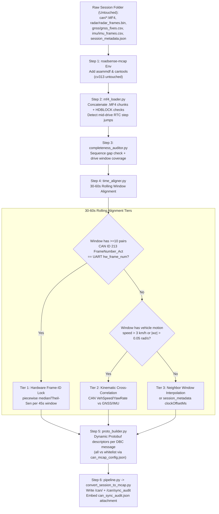

# Implementation Plan — Phase 3: Modular `CAN_Processing` & Millisecond-Aligned MCAP Ingestion

## Goal Description

Phase 2 locked down reliable, hotspot-optional on-device CANedge2 logging (`config-01.09.json` `"tolerance": 3`, `"ntp_server": "time.cloudflare.com"`, live rollover fix at `657 ms`, and Option A offline calibration grace).

**Phase 3** now brings raw CAN `.MF4` streams into RoadSense's PC post-processing and Foxglove `.mcap` container pipeline with **zero mutation of raw sensor files**, **30–60 s rolling time-offset tracking**, **3-tier failsafe alignment** (working both when Radar is present and when Radar is disconnected), and a **clean, modular `tools/CAN_Processing/` architecture** that never bloats `tools/sync_and_process_sessions.py`.

---

## Key Empirical Baseline (Measured Across Real Vehicle Drives)

From field logs inspected against `tools/VCU.dbc` (`114` messages):
1. **Tier 1 Anchor (`BO_ 213 RADAR_Debug_Info.FrameNumber_Act` ↔ UART `hw_frame_num & 0xFFFF`):**
   - `session_20261116_143131` (`11` chunks): **`5,957`** 1:1 hardware frame locks; monotonic crystal drift of **`-25 to -33 ms` per 60 s chunk (`-460 ppm`)** across the drive.
   - `session_20261117_143826` (`7` chunks): **`3,785`** locks; steady smooth drift.
2. **Tier 2 Anchor When Radar Is Absent (`logs/session_20261119_104518`, `105126`, `121554`):**
   - Today's three vehicle sessions had `radar_frames.bin = 0 bytes` (radar disconnected), but rich vehicle CAN (`1,970–2,309` decoded channels including `VCU_Vehicle_Info1.ETS_VCU_VehSpeed_Act_kmph`, `MCU_Speed_Info.ETS_MOT_MotorRPM_Act_rpm`, `VCU_IMU_Processed_Accel_Msg`, `VCU_IMU_Processed_Angular_Msg`) alongside Android `gnss/gnss_fixes.csv` (`speed_kmh`) and `imu/imu_frames.csv` (`gx, gy, gz, lin_ax..az`).
   - Windowed kinematic cross-correlation unlocks sub-50 ms alignment even without Radar!

---

## Step-by-Step Execution Architecture



---

## Proposed Changes (Component by Component)

### Component 1 — Environment & Configuration (Zero Touch to `cv313`)

#### [MODIFY] [requirements-mcap.txt](file:///c:/Users/rakadu1.AHEAD/AndroidStudioProjects/RoadSense/tools/requirements-mcap.txt)
- Add `asammdf>=8.0.0`, `cantools>=40.0.0` alongside existing `mcap>=1.4.0`, `mcap-protobuf-support>=0.5.4`, `foxglove-schemas-protobuf>=0.4.0`, `protobuf>=4.25.0`, `zstandard>=0.22.0`, `numpy>=1.26.0`, `av>=14.0.0`.
- Install into Conda env `roadsense-mcap` only (`cv313` left strictly untouched).
- Verify Dynamic Protobuf descriptor compatibility with `protobuf 7.36.2` + `mcap-protobuf-support 0.5.4` inside `roadsense-mcap` before writing schemas.

#### [NEW] [can_mcap_config.json](file:///c:/Users/rakadu1.AHEAD/AndroidStudioProjects/RoadSense/tools/CAN_Processing/can_mcap_config.json)
```json
{
  "dbc_path": "../VCU.dbc",
  "ingest_mode": "all",
  "important_messages": [
    "VCU_Vehicle_Info1",
    "VCU_Status",
    "VCU_Vehicle_Info2",
    "VCU_Trq_Command_1",
    "MCU_Speed_Info",
    "MCU_Power_Info",
    "BMS_Overview",
    "BMS_Sox",
    "VCU_IMU_Processed_Accel_Msg",
    "VCU_IMU_Processed_Angular_Msg",
    "FCW_Warning_Info",
    "RADAR_BSD_Info",
    "ACC_Params_Info",
    "RADAR_Debug_Info"
  ],
  "exclude_messages": [],
  "per_message_max_rate_hz": null,
  "alignment": {
    "window_sec": 45.0,
    "step_sec": 30.0,
    "min_tier1_pairs_per_window": 10,
    "tier2_min_speed_kmph": 3.0,
    "max_jump_warn_ms": 250.0
  }
}
```

---

### Component 2 — Modular `tools/CAN_Processing/` Subpackage

Keeping each step small, single-responsibility, and independently unit-testable:

#### [NEW] [__init__.py](file:///c:/Users/rakadu1.AHEAD/AndroidStudioProjects/RoadSense/tools/CAN_Processing/__init__.py)
- Exports clean public entrypoints (`prepare_can_bundle`, `write_can_topics_to_mcap`, `load_can_config`).

#### [NEW] [mf4_loader.py](file:///c:/Users/rakadu1.AHEAD/AndroidStudioProjects/RoadSense/tools/CAN_Processing/mf4_loader.py)
- Reads raw `can/*.MF4` headers directly (zero-dependency `HDBLOCK` extraction matching Android `Mdf4HeaderInspector.kt`), sorts by `(hd_start_time_ns, folder, split_seq)`.
- Checks inter-chunk continuity: flags any `HDBLOCK` discontinuity or inter-chunk clock jump (e.g., if an offline logger snapped to NTP mid-drive).
- Uses `asammdf.MDF.concatenate()` + `extract_bus_logging({'CAN': [(dbc_path, 0)]})` **in-memory / temp-free without ever altering `.MF4` files**, returning raw signal timestamps (`raw_can_epoch_sec = hd_start_sec + relative_sig_ts`) grouped by DBC message name.

#### [NEW] [completeness_auditor.py](file:///c:/Users/rakadu1.AHEAD/AndroidStudioProjects/RoadSense/tools/CAN_Processing/completeness_auditor.py)
- Verifies sequence continuity across `<folder>_<split>.MF4` chunks (reports missing split numbers inside a folder).
- Maps CAN time bounds (`t_start_utc_ns .. t_end_utc_ns`) against Android's `[startTimeWallMs .. stopTimeWallMs]`, computing exact start-gap (s), end-gap (s), and `%` drive coverage.
- Prints clear `[WARN]` summaries on partial logs (such as legacy `session_20261113_101048`) and supports `--strict-can` failure if desired.

#### [NEW] [time_aligner.py](file:///c:/Users/rakadu1.AHEAD/AndroidStudioProjects/RoadSense/tools/CAN_Processing/time_aligner.py)
- **Why Rolling 30–60 s Windows (Never Single `t=0` Offset):**
  Real drives exhibit steady oscillator drift (`-25 to -33 ms/min`, `-460 ppm`) and can encounter thermal changes or mid-drive clock shifts. Instead of trusting a single scalar offset from `t=0`, `time_aligner.py` partitions the drive into overlapping **`45 s` windows stepped every `30 s`**:
  1. **Tier 1 (`TIER1_RADAR_FRAME_ID`) — Per-Window Anchor:**
     - Extracts `(raw_can_ts_ns, FrameNumber_Act)` from CAN `RADAR_Debug_Info` (`ID 213`) and `(utc_ns, hw_frame_num & 0xFFFF)` from `radar/radar_frames.bin` via RoadSense's `time_offset_ns`.
     - Handles 16-bit counter wraparound cleanly (`0..65535` rolls over every `65,536 / 20 Hz ≈ 54.6 min` of driving — processing itself runs in `~1–2 s`) using greedy monotonic sequential pairing inside bounded coarse offset proximity.
     - Computes robust per-window offset (median + MAD outlier rejection) every `30–60 s`.
  2. **Tier 2 (`TIER2_KINEMATIC_XCORR`) — Deferred Low-Confidence Cross-Check (Implemented Last):**
     - Because phone-mount vibrations add high-frequency noise to Android IMU and GPS speed lags CAN speed smoothly, Tier 2 will NOT be trusted blindly when Radar is absent; we will add a heavily smoothed/optional cross-check only in the final verification step if ever needed.
  3. **Tier 3 (`TIER3_METADATA`) — Stationary / NTP / Fallback Anchor:**
     - Interpolates across adjacent verified Tier 1 windows during brief gaps, or uses CANedge2 NTP-synced clock (`<= 3 s`) + `session_metadata.json -> can.clockOffsetMs`.
- Produces a continuous piecewise-linear lookup `map_can_sec_to_utc_ns(raw_can_sec_array)` plus full `can_sync_audit` diagnostics (per-window tier, local offset ms, drift ppm, residual `p95 - p05` ms).

#### [NEW] [proto_builder.py](file:///c:/Users/rakadu1.AHEAD/AndroidStudioProjects/RoadSense/tools/CAN_Processing/proto_builder.py)
- Dynamically constructs `FileDescriptorSet` + `DescriptorProto` classes (one per active DBC message matching `can_mcap_config.json`, named `roadsense.can.<MessageName>`) using `google.protobuf.descriptor_pool` + `message_factory`.
- Each message encodes every signal as native `double` (or `int64` / `bool` where appropriate) **plus** `int64 raw_can_ts_ns` and `int32 window_offset_ms`, serialized cleanly with `mcap-protobuf-support`'s `ProtobufWriter` + MCAP Zstd compression (no per-frame JSON key bloat).

#### [NEW] [pipeline.py](file:///c:/Users/rakadu1.AHEAD/AndroidStudioProjects/RoadSense/tools/CAN_Processing/pipeline.py)
- Clean, sequential orchestrator:
  1. `prepare_can_bundle(session_dir, sync_master, time_offset_ns, config_path=..., can_mode=..., strict_can=False)`: calls `mf4_loader` → `time_aligner` → `completeness_auditor` → builds signal frame batches + `can_sync_audit` dict.
  2. `write_can_bundle_to_mcap(writer, can_bundle, count_msg_cb, start_wall_ms)`: calls `proto_builder`, writes `/can/<MessageName>` channels sorted chronologically on `utc_ns`, writes `/can/sync_audit` telemetry, and attaches `can_sync_audit.json` inside the MCAP.

---

### Component 3 — Lean Integration Hooks (Without Bloating Monolith)

#### [MODIFY] [sync_and_process_sessions.py](file:///c:/Users/rakadu1.AHEAD/AndroidStudioProjects/RoadSense/tools/sync_and_process_sessions.py)
- Inside `process_session(...)` right before calling `convert_session_to_mcap(...)`: invoke `prepare_can_bundle` in a clean sequential 5-line call (passing pre-audited `can_bundle` if available, or emitting `can_sync_audit.json` alongside legacy artifacts) + pass `--can-mode` / `--skip-can` through CLI cleanly. **Zero CAN parsing/alignment math lives in `sync_and_process_sessions.py`.**

#### [MODIFY] [convert_session_to_mcap.py](file:///c:/Users/rakadu1.AHEAD/AndroidStudioProjects/RoadSense/tools/convert_session_to_mcap.py)
- Add optional `can_bundle=None`, `can_config=None`, `can_mode=None`, `strict_can=False`, `skip_can=False` parameters + matching CLI flags (`--can-config`, `--can-mode {all,whitelist}`, `--strict-can`, `--skip-can`).
- If `not skip_can` and `session/can/*.MF4` exists: lazily import `tools.CAN_Processing.pipeline` (`prepare_can_bundle` if `can_bundle is None`, then `write_can_bundle_to_mcap`).

---

## Verification Plan

### Step 1 — Conda Environment & Unit Tests (`pytest` in `roadsense-mcap`)
1. Install `asammdf` and `cantools` into `roadsense-mcap` and verify clean imports alongside `mcap`, `mcap-protobuf-support`, and `protobuf`.
2. Add focused unit tests in `tools/CAN_Processing/tests/test_can_processing.py`:
   - Windowed Tier 1 `FrameNumber_Act` matching across **16-bit wraparound** (`65530 -> 5`), injected **`-460 ppm` linear drift**, and an injected **mid-drive `+1.2 s` RTC step jump** caught by `30–60 s` rolling windows (asserting residual `< 25 ms`).
   - Tier 2 speed/yaw-rate sliding cross-correlation with synthetic `±30 s` clock skew (recovering offset `< 100 ms`).
   - Completeness auditor gap detection (both warning mode and `--strict-can`).
   - Dynamic Protobuf serialization round-trip inside a temp `.mcap` read back with `mcap.reader.make_reader` + `DecoderFactory`.

### Step 2 — Real Multi-Drive MCAP Conversion Matrix (Raw Files Untouched)
Convert archived drives via `C:\Users\rakadu1.AHEAD\.conda\envs\roadsense-mcap\python.exe tools/convert_session_to_mcap.py <session_dir>`:
1. **`logs/session_20261116_143131` (Radar + CAN present):**
   - Expect **Tier 1 (`FrameNumber_Act`)** across every `45 s` window, tracking `~-460 ppm` crystal drift (`~+31.05 s -> +30.83 s`) with window residuals `< 25 ms` (down from `220 ms` static spread).
2. **`logs/session_20261119_121554` & `logs/session_20261119_105126` (CAN present, Radar disconnected):**
   - Expect automatic **Tier 2/Tier 3** alignment + clean `can_sync_audit.json` attachment + explicit tail coverage audit.
3. **`logs/session_20261113_101048` (Partial CAN coverage):**
   - Expect explicit `[WARN]` partial-coverage audit (`~71 s / 542.4 s`) without crashing MCAP generation (and hard failure when `--strict-can` is passed).

### Step 3 — Manual Inspection in Foxglove Studio
Open generated `.mcap` files in Foxglove Studio and plot `/can/VCU_Vehicle_Info1` (`ETS_VCU_VehSpeed_Act_kmph`), `/can/RADAR_Debug_Info` (`FrameNumber_Act`), `/gnss/fix`, `/imu/*`, and `/radar/tracks` side by side to confirm millisecond alignment on acceleration/braking events and frame transitions.
