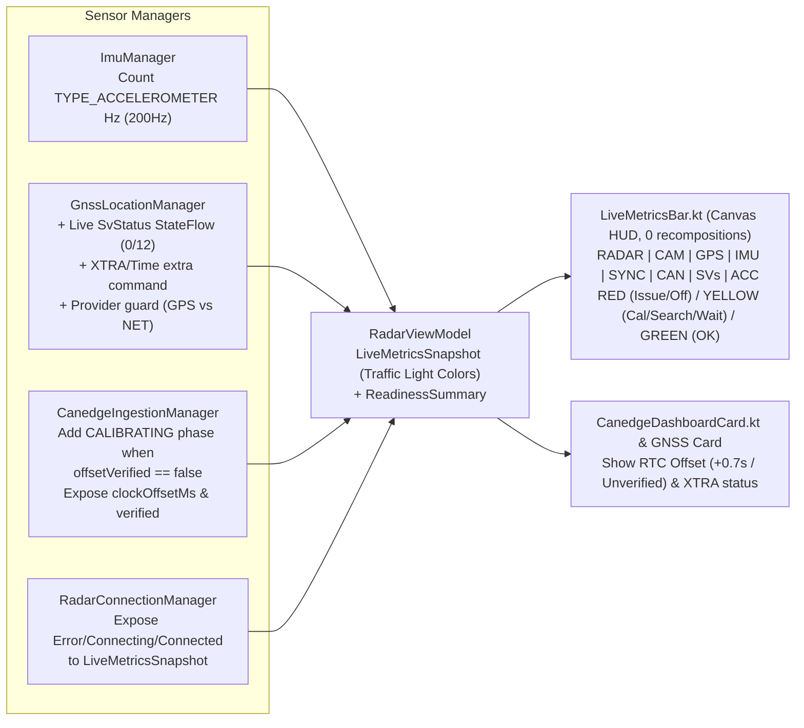

# Audit & Plan: Multi-Sensor Readiness Semantics (`RED / YELLOW / GREEN`) & IMU/GPS/CAN Root Causes

## 1. Root-Cause Audit of Observed Issues

### A. IMU — Why UI Showed `150 Hz` While Recording & MCAP Are `200 Hz`
- **Confirmed: ZERO IMU data is missing in CSV or MCAP.**
  - Inspecting raw recordings and generated MCAP (`logs/session_20261116_143131` and `logs/session_20261119_121554`):
    - `session_20261116_143131/imu/imu_frames.csv`: **`104,851` rows / `524.25 s` = `200.00 Hz`** (`dt_p50 = 5.00 ms` inside `/imu/data` in MCAP).
    - `session_20261119_121554/imu/imu_frames.csv`: **`32,755` rows / `163.77 s` = `200.01 Hz`**.
- **Root Cause #1 — Android Live HUD Math Bug (`ImuManager.kt:408-412`):**
  - `ImuManager` registers 4 separate Android sensors on `liveTelemetryListener` at `SENSOR_DELAY_FASTEST`:
    1. `TYPE_ACCELEROMETER` (`200 Hz` native) — *this drives `activeRecorder.recordFrame()`*
    2. `TYPE_GYROSCOPE` (`200 Hz` native)
    3. `TYPE_LINEAR_ACCELERATION` (`100 Hz` HAL cap)
    4. `TYPE_GAME_ROTATION_VECTOR` (`100 Hz` HAL cap)
  - A single shared counter `hzCounterEvents++` counts events across **all 4 listeners** (`200 + 200 + 100 + 100 = 600 events/s`), then divides blindly by `4f`:
    $$\frac{600}{4} = \mathbf{150.0\text{ Hz}}$$
  - Meanwhile, disk/MCAP recording samples once per `TYPE_ACCELEROMETER` callback, so recorded IMU is a true **200.00 Hz**.
- **Root Cause #2 — Why Foxglove Studio Sidebar Showed `~150–159 Hz` Average:**
  - Verified with `mcap.get_summary()` on `test_143131.mcap`: global MCAP container duration is **`659.79 s`** (because CAN chunks cover `659.79 s` while IMU covers `524.25 s`). Foxglove's Topic sidebar divides total messages by total bag duration (`104,851 / 659.79 s = 158.92 Hz`) even though `/imu/data` samples are spaced at `5.00 ms` (`200.00 Hz`).

### B. GPS / GNSS — Cold-Start Delay & Status Bar Visibility
- **Why Google Maps Appears Faster:** Maps uses Google Play Services `FusedLocationProviderClient` which caches recent Wi-Fi/Cell rough location and downloads SUPL/XTRA extended ephemeris (`~3–7` day validity) whenever internet was recently available, cutting search time from Cold Start (`35–90 s`) to Hot/Warm Start (`2–8 s`).
- **What API Calls Can & Cannot Do Offline:**
  - Calling Android `LocationManager.sendExtraCommand("gps", "force_xtra_injection", null)` + `"force_time_injection"` helps **when brief internet is available** (downloads a ~50 KB XTRA file usable offline for ~3–7 days afterward).
  - Once an offline backup phone sits without internet for `> 7` days, **no Android API** can accelerate cold start — the GPS chip *must* decode fresh 50 bps ephemeris directly from satellites outdoors (`~30–45 s`).
- **Two Real Status-Bar Bugs Found (`GnssLocationManager.kt:89-99` & `LiveMetricsBar.kt:176`):**
  1. **`SVs 0/0` Blindness During Lock Search:** `satellitesInView` and `satellitesUsed` are only pushed to UI inside `onLocationChanged()`. During cold start (`GnssState.Searching`), `onLocationChanged()` never fires, so HUD stays stuck showing `GPS 0.0 Hz  SVs 0/0` even while hardware sees `0/14` → `3/14` satellites!
  2. **False-Green Indoors via `NETWORK_PROVIDER`:** `LiveMetricsBar` sets `gpsColor = colorGreen` whenever `gnssHz > 0.5f`, even if fixes came from `NETWORK_PROVIDER` with `satellitesUsed == 0`!

### C. CANedge2 & Radar — Missing Readiness Distinction Before Recording
- **CANedge2:** `CONNECTED_SYNCED` currently turns **`CAN: OK` (GREEN)** immediately on boot even if no 60 s rollover / `< 24h` verified offset exists yet (`CanedgeSyncStats` already holds `measuredClockOffsetMs`, unused by HUD!).
- **Radar:** `Disconnected` and `Error` (`USB Permission Denied`, port open failure) both render muted grey `0.0 Hz` rather than clear **RED** (issue/disconnected) vs **YELLOW** (connecting / low-Hz stabilizing) vs **GREEN** (`OK`, streaming `>= 15 Hz`).

---

## 2. Open Questions for Review

> [!IMPORTANT]
> Please confirm these 2 UX preferences before I implement:
> 1. **Traffic-Light Color for Disconnected Sensors (Radar / CAN):** When Radar or CANedge is intentionally disconnected (e.g., recording a Camera+CAN only drive with no USB Radar), do you want `RADAR: OFF` / `CAN: OFF` colored **RED** (`0xFFFF5252`) everywhere to make missing sensors unmistakable, or **RED only on Error/No-Fix** and **Muted/Amber on intentional Offline**? *(From your prompt, defaulting disconnected/no-lock states on primary sensors to **RED** with explicit `OFF` / `ERR` labels makes accidental missed recordings impossible.)*
> 2. **Pill Text Format on `LiveMetricsBar` (`20.0Hz OK` vs Compact `OK` / `20.0Hz`):** To keep `LiveMetricsCanvasHud` fitting cleanly on a compact 360dp phone screen without clipping, should ready sensors show **Green numeric rate** (e.g., `RADAR 20.0Hz`, `CAM 30.0fps`, `IMU 200Hz`, `GPS 1.0Hz`, `CAN OK` + optional **`READY / WAIT` banner or tap-to-inspect Readiness Sheet**)? Or explicit `OK` text (`RADAR OK`, `GPS OK`, `CAN OK`)?

---

## 3. Proposed Architecture & Component Changes

### Component 1 — Accurate 200 Hz IMU Telemetry ([`ImuManager.kt`](file:///c:/Users/rakadu1.AHEAD/AndroidStudioProjects/RoadSense/app/src/main/java/com/bajajauto/roadsense/imu/ImuManager.kt))
- Track `hzCounterAccelEvents++` strictly inside the `Sensor.TYPE_ACCELEROMETER` branch (the exact stream driving `ImuSessionRecorder`), replacing `hz / 4f` so `_imuHz` reports true **`200.0 Hz`** matching CSV & MCAP `/imu/data`.
- Also log actual `imu_frames.csv` active span (`524.25 s @ 200 Hz`) clearly in `session_metadata.json` (`crossSensorSync.imu.effectiveHz` already shows `200.0`).

### Component 2 — GNSS Live Satellite State & A-GPS Warmup ([`GnssLocationManager.kt`](file:///c:/Users/rakadu1.AHEAD/AndroidStudioProjects/RoadSense/app/src/main/java/com/bajajauto/roadsense/gnss/GnssLocationManager.kt), [`GnssState.kt`](file:///c:/Users/rakadu1.AHEAD/AndroidStudioProjects/RoadSense/app/src/main/java/com/bajajauto/roadsense/gnss/GnssState.kt))
- Emit a dedicated live `satelliteStatus: StateFlow<Pair<Int, Int>>` (`used / inView`) directly inside `gnssStatusCallback.onSatelliteStatusChanged()`, so HUD updates `SVs 0/14 → 3/14 → 9/14` immediately *before* first position lock.
- Add `injectAssistedGpsIfOnline()` on `startLocationUpdates()` calling `locationManager.sendExtraCommand("gps", "force_xtra_injection", null)` + `"force_time_injection"` (no-op safely when offline; refreshes 3–7 day XTRA ephemeris whenever internet is present, even briefly before a drive).
- Distinguish **true 3D GPS satellite lock** (`provider == "gps" && satellitesUsed >= 4 && gnssHz >= 0.5f` → **GREEN**) from **Search / Coarse Network-only (`0` SVs locked or `accuracy > 15 m`)** (**YELLOW** `SRCH` / `NET`) and **Disabled / Permission Denied / Error** (**RED** `OFF` / `ERR`).

### Component 3 — CANedge2 Startup & Post-Stop Offset Telemetry ([`CanedgeFile.kt`](file:///c:/Users/rakadu1.AHEAD/AndroidStudioProjects/RoadSense/app/src/main/java/com/bajajauto/roadsense/canedge/model/CanedgeFile.kt), [`CanedgeIngestionManager.kt`](file:///c:/Users/rakadu1.AHEAD/AndroidStudioProjects/RoadSense/app/src/main/java/com/bajajauto/roadsense/canedge/ingestion/CanedgeIngestionManager.kt), [`CanedgeDashboardCard.kt`](file:///c:/Users/rakadu1.AHEAD/AndroidStudioProjects/RoadSense/app/src/main/java/com/bajajauto/roadsense/ui/screens/CanedgeDashboardCard.kt))
- Add `CanedgeHudPhase.CALIBRATING` (shown as **YELLOW** `CAL` until `hasVerifiedClockOffset()` is `true` on startup, i.e., either fresh `<24h` verified offset OR after first live 60 s chunk rollover, transitioning to **GREEN** `OK` once verified & idle-synced!).
- Expose `isClockOffsetVerified: Boolean` + `measuredClockOffsetMs: Long?` cleanly on `CanedgeSyncStats` and render a compact badge in `CanedgeDashboardCard` (`RTC Δ: +0.66 s (Verified)` vs `RTC: Waiting 1st 60s rollover`).

### Component 4 — Unified Pre-Flight Traffic-Light HUD ([`RadarViewModel.kt`](file:///c:/Users/rakadu1.AHEAD/AndroidStudioProjects/RoadSense/app/src/main/java/com/bajajauto/roadsense/ui/RadarViewModel.kt), [`LiveMetricsBar.kt`](file:///c:/Users/rakadu1.AHEAD/AndroidStudioProjects/RoadSense/app/src/main/java/com/bajajauto/roadsense/ui/components/LiveMetricsBar.kt))
- Keep **zero-recomposition Canvas rendering** while adding lightweight readiness enums (`SensorReadiness { READY_GREEN, WARN_YELLOW, ISSUE_RED }`) inside `LiveMetricsSnapshot`:
  - **RADAR:** `GREEN` (streaming `>= 15 Hz`) | `YELLOW` (`Connecting` or `0 < Hz < 15`) | `RED` (`Disconnected` / `Error`)
  - **CAM:** `GREEN` (`>= 20 fps`) | `YELLOW` (`0 < fps < 20`) | `RED` (`0 fps` / camera error)
  - **IMU:** `GREEN` (`>= 80 Hz`, true `~200 Hz` accel rate) | `YELLOW` (`< 80 Hz` stabilizing) | `RED` (`0 Hz`)
  - **GPS:** `GREEN` (`GPS` provider active & `SVs >= 4`) | `YELLOW` (`Searching`, `0/N SVs` or `NET`-only) | `RED` (`OFF` / permission / GPS disabled)
  - **CAN:** `GREEN` (`CONNECTED_SYNCED` with verified offset → `OK`) | `CYAN/YELLOW` (`SYNCING`, `CAL`, `SCAN`, `WAIT`, `OFFLINE_PENDING`) | `RED` (`OFFLINE` / `ERROR`)

---

## 4. Verification Plan
1. **JVM Unit Tests (`./gradlew testDebugUnitTest --no-daemon`):**
   - Test `ImuManager` single-sensor accel Hz counter logic, `CanedgeHudPhase.CALIBRATING -> CONNECTED_SYNCED` transition logic, and unified `SensorReadiness` color mapping across all states.
2. **ADB Device Verification (`SM-M325F`):**
   - Verify live `LiveMetricsBar` shows **`IMU 200.0Hz`** (matching CSV/MCAP), live `SVs 0/12 → 8/12` progression outdoors without waiting for first fix, and `CAN CAL (Yellow) → CAN OK (Green)` transition across the first rollover.
