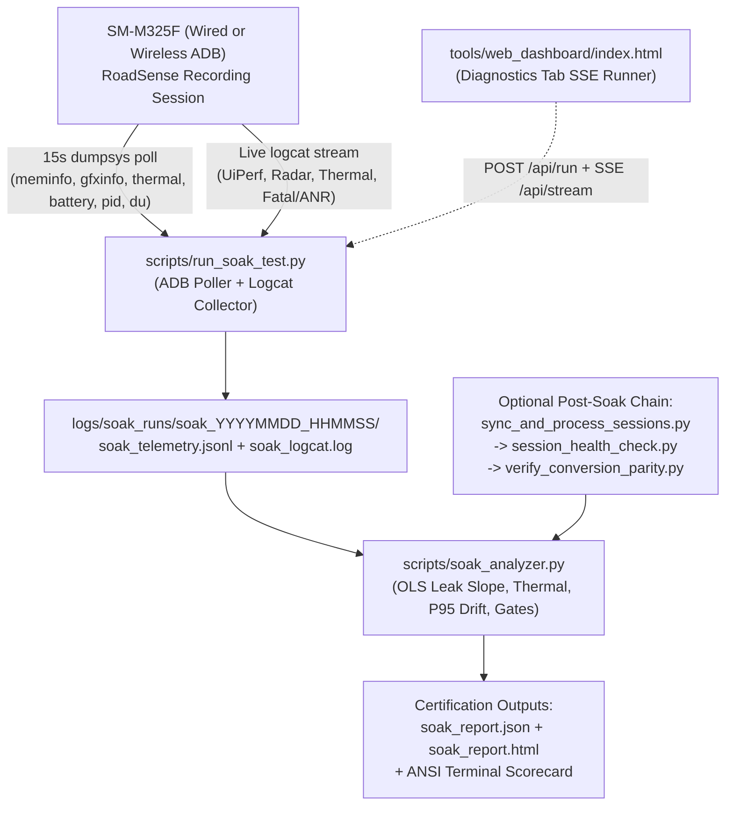

# Tier 3 Implementation Plan (`112`): Automated Long-Duration Bench Soak & Reliability Verification Harness

> **Document ID:** `112_plan_tier3_soak_test_and_reliability_harness.md`  
> **Parent Roadmap:** `109_plan_reliability_ux_soak_and_pitch_master_roadmap.md`  
> **Target Branch:** `Overhaul` (builds on committed Tier 1 `f64d08d` & Tier 2 `27593a9` / `cb65d0d`)  
> **Scope:** Pure PC tooling + optional Web Dashboard card (zero risky Android runtime changes required unless optional ADB stop-intent is approved).

---

## Goal Description

Before taking RoadSense on unattended 30–60 minute highway and track drives, we need an automated, repeatable **Bench Soak & Reliability Certification Harness** that monitors a live `SM-M325F` (or any target Android handset) over ADB while recording, detects subtle long-duration failure modes that short 1-minute tests miss, and outputs a definitive **PASS / WARN / FAIL** certification scorecard:

1. **Memory & Native Codec Leak Detection:** Tracks Java Heap, Native Heap, `GL mtrack`, and Total PSS over time and computes post-warmup linear growth slopes (`MB/hr`).
2. **Thermal & Battery Endurance:** Polls Android `ThermalHAL 2.0` (`AP`, `PA`, `BAT`, `SKIN`, `Thermal Status 0..6`) and Battery Service (`%`, `°C`, `mV`, drain `%/hr`) to verify zero thermal FPS collapse or severe throttling.
3. **UI Frame-Pacing Stability:** Captures both `dumpsys gfxinfo` (reset cleanly at soak start) and live `UiPerf [WINDOW_5S]` P50/P95/Max rollups from logcat to verify zero frame-time drift over 30–60 minutes.
4. **Process Liveness, Disk Growth & Sensor Watermarks:** Verifies constant PID (catches silent OOM kills), continuous session directory byte growth (catches stalled writers), `rawByteQueue` watermarks, radar drop/salvage counts, USB detach/recovery counts, and zero fatal/ANR logcat events.
5. **End-to-End Post-Soak Parity Chain:** Optionally pulls the finished soak session via `tools/sync_and_process_sessions.py`, runs `scripts/session_health_check.py`, and optionally validates MCAP conversion parity via `tools/verify_conversion_parity.py`.

---

## User Review Required

> [!IMPORTANT]
> Please confirm your preference on **3 practical design choices** before implementation:
>
> 1. **Radar USB OTG + Wireless ADB Support:** Because `SM-M325F` has a single USB-C port, plugging in the AWR1843BOOST radar prevents wired USB ADB simultaneously.
>    - **Proposal (Recommended):** Build first-class **Wireless ADB** support into `scripts/run_soak_test.py` (`--serial <ip:5555>` plus a 1-command `--setup-wireless-adb` helper that runs `adb tcpip 5555`, detects the phone's `wlan0` IP, and connects over Wi-Fi so you can unplug USB and plug in the radar for a full 5-sensor soak). Wired USB ADB also works out of the box for Camera + IMU + GNSS + CAN bench soaks.
> 2. **Session Start / Stop Control During Soak:**
>    - **Option A — Passive Monitor Mode (Recommended Default):** You start/stop recording manually on the phone (ensuring USB permission dialogs and pre-flight are clean); the orchestrator auto-detects the active session, monitors for `N` minutes, alerts you when the soak window finishes, and waits cleanly for you to tap `Stop` (or exits immediately on `Ctrl+C` and analyzes whatever was collected).
>    - **Option B — Auto-Stop via `RecordingForegroundService` Intent (`--auto-stop`):** Add an optional flag that invokes `adb shell am startservice -a com.bajajauto.roadsense.action.STOP_RECORDING` at `t = duration` so a 60-minute unattended soak automatically stops and saves the MP4 cleanly without touching the phone. (Uses the existing `RecordingForegroundService.ACTION_STOP_RECORDING` already built in Tier 1 — requires only verifying it's callable from ADB shell or keeping Option A as default.)
> 3. **Web Dashboard Integration & `.gitignore` Hygiene:**
>    - Add a **"Bench Soak Certification"** card directly inside the existing **🩺 Diagnostics** tab of `tools/web_dashboard/index.html` (reusing `roadsense_web_server.py`'s existing SSE `[PROGRESS]` streaming and `/logs/` HTML viewer), AND add `.vscode/` to `.gitignore`. Confirm if you want the Web Dashboard card included in Tier 3.

---

## Architecture & Data Flow



---

## Proposed Changes

### Sub-Topic 3.1 — Unattended ADB Soak Orchestrator (`scripts/run_soak_test.py`)

#### [NEW] `scripts/run_soak_test.py`
Zero-dependency Python 3 orchestrator (uses only standard library + existing `find_adb()` pattern) tailored to verified `SM-M325F` `dumpsys` output formats:

- **CLI Interface:**
  - `--duration-min <float>` (default `30`, supports quick bench checks like `2` or `5`, or endurance `60`)
  - `--interval-sec <int>` (default `15`)
  - `--serial <device_id_or_ip:port>` (optional; auto-detects single connected ADB device)
  - `--setup-wireless-adb` (runs `adb tcpip 5555`, parses `ip -f inet addr show wlan0`, connects `adb connect <ip>:5555`, and prints unplug/radar-attach instructions)
  - `--pull-and-audit` (after soak completes, pulls the detected session into `logs/` and chains `session_health_check.py`)
  - `--verify-mcap` (if `--pull-and-audit` is set, also runs `convert_session_to_mcap.py` + `verify_conversion_parity.py`)
  - `--output-dir <path>` (defaults to `logs/soak_runs/soak_YYYYMMDD_HHMMSS/`)
  - `--no-html` (skip HTML chart generation if desired)
- **Pre-Soak Baseline Setup:**
  1. Verifies ADB device connectivity and `pidof com.bajajauto.roadsense` (fails fast with clear message if RoadSense isn't running).
  2. Captures device metadata (`ro.product.model`, `ro.build.version.release`, `ro.build.version.sdk`, RoadSense `versionName` / `versionCode` via `dumpsys package`).
  3. Resets `dumpsys gfxinfo com.bajajauto.roadsense reset` so frame stats reflect strictly the soak window.
  4. Snapshots existing session directories under `/sdcard/Android/data/com.bajajauto.roadsense/files/sessions/` to automatically identify the active soak session.
- **Dual Concurrent Collectors:**
  1. **Periodic `dumpsys` Sampler (every `interval_sec`, default 15 s):**
     - `pidof com.bajajauto.roadsense` (tracks PID continuity & restart count)
     - `dumpsys meminfo com.bajajauto.roadsense` (extracts `Java Heap`, `Native Heap`, `GL mtrack`, `Total PSS`, `Total RSS`)
     - `dumpsys gfxinfo com.bajajauto.roadsense` (extracts `Total frames`, `Janky %`, `P50`, `P90`, `P95`, `P99`, `GPU P50/P95`, `Missed Vsync`)
     - `dumpsys thermalservice` (extracts `Thermal Status 0..6`, `AP`, `PA`, `BAT`, `SKIN` °C)
     - `dumpsys battery` (extracts `level %`, `temperature °C`, `voltage mV`, `USB powered`)
     - Active session directory size (`du -sk`) + free storage (`df -k /sdcard`) to verify steady disk write throughput (`MB/min`) and detect stalled writers.
     - Appends one structured JSON record per tick to `soak_telemetry.jsonl` and emits dashboard-compatible `[PROGRESS] {...}` JSON lines so SSE progress bars work seamlessly.
  2. **Background Logcat Watcher Thread:**
     - Runs `adb logcat -v time -T 1` and writes matching RoadSense + system crash lines to `soak_logcat.log`.
     - Increments real-time counters for: `FATAL EXCEPTION` / `ANR`, `RADAR_FRAME_DROP`, `RADAR_FRAME_SALVAGED`, `rawByteQueue` watermarks, `USB_DETACHED` / `USB_RECONNECTED`, `DisplayPacer` drops, `MediaRecorder` errors, `THERMAL_CHANGE`, `LOW_STORAGE_WARN`, and parses every `UiPerf [WINDOW_5S]` summary into time-series metrics.
- **Graceful `Ctrl+C` / Early-Stop Handling:**
  - Catching `SIGINT` / `SIGTERM` cleanly stops polling, closes the logcat thread, and **still runs `soak_analyzer.py`** on all collected samples so an interrupted 18-minute run still produces a complete certification report.

---

### Sub-Topic 3.2 — Automated Certification Scorecard & HTML Visualizer (`scripts/soak_analyzer.py`)

#### [NEW] `scripts/soak_analyzer.py`
Standalone analyzer (callable directly by `run_soak_test.py` OR re-run offline against any saved `logs/soak_runs/soak_*/` folder):

- **Verified Parsers (tested against live `SM-M325F` outputs captured during planning):**
  - `parse_meminfo(text)` → `java_heap_mb`, `native_heap_mb`, `gl_mtrack_mb`, `total_pss_mb`, `total_rss_mb`
  - `parse_gfxinfo(text)` → `total_frames`, `janky_frames`, `janky_pct`, `p50_ms`, `p90_ms`, `p95_ms`, `p99_ms`, `gpu_p50_ms`, `gpu_p95_ms`, `missed_vsync`
  - `parse_thermalservice(text)` → `thermal_status`, `temps_c` (`AP`, `PA`, `BAT`, `SKIN`)
  - `parse_battery(text)` → `level_pct`, `temp_c`, `voltage_mv`, `usb_powered`
  - `parse_uiperf_window(line)` → `frames`, `jank_count`, `jank_pct`, `p50_ms`, `p95_ms`, `max_ms`, `draw_p95_ms`, `gpu_p95_ms`
- **Statistical Trend Engine (Pure Stdlib):**
  - **Post-Warmup OLS Linear Regression Slope:** Excludes the first `warmup_exclude_sec` (default `120 s`, scaled down automatically for short `< 6 min` tests to first `20%`) when fitting `MB/hr` slope for Java Heap, Native Heap, and Total PSS.
  - **Early vs Late Frame-Pacing Drift:** Compares median `UiPerf` P95 in the first third vs final third of the soak to flag thermal/GC progressive slowdowns.
  - **Disk Throughput Continuity:** Checks for zero-growth stalls (`>= 3` consecutive ticks with `0 KB` delta while recording is active).
- **Certification Gates & Verdicts (`PASS` / `WARN` / `FAIL`):**

| Gate | PASS | WARN | FAIL |
|---|---|---|---|
| **Process Stability** | `0` crashes, `0` ANRs, `0` PID restarts | — | Any crash, ANR, or PID change |
| **Java Heap Slope** | `<= 15.0 MB/hr` | `15.0 – 30.0 MB/hr` | `> 30.0 MB/hr` |
| **Native Heap Slope** | `<= 20.0 MB/hr` | `20.0 – 40.0 MB/hr` | `> 40.0 MB/hr` |
| **Peak Total PSS** | `<= 750 MB` | `750 – 1024 MB` | `> 1024 MB` |
| **UI P95 Frame Time** | Median `<= 16.67 ms` & drift `<= +4 ms` | `16.67 – 22.0 ms` or drift `+4..+8 ms` | `> 22.0 ms` or drift `> +8 ms` |
| **Thermal Envelope** | Peak status `<= 1 (LIGHT)` & Bat `< 42°C` | Status `2 (MODERATE)` or Bat `42–45°C` | Status `>= 3 (SEVERE)` or Bat `> 45°C` |
| **Sensor & Queue Health** | `0` queue drops, `< 5` radar drops, `0` recorder errors | `5–15` radar drops or USB auto-recovered | `> 15` radar drops, queue drops `> 0`, or recorder error |
| **Post-Soak Session Audit** *(when chained)* | `session_health_check` has `0` FAILs | WARN only | Any FAIL or corrupt MP4/timeline |

- **Report Artifacts:**
  - `soak_report.json`: Complete structured metrics, gate verdicts, overall certification grade, and chained health/parity summaries.
  - `soak_report.html`: Zero-dependency dark-mode HTML dashboard with inline SVG trend charts (Memory MB, Thermal °C, UI P95 ms, Session Size MB) + gate scorecard table.
  - ANSI Terminal Scorecard: Clean colored table printed at completion.

---

### Sub-Topic 3.3 — Web Dashboard Preset & `.gitignore` Hygiene

#### [MODIFY] `tools/web_dashboard/index.html`
- Add a **"🔥 Bench Soak Certification Harness"** card inside the existing **🩺 Diagnostics (`diagTab`)** panel:
  - Duration dropdown (`2 min Smoke`, `5 min Quick`, `15 min Bench`, `30 min Standard`, `60 min Endurance`)
  - Poll interval (`15 s` default) + optional ADB serial/IP field
  - Checkboxes: `Pull & run Health Check (--pull-and-audit)`, `Verify MCAP Parity (--verify-mcap)`
  - Action buttons: `▶ Start Bench Soak` (invokes `/api/run` with `scripts/run_soak_test.py`) + `📶 Wireless ADB Setup` (`--setup-wireless-adb`)
  - Reuses the existing live SSE terminal & progress bar + opens generated `soak_report.html` via the existing `/logs/` static route.

#### [MODIFY] `.gitignore`
- Add `.vscode/` so local IDE settings remain untracked cleanly.

---

### Sub-Topic 3.4 — Unit Tests & Documentation

#### [NEW] `scripts/tests/test_soak_analyzer.py`
Comprehensive `unittest` suite covering:
1. Real `SM-M325F` `dumpsys meminfo`, `dumpsys gfxinfo`, `dumpsys thermalservice`, `dumpsys battery`, and `UiPerf [WINDOW_5S]` parser accuracy.
2. Post-warmup OLS slope calculation (`flat heap -> PASS`, `45 MB/hr leak -> FAIL`, warmup-exclusion ignores early startup spike).
3. PID restart / OOM kill detection (`FAIL`) and fatal logcat exception detection (`FAIL`).
4. Thermal severity escalation (`LIGHT -> PASS`, `MODERATE -> WARN`, `SEVERE -> FAIL`).
5. End-to-end `analyze_soak_run()` generating valid `soak_report.json` and non-empty `soak_report.html`.

#### [MODIFY] `Future_stuff.md`
- Update Tier 2 status (`[COMPLETED — Commit 27593a9]`) and mark Tier 3 (`Soak Test Harness`) status upon completion.

---

## Verification Plan

### Automated Tests
1. **Python Soak Analyzer & Parser Suite:**
   ```powershell
   conda run -n roadsense-mcap python -m unittest discover -s scripts/tests -p "test_soak_*.py" -v
   ```
2. **Existing Regression Suites:**
   ```powershell
   conda run -n roadsense-mcap python -m unittest discover -s tools/tests -p "test_*.py" -v
   conda run -n roadsense-mcap python tools/roadsense_web_server.py --test-init
   ```
3. **Dry-Run / Live 2-Minute Smoke Soak on Connected `SM-M325F`:**
   ```powershell
   conda run -n roadsense-mcap python scripts/run_soak_test.py --duration-min 2 --interval-sec 10
   ```
   Verify live telemetry polling, `soak_telemetry.jsonl`, `soak_report.json`, and `soak_report.html` generation with zero errors.

### Manual Field / Bench Certification (Exit Gate)
- Run a 30-minute unattended bench soak (`--duration-min 30 --pull-and-audit`) on `SM-M325F` (using Wireless ADB if Radar USB OTG is attached) and verify:
  - `0` crashes / PID restarts,
  - Bounded Java & Native heap slopes (`PASS`),
  - Stable UI P95 frame times and thermal curve,
  - Passing post-soak `session_health_check.py`.
