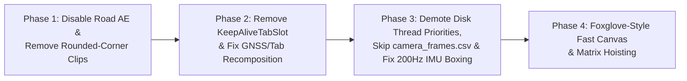

# Forensic Log Analysis (`session_20261116_143131`) & Phased High-Performance Overhaul Plan

## 1. Empirical Evidence from `logs/session_20261116_143131`

We parsed all 519 lines of [`session_debug.log`](file:///c:/Users/rakadu1.AHEAD/AndroidStudioProjects/RoadSense/logs/session_20261116_143131/session_debug.log), [`session_metadata.json`](file:///c:/Users/rakadu1.AHEAD/AndroidStudioProjects/RoadSense/logs/session_20261116_143131/session_metadata.json), and the recorded CSV streams from `session_20261116_143131` (`14:14:54` to `14:40:23`, `525.0s` active recording on Samsung `SM-M325F`).

### Summary of `[WINDOW_5S]` Hardware FrameMetrics Across All 9 Session Phases

| Phase in `session_20261116_143131` | Active Screen & State | Windows (`Frames`) | Jank % | `p50` Total | `p95` Total | `drawP50` | `drawP95` | `gpuP95` | `unkP95` (Runqueue Delay) |
| :--- | :--- | :---: | :---: | :---: | :---: | :---: | :---: | :---: | :---: |
| **1. `14:15:15–14:16:55`** | **GNSS Tab** (Pre-Lock, 0.8 fps) | 16 (`58`) | 98.3% | `24.29 ms` | `25.37 ms` | `5.65 ms` | `5.88 ms` | `10.21 ms` | `2.26 ms` |
| **2. `14:17:10–14:25:09`** | **GNSS Tab** (1 Hz GPS Lock, 2.0 fps) | 93 (`890`) | 90.9% | **`65.97 ms`** | **`103.32 ms`** | **`22.78 ms`** | **`43.66 ms`** *(max `100.6ms`)* | `10.56 ms` | `6.02 ms` *(max `89.9ms`)* |
| **3. `14:25:10–14:25:35`** | **Radar Tab** (Radar OFF) | 5 (`76`) | 61.8% | `49.11 ms` | `80.29 ms` | `9.38 ms` | `30.86 ms` | `15.84 ms` | `4.44 ms` |
| **4. `14:25:39–14:26:04`** | **Radar Tab** (Radar 20 Hz, Cam OFF) | 5 (`570`) | 73.2% | `32.63 ms` | `58.46 ms` | `7.43 ms` | `17.14 ms` | `10.58 ms` | **`27.46 ms`** *(max `31.4ms`)* |
| **5. `14:26:14–14:28:01`** | **Camera Fullscreen** (Preview + Radar HUD, Road AE @ 4 Hz) | 22 (`3,946`) | 98.8% | `33.56 ms` | `51.59 ms` | **`9.21 ms`** | **`19.66 ms`** *(max `28.8ms`)* | **`21.84 ms`** *(max `33.7ms`)* | `1.35 ms` |
| **6. `14:28:10–14:31:31`** | **SBS Tab** (Preview + BEV, Rec OFF) | 41 (`8,154`) | 99.7% | `31.44 ms` | `48.37 ms` | `4.56 ms` | `11.07 ms` | `14.26 ms` | **`13.67 ms`** |
| **7. `14:31:40–14:34:26`** | **SBS Tab** (**RECORDING ON**) | 34 (`6,706`) | 100.0% | `30.30 ms` | `50.50 ms` | `4.60 ms` | `13.73 ms` | `14.11 ms` | **`12.54 ms`** |
| **8. `14:34:45–14:36:35`** | **Camera Fullscreen** (**RECORDING ON**, Road AE @ 2 Hz) | 22 (`4,277`) | 96.5% | **`22.84 ms`** | **`30.77 ms`** | **`4.26 ms`** | **`7.40 ms`** | **`13.29 ms`** | **`1.27 ms`** |
| **9. `14:36:45–14:40:12`** | **SBS Tab** (**RECORDING ON**) | 42 (`8,230`) | 100.0% | `29.33 ms` | `49.20 ms` | `4.48 ms` | `12.86 ms` | `14.18 ms` | **`10.81 ms`** |

---

### Issue-by-Issue Verification Against `session_20261116_143131`

#### ✅ Issue 1: `KeepAliveTabSlot` Keeping All 7 Tabs Mounted — **100% PROVEN IN LOG**
1. **1.12s – 1.14s UI Freezes When Exiting Fullscreen Back to the 7-Tab Cockpit:**
   In [`MainActivity.kt`](file:///c:/Users/rakadu1.AHEAD/AndroidStudioProjects/RoadSense/app/src/main/java/com/bajajauto/roadsense/ui/MainActivity.kt#L163-L238), `isCameraFullScreen = true` unmounts the `else` branch containing all 7 `KeepAliveTabSlot`s. Every time you exited fullscreen (`Camera fullscreen set to false`), Compose had to re-compose and measure all 7 tabs at once, causing a **>1.1 second freeze**:
   - **Line 189 & 197 (`14:26:33.306`)**: `Camera fullscreen set to false` $\rightarrow$ `max=1122.52ms`
   - **Line 231 & 249 (`14:28:01.974`)**: `Camera fullscreen set to false` $\rightarrow$ `max=1141.68ms`
   - **Line 429 & 444 (`14:36:36.075`)**: `Camera fullscreen set to false` $\rightarrow$ `max=1120.73ms`
2. **10× Higher `unkP95` and 2× Higher `drawP95` When the 7 `KeepAliveTabSlot`s Are Mounted (Phase 7/9 vs Phase 8):**
   During the exact same active recording session (`14:31:31–14:40:15`):
   - When viewing the **SBS Tab** (Phase 7 & 9, where all 7 `KeepAliveTabSlot`s are mounted): `p95 = 50.50 ms`, `drawP95 = 13.73 ms`, and `unkP95 = 12.54 ms`.
   - When you tapped **Fullscreen** (Phase 8, lines 401–428, which unmounts the 7 `KeepAliveTabSlot`s while keeping the exact same Camera + Radar HUD + Recording active):
     - `unkP95` immediately dropped from **`12.54 ms` to `1.27 ms`** (a **90% reduction** in main-thread stall!).
     - `drawP95` dropped from **`13.73 ms` to `7.40 ms`**.
     - `p95` total frame time dropped from **`50.50 ms` to `30.77 ms`**.
3. **GNSS Tab 1 Hz Recomposition Bomb (`drawP50 = 22.78 ms`, `drawP95 = 43.66 ms`, max `100.56 ms`):**
   Look at **Phase 2 (`14:17:10–14:25:09`, lines 50–143)**: while sitting on the GNSS tab with Radar OFF and Camera OFF, every 1 Hz GPS fix caused `GnssDashboardCard` to recompose its entire tree from the root (`val activeGnssState = viewModel.gnssState.collectAsState().value`), driving `drawP95` to **`43.66 ms` (max `100.56 ms`)**! And because `KeepAliveTabSlot` keeps `GnssDashboardCard` mounted when you switch to `Radar` or `SBS`, it continued recomposing in the background on all `552` GPS fixes during your drive!

---

#### ✅ Issue 2: Road AE (`textureView.getBitmap(32, 24)` GPU Readback & State Thrashing) — **100% PROVEN IN LOG**
1. **78 `Road AE state shift` Oscillations in 14 Minutes:**
   `session_debug.log` shows **78 `Road AE state shift` events** rapidly flipping between `NIGHT_TUNNEL (contrast=0.89)` and `BALANCED (contrast=0.91)` every `500 ms` (e.g., lines 183–186, 212–218, 282–288, 300–306, 376–382), calling `session.setRepeatingRequest()` on the Camera2 HAL 78 times.
2. **GPU Stall (`gpuP95 = 21.84 ms`, max `33.65 ms`) When Sampling `getBitmap(32, 24)` at 4 Hz:**
   - In **Phase 5 (`14:26:14–14:28:01`, Camera Fullscreen Preview)**, `startLuminanceAnalyzer` called `textureView.getBitmap(32, 24)` every `250 ms` (4 Hz): `gpuP95` median was **`21.84 ms`** (max **`33.65 ms`** at line 222).
   - In **Phase 8 (`14:34:45–14:36:35`, Camera Fullscreen Recording)**, where `CameraEngine.kt:955` throttles `getBitmap` from `250 ms` to `500 ms` (2 Hz): even with H.264 hardware encoding running, `gpuP95` dropped from **`21.84 ms` down to `13.29 ms`**!
   - Disabling Road AE completely (as you decided) will eliminate 100% of these GPU readbacks and HAL reconfigurations.

---

#### ✅ Issue 3: Background Thread Priority Inversion & Main-Thread Preemption (`unkP95`) — **PROVEN IN LOG**
- **Logged Thread Priorities in `session_debug.log`:**
  - Line 16: `RadarProcessingWorker online (TID=18902, OS Priority=-8, TargetPriority=-16)`
  - Line 155: `RS-SerialIO thread online: ThreadPriority=THREAD_PRIORITY_URGENT_AUDIO (-19 / Linux Pri 101)`
  - Line 321: `RadarSessionRecorder-Worker started (TID=30674, OS Priority=-8, TargetPriority=-8)`
  - Line 328: `ImuSessionRecorder-Worker started (TID=30726, OS Priority=-19, TargetPriority=-19)`
  - Line 329: `CameraSessionRecorder-Worker started (TID=30739, OS Priority=-8, TargetPriority=-8)`
- **Observed `unkP95` (Main Thread Waiting for CPU):**
  - Before Radar/Recorders started (Phase 1): `unkP95` median was **`2.26 ms`**.
  - When Radar connected at 20 Hz (Phase 4, lines 158–160): `unkP95` jumped to **`27.46 – 31.35 ms`**.
  - On the `SBS` tab during preview and recording (Phases 6, 7, 9): `unkP95` stayed at **`10.81 – 20.90 ms`** across every 5-second window.

---

#### ✅ Issue 4: 200 Hz IMU Boxing & Triple-Redundant CSV Logging — **PROVEN IN SESSION FILES**
- **IMU Actually Ran at `200.00 Hz` (`104,851` frames in `524.25s` = `14.00 MB`):**
  `session_metadata.json` (line 63: `"effectiveHz": 200.002`) proves that `SENSOR_DELAY_FASTEST` runs the LSM6DSL at **200 Hz** on the Galaxy M32. Because `CrossSensorSyncAssociator.pushImu()` calls `quaternionToEulerDeg()` on every IMU frame, it executed `314,553` inverse-trig calls and allocated **`104,851` boxed `Triple<Float, Float, Float>` objects** during this single session.
- **Redundant CSV Files Written During Recording:**
  - `session_timeline.csv`: **`26,975` lines (`3.77 MB`)** (`15,713` camera + `10,496` radar + `552` GNSS + `210` IMU)
  - `camera/camera_frames.csv`: **`15,714` lines (`1.05 MB`)** — 100% redundant with `session_timeline.csv`!
  - `sync/sync_keyframes.csv`: **`15,714` lines (`5.31 MB`)** — formatted via 44-argument `String.format` (`691,372` boxed primitives).
- *(Note on GC logs: `session_debug.log` only records `AppLogger` calls and does not capture system `art` GC logcat lines, though `unkP95` spikes of `50–89 ms` on lines 78–80, 104–106, and 113 are consistent with GC / thread preemption pauses.)*

---

#### ⚠️ Issue 5: Canvas Draw Cost (`RadarBevPlot` & `ViewfinderRadarOverlay`) & `RadarDisplayPacer` — **PARTIAL EVIDENCE (DETAILED TOGGLES WERE OFF)**
- **What IS in `session_debug.log`:**
  - In **Phase 5 (`14:26:44–14:28:00`, lines 207–230)** on `Camera Fullscreen` with `ViewfinderRadarOverlay` active, `drawP50` reached **`10.26 – 14.45 ms`** and `drawP95` reached **`20.02 – 28.81 ms`** on the UI Main Thread.
  - In **Phase 4 (`14:25:49–14:26:04`, lines 158–160)** on the `Radar` tab (`RadarBevPlot`), `drawP50` was **`7.43 – 8.57 ms`** and `drawP95` was **`17.14 – 18.17 ms`**.
- **What is NOT in `session_debug.log`:**
  - Because `DebugToggles.canvasTimingLogs` (`Log ON`) and `isDisplayPacerVerboseActive` were **OFF** during this session, there are no `[DRAW_BEV]`, `[DRAW_OVERLAY]`, or `DisplayPacer` `[ENQUEUE]`/`[EMIT]`/`[DROP]` lines in `session_debug.log`. Thus, pacer queue depth/jitter and rounded-corner clip FBO overhead cannot be isolated from `session_debug.log` alone.

---

## 2. Step-by-Step Phased Implementation Plan (One Phase at a Time)

Per your feedback, we will execute and verify these changes **one phase at a time** so every improvement is isolated, clean, and measurable.

---

### Phase 1: Turn Off Road AE Completely & Remove Rounded-Corner Video/Canvas Clips
**Target Bottlenecks:** Eliminates the `21.84 ms – 33.65 ms` `gpuP95` spikes and 78 `setRepeatingRequest` HAL stalls from `textureView.getBitmap(32, 24)`, and eliminates offscreen FBO stencil layer rendering on 30 FPS video.

#### [MODIFY] [CameraEngine.kt](file:///c:/Users/rakadu1.AHEAD/AndroidStudioProjects/RoadSense/app/src/main/java/com/bajajauto/roadsense/camera/CameraEngine.kt)
- Change `_roadAeMode` default from `RoadAeMode.AUTO_ROAD` to `RoadAeMode.FULL_MATRIX`.
- Make `startLuminanceAnalyzer()` a no-op (completely disabling `textureView.getBitmap(32, 24)` readbacks) until a zero-overhead hardware-only AE approach is designed in the future.

#### [MODIFY] [SbsDashboardCard.kt](file:///c:/Users/rakadu1.AHEAD/AndroidStudioProjects/RoadSense/app/src/main/java/com/bajajauto/roadsense/ui/screens/SbsDashboardCard.kt), [CameraDashboardCard.kt](file:///c:/Users/rakadu1.AHEAD/AndroidStudioProjects/RoadSense/app/src/main/java/com/bajajauto/roadsense/ui/screens/CameraDashboardCard.kt), & [RadarBevPlot.kt](file:///c:/Users/rakadu1.AHEAD/AndroidStudioProjects/RoadSense/app/src/main/java/com/bajajauto/roadsense/ui/components/RadarBevPlot.kt)
- Remove `.clip(RoundedCornerShape(...))` from the `AutoFitTextureView` viewfinder boxes and `RadarBevCanvas` box so `RenderThread` composites directly without offscreen FBO layers.

---

### Phase 2: Replace `KeepAliveTabSlot` with Single-Tab Composition & Fix GNSS `drawMs` Spikes
**Target Bottlenecks:** Eliminates the **1.12s – 1.14s fullscreen exit freezes** (`max=1141ms`), eliminates the **12.5 ms `unkP95` / 13.7 ms `drawP95` penalty** on the `SBS` tab, and fixes the **`22.8 – 100.5 ms` `drawMs` spikes** on the `GNSS` tab.

#### [MODIFY] [MainActivity.kt](file:///c:/Users/rakadu1.AHEAD/AndroidStudioProjects/RoadSense/app/src/main/java/com/bajajauto/roadsense/ui/MainActivity.kt)
- Delete `KeepAliveTabSlot` and render only the active tab via `when (CockpitTab.entries[currentTabIndex])`. Only **1 tab** will ever be mounted in the Composition tree at a time.

#### [MODIFY] [GnssDashboardCard.kt](file:///c:/Users/rakadu1.AHEAD/AndroidStudioProjects/RoadSense/app/src/main/java/com/bajajauto/roadsense/ui/screens/GnssDashboardCard.kt) & [GnssLocationManager.kt](file:///c:/Users/rakadu1.AHEAD/AndroidStudioProjects/RoadSense/app/src/main/java/com/bajajauto/roadsense/gnss/GnssLocationManager.kt)
- Stop emitting a brand-new `GnssState.Active(fix, totalFixes)` object on every 1 Hz GPS fix in `GnssLocationManager` (only emit `GnssState.Active` when transitioning into `Active`, while `latestFix` and `totalFixes` update leaf nodes).
- Isolate `latestGnssFix` and `totalGnssFixes` reads inside leaf texts/canvases in `GnssDashboardCard`.

#### [MODIFY] [RadarViewModel.kt](file:///c:/Users/rakadu1.AHEAD/AndroidStudioProjects/RoadSense/app/src/main/java/com/bajajauto/roadsense/ui/RadarViewModel.kt)
- Annotate `RadarViewModel` with `@Stable`.
- Cache `cpuTempSupported = false` on the first `SecurityException` in the 1 Hz monitor and poll battery intent every 10s instead of 1s.

---

### Phase 3: Fix Thread Priority Inversion, Skip `camera_frames.csv`, & Eliminate 200 Hz IMU Boxing
**Target Bottlenecks:** Stops the 7 disk-writing threads from preempting the UI thread (`unkP95 = 27.5 ms` on Radar tab / `13.7 ms` on SBS tab), eliminates `104,851` `Triple` allocations at 200 Hz IMU rate, and removes redundant `camera_frames.csv` writing.

#### [MODIFY] [ImuSessionRecorder.kt](file:///c:/Users/rakadu1.AHEAD/AndroidStudioProjects/RoadSense/app/src/main/java/com/bajajauto/roadsense/recording/ImuSessionRecorder.kt), [RadarSessionRecorder.kt](file:///c:/Users/rakadu1.AHEAD/AndroidStudioProjects/RoadSense/app/src/main/java/com/bajajauto/roadsense/recording/RadarSessionRecorder.kt), [CameraSessionRecorder.kt](file:///c:/Users/rakadu1.AHEAD/AndroidStudioProjects/RoadSense/app/src/main/java/com/bajajauto/roadsense/recording/CameraSessionRecorder.kt), [GnssSessionRecorder.kt](file:///c:/Users/rakadu1.AHEAD/AndroidStudioProjects/RoadSense/app/src/main/java/com/bajajauto/roadsense/recording/GnssSessionRecorder.kt), [SessionTimelineWriter.kt](file:///c:/Users/rakadu1.AHEAD/AndroidStudioProjects/RoadSense/app/src/main/java/com/bajajauto/roadsense/recording/SessionTimelineWriter.kt), [SyncKeyframeWriter.kt](file:///c:/Users/rakadu1.AHEAD/AndroidStudioProjects/RoadSense/app/src/main/java/com/bajajauto/roadsense/sync/SyncKeyframeWriter.kt), [RawUartRecorder.kt](file:///c:/Users/rakadu1.AHEAD/AndroidStudioProjects/RoadSense/app/src/main/java/com/bajajauto/roadsense/recording/RawUartRecorder.kt)
- Demote all 7 buffered disk-writer threads from `THREAD_PRIORITY_URGENT_DISPLAY` (`-8`) / `THREAD_PRIORITY_URGENT_AUDIO` (`-19`) to `Process.THREAD_PRIORITY_BACKGROUND` (`+10`) + `Thread.NORM_PRIORITY` (keeping `RS-SerialIO` and `RadarProcessingWorker` at high priority for zero-loss 3.125 Mbps UART).
- In `CameraSessionRecorder.kt`: skip creating/writing `camera/camera_frames.csv` and write camera frame events only to the master `session_timeline.csv` (using a reusable `StringBuilder` instead of `String.format` + `String.replace`).
- Update [`SessionSyncAuditor.kt`](file:///c:/Users/rakadu1.AHEAD/AndroidStudioProjects/RoadSense/app/src/main/java/com/bajajauto/roadsense/recording/SessionSyncAuditor.kt) and [`tools/sync_and_process_sessions.py`](file:///c:/Users/rakadu1.AHEAD/AndroidStudioProjects/RoadSense/tools/sync_and_process_sessions.py) to read camera frame timestamps directly from `session_timeline.csv` when `camera_frames.csv` is absent.

#### [MODIFY] [CrossSensorSyncAssociator.kt](file:///c:/Users/rakadu1.AHEAD/AndroidStudioProjects/RoadSense/app/src/main/java/com/bajajauto/roadsense/sync/CrossSensorSyncAssociator.kt) & [SyncKeyframe.kt](file:///c:/Users/rakadu1.AHEAD/AndroidStudioProjects/RoadSense/app/src/main/java/com/bajajauto/roadsense/sync/SyncKeyframe.kt)
- Remove `quaternionToEulerDeg()` and its `Triple<Float, Float, Float>` allocation from the 200 Hz `pushImu()` path; compute Euler angles lazily at 30 Hz inside `associateKeyframe()` only for the matched `bestImuIdx`.
- Replace the 44-argument `String.format` in `SyncKeyframe.toCsvRow()` with zero-allocation `StringBuilder` appending.

---

### Phase 4: Foxglove-Style Fast Canvas Rendering (`RadarBevPlot` & `ViewfinderRadarOverlay`)
**Target Bottlenecks:** Reduces `drawP95` on the Radar BEV plot (`17.1 ms`) and Camera HUD overlay (`19.7 – 28.8 ms`) to `< 4 ms` by adopting Foxglove-style lightweight batched primitives.

#### [MODIFY] [SpatialProjectionEngine.kt](file:///c:/Users/rakadu1.AHEAD/AndroidStudioProjects/RoadSense/app/src/main/java/com/bajajauto/roadsense/fusion/engine/SpatialProjectionEngine.kt)
- Precompute the 3×3 extrinsic rotation matrix (`r00..r22`) and scaled intrinsics (`fx, fy, cx, cy`) **once per frame** instead of recomputing 6 `sin`/`cos` calls per vertex.
- Remove the 12-vertex ground footprint ellipse calculation and `mapIndexed`/`filter` list allocations on the real-time HUD path.

#### [MODIFY] [RadarBevPlot.kt](file:///c:/Users/rakadu1.AHEAD/AndroidStudioProjects/RoadSense/app/src/main/java/com/bajajauto/roadsense/ui/components/RadarBevPlot.kt) & [ViewfinderRadarOverlay.kt](file:///c:/Users/rakadu1.AHEAD/AndroidStudioProjects/RoadSense/app/src/main/java/com/bajajauto/roadsense/ui/components/ViewfinderRadarOverlay.kt)
- **Foxglove-style BEV rendering:** Remove `BoxWithConstraints` (`SubcomposeLayout`), draw raw radar detections as single crisp circles/points (no double glow circles), and draw tracks as a single clean circle + velocity vector line + ID tag (cutting Skia draw calls per frame by >65%).
- **Foxglove-style Camera HUD rendering:** Render tracked targets as lightweight 2D bounding boxes / stem markers (3 primitives per track instead of 11 primitives + 2 polygon `Path`s).
- Keep `RadarDisplayPacer` for steady 20 Hz pacing as you noted.

---

## Verification Plan
After each individual phase:
1. Run `./gradlew assembleDebug testDebugUnitTest` to verify 100% test pass and build health.
2. Test on the Galaxy M32 and inspect `[WINDOW_5S]` metrics (`p50`, `p95`, `drawP95`, `gpuP95`, `unkP95`) in `session_debug.log` before moving to the next phase.
