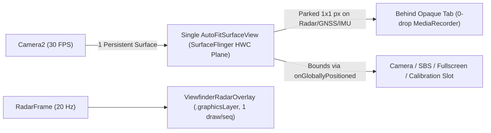

# Point 1, 2 & 3 Implementation Plan: Persistent `SurfaceView` Host & Double `[DRAW_OVERLAY]` Elimination

## Goal Description
Combine all three remaining UI & camera pipeline optimizations so RoadSense achieves **60 FPS hardware-composited video**, **0-drop recording across all tab/fullscreen switches**, and **strictly 1× `[DRAW_OVERLAY]` per radar frame (20 Hz)**:
1. **Point 1 (`TextureView` → `SurfaceView`):** Replace `AutoFitTextureView` with `AutoFitSurfaceView` (`SurfaceView`) so 30 FPS Camera2 frames composite directly on a `SurfaceFlinger` hardware overlay plane (**0 ms HWUI `RenderThread` GPU copy**, eliminating the `9.4–11.3 ms` `gpuP95` overhead).
2. **Point 2 (Single Persistent `SurfaceView` Host):** Instead of creating/destroying 5 separate `SurfaceView` instances across `Camera`, `SBS`, `Fullscreen`, and `Calibration`, mount **one persistent `AutoFitSurfaceView`** in `MainActivity` that dynamically repositions/resizes to the active viewfinder slot's screen bounds (and parks at `1×1 px` behind opaque tab content on non-camera tabs). Its `Surface` is **never destroyed**, eliminating `307–673 ms` surface handoff hitches and guaranteeing **true 0-drop H.264 recording** even while switching tabs or entering/exiting fullscreen.
3. **Point 3 (Eliminate Double `[DRAW_OVERLAY]`):** Isolate `ViewfinderRadarOverlay` in its own `.graphicsLayer()` and remove the duplicate `viewModel.latestFrame.collectAsState()` in `SbsCameraFeedPane` so `[DRAW_OVERLAY]` fires strictly once per radar `seq` (`20 Hz`).

---

## User Review Required

> [!NOTE]
> **Road AE Compatibility:** `CameraEngine.startLuminanceAnalyzer()` is currently disabled (Phase 1). Because `SurfaceView` renders on a separate `SurfaceFlinger` plane, `TextureView.getBitmap(32, 24)` cannot be used in the future if Road AE is re-enabled; a future hardware-only AE or `ImageReader` YUV plane approach would be used instead.

> [!IMPORTANT]
> **Transparent Viewfinder Slot Rule:** Because `SurfaceView` renders *behind* the Compose window (hole-punched through Compose), active viewfinder containers (`CameraDashboardCard`, `SbsDashboardCard`, `FullscreenCameraPreview`, `FullscreenCalibrationStudio`) must use `Color.Transparent` inside the active viewfinder bounds (while outer pillarbox/tab backgrounds remain opaque) so the video shows through and HUD overlays (`ViewfinderRadarOverlay`, `TapFocusReticleOverlay`, badges) render cleanly on top.

---

## Architecture Overview

---

## Proposed Changes

### 1. Viewfinder Component (`AutoFitSurfaceView`)

#### [NEW] `app/src/main/java/com/bajajauto/roadsense/camera/AutoFitSurfaceView.kt`
- Create a `SurfaceView` subclass with `setAspectRatio(width, height, displayRotation)` and `setZOrderMediaOverlay(false)` (renders behind the Compose window so HUD overlays draw on top).

---

### 2. Persistent Viewfinder Bounds Coordinator & `MainActivity` Host (Point 2)

#### [NEW] `app/src/main/java/com/bajajauto/roadsense/ui/components/PersistentCameraViewportHost.kt`
- Define a lightweight Compose state holder (`CameraViewportBoundsState` with `IntRect` bounds + `isActive: Boolean` + `displayRotation: Int`) provided via `CompositionLocalProvider(LocalCameraViewportBounds provides ...)`.
- Provide a modifier/helper `Modifier.bindPersistentCameraViewport(active: Boolean)` using `onGloballyPositioned` + `DisposableEffect` so whichever screen is currently mounted (`CameraDashboardCard` landscape/portrait, `SbsDashboardCard`, `FullscreenCameraPreview`, `FullscreenCalibrationStudio`) publishes its exact window coordinates `(x, y, width, height)` to the single `AutoFitSurfaceView` host.

#### [MODIFY] `app/src/main/java/com/bajajauto/roadsense/ui/MainActivity.kt`
- Mount **one single `AndroidView(factory = { AutoFitSurfaceView(ctx) })`** at the root `Box` (underneath the Compose `Surface` / tab content / fullscreen overlays):
  - When `viewportBounds.isActive` is `true` and `width > 0 && height > 0`: size & offset the `AutoFitSurfaceView` to match `viewportBounds` (`x, y, width, height`), call `attachPreviewSurface(holder.surface, width, height)`, `updateCameraDisplayRotation(...)`, and `updateCameraIntrinsics(width, height)`.
  - When `viewportBounds.isActive` is `false` (on `Radar`, `GNSS`, `IMU`, `CANedge`, `Session`, or muted): keep the `SurfaceView` attached at `1×1 px` at `(0, 0)` behind the opaque tab `Surface` so Android **never destroys its `SurfaceHolder`**, and call `cameraEngine.setPreviewPaused(true)` (which pauses `stopRepeating()` **only if not recording**, keeping `MediaRecorder` at **0 drops**!).

---

### 3. Camera2 Engine (`CameraEngine.kt`)

#### [MODIFY] `app/src/main/java/com/bajajauto/roadsense/camera/CameraEngine.kt`
- Replace `SurfaceTexture` preview handling with `Surface`:
  - `attachPreviewSurface(surface: Surface, width: Int = 0, height: Int = 0)`:
    - If `previewSurface === surface && captureSession != null && cameraDevice != null`: just set `isPreviewActive = true`, update `currentViewWidth`/`currentViewHeight`, and call `resumeRepeatingPreviewIfNeeded()` (**< 16 ms**, **0 `restartSession()`**, **0 video drops**!).
    - Otherwise (initial open or resolution/camera change): set `previewSurface = surface`, `isPreviewActive = true`, and call `restartSession()` or `openCamera()`.
  - `setPreviewPaused(paused: Boolean)` (replaces destructive detach when switching to non-camera tabs):
    - If `paused`: set `isPreviewActive = false`; if **not** recording (`!isRecordingVideo && !isPendingVideoRecording`), call `captureSession?.stopRepeating()` (0% ISP CPU). If recording, keep repeating request running uninterrupted (**0 drops**).
    - If `!paused`: set `isPreviewActive = true` and `resumeRepeatingPreviewIfNeeded()`.
  - `detachPreviewSurface(surface: Surface? = null)` (called only if `MainActivity` is destroyed): stops repeating if not recording and clears `previewSurface`.

---

### 4. Viewfinder Slots (4 Files)

#### [MODIFY] `app/src/main/java/com/bajajauto/roadsense/ui/screens/CameraDashboardCard.kt`
- Remove local `AndroidView(AutoFitTextureView)` in both Landscape and Portrait layouts.
- Replace with a transparent `Box` bound via `Modifier.bindPersistentCameraViewport(shouldRenderPreview)` + tap-to-focus + `TapFocusReticleOverlay` + `ViewfinderRadarOverlay`.

#### [MODIFY] `app/src/main/java/com/bajajauto/roadsense/ui/screens/SbsDashboardCard.kt`
- Remove local `AndroidView(AutoFitTextureView)` and replace with `Modifier.bindPersistentCameraViewport(shouldRenderPreview)` on the transparent viewfinder `Box`.
- **Point 3 Fix:** Remove the duplicate `viewModel.latestFrame.collectAsState()` inside `SbsCameraFeedPane` when `frameProducer` is already passed.

#### [MODIFY] `app/src/main/java/com/bajajauto/roadsense/ui/components/FullscreenCameraPreview.kt`
- Remove local `AndroidView(AutoFitTextureView)` and replace with `Modifier.bindPersistentCameraViewport(true)` on the `Modifier.aspectRatio(cameraAspect)` `Box` (outer pillarbox `Box` stays black, inner aspect-matched `Box` is transparent so the persistent `SurfaceView` shows through).

#### [MODIFY] `app/src/main/java/com/bajajauto/roadsense/ui/components/FullscreenCalibrationStudio.kt`
- Remove local `AndroidView(AutoFitTextureView)` and replace with `Modifier.bindPersistentCameraViewport(true)` on the calibration viewfinder `Box`.

---

### 5. Overlay Layer Isolation (Point 3)

#### [MODIFY] `app/src/main/java/com/bajajauto/roadsense/ui/components/ViewfinderRadarOverlay.kt`
- Add `.graphicsLayer()` to the `Canvas` modifier so `ViewfinderRadarOverlay` owns an isolated `RenderNode` layer.
- Ensure `[DRAW_OVERLAY]` executes strictly once per radar `seq` (`20 Hz`).

---

## Verification Plan

### Automated Tests
- Run `./gradlew --no-daemon assembleDebug testDebugUnitTest` (with `JAVA_HOME` set to Android Studio JBR) and confirm `BUILD SUCCESSFUL` and 100% unit test pass.

### Manual & Log Verification (on `SM-M325F`)
1. **Visual Verification:**
   - Verify `Camera` (portrait & landscape), `SBS`, `Camera Fullscreen`, and `Calibration Studio` display live video in the exact aspect-matched bounds with **no stretching**, **no black screen**, and **all Compose HUD overlays visible on top**.
   - Switch rapidly across `Camera ↔ SBS ↔ Radar ↔ Fullscreen` during both idle preview and active recording — verify instant transitions with **no half-second freeze**.
2. **Debug Log Verification (`Log ON` for ~60s recording with tab & fullscreen switches):**
   - **0-Drop Recording:** Run `python scripts/session_health_check.py <session>` and confirm `Camera` reports **`0 Frame Drops (>50ms)`** even with tab and fullscreen switches during recording.
   - **1× `[DRAW_OVERLAY]` per `seq`:** Confirm `DRAW_OVERLAY` count matches `DRAW_BEV` (`~20 Hz`), no longer double-drawing.
   - **SBS & Camera `[WINDOW_5S]` metrics:** Verify `gpuP95` drops from `9.4–11.3 ms` toward `< 4–6 ms`, `drawP50` drops from `6.1–6.9 ms`, and `max` transition spikes drop from `307–673 ms`.
