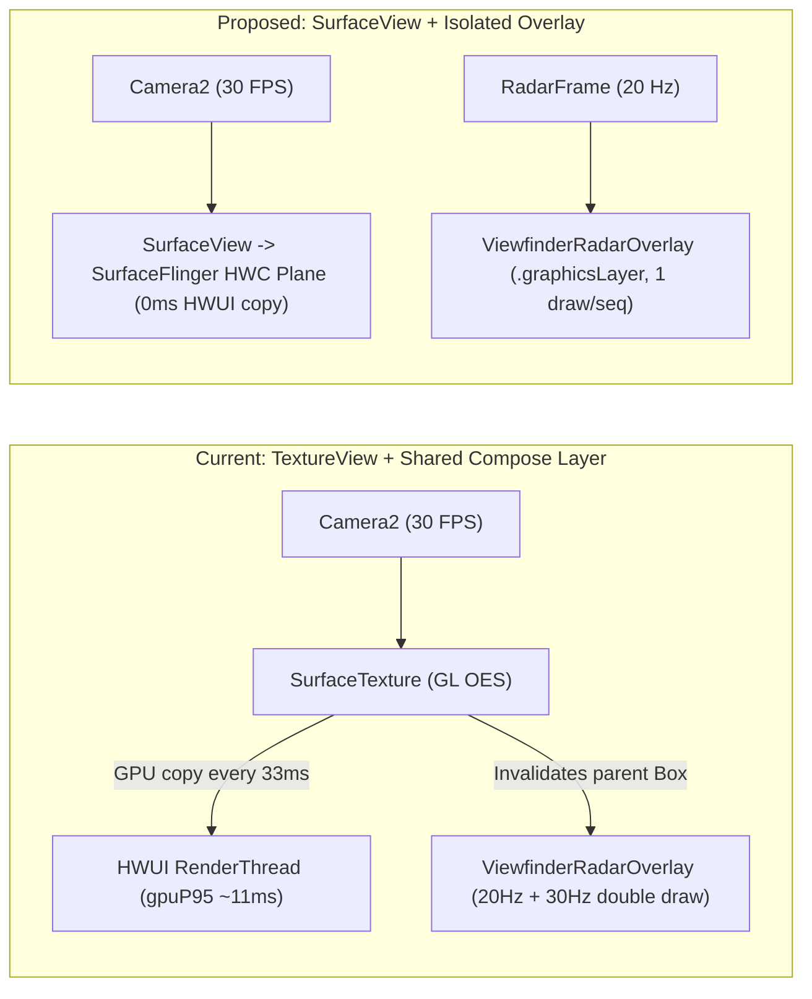

# Point 1 & Point 3 Implementation Plan: `SurfaceView` Viewfinder Migration & Double `[DRAW_OVERLAY]` Elimination

## Goal Description
In `session_20261117_114144` (post-Phase 4), `DRAW_BEV` (`p50 = 1.09 ms`) and `DRAW_OVERLAY` (`p50 = 0.80 ms`) are no longer the bottleneck, yet the **SBS** and **Camera** tabs still show:
- **Point 1 (`TextureView` GPU/HWUI copy overhead):** `gpuP95 = 9.4–11.3 ms`, `drawP50 = 6.1–6.9 ms`, and `p50 = 22.9–24.6 ms` on SBS because `AutoFitTextureView` routes every 30 FPS Camera2 frame through a `SurfaceTexture` GL ES texture copy inside Android's HWUI `RenderThread`.
- **Point 3 (Double `[DRAW_OVERLAY]` per radar frame):** `ViewfinderRadarOverlay` logged `1,240` draws over `44s` (~`28 Hz`) vs. `936` `DRAW_BEV` draws (`~21 Hz`), firing twice for the same radar `seq` (`33 ms` apart) because `AutoFitTextureView`'s 30 FPS frame invalidations dirty the sibling `Canvas` inside the same `Box`, and `SbsCameraFeedPane` holds a redundant `viewModel.latestFrame.collectAsState()` subscription.

Migrating the viewfinder to `AutoFitSurfaceView` (`SurfaceView`) moves 30 FPS video compositing onto a dedicated `SurfaceFlinger` hardware overlay plane (**0% HWUI `RenderThread` GPU copy** and **0 View/Compose invalidations per video frame**), while isolating `ViewfinderRadarOverlay` in its own `.graphicsLayer()` and removing the duplicate `StateFlow` read ensures `[DRAW_OVERLAY]` runs strictly once per radar frame (`20 Hz`).

---

## User Review Required

> [!IMPORTANT]
> **Trade-off with Deferring Point 2 (Tab/Fullscreen Surface Handoff During Active Recording):**
> With `AutoFitTextureView`, `CameraEngine.persistentSurfaceTexture` kept the `SurfaceTexture` alive in memory when switching tabs or entering/exiting fullscreen, so `MediaRecorder` never needed a `CameraCaptureSession` restart.
>
> A `SurfaceView` owns its own `SurfaceHolder` and Android **destroys its `Surface`** whenever its tab (`Camera`, `SBS`) or fullscreen composable unmounts (`Single-Tab Composition` from Phase 2). During **active H.264 recording**:
> - Leaving `Camera`/`SBS` calls `removeTarget(previewSurface)` so `MediaRecorder` keeps recording with zero interruption.
> - Returning to `Camera`/`SBS`/`Fullscreen` while recording provides a **new** `SurfaceView` `Surface`, which requires `restartSession()` to re-add the preview target alongside `recorderSurface` (~`150–250 ms` video gap on that tab-return transition).
> - *(If you stay on one tab/fullscreen while recording, there are **0** drops.)*
>
> Please confirm you are comfortable with this behavior while Point 2 is deferred.

> [!NOTE]
> **Road AE Compatibility:** `CameraEngine.startLuminanceAnalyzer()` is currently disabled (Phase 1). Because `SurfaceView` renders on a separate `SurfaceFlinger` plane, `TextureView.getBitmap(32, 24)` cannot be used in the future if Road AE is re-enabled; a future hardware-only AE or `ImageReader` YUV plane approach would be used instead.

---

## Architecture & Root-Cause Breakdown

---

## Proposed Changes

### 1. Viewfinder Component (`AutoFitSurfaceView`)

#### [NEW] `app/src/main/java/com/bajajauto/roadsense/camera/AutoFitSurfaceView.kt`
- Create a `SurfaceView` subclass mirroring `AutoFitTextureView`'s orientation-aware aspect measurement (`setAspectRatio(width, height, displayRotation)`).
- Calls `setZOrderMediaOverlay(false)` (default window-behind hole-punching) so Compose HUD overlays (`ViewfinderRadarOverlay`, `TapFocusReticleOverlay`, lens badges, `QuickNudgeBar`) render cleanly above the video plane.

#### [KEEP / DEPRECATE] `app/src/main/java/com/bajajauto/roadsense/camera/AutoFitTextureView.kt`
- Retain temporarily or remove once all 5 call sites are verified on `AutoFitSurfaceView`.

---

### 2. Camera2 Engine (`CameraEngine.kt`)

#### [MODIFY] `app/src/main/java/com/bajajauto/roadsense/camera/CameraEngine.kt`
- Replace `SurfaceTexture`-coupled preview management with `Surface`-based preview management:
  - Replace `persistentSurfaceTexture` / `previewSurfaceTexture` with `private var previewSurface: Surface? = null` and `fun isSurfaceAttached(surface: Surface?): Boolean`.
  - Update `attachPreviewSurface(surface: Surface, width: Int = 0, height: Int = 0)`:
    - If `previewSurface === surface && isPreviewActive && isRepeatingActive`: update dimensions and return.
    - If `isRecordingVideo || isPendingVideoRecording`: set `previewSurface = surface`, `isPreviewActive = true`, and call `restartSession()` so the new `SurfaceView` joins the active `recorderSurface` session.
    - Otherwise: set `previewSurface = surface`, `isPreviewActive = true`, and call `restartSession()` (if `cameraDevice != null`) or `openCamera()`.
  - Update `detachPreviewSurface(surface: Surface? = null)`:
    - Ignore stale `surface` callbacks (`if (surface != null && previewSurface != null && previewSurface !== surface) return`).
    - Set `isPreviewActive = false` and `previewSurface = null`.
    - If **not** recording: pause repeating request (`captureSession?.stopRepeating()`), as before.
    - If **actively recording** (`isRecordingVideo || isPendingVideoRecording`): remove the destroyed `surface` from `repeatingRequestBuilder` (`builder.removeTarget(surface)`), call `session.setRepeatingRequest(builder.build(), ...)`, and keep `recorderSurface` running uninterrupted.
  - Remove `configureTransform(textureView, ...)` calls for `SurfaceView` (Camera2 + `SurfaceView` layout bounds already handle orientation and `16:9`/`9:16` scaling natively without `Matrix`).

---

### 3. Viewfinder Call Sites (5 Locations)

#### [MODIFY] `app/src/main/java/com/bajajauto/roadsense/ui/screens/CameraDashboardCard.kt`
- Replace both Landscape and Portrait `AutoFitTextureView` `AndroidView` blocks with `AutoFitSurfaceView` + `holder.addCallback(SurfaceHolder.Callback)`:
  - `surfaceCreated`: call `holder.setFixedSize(res.width, res.height)` and `viewModel.cameraEngine.attachPreviewSurface(holder.surface, width, height)`.
  - `surfaceChanged`: update `previewWidth`/`previewHeight`, call `attachPreviewSurface(holder.surface, width, height)`, `updateCameraDisplayRotation(...)`, and `updateCameraIntrinsics(width, height)`.
  - `surfaceDestroyed`: call `viewModel.cameraEngine.detachPreviewSurface(holder.surface)`.
- Keep `ViewfinderRadarOverlay` and `TapFocusReticleOverlay` positioned directly after `AndroidView` in the same `Box`.

#### [MODIFY] `app/src/main/java/com/bajajauto/roadsense/ui/screens/SbsDashboardCard.kt`
- Replace `AutoFitTextureView` with `AutoFitSurfaceView` + `SurfaceHolder.Callback`.
- **Point 3 Fix:** Remove the duplicate `val radarFrameState = viewModel.latestFrame.collectAsState()` inside `SbsCameraFeedPane` when `frameProducer` is already passed from `SbsDashboardCard`, and wrap `effectiveFrameProducer` with `remember(frameProducer)`.

#### [MODIFY] `app/src/main/java/com/bajajauto/roadsense/ui/components/FullscreenCameraPreview.kt`
- Replace `AutoFitTextureView` with `AutoFitSurfaceView` + `SurfaceHolder.Callback`.
- Keep `Modifier.aspectRatio(cameraAspect)` on `AndroidView`, tap-to-focus layer, `TapFocusReticleOverlay`, and `FullscreenRadarOverlay`.

#### [MODIFY] `app/src/main/java/com/bajajauto/roadsense/ui/components/FullscreenCalibrationStudio.kt`
- Replace `AutoFitTextureView` with `AutoFitSurfaceView` + `SurfaceHolder.Callback`.

---

### 4. Overlay Layer Isolation (Point 3)

#### [MODIFY] `app/src/main/java/com/bajajauto/roadsense/ui/components/ViewfinderRadarOverlay.kt`
- Add `.graphicsLayer()` to the `Canvas` modifier so `ViewfinderRadarOverlay` owns an isolated `RenderNode` layer and is never dirtied by sibling composables.
- Guard against redundant back-to-back draws of the same `RadarFrame` sequence when geometry hasn't changed, ensuring strictly **1 `[DRAW_OVERLAY]` per radar frame (20 Hz)**.

---

## Verification Plan

### Automated Tests
- Run `./gradlew --no-daemon assembleDebug testDebugUnitTest` (with `JAVA_HOME` set to Android Studio JBR) and confirm `BUILD SUCCESSFUL` and 100% unit test pass.

### Manual & Log Verification (on `SM-M325F`)
1. **Visual Verification:**
   - Verify `Camera` (portrait & landscape), `SBS`, `Camera Fullscreen`, and `Calibration Studio` show live video with **correct aspect ratio** (no stretching or rotation bugs).
   - Verify `ViewfinderRadarOverlay` lollipops, range arcs, `TapFocusReticleOverlay`, and lens badges render **above** the `SurfaceView` video (not hidden behind it).
   - Verify no black flicker or stuck surface when switching between `Radar`, `Camera`, `SBS`, and `Fullscreen`.
2. **Debug Log Verification (`Log ON` for ~60s recording):**
   - **`[DRAW_OVERLAY]` count vs `[DRAW_BEV]` count:** Confirm `DRAW_OVERLAY` draws **once per radar `seq`** (`~20 Hz`, matching `DRAW_BEV`), no longer double-drawing at `20 Hz + 30 Hz`.
   - **SBS & Camera `[WINDOW_5S]` metrics:** Verify `gpuP95` drops from `9.4–11.3 ms` toward `< 4–6 ms`, `drawP50` drops from `6.1–6.9 ms`, and `p50` approaches `16.67 ms` (60 FPS).
   - **Data Integrity:** Run `python scripts/session_health_check.py <session>` and confirm `Camera` (`30.00 FPS`), `Radar` (`0` gaps), and `IMU` (`200 Hz`, `0` drops) all `PASS`.
