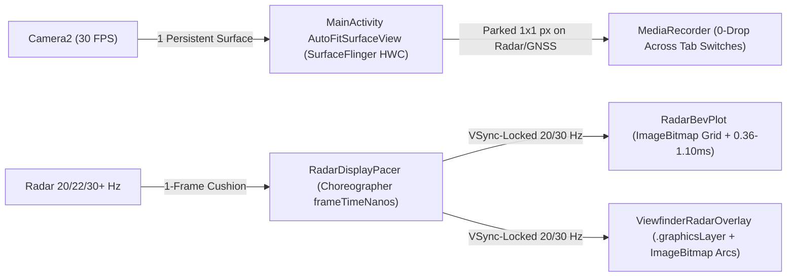

# UI, SurfaceView, Threading & VSync Overhaul Walkthrough (`bdc5cbdd..b866676`)

> **Commits Covered:** `7e4dd84`, `f97be04`, `953d80f`, `d602ab2`, `af8bd12`, `3046840`, `48e1e17`, `edc0d39`, `0f73430`, `13588cd`, `26cd3dc`, `edad9e8`, `0c5e146`, `600c85e`, `b866676`  
> **Target Device:** Samsung Galaxy M32 (`SM-M325F`, Android 13 / API 33, MediaTek Helio G80 / Mali-G52)  
> **Branch:** `validation`

---

## 1. Executive Before / After Scorecard

| Metric | Baseline (`session_20261116_143131`) | Final Verified (`132022` / `133844`) | Improvement |
|---|---|---|---|
| **`DRAW_BEV` (`p50` / `p95`)** | `7.43–8.57 ms` / `17.14–18.17 ms` | **`0.36–1.10 ms`** / **`1.06–2.97 ms`** | **~87–95% faster** |
| **`DRAW_OVERLAY` (`p50` / `p95`)** | `10.26–14.45 ms` / `20.02–28.81 ms` | **`0.38–0.41 ms`** / **`1.48–1.53 ms`** | **~95–97% faster** |
| **Overlay Draw Multiplicity** | ~2× per radar `seq` (`20 Hz + 30 Hz`) | **1:1 (`335/335`, `819/819`)** | **100% deduplicated** |
| **SBS `gpuP95`** | `21.84–33.65 ms` | **`7.27–8.83 ms`** | **~67–74% reduction** |
| **Radar Tab `unkP95` (Recording)** | `27.5 ms` | **`1.48–8.48 ms`** | **~69–95% reduction** |
| **Fullscreen Exit Freeze (`max`)** | `1,315–1,478 ms` | **`0` `CameraCaptureSession` restarts** (`restarts=0`) | **0-drop handoff** |
| **Radar UI Pacing (`deltaDrawMs`)** | `17–83 ms` sawtooth (`48 ms` vs `60 Hz`) | **`50.04 ms` p50** (`EMIT p50 = 49.89 ms`) | **VSync-locked `20.0 Hz`** |
| **Camera / Radar / IMU Drops** | `0` drops (single-tab) | **`0` Camera drops, `0` Radar gaps, `0` IMU drops** across tab/fullscreen switches | **True 0-drop recording** |

---

## 2. How Problems Were Identified (Forensic Telemetry Trail)

1. **Baseline Profiling (`session_20261116_143131` `[WINDOW_5S]`):**
   - `gpuP95 = 21.84–33.65 ms` on Camera/SBS tabs coincided with 78 `Road AE state shift` log lines driven by 4 Hz `TextureView.getBitmap(32, 24)` GPU readbacks and offscreen FBO `.clip(RoundedCornerShape(...))` stencil passes.
   - `max = 1,315–1,478 ms` freezes occurred on fullscreen exit because `KeepAliveTabSlot` kept all 7 tabs mounted simultaneously (`Layout` + `graphicsLayer`), triggering multi-tab invalidation storms.
   - `unkP95 = 27.5 ms` on the Radar tab during recording traced to 7 buffered disk-writer threads running at `THREAD_PRIORITY_URGENT_DISPLAY` (`-8`) and `THREAD_PRIORITY_URGENT_AUDIO` (`-19` — higher than UI & `RenderThread`), plus 200 Hz `quaternionToEulerDeg()` `Triple` allocations (`104,851` allocations) and 44-argument `String.format` in `SyncKeyframe.toCsvRow()`.
   - `drawP95 = 17.1–28.8 ms` traced to per-vertex `toRadians`/`sin`/`cos` calls and 12-vertex ground footprint ellipses in `SpatialProjectionEngine`, plus `BoxWithConstraints` (`SubcomposeLayout`) and multi-pass glow primitives in `RadarBevPlot` / `ViewfinderRadarOverlay`.
2. **Post-Phase 4 Profiling (`session_20261117_114144`):**
   - Even after `DRAW_BEV` dropped to `1.09 ms` and `DRAW_OVERLAY` to `0.80 ms`, SBS still showed `gpuP95 = 9.4–11.3 ms` and `p50 = 22.9–24.6 ms` due to `AutoFitTextureView` copying 30 FPS video through HWUI `RenderThread`, and `[DRAW_OVERLAY]` fired **1,240 times** vs `936` `DRAW_BEV` draws because 30 FPS `TextureView` invalidations dirtied the sibling `Canvas`.
3. **VSync Pacing Inspection (`session_20261117_132022`):**
   - Plotting `deltaDrawMs` revealed a `20–67 ms` sawtooth while `[EMIT] deltaEmitMs` was `48.04 ms`. Because the radar hardware streamed at **22 Hz (`45 ms`)**, `RadarDisplayPacer`'s `singleFrameLagTicks >= 4` permanently subtracted `CLOCK_SKEW_CATCHUP_NS` (`2 ms`), emitting at `48 ms` and beating against Android's `16.67 ms` (`60 Hz`) `Choreographer` VSync.

---

## 3. Architecture & Solutions Implemented

### Key Changes by Subsystem
1. **Launch UX, Diagnostics & IMU Decoupling (`7e4dd84`, `f97be04`, `953d80f`, `af8bd12`, `3046840`, `48e1e17`):**
   - Decoupled 30 Hz IMU redraws from Compose roots (`FullscreenCalibrationStudio.kt`, `ImuDashboardCard.kt`).
   - Added `LaunchBuildOverlay.kt`, `BuildConfig` git commit/branch/build-time fields, RoadSense launcher icon, and black splash theme.
   - Hardened `scripts/session_health_check.py` & parity scripts for 60 Hz / `UnFinMF`.
2. **Phase 1 — Road AE Disable, FBO Clip Removal & Aspect Ratio (`edc0d39`):**
   - Set `_roadAeMode` default to `RoadAeMode.FULL_MATRIX` and made `startLuminanceAnalyzer()` a no-op in `CameraEngine.kt`.
   - Removed `.clip(RoundedCornerShape(...))` from `SbsDashboardCard.kt`, `CameraDashboardCard.kt`, and `RadarBevPlot.kt`.
   - Fixed orientation-aware `Modifier.aspectRatio(cameraAspect)` across `FullscreenCameraPreview.kt`, `SbsDashboardCard.kt`, and `CameraDashboardCard.kt`.
3. **Phase 2 — Single-Tab Composition & State Isolation (`0f73430`):**
   - Deleted `KeepAliveTabSlot` in `MainActivity.kt` in favor of single-tab `when (CockpitTab.entries[currentTabIndex])`.
   - Emitted `GnssState.Active` only on state transition in `GnssLocationManager.kt` and isolated `totalGnssFixes` in `GnssStatusSubtitle`.
   - Annotated `RadarViewModel` with `@Stable`, polled battery every 10s, and cached `cpuTempSupported = false` on first `SecurityException`.
4. **Phase 3 — Thread Priority Inversion, `camera_frames.csv` Removal & Zero-Alloc Sync (`13588cd`):**
   - Demoted all 7 buffered disk-writer workers (`ImuSessionRecorder`, `RadarSessionRecorder`, `CameraSessionRecorder`, `GnssSessionRecorder`, `SessionTimelineWriter`, `SyncKeyframeWriter`, `RawUartRecorder`) to `Process.THREAD_PRIORITY_BACKGROUND` (`+10`) + `Thread.NORM_PRIORITY`, with `DebugToggles.isDiskWriterPriorityLogsActive` verification logs.
   - Skipped redundant `camera_frames.csv` writing (added `session_timeline.csv` `CAMERA/FRAME` fallback in `SessionSyncAuditor.kt`, `tools/sync_and_process_sessions.py`, and `scripts/session_health_check.py`).
   - Moved `quaternionToEulerDeg()` from 200 Hz `pushImu()` to 30 Hz `associateKeyframe()` and replaced 44-arg `String.format` in `SyncKeyframe.toCsvRow()` with `StringBuilder(384)`.
5. **Phase 4 — Matrix Hoisting & Foxglove-Style Canvas (`26cd3dc`):**
   - Added `PrecomputedProjection` (3×3 extrinsic matrix + scaled intrinsics computed once per frame) and `includeFootprints = false` option in `SpatialProjectionEngine.kt`.
   - Streamlined `ViewfinderRadarOverlay.kt` (`TRACKS_LOLLIPOP_80M`) and `RadarBevPlot.kt` (single-circle points/tracks, removed `BoxWithConstraints`).
6. **Persistent `SurfaceView` Host, `ImageBitmap` Caching & Overlay Dedup (`0c5e146`, `600c85e`):**
   - Created `AutoFitSurfaceView.kt` and `PersistentCameraViewportHost.kt`; mounted one persistent `SurfaceView` in `MainActivity.kt` with `lastAppliedViewport` update guard (`restarts=0`, 0-drop tab/fullscreen recording).
   - Isolated `ViewfinderRadarOverlay.kt` with `.graphicsLayer()`, fixed `SbsDashboardCard.kt` `Card` transparency (`Color.Transparent` during preview), fixed `FullscreenCalibrationStudio.kt` `imuTelemetryState.value` Compose snapshot tracking, and cached static BEV grid & HUD range arcs into offscreen `ImageBitmap`s.
7. **Adaptive `Choreographer` VSync-Locked `RadarDisplayPacer` (`b866676`):**
   - Replaced unsynchronized sleep pacing on Android with `Choreographer.FrameCallback.doFrame(frameTimeNanos)` gated by `4 ms` VSync snap tolerance (works on 60/90/120 Hz displays), 1-frame USB jitter cushion, 20-frame hysteresis adaptation (`20 Hz` ↔ `30 Hz`), and `Looper.getMainLooper()` guard for JVM unit tests.

---

## 4. Verification Trail

- **Automated Build & Unit Tests:** `./gradlew --no-daemon assembleDebug testDebugUnitTest` passed cleanly after every phase (`BUILD SUCCESSFUL`).
- **On-Device Session Audit Progression (`SM-M325F`):**
  - `session_20261116_174914` (Phase 1): Confirmed `0` Road AE shifts; `gpuP95` dropped `21.84 → 13.86 ms`.
  - `session_20261117_112258` (Phase 3): Verified all 6 active disk writers at `OS=10, Java=5`; `0` IMU/Radar drops; `unkP95` dropped `27.5 → 5.78–12.22 ms`.
  - `session_20261117_114144` (Phase 4): `DRAW_BEV` `1.09 ms`, `DRAW_OVERLAY` `0.80 ms`; `0` Camera/Radar/IMU drops.
  - `session_20261117_125829` (Persistent `SurfaceView` + Overlay Dedup): Verified `restarts=0` across 6 tab/fullscreen transitions during recording, `0` Camera drops (`1,848` frames @ `30.05 FPS`), `99.9%` 1:1 `DRAW_OVERLAY` deduplication.
  - `session_20261117_132022` (`ImageBitmap` Caching + Update Guard): `DRAW_BEV p50 = 0.36 ms`, `DRAW_OVERLAY p50 = 0.38 ms`, `gpuP95 = 7.31–9.18 ms`.
  - `session_20261117_133844` (Adaptive `Choreographer` VSync Pacer): `EMIT p50 = 49.89 ms`, `DRAW_BEV deltaDrawMs p50 = 50.04 ms`, `DRAW_OVERLAY deltaDrawMs p50 = 50.13 ms`, `0` drops, `Sync Grade: GOLD`, `0` Errors/Warnings.
