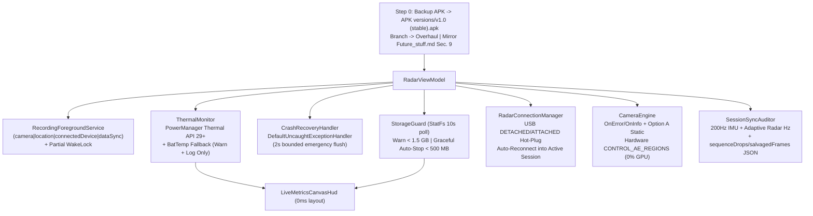

# Tier 1 Implementation Plan (`110`, Revised): Critical Reliability & Crash-Safety Shield

> **Document ID:** `110_plan_tier1_reliability_and_crash_safety.md`  
> **Parent Roadmap:** [`109_plan_reliability_ux_soak_and_pitch_master_roadmap.md`](../08_HANDOVER_AND_DOCS/109_plan_reliability_ux_soak_and_pitch_master_roadmap.md)  
> **Target Branch:** `Overhaul` (branched from `validation` after backing up `APK versions/v1.0 (stable).apk`)  
> **Target Subsystems:** `AndroidManifest.xml`, `recording/`, `acquisition/`, `camera/`, `diagnostics/`, `ui/`, `Future_stuff.md`, `.gitignore`  
> **Confirmed Decisions:** Single-file `camera_video.mp4`, **Option A Static Hardware `CONTROL_AE_REGIONS` Road AE** (`0%` CPU/GPU, `0` mid-drive `setRepeatingRequest()` calls), `1.5 GB` warn / `500 MB` graceful auto-stop, thermal `SEVERE` warn + log only.

---

## Goal Description

Safely archive the proven `validation` build as `APK versions/v1.0 (stable).apk`, isolate all new development onto the `Overhaul` branch, mirror the November 2026 audit backlog into `Future_stuff.md` (Section 9), and implement all 6 Tier 1 reliability & crash-safety defenses across the Android acquisition runtime without introducing any CPU, GPU, or Camera2 HAL overhead.

---

## Architecture Overview



---

## User Review Required Before Executing Step 0 & Tier 1

> [!IMPORTANT]
> **Two quick hygiene checks before I copy the APK, switch to `Overhaul`, and implement Tier 1:**
> 1. **Uncommitted Update 4 Presentation Files on `validation`:** You currently have 3 modified presentation files on `validation` (`RoadSense_Update4_Executive_Progress.pptx`, `RoadSense_Update4_Slide_by_Slide_Handover_Notes.md`, `generate_roadsense_update4_deck.js`). Should I **commit those onto `validation` first** so `validation` stays completely clean before branching `Overhaul`, or carry them straight into `Overhaul`?
> 2. **Keep `APK versions/` Out of Git History (`.gitignore`):** `app/build/outputs/apk/debug/app-debug.apk` (`2026-11-20 11:13 AM`, `62.2 MB`) matches the latest Android Kotlin code on `validation`. Adding `APK versions/` to `.gitignore` keeps `v1.0 (stable).apk` safely archived locally without bloating Git history by 62 MB per backup. Confirm adding `APK versions/` to `.gitignore`?

---

## Proposed Changes

### Pre-Work Step 0: Backup Snapshot, `Overhaul` Branch & `Future_stuff.md` Sec. 9
1. Copy `app/build/outputs/apk/debug/app-debug.apk` $\rightarrow$ `APK versions/v1.0 (stable).apk` (creating `APK versions/` at repo root).
2. Add `APK versions/` to `.gitignore` (if confirmed).
3. Switch branch via `git checkout -b Overhaul`.
4. Append **Section 9: System Reliability, Field UX, Capability & Research Audit Backlog (Nov 2026)** to [Future_stuff.md](../../../Future_stuff.md) preserving all 4 categories verbatim (`[PLANNED — TIER 1..4]` vs `[BACKLOG]`).

---

### Sub-Topic 1.1: Foreground Recording Service & Partial WakeLock (`targetSdk = 37` Safe)
#### [MODIFY] [AndroidManifest.xml](../../../app/src/main/AndroidManifest.xml)
Declare Android 14+ (`targetSdk = 37`) foreground service permissions and service entry:
```xml
<uses-permission android:name="android.permission.FOREGROUND_SERVICE" />
<uses-permission android:name="android.permission.FOREGROUND_SERVICE_CAMERA" />
<uses-permission android:name="android.permission.FOREGROUND_SERVICE_LOCATION" />
<uses-permission android:name="android.permission.FOREGROUND_SERVICE_CONNECTED_DEVICE" />
<uses-permission android:name="android.permission.FOREGROUND_SERVICE_DATA_SYNC" />
<uses-permission android:name="android.permission.POST_NOTIFICATIONS" />
<uses-permission android:name="android.permission.WAKE_LOCK" />

<service
    android:name=".recording.RecordingForegroundService"
    android:exported="false"
    android:foregroundServiceType="camera|location|connectedDevice|dataSync" />
```

#### [NEW] [RecordingForegroundService.kt](../../../app/src/main/java/com/bajajauto/roadsense/recording/RecordingForegroundService.kt)
- Silent low-importance notification channel `"roadsense_recording"`.
- Dynamic `foregroundServiceType` bitmask at `startForeground()` strictly gated on runtime-granted permissions (`DATA_SYNC` always included + `CAMERA`/`LOCATION`/`CONNECTED_DEVICE` only when granted/active) — zero `SecurityException` risk on Android 14+.
- Acquires `PowerManager.PARTIAL_WAKE_LOCK` (`"RoadSense:RecordingWakeLock"`, 4-hour safety timeout, always released in `onDestroy()`).
- Shows persistent `"RoadSense Recording • session_YYYYMMDD_HHMMSS"` notification with a **Stop Recording** action hooked safely back to `RadarViewModel`.
- `MainActivity.onCreate()` requests `POST_NOTIFICATIONS` on Android 13+ (non-blocking).

---

### Sub-Topic 1.2: Protected Single-File `MediaRecorder`, `StatFs` Disk Guard & Emergency Crash Flush
#### [MODIFY] [CameraEngine.kt](../../../app/src/main/java/com/bajajauto/roadsense/camera/CameraEngine.kt)
- Attach `setOnErrorListener` and `setOnInfoListener` inside `setupMediaRecorder()` (`L633-L644`), logging exact `what`/`extra` codes to `AppLogger`, setting `CameraEngineState.Error`, and invoking an `onRecorderErrorListener` callback so `RadarViewModel` cleanly terminates and logs `CAMERA / RECORDER_ERROR`.

#### [NEW] [StorageGuard.kt](../../../app/src/main/java/com/bajajauto/roadsense/recording/StorageGuard.kt)
- Pure-Kotlin policy evaluator + `StatFs` sampler:
  - `WARN_THRESHOLD_MB = 1500L` (`StorageHealth.LOW_WARN`)
  - `CRITICAL_STOP_MB = 500L` (`StorageHealth.CRITICAL_STOP`)
- Checked synchronously at `startSessionRecording()` (blocks start with a clear warning if `< 500 MB`) and every `10 s` inside `RadarViewModel`'s existing `tickCount % 10 == 0` battery loop (`0` hot-path cost).
- On `< 500 MB` during recording: logs `STORAGE / CRITICAL_AUTO_STOP` to `session_timeline.csv` and triggers graceful `stopSessionRecording()` so `MediaRecorder.stop()` finalizes `camera_video.mp4` (`moov` intact).

#### [NEW] [CrashRecoveryHandler.kt](../../../app/src/main/java/com/bajajauto/roadsense/diagnostics/CrashRecoveryHandler.kt)
- Installed once in `MainActivity.onCreate()`, chaining to the prior `Thread.UncaughtExceptionHandler`.
- On uncaught exception: logs stack trace via `AppLogger.e("CRASH", ...)`, executes bounded (`2,000 ms` join timeout) emergency flush stopping `MediaRecorder`, flushing `timelineWriter` / sensor recorders, stamping `"terminatedByCrash": true` in `session_metadata.json`, flushing `AppLogger`, and delegating to the original system handler.

---

### Sub-Topic 1.3: USB Hot-Plug Detach & Automatic Re-Attach Recovery
#### [MODIFY] [RadarConnectionManager.kt](../../../app/src/main/java/com/bajajauto/roadsense/acquisition/RadarConnectionManager.kt)
- Add `data class Reconnecting(val message: String, val attempt: Int = 1) : RadarConnectionState()`.
- Track `connectedDeviceId: Int?` and `autoReconnectEnabled: Boolean` (set `true` on `scanAndConnect()`, cleared on explicit user `disconnect()`).
- Extend `BroadcastReceiver` to handle `ACTION_USB_DEVICE_DETACHED` and `ACTION_USB_DEVICE_ATTACHED`:
  - **Detach:** Cleanly stop IO managers and close ports, emit `Reconnecting`, notify `RadarViewModel` to log `RADAR / USB_DETACHED` while keeping active session recording alive.
  - **Attach:** Probe matching CP2105/TI device; if permitted, auto-reconnect after `250 ms` settle, notify `RadarViewModel` to reset `packetAssembler` + `clockDiscipliner`, log `RADAR / USB_RECONNECTED`, and resume streaming into the same session.
- Add 3 bounded backoff retries (`500 ms`, `1500 ms`, `3000 ms`) in `onRunError()` if the port closes unexpectedly while `autoReconnectEnabled`.

#### [MODIFY] [SensorReadinessEvaluator.kt](../../../app/src/main/java/com/bajajauto/roadsense/ui/SensorReadinessEvaluator.kt) & [RadarViewModel.kt](../../../app/src/main/java/com/bajajauto/roadsense/ui/RadarViewModel.kt)
- Map `RadarConnectionState.Reconnecting` $\rightarrow$ `SensorPillStatus("RECONN", "REC", SensorHudTone.YELLOW)`.

---

### Sub-Topic 1.4: Thermal Throttling Monitor & Zero-Alloc HUD Indicator
#### [NEW] [ThermalMonitor.kt](../../../app/src/main/java/com/bajajauto/roadsense/diagnostics/ThermalMonitor.kt)
- Pure-Kotlin `ThermalSeverity { NOMINAL, LIGHT, MODERATE, SEVERE, CRITICAL }` + `classify(powerManagerThermalStatus, batteryTempC)` (API 29+ `PowerManager.addThermalStatusListener`, with battery temperature fallback `>= 40°C -> MODERATE`, `>= 45°C -> SEVERE` on API 28 / OEMs returning `NONE`).
- **Warn + Log Only:** Never modifies camera preview state; logs transitions to `session_timeline.csv` (`SYSTEM / THERMAL_CHANGE`) and tracks `peakThermalSeverity` + `peakBatteryTempC` on `SessionInfo`.

#### [MODIFY] [LiveMetricsBar.kt](../../../app/src/main/java/com/bajajauto/roadsense/ui/components/LiveMetricsBar.kt), [RadarViewModel.kt](../../../app/src/main/java/com/bajajauto/roadsense/ui/RadarViewModel.kt), & [SessionInfo.kt](../../../app/src/main/java/com/bajajauto/roadsense/recording/SessionInfo.kt)
- Add `thermalSeverity` and `storageStatus` to `LiveMetricsSnapshot`.
- Draw thermal tag (`THRM` amber / `HOT!` red) and low-storage alert (`LOW <1.5G`) directly inside the existing single-node `LiveMetricsCanvasHud` pass (`0` extra Compose nodes, `0.00 ms` layout overhead).

---

### Sub-Topic 1.5: `SessionSyncAuditor` 200 Hz IMU & Adaptive Radar JSON Parity
#### [MODIFY] [SessionSyncAuditor.kt](../../../app/src/main/java/com/bajajauto/roadsense/recording/SessionSyncAuditor.kt) & [SessionInfo.kt](../../../app/src/main/java/com/bajajauto/roadsense/recording/SessionInfo.kt)
- Store `totalRadarSalvagedFrames`, `totalRadarSequenceDrops`, `peakThermalSeverity`, `terminatedByCrash` on `SessionInfo` and serialize them into `session_metadata.json`.
- Auto-detect `200 Hz` (`p50 <= 7.5 ms`, `12 ms` jitter threshold) vs legacy `100 Hz` (`20 ms`) for IMU audit.
- Compute adaptive Radar nominal cadence from `p50IntervalMs` (`10–60 Hz`, anomaly threshold `maxOf(65f, p50 * 1.5f)`) so `20 Hz`, `22.2 Hz`, and `30–60 Hz` DSP builds are all scored accurately.
- Emit `meanIntervalMs`, `p50IntervalMs`, `p95IntervalMs`, `maxIntervalMs`, `sequenceDrops`, and `salvagedFrames` inside `"radar"` in `AuditResult.toJson()`.

---

### Sub-Topic 1.6: Option A — Static Hardware `CONTROL_AE_REGIONS` Road AE (0% CPU/GPU, 0 Mid-Drive HAL Calls)
#### [MODIFY] [CameraEngine.kt](../../../app/src/main/java/com/bajajauto/roadsense/camera/CameraEngine.kt)
- **Delete** dead `startLuminanceAnalyzerLegacyDisabled()` (`TextureView.getBitmap` stub) and unused contrast/luminance loop fields.
- Keep `applyAeMeteringSettings(builder)` ultra-simple and purely static:
  - When `_roadAeMode.value == RoadAeMode.AUTO_ROAD` (and not tap-locked): apply `createRoadMeteringRectangle(activeArray, effectiveRotation)` (bottom 65% road zone, `METERING_WEIGHT_MAX`) with `CONTROL_AE_EXPOSURE_COMPENSATION = 0` and set `_roadAeState.value = RoadAeState.BALANCED`.
  - When `_roadAeMode.value == RoadAeMode.FULL_MATRIX`: set `CONTROL_AE_REGIONS = null` and `CONTROL_AE_EXPOSURE_COMPENSATION = 0`.
- Applied **only once** inside `createCaptureSession()` when the camera opens or when the user explicitly toggles `setRoadAeMode()` — **zero dynamic `setRepeatingRequest()` calls during driving, 0% CPU, 0% GPU, zero oscillation risk**.
- Default `_roadAeMode` to `RoadAeMode.FULL_MATRIX` (or `AUTO_ROAD` if preferred — persisted or toggleable with 1 tap).

---

## Verification Plan

### Automated JVM Unit Tests
- `[NEW] StorageGuardTest.kt` (`>= 1500 MB OK`, `500..1499 MB LOW_WARN`, `< 500 MB CRITICAL_STOP`)
- `[NEW] ThermalMonitorTest.kt` (`PowerManager` API 29+ severity mapping + API 28 battery-temp fallback)
- `[MODIFY] SensorReadinessEvaluatorTest.kt` (`RadarConnectionState.Reconnecting -> YELLOW / RECONN`)
- `[NEW/MODIFY] SessionSyncAuditorTest.kt` (`200 Hz` vs `100 Hz` IMU auto-detect, adaptive `22.2 Hz` / `20 Hz` radar cadence, `sequenceDrops` & `salvagedFrames` JSON output)

Command:
```powershell
$env:JAVA_HOME = "C:\Users\rakadu1.AHEAD\Android_Studio\android-studio-quail4-windows\android-studio\jbr"; ./gradlew testDebugUnitTest
```
*(User builds & installs APK onto `SM-M325F` per `gemini.md` Rule 5.)*
