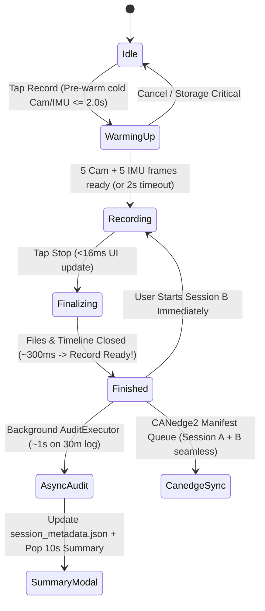

# Tier 2 Implementation Plan (`111` — Rev 2): Field UX, 4-Way Swipe Bookmarks, Non-Blocking Stop/Audit, Warmup & Landscape Preflight

> **Document ID:** `111_plan_tier2_field_ux_bookmarks_and_post_drive_card.md`  
> **Parent Roadmap:** [`109_plan_reliability_ux_soak_and_pitch_master_roadmap.md`](../08_HANDOVER_AND_DOCS/109_plan_reliability_ux_soak_and_pitch_master_roadmap.md)  
> **Branch:** `Overhaul` (immediately following committed Tier 1 `f64d08d`)  
> **Revision Notes (Rev 2):** Incorporates all user review feedback — Audio Alerts (`AudioAlertManager`) deferred to `Future_stuff.md` backlog; added non-blocking `STOP` + 10× faster decoupled `SessionSyncAuditor`; added `WarmingUp` sensor-stabilization routine; upgraded `EventBookmarkButton` to a 4-direction swipe gesture with exact non-overlapping placements and toggleable haptics; redesigned `PreflightChecklistOverlay` for zero-scroll landscape visibility triggered from the `IDLE` pill; set `PostDriveSummaryOverlay` auto-dismiss to `10 s` with error/CAN summary and toggleable lifecycle/CAN verification logs.

---

## Goal Description

Upgrade RoadSense's in-cabin ergonomics, start/stop responsiveness, and post-drive verification across five focused sub-topics:

1. **Sub-Topic 2.1 — 4-Direction Swipe Event Bookmarking (`EVENT_MARKER` + Foxglove `/events`):** Large, thumb-friendly bookmark button (tap = plain `EVENT`, swipe `>= 36.dp` ↑ `CUT_IN` / ↓ `BRAKE` / ← `FALSE_ALARM` / → `BUMP` with live radial directional guide + toggleable haptic lock-in) placed cleanly with zero plot overlap across `FullscreenCameraPreview` (left edge), `FullscreenSbsPreview` (separate large button left of `EXIT`), and regular non-fullscreen cockpit (left of `IDLE`), exported to Foxglove `/events` + `/diagnostics/logs`.
2. **Sub-Topic 2.2 — Non-Blocking `STOP`, Decoupled 10× Faster `SessionSyncAuditor` & Seamless Back-to-Back CANedge2 Sync:** Eliminate the 10–15 s frozen `STOP` button on 30+ min drives by moving file close off the Main Thread, introducing `Finalizing` state (`< 350 ms` return to `Record`), running zero-allocation `SessionSyncAuditor` asynchronously on an isolated `AuditExecutor` (`10–15 s → ~1 s`), and verifying multi-session CANedge2 queueing (`Session A` + `Session B`) with toggleable debug logs.
3. **Sub-Topic 2.3 — Structured Session Metadata Tagging (`SessionTags`) & Deferred Audio Backlog:** Sticky run metadata (`vehicleId`, `dspFirmwareBuild`, `mountType`, `lightingCondition`, `notes`) in `SessionDeckCard` stamped into `session_metadata.json`, plus moving deferred `AudioAlertManager` into `Future_stuff.md` backlog.
4. **Sub-Topic 2.4 — Post-Drive Summary Card (`10 s` Auto-Dismiss + Error & CAN Glance):** Dark modal card modeled on `LaunchBuildOverlay.kt` auto-dismissing after `10 s` (tap-to-`Hold` / `Done`), displaying Sync Grade, Radar/Camera/IMU/GNSS metrics, occurred errors/warnings, CANedge2 background sync status, thermal peak, and bookmark count.
5. **Sub-Topic 2.5 — Clickable `IDLE` Zero-Scroll Landscape Preflight Modal, Sensor Warmup Routine (`WarmingUp`) & Dead-Code Cleanup:** Tapping the existing `IDLE` / `✓ SAVED` pill beside `Record` opens a landscape-optimized single-view `PreflightChecklistOverlay` (all 5 sensors, storage, battery/thermal, calibration, tags). Tapping `Record` runs a bounded `<= 2.0 s` `WarmingUp` pre-roll so cold Camera/IMU sensors stabilize at 30 FPS / 200 Hz before atomic session open. Deletes 3 verified zero-reference legacy files.

---

## Architecture & Lifecycle State Machine



### Compose Performance & Reflow Guardrails (`gemini.md` Sec. 5.6)
- All new buttons, chips, and pills use `maxLines = 1`, `softWrap = false`, and `Modifier.weight(1f)` on flexible sibling text.
- `CockpitTabNavigationBar` in landscape wraps its 7 tab buttons in a `Modifier.weight(1f).horizontalScroll(...)` container so the right-side `[ MARK ] [ ✓ IDLE ] [ Record ]` control bar is **never** squeezed on compact screens.
- Radial swipe HUD renders in an isolated `Popup` with zero parent layout/canvas recomposition.

---

## Proposed Changes

### 2.1 4-Direction Swipe Event Bookmarking (`EVENT_MARKER` + Foxglove `/events`)

#### [NEW] `app/src/main/java/com/bajajauto/roadsense/recording/EventBookmark.kt`
```kotlin
enum class EventBookmarkType(val tag: String, val shortLabel: String, val accentHex: Long) {
    EVENT("EVENT", "MARK", 0xFF38BDF8),
    CUT_IN("CUT_IN", "CUT-IN", 0xFFF59E0B),
    BRAKE("BRAKE", "BRAKE", 0xFFEF4444),
    FALSE_ALARM("FALSE_ALARM", "FALSE", 0xFFA855F7),
    BUMP("BUMP", "BUMP", 0xFF10B981)
}

enum class SwipeDirection { CENTER, UP, DOWN, LEFT, RIGHT }

object EventBookmarkGestureResolver {
    const val MIN_SWIPE_THRESHOLD_DP = 36f

    fun resolve(dxPx: Float, dyPx: Float, thresholdPx: Float): EventBookmarkType {
        val distSq = dxPx * dxPx + dyPx * dyPx
        if (distSq < thresholdPx * thresholdPx) return EventBookmarkType.EVENT
        return if (kotlin.math.abs(dxPx) >= kotlin.math.abs(dyPx)) {
            if (dxPx < 0f) EventBookmarkType.FALSE_ALARM else EventBookmarkType.BUMP
        } else {
            if (dyPx < 0f) EventBookmarkType.CUT_IN else EventBookmarkType.BRAKE
        }
    }
}
```

#### [NEW] `app/src/main/java/com/bajajauto/roadsense/ui/components/EventBookmarkButton.kt`
Reusable swipeable thumb button with two visual variants (`EventBookmarkStyle.LARGE_DOCK` for Fullscreen Camera / Fullscreen SBS, and `EventBookmarkStyle.COMPACT_BAR` for the regular cockpit bar):
- **Gesture Physics (`Modifier.pointerInput`):** Uses `awaitEachGesture` consuming drag changes so parent scrollables never steal the gesture.
  - Release `< 36.dp` → **`EVENT`** (plain marker).
  - Release `>= 36.dp` → **↑ `CUT_IN`** (Amber) | **↓ `BRAKE`** (Red) | **← `FALSE_ALARM`** (Purple) | **→ `BUMP`** (Emerald).
  - Dragging back within `< 36.dp` resets selection to plain **`EVENT`**.
- **Visual Directional Guide:**
  - Resting button displays a bookmark/flag icon, optional count (`MARK` / `MARK 3`), and subtle 4-dot N/S/E/W compass hints.
  - On touch-down + `> 8.dp` drag (or `> 120 ms` press), an isolated translucent **4-direction radial cross `Popup`** opens over the button showing `↑ CUT-IN`, `↓ BRAKE`, `← FALSE`, `→ BUMP`, and center `● MARK`.
  - Crossing `36.dp` scales (`1.15×`) and illuminates the active direction pill and (if `bookmarkHapticsEnabled == true`) triggers `HapticFeedbackConstants.CLOCK_TICK`; releasing triggers `HapticFeedbackConstants.CONFIRM` and flashes a 1.5 s pill (`"✓ #3 CUT-IN"`).
  - If tapped while not recording, briefly flashes `"Start REC to mark"` without logging.

#### [MODIFY] Exact Non-Overlapping Placements
1. **`FullscreenCameraPreview.kt`:** Add a dedicated left-edge floating dock (`Alignment.CenterStart`, `padding(start = 16.dp)`) styled identically to the right-edge Focus Lock dock (`Color.Black.copy(alpha = 0.70f)`, `RoundedCornerShape(16.dp)`, `46.dp` tactile button + `"MARK"` caption below). Zero overlap with the camera center, bottom nudge bar, or right-edge focus buttons.
2. **`FullscreenSbsPreview.kt`:** Place a **separate large tactile button** (`EventBookmarkStyle.LARGE_DOCK`, `42.dp` touch target in matching translucent dark pill style) immediately **to the left of the `EXIT` / `HUD` / `Range` / `REC` top control strip** (`Row` at `Alignment.TopCenter` with `10.dp` gap between the large `MARK` button and the control pill). Easy solo reach without overlapping the Camera or BEV plots.
3. **`MainActivity.kt` (`LandscapeSessionControlBar`) & `TopSessionHeader.kt`:** Place `EventBookmarkButton(style = COMPACT_BAR)` directly **to the left of the `IDLE` (Preflight) button** — covering both regular `SBS` and regular `Camera` tabs (and all other cockpit tabs) from one consistent muscle-memory slot with zero overlap on any plot or viewfinder.

#### [MODIFY] `tools/convert_session_to_mcap.py`
- Add pure helper `parse_timeline_events(timeline_csv_path)` parsing `USER,EVENT_MARKER` rows (`mono_ns`, `seq_id`, `tag`, `wall_ms`, `note`).
- Register JSON schema `roadsense.EventMarker` on channel **`/events`** (`event_id`, `tag`, `note`, `mono_ns`, `wall_ms`, `elapsed_sec`).
- Write each bookmark to `/events` at `utc_ns = mono_ns + time_offset_ns` and mirror a `WARN`-level `foxglove.Log` (`name = "BOOKMARK"`) on `/diagnostics/logs`.

---

### 2.2 Non-Blocking `STOP`, Decoupled 10× Faster `SessionSyncAuditor` & Seamless CANedge2 Verification

#### [MODIFY] `SessionRecordingState.kt`
Add two explicit transition states so UI controls never appear frozen:
```kotlin
data class WarmingUp(val statusText: String = "Warming sensors…") : SessionRecordingState()
data class Finalizing(val sessionInfo: SessionInfo, val phase: String = "SAVING") : SessionRecordingState()
```

#### [MODIFY] `RadarSessionRecorder.kt` & `SessionManager.kt`
- **Split `SessionManager.closeSession()` into 2 clean stages:**
  1. `closeSessionFiles(sessionInfo)` (fast `< 50 ms`): stamps `stopTimeWallMs`/`stopTimeMonotonicNs`, writes `SESSION:STOP` to `timelineWriter`, calls `timelineWriter.stop()`, writes initial `session_metadata.json`, detaches `AppLogger` session log.
  2. `runDeferredSessionAudit(sessionInfo)` (runs on dedicated single-thread `AuditExecutor` using ONLY closed files on disk — **zero** shared mutable state with any newly started Session B!): executes `SessionSyncAuditor.auditSession(sessionInfo)`, updates `sessionInfo.syncAuditResult` & `crossSensorSyncJson`, re-writes `sessionInfo.sessionDir/session_metadata.json`, and fires a callback to `RadarViewModel`.
- **Non-blocking `stopSessionRecording()` in `RadarViewModel.kt`:**
  - Immediately emits `SessionRecordingState.Finalizing(activeSession, "SAVING")` on the Main Thread (`< 16 ms` visual response!).
  - Dispatches `cameraEngine.stopVideoRecording()`, `cameraSessionRecorder.stopRecording()`, `gnssSessionRecorder.stopRecording()`, `imuSessionRecorder.stopRecording()`, `sessionRecorder.stopSessionAndFlush()`, `RecordingForegroundService.stop()`, and `canedgeIngestionManager.onSessionStopped()` onto `Dispatchers.IO` under `sessionLifecycleLock`.
  - Once file flush finishes (~`250–350 ms`), `_recordingState` transitions to `SessionRecordingState.Finished` — **the `Record` button is immediately interactive for Session B**, while `_isSessionAuditing` shows a subtle `"AUDITING…"` indicator inside the `IDLE / ✓ SAVED` pill until `AuditExecutor` finishes (~`1 s`) and pops `PostDriveSummaryOverlay`!

#### [MODIFY] `SessionSyncAuditor.kt`
Zero-allocation streaming optimization (`10–15 s → ~1 s` on 30-min logs):
- Replace `line.split(",")` across `imu_frames.csv`, `session_timeline.csv`, `camera_frames.csv`, and `sync_keyframes.csv` with a fast `indexOf(',')` column extractor (`extractColumn(line, colIdx)`) and primitive growing `LongArrayBuffer` / `FloatArrayBuffer` helpers.
- Add `Arrays.sort(primitiveArray, 0, size)` instead of boxing `ArrayList<Float>.sorted()`.

#### [MODIFY] `DebugToggles.kt` & `CanedgeIngestionManager.kt`
- Add toggleable `sessionLifecycleDebugLogs: Boolean` (exposed in `DebugToggleSnapshot` + accessible toggle in `SessionDeckCard` debug strip) logging timestamped lifecycle milestones:
  - `[LIFECYCLE_DIAG] WARMUP_START -> CAM_WARM(ms) -> IMU_WARM(ms) -> REC_ACTIVE(totalMs)`
  - `[LIFECYCLE_DIAG] STOP_TAP -> CAM_STOP(ms) -> IMU_FLUSH(ms) -> FILE_CLOSE(ms) -> UI_READY(totalMs)`
  - `[LIFECYCLE_DIAG] AUDIT_START(sessionId) -> AUDIT_DONE(ms, grade)`
- Add `[CAN_TRANSITION]` verbose logs (gated by `DebugToggles.isCanedgeVerboseActive || DebugToggles.isSessionLifecycleDebugActive`) in `CanedgeIngestionManager.onSessionStarted()`, `onSessionStopped()`, and `reconcilePendingSessionsOnline()` logging exact queued session IDs (`pendingIds=[A, B]`), cancellation/resume transitions, and per-session staged MF4 counts so seamless back-to-back CAN sync is trivially verifiable.

---

### 2.3 Structured Session Metadata Tagging (`SessionTags`) & Deferred Audio Backlog

#### [MODIFY] `AppPreferences.kt`
Add persistent keys:
- `sessionVehicleId` (`""`), `sessionDspFirmware` (`""`), `sessionMountType` (`"Hard Mount"`), `sessionLightingCondition` (`"Daylight"`), `bookmarkHapticsEnabled` (`true`), `promptPreflightBeforeRec` (`false`).

#### [MODIFY] `SessionInfo.kt`
- Add `SessionTags(vehicleId, dspFirmwareBuild, mountType, lightingCondition, notes)`, `var sessionTags: SessionTags = SessionTags()`, `var totalEventBookmarks: Int = 0`, and `var recordedErrorCount: Int = 0` / `var recordedWarnings: MutableList<String>` (to feed the Post-Drive Summary Card's error summary!).
- Serialize `"sessionTags"` and `"bookmarksCount"` in `SessionInfo.toJson()`.

#### [MODIFY] `SessionDeckCard.kt`
- Add collapsible **"Run Metadata & Tags"** card (quick-select chips for `Mount Type` & `Lighting`, compact inputs for `Vehicle ID`, `DSP Firmware`, `Notes`, plus compact toggles for **Bookmark Haptics** and **Lifecycle Debug Logs**).
- Fix line 310 hardcoded `<= 16.7ms` text to display `audit.radarCameraProximity.complianceThresholdMs` (`<= 25.0ms` @ 20 Hz).

#### [MODIFY] `Future_stuff.md`
Update Section 9.2 item 2 (`AudioAlertManager`) tag from `[PLANNED — TIER 2]` to `[BACKLOG — DEFERRED]`.

---

### 2.4 Post-Drive Summary Card (`10 s` Auto-Dismiss + Quick-Glance Errors & CAN)

#### [NEW] `app/src/main/java/com/bajajauto/roadsense/ui/components/PostDriveSummaryOverlay.kt`
Modeled on `LaunchBuildOverlay.kt` (`Color(0xFF131A24)` card, `Color(0xE6090D14)` scrim), with **`AUTO_DISMISS_MS = 10_000L` (10 s)** countdown progress bar, tap-card-to-`Hold`, and `Done` button. Auto-dismisses immediately if user taps `Record` for a new run.
- **Landscape-first 2-column grid (`widthIn(max = 640.dp)` in landscape, `440.dp` in portrait) fitting cleanly in one view without scrolling:**
  - **Header:** `"Drive Summary"` + Sync Grade badge (`GOLD` / `SILVER` / `WARN` / `CRASH FLUSH`) + session ID & duration (`MM:SS`).
  - **Left Column (Core Streams & Sync):** Radar (`frames`, `drops`, `salvaged`, `Hz`), Camera (`frames`, `FPS`, `drops`), IMU (`200 Hz`, `Cam↔IMU Δt`), Rad↔Cam `Δt`, GNSS fixes.
  - **Right Column (Health, Errors, CAN & Marks):**
    - **Errors & Alerts Box:** Green `"0 Runtime Errors"` when clean, or concise amber/red list (e.g. `1× USB Detach`, `Thermal MODERATE (41.2°C)`, `Storage Low`, `MediaRecorder Error`).
    - **CANedge2 Status:** Live badge (`QUEUED — syncing in bg` / `SYNCED (N files)` / `OFFLINE`) confirming it's safe to start the next drive immediately.
    - **Bookmarks & Tags:** `N Event Marks` + active `Mount • Lighting • DSP`.

---

### 2.5 Clickable `IDLE` Zero-Scroll Landscape Preflight Modal, Sensor Warmup & Dead-Code Cleanup

#### [NEW] `app/src/main/java/com/bajajauto/roadsense/ui/components/PreflightChecklistOverlay.kt`
Dark modal card matching `LaunchBuildOverlay.kt` and `PostDriveSummaryOverlay.kt`, triggered by tapping the **`IDLE` / `✓ SAVED` pill** beside the `Record` button:
- **Zero-Scroll Landscape Layout (`widthIn(max = 680.dp)` in landscape):**
  - **Header Row:** `"Pre-Flight Sensor Readiness"` + overall readiness badge (`ALL READY` green / `CHECK WARNINGS` amber) + Close (`×`).
  - **2-Column Body (Side-by-Side in Landscape, Stacked with Scroll Fallback in Portrait):**
    - **Left Column — All 5 Sensors (Compact 1-Line Status Rows):**
      - `Radar (3.125M)`: `Connected (20.0 Hz)` / `Reconnecting` / `Disconnected`
      - `Camera (H.264)`: `Previewing (30 FPS)` / `Standby (Auto-Warm on REC)` / `Closed (Auto-Warm)`
      - `IMU (200 Hz)`: `Live (200 Hz)` / `Standby (Auto-Warm on REC)`
      - `GNSS (GPS)`: `Locked (N sats, ±Xm)` / `Searching` / `No Permission`
      - `CANedge2 (Wi-Fi)`: `Synced (N staged)` / `Syncing (N pending)` / `Offline`
    - **Right Column — Vehicle & System Health:**
      - `Storage`: Free GB/MB + `OK / LOW / CRITICAL` badge (`StorageGuard`)
      - `Power & Thermal`: Battery %, Temp °C, `NOMINAL / MODERATE / SEVERE`
      - `Calibration`: Active `Pitch° / Yaw°` baseline
      - `Run Tags`: Active `Vehicle • DSP • Mount • Lighting`
  - **Footer Row:** Compact `"Prompt before REC"` checkbox + `Close` + `Start REC` (single-line buttons, `maxLines = 1, softWrap = false`).

#### [MODIFY] `RadarViewModel.kt` & `CameraEngine.kt` — Sensor Warmup Routine (`WarmingUp`)
- Add `CameraEngine.warmUpForRecording(onWarm: (Boolean) -> Unit)` helper:
  - If `cameraDevice != null && isRepeatingActive` → invokes `onWarm(true)` immediately (`0 ms`).
  - If `cameraDevice == null` and `hasCameraPermission()` → opens `CameraDevice` silently into a warm-up capture session (using persistent `previewSurface` if attached, or lightweight dummy 16×16 `ImageReader` / `SurfaceTexture` if preview is muted) and fires `onWarm(true)` after **`5` consecutive shutter frames** (`~160 ms`) so ISP/AE/30 FPS lock in before `MediaRecorder.start()`!
- In `RadarViewModel.startSessionRecording()`:
  - Enters `SessionRecordingState.WarmingUp("Warming sensors…")` asynchronously on `viewModelScope`.
  - Starts `ImuManager` live monitoring if idle (waits up to `5` samples) + `GnssLocationManager` (non-blocking) + `cameraEngine.warmUpForRecording(...)` with a hard **`2,000 ms` timeout**.
  - Once warm (typically `0 ms` if preview is open, `~400–650 ms` if camera was cold), atomically creates the session and starts `MediaRecorder`, `RadarSessionRecorder`, `ImuSessionRecorder`, and `GnssSessionRecorder` together!

#### [DELETE] Verified Zero-Reference Legacy Files
- `app/src/main/java/com/bajajauto/roadsense/acquisition/AcquisitionPlaceholder.kt`
- `app/src/main/java/com/bajajauto/roadsense/recording/RecordingPlaceholder.kt`
- `app/src/main/java/com/bajajauto/roadsense/camera/AutoFitTextureView.kt` (update stale KDoc line in `FullscreenCameraPreview.kt:44` to `AutoFitSurfaceView`).

---

## Verification Plan

### Automated Tests
1. **Android JVM Unit Tests:**
   ```powershell
   $jbr = "C:\Users\rakadu1.AHEAD\Android_Studio\android-studio-quail4-windows\android-studio\jbr"
   $env:JAVA_HOME = $jbr
   ./gradlew --stop
   ./gradlew testDebugUnitTest "-Dorg.gradle.java.home=$jbr" --console=plain
   ```
   - `[NEW] EventBookmarkTest.kt`: Verify `EventBookmarkGestureResolver` deadzone (`< 36.dp -> EVENT`) and exact 4-direction cardinal resolution (`↑ CUT_IN`, `↓ BRAKE`, `← FALSE_ALARM`, `→ BUMP`) plus diagonal tie-breaking.
   - `[MODIFY] SessionSyncAuditorTest.kt`: Verify zero-allocation `indexOf(',')` parser matches exact counts/percentiles/GOLD grade AND benchmark synthetic 30-min (`360,000` IMU + `54,000` keyframes) completion speed `< 2,000 ms` on JVM.
   - `[MODIFY] SessionInfoTest.kt`: Verify `sessionTags` and `bookmarksCount` JSON round-trip.
2. **Python MCAP `/events` Unit Test (`roadsense-mcap` env):**
   ```powershell
   conda run -n roadsense-mcap python -m unittest discover -s tools/tests -p "test_*.py" -v
   ```
   - `[NEW] tools/tests/test_event_markers_mcap.py`: Verify `parse_timeline_events()` + `/events` MCAP channel + mirrored `/diagnostics/logs` bookmark entries.

### Manual Verification (User Hardware Smoke Test on `SM-M325F`, per `gemini.md` Rule 5)
1. **Landscape Preflight & Warmup:** Tap the `IDLE` pill in landscape — verify all 5 sensors, storage, thermal, calibration, and tags fit cleanly on **one screen without scrolling**. With camera preview muted, tap `Record` — verify `WARMING…` resolves in `< 1 s` and `LiveMetricsBar` starts cleanly at `30 FPS` from second 1.
2. **4-Direction Swipe Bookmarks:** Test tap (`EVENT`) and 4-way swipes (`↑ CUT-IN`, `↓ BRAKE`, `← FALSE`, `→ BUMP`) on:
   - Regular cockpit (left of `IDLE`)
   - `FullscreenSbsPreview` (separate large button left of `EXIT`)
   - `FullscreenCameraPreview` (left-edge dock)
   Verify visual radial cross, haptic lock-in (and IMU signature + toggle off if desired), and zero plot/panel overlap.
3. **Non-Blocking Stop, Post-Drive Summary & Back-to-Back CANedge2 Sync:** Enable `Lifecycle Debug Logs`, stop a recording, confirm `STOP` transitions immediately without freezing, verify `PostDriveSummaryOverlay` renders for `10 s` with grade/errors/CAN status, and start a 2nd recording immediately while CANedge2 sync is queued to verify both sessions receive their `.MF4` chunks cleanly.
4. **Foxglove MCAP Check:** Convert test session via `tools/convert_session_to_mcap.py` and confirm `/events` + `/diagnostics/logs` bookmark markers render at exact timestamps.
