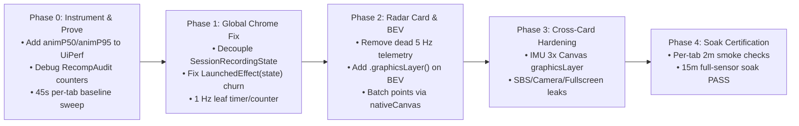

# Plan 113: Analytical Investigation & Optimization of UI Frame Pacing (P95 > 16.67 ms)

> **Target Hardware:** Samsung Galaxy M32 (`SM-M325F`, Exynos / Mali-G52, Android 13, 60 Hz locked = `16.67 ms` frame budget)  
> **Primary Orientation:** **Reverse Landscape** (99.9% of field & bench usage — `LandscapeSessionControlBar` + Dual-Pane `RadarDashboardCard`)  
> **Locked Baseline:** `logs/soak_runs/soak_20261126_111051` (2.0 min Wireless ADB + live 3.125 Mbps Radar OTG on Radar Card; **no new baseline soak needed**)  
> **Goal:** Systematically prove *which* cards/composables cause UI jank, *why* `P95` settles at `35–43 ms` while `P50` is `15.5 ms`, and drive steady-state `UI Frame Pacing (P95)` below **`16.67 ms`** (`PASS`) in Reverse Landscape across all cockpit cards with zero recording impact.

---

## 1. Forensic Evidence Already Captured (What the Numbers Actually Tell Us)

Before touching a single line of UI code, we parsed all `24` `[WINDOW_5S]` rollups and `546` `[JANK_FRAME]` records from [soak_logcat.log](file:///c:/Users/rakadu1.AHEAD/AndroidStudioProjects/RoadSense/logs/soak_runs/soak_20261126_111051/soak_logcat.log):

| Metric | Steady-State Measured Value | 60 Hz Budget / Target | Interpretation |
|---|---|---|---|
| **Frame Rate (Window)** | `104–117 frames / 5 s` (`~22 Hz`) | `20 Hz` radar + `1 Hz` HUD | UI only renders on sensor/state ticks (good) |
| **Total Frame Time `P50`** | **`15.47 – 16.38 ms`** | `≤ 16.67 ms` | **Majority of 20 Hz radar frames ALREADY pass!** |
| **Total Frame Time `P95`** | **`33.73 – 37.33 ms`** | `≤ 16.67 ms` | **Periodic spikes — NOT uniform slowness** |
| **Draw Phase `P50`** | **`1.10 – 1.17 ms`** | `< 3 ms` | Normal 20 Hz BEV Canvas draw is fast! |
| **Draw Phase `P95`** | **`8.22 – 9.32 ms`** | `< 4 ms` | **8× jump** on periodic spike frames |
| **Layout `P95` / Sync `P95`** | `0.33 ms` / `0.59 ms` | `< 1 ms` | Negligible |
| **GPU `P95` / Swap `P95`** | `7.57 ms` / `3.86 ms` | `< 8 ms` / `< 4 ms` | Elevated only when large DisplayLists rebuild |
| **Animation (`anim`) on Jank Frames** | **`10.5 – 21.0 ms`** (vs `0.1 ms` normal) | `< 1 ms` | **#1 CPU time sink on jank frames!** |
| **Period Between High-Draw Janks** | **`median = 297.0 ms` (`p25 = 199.0 ms`, `p75 = 317.0 ms`)** | — | **SMOKING GUN: `~3.3 Hz` (`297 ms`) and `5 Hz` (`199 ms`) clocks!** |

---

## 2. Answering the Hard Engineering Questions

### Q1: Why is `P50` fast (`15.5 ms`, `drawP50 = 1.16 ms`) while `P95` is stuck at `35–42 ms`?
Because the **20 Hz radar BEV redraw itself is NOT the main culprit**. Instead, **periodic `200 ms` (5 Hz) and `250–300 ms` (~3.3 Hz) state emissions** are triggering heavy Compose recompositions + Material3 DisplayList rebuilds (`anim = 10–21 ms` + `draw = 8–12 ms`) roughly 3–5 times per second. Since ~35–45% of rendered frames collide with those ticks, `P95` locks onto the spike height (`35–42 ms`) while `P50` stays near `15.5 ms`.

### Q2: Why does `anim` spike to `10–21 ms` when there are ZERO `rememberInfiniteTransition` animations in the entire app?
In Android `FrameMetrics`, **`ANIMATION_DURATION` (`anim`)** measures **all Choreographer `CALLBACK_ANIMATION` work** — which is **where Jetpack Compose's `AndroidUiFrameClock` runs Recomposition, Snapshot state observation, `LaunchedEffect` cancellation/relaunch, and slot-table diffs**!  
So `anim = 15–21 ms` is **pure Compose Main-Thread recomposition work**, not a visual animation.

### Q3: Why did the initial 10 seconds spike to `64–116 ms` before settling to `35–40 ms`?
Three one-time cold-start costs overlap right after tapping Record:
1. **ART JIT warm-up** of Compose lambdas & `RadarBevCanvas` draw paths on a debug build.
2. **Recording startup burst:** `MediaRecorder` / `Camera2` session bring-up + `SessionRecordingState` transitions (`Idle → WarmingUp → Recording`) + `ImageBitmap` allocation for the BEV static grid.
3. **CPU contention:** Short spike while camera encoder + file writers initialize (`unk = 8.5–42 ms` Main-Thread scheduling delay), which then drops to `unkP95 = 1.1 ms` in steady state.

### Q4: Which exact cards / composables are firing at `297 ms` and `199 ms` right now?
Because [MainActivity.kt](file:///c:/Users/rakadu1.AHEAD/AndroidStudioProjects/RoadSense/app/src/main/java/com/bajajauto/roadsense/ui/MainActivity.kt#L409-L429) mounts **only the active tab**, only **4 composables** were alive during the Radar Card soak (`LiveMetricsBar`, `CockpitTabNavigationBar`, `RadarDashboardCard`, `RadarBevPlot`). Static audit of those 4 composables + our full-app collector scan revealed **4 concrete, high-confidence offenders**:

| # | Suspect Component & File | Firing Period | What It Actually Does Wrong | Affects Which Tabs? |
|---|---|---|---|---|
| **S1** | **`RadarSessionRecorder.kt:39,197`** → **`TopSessionHeader.kt:136-165`** (Portrait) & **`LandscapeSessionControlBar` (`MainActivity.kt:587-650`)** | **`250–300 ms`** *(matches **`297 ms` median**!)* | Emits a new `SessionRecordingState.Recording(durationMs, framesRecorded, bytesRecorded)` every `250 ms` (quantized to 50 ms radar frames → **297 ms**). Both headers read `.value` at their **root**, recomposing the entire Material3 `Card`/`Row`/`EventBookmarkButton`/`Stop Button` every `297 ms`. Worse: `rememberTransientSavedFlag(state)` runs **`LaunchedEffect(state)`**, **cancelling & relaunching a coroutine every `297 ms`**, and `TopSessionHeader.kt:145` writes `remember(currentSessionState) { derivedStateOf { ... } }`, destroying `derivedStateOf` every `297 ms`! | **ALL 7 TABS** (Global Cockpit Chrome!) |
| **S2** | **`RadarViewModel.kt:820`** (`delay(200)`) → **`RadarHardwareStatusCard` (`RadarDashboardCard.kt:135-143`)** | **`200 ms` (5 Hz)** *(matches **`199 ms` p25**!)* | Collects `viewModel.radarUiTelemetry` at `5 Hz` **even while recording**, recomposing the entire Material3 `Card` + 4 `Text`s + cancelling/relaunching **`LaunchedEffect(telemetry, isRecording)`** 5×/sec — even though `RadarHardwareStatusCard` **never renders a single field of `telemetry`** and skips updating `sampledFrame` while recording (`if (!isRecording)`)! Pure wasted recomposition! | **Radar Tab** |
| **S3** | **`RadarBevCanvas` (`RadarBevPlot.kt:504-510`)** | **`50 ms` (20 Hz)** | **Missing `.graphicsLayer()`** (unlike `LiveMetricsBar` and `ViewfinderRadarOverlay`, which both isolate their RenderNodes). Sitting inside a Material3 `Card(RoundedCornerShape(12.dp))`, every 20 Hz invalidation forces HWUI to re-record the parent `Card` clip & sibling DisplayList (`drawP95` + `gpuP95` bloat). Also draws points via individual Compose `drawCircle(Offset(...))` calls instead of batched `nativeCanvas.drawPoints(...)`. | **Radar Tab** & **SBS Tab** |
| **S4** | **Other Tabs & Fullscreen Overlays (Cross-Card Audit)** | `50–300 ms` | Static scan of all 23 UI files flagged additional hotspots to verify empirically: • **`ImuDashboardCard.kt` + `PhoneOrientation3DVisualizer.kt`**: 3 Canvases with `0` `graphicsLayer`s + top-level `imuTelemetry` collection. • **`SbsDashboardCard.kt`**: collects `latestFrame` **twice** + `cameraFps` + `cameraSessionFrames`. • **`CameraDashboardCard.kt`**: 29 `collectAsState()` calls (including duplicate `cameraSessionFrames` & `roadAeState`). • **`FullscreenCameraPreview.kt` & `FullscreenSbsPreview.kt`**: collect `sessionRecordingState` (`297 ms`) and `latestFrame` (`20 Hz`) — must verify `.value` reads are deferred to leaves/DrawScope. | **IMU, SBS, Camera, Fullscreen** |

### Q5: Why did `DisplayPacer` log `12–54` drops?
`RadarDisplayPacer` executes its `Choreographer.FrameCallback` on the Main Looper. When **S1** or **S2** stalls the Main Thread for `35–65 ms`, the next 50 ms radar frame arrives before the UI drains the previous one, so `DisplayPacer` trims the display queue (`[BLOAT_TRIM]` / `[DROP]`). **Disk recording is unaffected (`0` drops)**, and eliminating the `35 ms` UI spikes will naturally drive `DisplayPacer` drops to `~0`.

### Q6: How much does Debug vs. Release APK matter?
Debug builds disable R8 optimization and add Compose debugging metadata (~1.5–2× higher recomposition cost). That is actually an advantage here: **debug acts as a magnifying glass**. If we eliminate structural recompositions and push `P95 ≤ 16.67 ms` in **Debug**, Release builds will have massive headroom (`~8–11 ms`).

---

## 3. Phased Analytical Methodology (Measure First → Fix Surgically → Re-Verify)

---

### Phase 0: Fast ADB UI Profiler & Instrumentation (30-Second Iteration Loop)
**Goal:** Replace full 4-minute soak cycles with a **30-second ADB profiler** that captures targeted `UiPerf` + `RecompAudit` + `gfxinfo` + pulled `app_system.log` / `session_debug.log` and prints an instant side-by-side attribution breakdown.

1. **New Lightweight PC Profiler: `scripts/profile_ui_perf.py`:**
   * Auto-detects Wired or Wireless ADB (`10.225.54.7:5555` or `--serial`).
   * Arms `DebugToggles` UI profiling via debug-only ADB broadcast (`com.bajajauto.roadsense.action.SET_UI_PROFILING --ez enabled true`) on start and restores it on exit so normal drives remain zero-overhead.
   * Clears logcat + resets `dumpsys gfxinfo`, captures `--duration 30` (default 30 s) of `UiPerf`, `RecompAudit`, `DisplayPacer`, `RadarBevPlot`, and `MainActivity` logs.
   * Automatically pulls the latest `app_system.log` and active/latest `session_debug.log` from `/sdcard/Android/data/com.bajajauto.roadsense/files/` into `logs/ui_profiles/profile_<label>_YYYYMMDD_HHMMSS/`.
   * Computes & prints an instant scorecard: `P50`, `P95`, `max`, `animP95`, `drawP95`, `gpuP95`, `jank %`, `DisplayPacer drops`, **inter-jank period histogram** (instantly showing whether `297 ms` S1 or `199 ms` S2 spikes still exist!), and **per-composable `RecompAudit` counts/5s**.
   * Supports `--compare <baseline_dir> <new_dir>` (and accepts existing soak folders like `logs/soak_runs/soak_20261126_111051` directly as `<baseline_dir>`!).
2. **Add `animP50` & `animP95` to `[WINDOW_5S]` in [UiFrameMetricsProfiler.kt](file:///c:/Users/rakadu1.AHEAD/AndroidStudioProjects/RoadSense/app/src/main/java/com/bajajauto/roadsense/diagnostics/UiFrameMetricsProfiler.kt):**
   * Adds `animDurationsMs` (`animP50`, `animP95`) to the 5-second rollup (pre-allocated `FloatArray`, zero GC overhead) so Compose recomposition latency is directly visible in every profile & soak log.
   * Gates verbose `[JANK_FRAME]` logging behind `DebugToggles` (`isUiPerfJankLogcatActive` / `isUiPerfJankToFileActive`) so `[WINDOW_5S]` summary stays lightweight while noisy per-frame traces stay toggleable.
3. **Centralized `DebugToggles` Integration + `RecompAudit` Counter:**
   * Add `recompAuditLogs` (`isRecompAuditActive`) and `uiPerfJankLogcatLogs` (`isUiPerfJankLogcatActive`) to [DebugToggles.kt](file:///c:/Users/rakadu1.AHEAD/AndroidStudioProjects/RoadSense/app/src/main/java/com/bajajauto/roadsense/DebugToggles.kt) and expose a switch in [SessionDeckCard.kt](file:///c:/Users/rakadu1.AHEAD/AndroidStudioProjects/RoadSense/app/src/main/java/com/bajajauto/roadsense/ui/screens/SessionDeckCard.kt).
   * Lock-free `AtomicInteger` counter inside `SideEffect` emitting **one compact line every 5 seconds** (`I/RecompAudit`) only when `DebugToggles.isRecompAuditActive` is enabled.

---

### Phase 1: Fix Global Cockpit Chrome — Zero-Recomposition Readouts (Reverse Landscape Primary + Portrait Parity)
**Files:** [MainActivity.kt](file:///c:/Users/rakadu1.AHEAD/AndroidStudioProjects/RoadSense/app/src/main/java/com/bajajauto/roadsense/ui/MainActivity.kt), [TopSessionHeader.kt](file:///c:/Users/rakadu1.AHEAD/AndroidStudioProjects/RoadSense/app/src/main/java/com/bajajauto/roadsense/ui/components/TopSessionHeader.kt), [RadarSessionRecorder.kt](file:///c:/Users/rakadu1.AHEAD/AndroidStudioProjects/RoadSense/app/src/main/java/com/bajajauto/roadsense/recording/RadarSessionRecorder.kt)

1. **Why Direct-Canvas Draw-Phase Beats `Text(...)` Recomposition:**
   * Updating a numeric string inside Compose `Text(...)` still executes Composition (`anim`), text re-measurement/layout, Accessibility/Semantics updates, and DisplayList re-recording.
   * By reading `.value` **strictly inside `Canvas { ... }` (`DrawScope`)** with `.graphicsLayer()` + `.clearAndSetSemantics {}` (matching `LiveMetricsBar.kt`), layout stays 100% constant and **0 recompositions (`anim ≈ 0 ms`) + 0 layout passes** occur when numbers increment!
2. **Fix `rememberTransientSavedFlag()` coroutine churn:**
   * Change `LaunchedEffect(state)` → `LaunchedEffect(state is SessionRecordingState.Finished)` so no coroutine is cancelled/relaunched during recording.
3. **True Zero-Recomposition `LandscapeSessionControlBar` (`MainActivity.kt:581`):**
   * Remove root `val state by viewModel.sessionRecordingState.collectAsState()` from `LandscapeSessionControlBar`.
   * Derive coarse phase (`SessionHeaderPhase`) via `remember(sessionStateHolder) { derivedStateOf { ... } }` so `EventBookmarkButton` and `Stop`/`Record` button recompose **0 times/sec**.
   * Render the ticking `● REC MM:SS (Nf)` / `CAN SYNC %` / `IDLE ⓘ` status pill via a fixed-size **Direct `Canvas` + `.graphicsLayer()` + `.clearAndSetSemantics {}`** leaf (`LandscapeStatusPillCanvas`) reading `stateHolder.value` only inside `DrawScope` → **literal 0 recompositions/sec even at 2 Hz ticks!**
4. **Fix Portrait `TopSessionHeader` root recomposition leak (parity):**
   * Fix `remember(currentSessionState) { derivedStateOf { ... } }` → `remember(sessionStateHolder) { derivedStateOf { ... } }` and defer `.value` reads to leaf `SessionTimerText` / `SessionTelemetrySummaryText`.
5. **Throttle `RadarSessionRecorder` UI tick from `250 ms` (4 Hz) → `500 ms` (2 Hz):**
   * Keep `UI_UPDATE_INTERVAL_MS = 500L` (**2 Hz**) so live frame counts stay crisp while cutting state emissions in half, at near-zero UI cost thanks to the Direct-Canvas pill.

---

### Phase 2: Fix Radar Card & BEV Canvas Hotpath (Target: Radar P95 < 16.67 ms)
**Files:** [RadarDashboardCard.kt](file:///c:/Users/rakadu1.AHEAD/AndroidStudioProjects/RoadSense/app/src/main/java/com/bajajauto/roadsense/ui/screens/RadarDashboardCard.kt), [RadarBevPlot.kt](file:///c:/Users/rakadu1.AHEAD/AndroidStudioProjects/RoadSense/app/src/main/java/com/bajajauto/roadsense/ui/components/RadarBevPlot.kt)

1. **Zero-Recomposition Telemetry Chip in `RadarHardwareStatusCard`:**
   * Remove `val telemetry by viewModel.radarUiTelemetry.collectAsState()` and the dead `LaunchedEffect(telemetry, isRecording)` loop from `RadarHardwareStatusCard`.
   * Replace the changing right-hand telemetry `Text` (`Seq #... | Pts: ... | Trk: ...`) with a fixed-height **Direct `Canvas` + `.graphicsLayer()` + `.clearAndSetSemantics {}`** readout reading `telemetryState.value` / `frameState.value` strictly inside `DrawScope` — **0 recompositions/sec, 0 layout passes** whether idle or recording!
2. **Remove `viewModel.latestFrame.collectAsState()` from `RadarDashboardCard` root:**
   * Pass `viewModel` / `latestFrame` StateFlow cleanly to `RadarBevPlot` so `RadarDashboardCard` root has **0** 20 Hz state reads.
3. **Isolate `RadarBevCanvas` onto a Hardware RenderNode (`.graphicsLayer()`):**
   * Add `.graphicsLayer()` to `Canvas(...)` inside `RadarBevCanvas` (`RadarBevPlot.kt:505`) so 20 Hz BEV redraws never re-record or re-clip the parent Material3 `Card`, range selector buttons, filter pills, or legend.
4. **Zero-Allocation Native Point Batching inside `RadarBevCanvas`:**
   * Pre-allocate 3 reusable `FloatArray` scratch buffers (approaching / receding / stationary) + 3 `android.graphics.Paint` objects (`strokeWidth = 9f`, `strokeCap = ROUND`) in `BevGeometryCache`, and replace the per-point Compose `drawCircle(color, radius, Offset(px, py))` loop with **3 batched `nativeCanvas.drawPoints(buf, 0, count, paint)` calls**.

---

### Phase 3: Cross-Card Hardening (Prevent Regressions on Other Tabs)
*(Guided by Phase 0 baseline results — we only touch cards that Phase 0 proves exceed budget!)*

1. **`ImuDashboardCard.kt` & `PhoneOrientation3DVisualizer.kt`:**
   * Add `.graphicsLayer()` to all 3 Canvases; defer `imuTelemetry` `.value` reads into `DrawScope` lambdas so parent Material3 cards don't recompose at IMU UI rate.
2. **`SbsDashboardCard.kt` & `CameraDashboardCard.kt`:**
   * Deduplicate double `latestFrame` / `cameraSessionFrames` / `roadAeState` `.collectAsState()` calls; verify `.value` reads are strictly inside leaf DrawScope lambdas.
3. **`FullscreenCameraPreview.kt` & `FullscreenSbsPreview.kt`:**
   * Verify `sessionRecordingState` and `latestFrame` are read only inside leaf timer / `ViewfinderRadarOverlay` DrawScope, not at fullscreen root.

---

### Phase 4: Verification & Certification Plan

1. **JVM Unit Tests:** Run `./gradlew testDebugUnitTest --no-daemon` (all 133+ existing tests pass + add unit test for `FrameWindowStats` `animP50`/`animP95` rollup and `TopSessionHeader` phase derivation).
2. **A/B Measurement on `SM-M325F` (using 30s `scripts/profile_ui_perf.py` + Tier 3 Soak Harness):**
   * Compare **Before (Baseline `soak_20261126_111051`)** vs **After**:

| Metric | Baseline (`111051`) | Target After Plan 113 |
|---|---|---|
| `RecompAudit` (during recording on Radar tab) | ~`3.3/s` header + `5/s` HW card | **`0/s` cards & chrome (Direct Canvas draw-phase only)** |
| `UiPerf animP95` | `~15–21 ms` | **`< 2.0 ms`** |
| `UiPerf drawP95` | `8.2 – 9.3 ms` | **`< 3.0 ms`** |
| `UiPerf total P95` (Radar Card) | `35.15 ms` (`FAIL`) | **`≤ 16.67 ms` (`PASS`)** |
| `UiPerf jank %` | `32 – 46%` | **`< 5%`** |
| `DisplayPacer` drops (2-min run) | `12 – 54` | **`0`** |
| Sensor Recording Drops (Radar/Cam/IMU) | `0` | **`0` (regression guard)** |

3. **Debug vs. Release APK Comparison Benchmark:**
   * Once the **Debug** build passes `≤ 16.67 ms`, build/profile the **Release** APK with `profile_ui_perf.py --label release` (since `UiFrameMetricsProfiler` runs in Release too) to quantify R8/ART headroom (expected `~8–11 ms` P95 in Release).

---

## 4. Confirmed Decisions & Next Step

* **Header Tick Cadence:** `500 ms` (**2 Hz**) — confirmed.
* **Primary Orientation:** **Reverse Landscape** (`LandscapeSessionControlBar` + Dual-Pane `RadarDashboardCard`) — confirmed.
* **Baseline Strategy:** Reuse [soak_20261126_111051](file:///c:/Users/rakadu1.AHEAD/AndroidStudioProjects/RoadSense/logs/soak_runs/soak_20261126_111051/soak_report.json) (`P50 = 15.6 ms`, `P95 = 35.15 ms`, `drawP95 = 9.1 ms`, `297 ms` + `199 ms` spike cadence) as our locked baseline — **no new soak test required before coding**.
* **Fast Iteration Loop:** Build `scripts/profile_ui_perf.py` (30-second ADB `logcat` + `gfxinfo` + `app_system.log`/`session_debug.log` puller + `--compare` diff tool) + **Phase 0 (`animP95` + `RecompAudit`) + Phase 1 (Global Chrome) + Phase 2 (Radar Card & BEV)** in one clean build, then run a 30-second `profile_ui_perf.py` check against `soak_20261126_111051` to verify every fix's individual fingerprint (`RecompAudit` counts, `animP95`, `drawP95`, `gpuP95`, and inter-jank period histogram).
