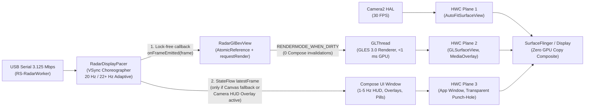

# Implementation Plan: Tier C — Native OpenGL ES 3.0 BEV Renderer (`GLES30`)

> **Document ID:** `Plan 115` (`intel/Implementations/06_UI_AND_PERFORMANCE/115_plan_tier_c_opengles30_bev_renderer.md`)  
> **Builds On:** `Plan 113` (UI Frame Pacing & Recompositions), `Tier A` (Primitive BEV Grid & 20–22 Hz `RadarDisplayPacer`), and `Report 114` (`114_feasibility_bev_pointcloud_rendering_vs_foxglove_gles30.md`)  
> **Target Hardware:** Samsung Galaxy M32 (`SM-M325F`, MediaTek Helio G80 / Mali-G52 MC2, Android 13 API 33, `minSdk = 28` -> OpenGL ES 3.0 guaranteed)  
> **External Dependencies Added:** **Zero** (`android.opengl.GLES30` & `android.opengl.GLSurfaceView` are built into the Android SDK)

---

## 1. Goal Description

Eliminate the remaining Compose + Skia full-screen redraw overhead on the Radar Bird's-Eye View (BEV) scope by replacing the 20–22.3 Hz Compose `Canvas` drawing path with a dedicated, hardware-composited **OpenGL ES 3.0 (`GLSurfaceView`) renderer** modeled directly after Foxglove Studio's WebGL2/Three.js `ThreeDeeRender` pipeline (`DynamicBufferGeometry` + persistent direct buffers + single-draw-call GPU point/primitive shaders).

### Quantified Problem & Target Outcome

| Metric (`SM-M325F`, Reverse Landscape, Radar + Recording) | Tier A Compose `Canvas` (Debug, `22.3 Hz` DSP) | Tier A Compose `Canvas` (`staging` Release) | **Tier C `GLES30` Target** |
| :--- | :---: | :---: | :---: |
| Compose App Window Redraw Rate | `22.3 Hz` (full `2400×1080` window) | `20.0 Hz` | **`1–5 Hz`** (only HUD/telemetry strips; BEV decoupled) |
| Compose `MainActivity` `Total P95` | `19.16 ms` | `18.67 ms` | **`≤ 15.5 ms` (PASS `≤ 16.67 ms`)** |
| Compose `GPU P95` | `7.48 ms` | `8.77 ms` | **`≤ 4.8 ms`** (matches Storage tab idle baseline `4.74 ms`) |
| BEV GPU Render Time (`GLThread`) | Coupled in Skia pass | Coupled in Skia pass | **`< 1.0 ms` per frame** (`5` GL draw calls total) |
| BEV Frame Allocation / GC Pressure | `0 B` (after Plan 113) | `0 B` | **`0 B`** (persistent `ByteBuffer.allocateDirect` VBOs) |
| Scaling Headroom (e.g. `2,000+` dense points / persistence trails) | Linear Skia bottleneck | Linear Skia bottleneck | **Constant `< 1.5 ms` GPU** (hardware vertex pipeline) |

---

## 2. User Review Required

> [!IMPORTANT]
> **Dual-`SurfaceView` Z-Order Architecture (SBS & Fullscreen SBS):**  
> RoadSense hosts a persistent Camera2 `AutoFitSurfaceView` at default Z-order (`-2`, behind the Compose App Window) in [MainActivity.kt](file:///c:/Users/rakadu1.AHEAD/AndroidStudioProjects/RoadSense/app/src/main/java/com/bajajauto/roadsense/ui/MainActivity.kt#L290-L372). The new `GLSurfaceView` MUST use **`setZOrderMediaOverlay(true)`** (and **NEVER** `setZOrderOnTop(true)`):
> - It remains **behind** the Compose App Window so all floating overlays (`FullscreenSbsPreview` control pill, `EventBookmarkButton` radial menu, `PreflightChecklistOverlay`, `PostDriveSummaryOverlay`, `SyncInspectionDialog`, `SnackbarHost`) always render cleanly on top.
> - It sits on its own disjoint right-half HWC plane (`W/2..W`) alongside the Camera2 `AutoFitSurfaceView` (`0..W/2`) in `SbsDashboardCard` and `FullscreenSbsPreview` without Z-fighting.

> [!NOTE]
> **Automatic Portrait Scroll Fallback & Runtime A/B Switch:**  
> In Portrait mode, `RadarDashboardCard` places `RadarBevPlot` inside `Modifier.verticalScroll(rememberScrollState())`. Android `SurfaceView` punches a hardware window hole that lags/clips during parent scroll. Therefore:
> - **Landscape Radar, SBS (Landscape & Portrait — non-scrolling), and Fullscreen SBS** use the **OpenGL ES 3.0 renderer**.
> - **Portrait `RadarDashboardCard` (`!isLandscape && showChrome`)**, Compose Previews, and any device lacking GLES 3.0 automatically fall back to the existing Tier A **`RadarBevCanvas`**.
> - A runtime toggle **`DebugToggles.useGlBevRenderer`** (default `true`, exposed in the BEV Bench strip & Storage Diagnostics) allows instant live **GL vs. Canvas A/B benchmarking** without rebuilding.

### Open Questions / Design Decisions for Your Sign-Off

1. **Phased Scope — Phase 1 (100% Visual Parity) first, then Phase 2 (Interactive Camera)?**  
   - **Recommended:** Ship **Phase 1** first (exact visual & feature parity with `RadarBevCanvas`: polar grid, FOV rays, ego marker, clusters, Doppler point cloud, EKF tracks + velocity vectors + FCW/ACC halos, GPU text labels + FCW banner, zero-wakeup frame path, A/B toggle, unit tests & profiler).  
   - **Phase 2 (Follow-up once Phase 1 is verified on vehicle):** Add smooth 60 FPS pinch-to-zoom, drag-pan, 2.5D/3D orbit tilt, and multi-frame point-cloud persistence trails (all trivial once the `4×4` MVP matrix and VBO ring buffer exist).
2. **Decouple `SbsDashboardCard` & `FullscreenSbsPreview` from `latestFrame.collectAsState()` when Camera HUD Overlay is OFF?**  
   - Currently [SbsDashboardCard.kt](file:///c:/Users/rakadu1.AHEAD/AndroidStudioProjects/RoadSense/app/src/main/java/com/bajajauto/roadsense/ui/screens/SbsDashboardCard.kt#L62) and [FullscreenSbsPreview.kt](file:///c:/Users/rakadu1.AHEAD/AndroidStudioProjects/RoadSense/app/src/main/java/com/bajajauto/roadsense/ui/components/FullscreenSbsPreview.kt#L71) collect `viewModel.latestFrame` at the top of the composable even when `isRadarOverlayEnabled == false`. Moving that collection down into `ViewfinderRadarOverlay` (only when enabled) allows **both** SBS and Fullscreen SBS to hit `0` Compose 20 Hz redraws whenever Camera HUD overlay is off. **Recommended: Include in Phase 1.**
3. **Bench Strip Toggle Placement:**  
   - Should the live **`GL / Skia` A/B toggle** appear as a chip in the collapsible BEV `Bench` strip (alongside `Pts`, `Trk`, `Clst`, `Grid`, `Log`) AND in Storage → Run Metadata & Toggles? **Recommended: Yes** (1 tap to compare side-by-side in the car).

---

## 3. System Architecture & Rendering Pipeline

### 3.1 Zero-Wakeup Dataflow (HWC Plane Separation)



### 3.2 Five-Pass OpenGL ES 3.0 Pipeline (`< 1.0 ms` Total GPU)

All coordinates are transformed via a single column-major `4×4` orthographic **`uMvp` matrix** matching [RadarBevPlot.kt](file:///c:/Users/rakadu1.AHEAD/AndroidStudioProjects/RoadSense/app/src/main/java/com/bajajauto/roadsense/ui/components/RadarBevPlot.kt#L540-L547) to the sub-pixel (`Bug #33` `sin(60°) = 0.8660254f` fit preserved identically):

- **World-to-Pixel:** `sx = originX + x * scale`, `sy = originY - y * scale`, where `originX = w / 2f`, `originY = h - 28f`, `usableHeight = originY - 16f`, `halfWidth = (w / 2f - 12f).coerceAtLeast(1f)`, `scale = min(usableHeight / maxRangeMeters, halfWidth / (maxRangeMeters * 0.8660254f))`.
- **Background Clear:** `glClearColor(0.0353f, 0.0431f, 0.0627f, 1.0f)` (`#090B10`), `GL_BLEND` with `GL_SRC_ALPHA, GL_ONE_MINUS_SRC_ALPHA`, `GL_DEPTH_TEST` disabled (painter's order across the 5 passes).

| Pass | Primitives & Visual Parity | GLES 3.0 Implementation | Draw Calls | GPU Memory |
| :---: | :--- | :--- | :---: | :---: |
| **Pass 1** | Polar range rings (`5/10/15/25 m` steps), `±60°` FOV rays, centerline, `5 m` lateral baseline ticks, & Cyan Ego triangle (`#00E5FF`) | **1 fullscreen triangle/quad** fragment shader evaluating analytical polar SDFs with `fwidth()` screen-space anti-aliasing (`0` texture fetches, `0` Skia path masks) + static 3-vertex VBO for ego triangle (`24×32 px`). | `2` | `< 1 KB` |
| **Pass 2** | Clusters (`TLV 2`): `8 px` radius translucent fill (`#55FFD54F`) + `1.5 px` ring stroke (`#FFFFD54F`) | **1 batched `GL_POINTS`** SDF fragment shader (`gl_PointSize = 18.0` px) drawing fill + anti-aliased outer stroke in a single fragment pass. | `1` | Dynamic VBO (`8 B/cluster`) |
| **Pass 3** | Point Cloud (`TLV 1`): Doppler-colored reflections (`Appr #FF5252`, `Rec #40C4FF`, `Stat #69F0AE`) with `dynamicOnly` (`|v| > 0.35 m/s`) & `minSnrFilter` (`≥ 15 dB`) | **Foxglove `DynamicBufferGeometry` pattern:** Persistent direct `ByteBuffer` (`16 B/pt`: `x, y, doppler, snrDb`) with `1.5×` growth slack -> `glBufferSubData` (`GL_DYNAMIC_DRAW`) -> **1 `GL_POINTS` draw call** (`gl_PointSize = 8.0` px) with Doppler color & smooth circular/rounded-square AA computed in shader! | `1` | `16 KB` (`1,024` pts initial; grows automatically) |
| **Pass 4** | EKF Tracks (`TLV 3`) + ADAS FCW/ACC (`TLV 6`) halos, fallback FCW reticle, velocity arrowheads & shafts | **2 batched calls:** (a) **1 `GL_POINTS`** multi-ring SDF shader (`x, y, styleFlags, radiusPx`) rendering outer FCW/ACC halo + translucent glow core + crisp border ring in one fragment pass; (b) **1 `GL_TRIANGLES`** dynamic VBO batching all arrowheads + thick quad velocity shafts (`2 px` wide — avoids Mali-G52 `glLineWidth` > 1.0 driver quirk!) + endpoint dots. | `2` | `~12 KB` |
| **Pass 5** | Crisp Labels: Range labels (`5m..150m`), Track ID/ADAS tags (`#12 [FCW+ACC]`, `[FCW S2]`), & Top FCW Warning Banner | **Pre-baked `512×256` `GL_R8` Monospace Glyph Atlas (`128 KB` VRAM)** rasterized once via `android.graphics.Canvas` for ASCII `32..126` + `'•'` inside `onSurfaceCreated`. All labels packed into a single textured-quad VBO -> **1 `GL_TRIANGLES` draw call**. | `1` | `128 KB` (`GL_R8`) |

**Total per frame:** **7 draw calls** (`~5` when clusters/tracks empty), **0 heap allocations**, **0 Skia invocations**, **~160 KB total VRAM** (down from `2.03 MB` bitmap in pre-Tier A and `~10 MB` Compose full-window redraws).

---

## 4. Proposed Changes

### 4.1 Manifest, Feature Toggle & ViewModel Plumbing

#### [MODIFY] [AndroidManifest.xml](file:///c:/Users/rakadu1.AHEAD/AndroidStudioProjects/RoadSense/app/src/main/AndroidManifest.xml)
- Declare non-required OpenGL ES 3.0 feature hint (preserves Play/sideload compatibility and universal fallback):
  ```xml
  <uses-feature android:glEsVersion="0x00030000" android:required="false" />
  ```

#### [MODIFY] [DebugToggles.kt](file:///c:/Users/rakadu1.AHEAD/AndroidStudioProjects/RoadSense/app/src/main/java/com/bajajauto/roadsense/DebugToggles.kt)
- Add `val useGlBevRenderer: Boolean = true` to `DebugToggleSnapshot` and `@Volatile var useGlBevRenderer: Boolean = true` + `fun setUseGlBevRenderer(enabled: Boolean)` to `DebugToggles` (defaulting to `true`, allowing instant live toggle to `false` for Skia Canvas A/B comparison).

#### [MODIFY] [RadarViewModel.kt](file:///c:/Users/rakadu1.AHEAD/AndroidStudioProjects/RoadSense/app/src/main/java/com/bajajauto/roadsense/ui/RadarViewModel.kt)
- Add `fun setUseGlBevRenderer(enabled: Boolean)` delegating to `DebugToggles.setUseGlBevRenderer(enabled)` and logging via `AppLogger.i("RadarBevPlot", ...)`.

#### [MODIFY] [SessionDeckCard.kt](file:///c:/Users/rakadu1.AHEAD/AndroidStudioProjects/RoadSense/app/src/main/java/com/bajajauto/roadsense/ui/screens/SessionDeckCard.kt)
- Add a clean `OpenGL ES 3.0 BEV Renderer` switch in `RunMetadataAndTogglesCard` next to `UI Perf Profiling Logs` for easy field switching.

---

### 4.2 Zero-Wakeup Frame Delivery (`RadarDisplayPacer`)

#### [MODIFY] [RadarDisplayPacer.kt](file:///c:/Users/rakadu1.AHEAD/AndroidStudioProjects/RoadSense/app/src/main/java/com/bajajauto/roadsense/sync/RadarDisplayPacer.kt)
- Add a lightweight, thread-safe listener registry using `CopyOnWriteArrayList<(RadarFrame?) -> Unit>`:
  - `fun addFrameListener(listener: (RadarFrame?) -> Unit)` (immediately delivers current `_latestFrame.value` if non-null so newly mounted GL views render without waiting for the next radar frame).
  - `fun removeFrameListener(listener: (RadarFrame?) -> Unit)`.
  - Inside `processSingleTick(...)` right after `_latestFrame.value = frameToEmit` and inside `reset()` (passing `null`), notify registered listeners via an index loop (`for (i in 0 until listeners.size)`) with zero iterator allocation.
- Keep `val latestFrame: StateFlow<RadarFrame?>` 100% intact for `RadarBevCanvas` fallback and `ViewfinderRadarOverlay`.

---

### 4.3 Pure-Kotlin GL-Free Core (`ui/components/gl/`) — 100% JVM Unit-Testable

Separating all math, ADAS track matching, vertex packing, and glyph layout from `android.opengl.GLES30` ensures deterministic JVM unit tests without Robolectric or EGL mocks.

#### [NEW] `app/src/main/java/com/bajajauto/roadsense/ui/components/gl/BevProjectionMath.kt`
- Pure-Kotlin data class `BevViewportMetrics(widthPx, heightPx, originX, originY, usableHeight, scalePxPerMeter, maxRangeMeters, ringStepMeters, maxVisibleDistMeters)`.
- `computeMetrics(widthPx: Float, heightPx: Float, maxRangeMeters: Float): BevViewportMetrics`: exact single source of truth for `Bug #33` `sin(60°) = 0.8660254f` scaling, `28 px` bottom margin, `16 px` top margin, `12 px` side margin, and `5/10/15/25 m` ring steps.
- `buildOrthoMvpMatrix(widthPx: Float, heightPx: Float, outMatrix16: FloatArray)`: writes column-major `4×4` orthographic projection mapping pixel coordinates `(0..w, 0..h)` (Y-down matching Android screen coords) to OpenGL NDC `(-1..+1, +1..-1)` — structured to accept future Phase 2 `zoom`, `panX`, `panY`, and `tiltDeg` parameters cleanly.
- `worldToScreenX(xMeters: Float, metrics: BevViewportMetrics): Float` and `worldToScreenY(yMeters: Float, metrics: BevViewportMetrics): Float`.

#### [NEW] `app/src/main/java/com/bajajauto/roadsense/ui/components/gl/BevTrackAssociator.kt`
- Extract the exact FCW (`TLV 6` `fcw`) and ACC (`TLV 6` `acc`) track-association heuristics currently duplicated inside [RadarBevPlot.kt](file:///c:/Users/rakadu1.AHEAD/AndroidStudioProjects/RoadSense/app/src/main/java/com/bajajauto/roadsense/ui/components/RadarBevPlot.kt#L739-L803) into a zero-allocation pure-Kotlin helper (`data class BevAdasMatch(val fcwIndex: Int, val accIndex: Int)` using `-1` for unmatched).
- Shared by **both** `RadarGlBevRenderer` and `RadarBevCanvas` so ADAS FCW/ACC highlighting can never drift between GL and Skia modes.

#### [NEW] `app/src/main/java/com/bajajauto/roadsense/ui/components/gl/BevGlVertexPacker.kt`
- Pre-allocated direct `ByteBuffer` / `FloatBuffer` manager modeled after Foxglove's `DynamicBufferGeometry`:
  - **Growth policy:** Start at `1,024` points (`16 KB`), `128` clusters (`1 KB`), `128` tracks (`4 KB`), `1,024` vector/text vertices (`16 KB`); grow by `max(required, capacity * 3 / 2)` only on overflow (`0 B` steady-state heap/native churn).
  - **Point Cloud packing (`packPoints`):** Writes interleaved `(sx, sy, colorCode, unused)` or `(xMeters, yMeters, doppler, snrDb)` filtered by `dynamicOnly` (`|doppler| > 0.35f`), `minSnrFilter` (`snrDb >= 15f`), and viewport bounds `sx in 0..w && sy in 0..originY`.
  - **Cluster packing (`packClusters`):** Packs `(sx, sy)` for visible `TLV 2` clusters.
  - **Track marker & velocity vector packing (`packTracks`):** Packs:
    1. Multi-ring point vertices `(sx, sy, radiusPx, styleType)` (`0 = Default`, `1 = ACC`, `2 = FCW`, `3 = FCW Fallback`).
    2. Thickened quad velocity shafts (`2.0 px` width via perpendicular normal offsets — completely immune to Mali-G52 `glLineWidth` clamping to `1.0 px`), arrowhead triangles (`triLen = 6.5f`, `triWidth = 4f`), and endpoint dot quads.
  - **Label quad packing (`packLabels`):** Given `BevGlyphMetrics`, packs screen-space textured quads (`posX, posY, u, v, r, g, b, a`) for:
    - Range ring labels (`5m..150m`),
    - Track ID + ADAS tag (`#TID`, `#TID [FCW]`, `#TID [ACC]`, `#TID [FCW+ACC]`, `[FCW S1/S2]`),
    - Active top-of-scope FCW warning banner (`FCW HAZARD: AUDIBLE ALERT • TTC 1.4s • 12.3m`).

#### [NEW] `app/src/main/java/com/bajajauto/roadsense/ui/components/gl/BevGlyphAtlas.kt`
- **Pure-Kotlin metrics** (`BevGlyphAtlasMetrics`) mapping ASCII `32..126` + `'•'` (`\u2022`) to `(u0, v0, u1, v1, advancePx, cellW, cellH)` inside a fixed `16×8` grid on a `512×256` `GL_R8` texture (`128 KB` single-channel VRAM, `32×32 px` glyph cells for ultra-crisp HiDPI typography on `411 dpi` `SM-M325F`, still 16× smaller than the old `2.03 MB` grid bitmap).
- **Android rasterizer** (`BevGlyphAtlasUploader.createTexture()`): draws glyphs once onto an `ALPHA_8` `Bitmap` inside `onSurfaceCreated`, uploads via `glTexImage2D(GL_TEXTURE_2D, 0, GL_R8, w, h, 0, GL_RED, GL_UNSIGNED_BYTE, buf)` with `GL_LINEAR` filtering, and immediately recycles the `Bitmap`.

---

### 4.4 OpenGL ES 3.0 Shaders, Renderer & Lifecycle-Safe View (`ui/components/gl/`)

#### [NEW] `app/src/main/java/com/bajajauto/roadsense/ui/components/gl/BevGlShaders.kt`
- Contains the 5 compact, GLSL ES 3.00 (`#version 300 es`, `precision highp float;`) shader program sources + compile/link validation helper with clear `AppLogger.e("RadarGlBev", ...)` error diagnostics:
  1. **`GRID_SHADER` (Procedural Polar Grid + FOV Rays + Centerline + 5m Ticks):**
     - Fullscreen triangle (`3` vertices, no VBO needed via `gl_VertexID`) computes exact world meters `vec2 m = vec2(px.x - uOrigin.x, uOrigin.y - px.y) / uScale`.
     - Evaluates analytical distance to:
       - Concentric range rings: `abs(mod(r + 0.5*uRingStep, uRingStep) - 0.5*uRingStep)` for `m.y >= 0.0 && r <= uMaxVisibleDist` with `fwidth(r)` AA.
       - `±60°` FOV boundary rays (`abs(abs(m.x) * 0.5 - m.y * 0.8660254)`).
       - Forward centerline (`abs(px.x - uOrigin.x)` for `px.y >= 10.0 && px.y <= uOrigin.y`).
       - `5 m` lateral baseline ticks (`uOrigin.y - 12.0 <= px.y <= uOrigin.y`).
     - Zero texture lookups, razor-sharp at any resolution or zoom level, instant `uShowGrid` toggle.
  2. **`SOLID_GEOM_SHADER`:** Renders static ego triangle (`#00E5FF`) and batched colored velocity shafts / arrowheads (`GL_TRIANGLES` with per-vertex `vec4 aColor`).
  3. **`POINT_CLOUD_SHADER`:** Vertex shader maps `(sx, sy)` via `uMvp`, sets `gl_PointSize = uPointSizePx` (`8.0`), and selects Doppler color (`#FF5252` / `#40C4FF` / `#69F0AE`) from vertex attribute; fragment shader clips crisp rounded-square/circle via `gl_PointCoord` (`smoothstep` AA).
  4. **`RING_SDF_SHADER`:** Single-pass SDF shader for both **Clusters** (`8 px` fill + `1.5 px` stroke) and **EKF Tracks / FCW / ACC / Fallback FCW** (concentric outer halo + translucent fill + crisp border ring + center dot for fallback FCW) using `gl_PointCoord` radial distance `d = length(gl_PointCoord - 0.5) * sizePx`.
  5. **`TEXT_ATLAS_SHADER`:** Samples `.r` channel of the `GL_R8` glyph atlas texture and multiplies by per-vertex `vec4 aColor` for crisp anti-aliased text in one batched draw call.

#### [NEW] `app/src/main/java/com/bajajauto/roadsense/ui/components/gl/RadarGlBevRenderer.kt`
- Implements `GLSurfaceView.Renderer`:
  - Thread-safe state handoff (zero locks on UI/Pacer thread):
    - `private val pendingFrame = AtomicReference<RadarFrame?>(null)`
    - `private val renderConfig = AtomicReference(BevRenderConfig())` (immutable config snapshot: `maxRangeMeters`, `dynamicOnly`, `minSnrFilter`, `showGrid`, `showClusters`, `showRawPoints`, `showTracks`, `enableTimingLog`, `enablePerfWindowLog`).
  - `onSurfaceCreated`: Compiles all 5 GLSL ES 3.00 programs, uploads static ego VBO + dynamic VBOs (`GL_DYNAMIC_DRAW`), builds `512×256` `GL_R8` glyph atlas texture. Sets `glInitFailed = true` + notifies fallback callback if any shader/GL error occurs!
  - `onSurfaceChanged`: Updates `glViewport(0, 0, w, h)`, recomputes `BevViewportMetrics`, `uMvp` matrix, and static ego triangle vertices.
  - `onDrawFrame`:
    - Records `startNs = System.nanoTime()`.
    - Reads latest `pendingFrame.get()` and `renderConfig.get()`.
    - Executes Passes 1–5 (`0` allocations).
    - Records CPU+submission duration (`(System.nanoTime() - startNs) / 1e6`) into a lightweight 5-second rolling histogram (no allocations: pre-allocated `FloatArray(256)`).
    - Emits:
      - `[DRAW_BEV]` when `DebugToggles.isCanvasTimingActive` is true (preserving existing bench log format), and
      - `[GL_BEV_5S]` every 5 seconds when `DebugToggles.isUiPerfProfilingActive` is true:  
        `[GL_BEV_5S] frames=111 fps=22.2 p50=0.42ms p95=0.78ms max=1.31ms pts=64 trk=4`

#### [NEW] `app/src/main/java/com/bajajauto/roadsense/ui/components/gl/RadarGlBevView.kt`
- Composable wrapper hosting a custom `GLSurfaceView` inside `AndroidView`:
  - `setEGLContextClientVersion(3)`
  - `setEGLConfigChooser(8, 8, 8, 8, 0, 0)` (no depth/stencil buffer wasted on 2D BEV!)
  - `preserveEGLContextOnPause = true` (eliminates shader/atlas recompilation stutter on app resume!)
  - `setZOrderMediaOverlay(true)` (safe alongside Camera `AutoFitSurfaceView`, stays behind all Compose overlays!)
  - `renderMode = GLSurfaceView.RENDERMODE_WHEN_DIRTY` (draws **only** when a new radar frame or config change arrives — `0%` GPU usage when radar is idle/disconnected!)
  - Lifecycle-aware `DisposableEffect(lifecycleOwner, viewModel.displayPacer)`:
    - Subscribes directly to `viewModel.displayPacer.addFrameListener { frame -> renderer.updateFrame(frame); glView.requestRender() }`.
    - Observes `ON_RESUME` / `ON_PAUSE` to call `glView.onResume()` / `glView.onPause()` cleanly.
    - Unregisters listener & calls `glView.onPause()` on disposal (tab switch or fullscreen transition).
  - Runtime capability check `isOpenGlEs3Supported(context: Context): Boolean` via `ActivityManager.deviceConfigurationInfo.reqGlEsVersion >= 0x30000`, plus `onGlInitError` callback that flips an internal state to fall back gracefully to `RadarBevCanvas`.

---

### 4.5 Compose Integration & SBS Zero-Wakeup Cleanup

#### [MODIFY] [RadarBevPlot.kt](file:///c:/Users/rakadu1.AHEAD/AndroidStudioProjects/RoadSense/app/src/main/java/com/bajajauto/roadsense/ui/components/RadarBevPlot.kt)
- Update `RadarBevPlot` to decide cleanly between `RadarGlBevView` and `RadarBevCanvas`:
  - `val canUseGl = debugState.useGlBevRenderer && !LocalInspectionMode.current && (isLandscape || !showChrome) && frame == null && isOpenGlEs3Supported(context) && !glInitFailed`
  - Notice `frame == null`: static preview/replay callers passing an explicit `frame` continue to work transparently via `RadarBevCanvas`, while live cockpit views (`RadarDashboardCard` Landscape, `SbsDashboardCard`, `FullscreenSbsPreview`) route to **`RadarGlBevView`**.
  - When `canUseGl` is true: mount `RadarGlBevView` with `Modifier.background(Color.Transparent)` (GL clears `#090B10` directly — zero Compose overdraw over the `SurfaceView` punch-hole).
  - Add a compact **`GL`** / **`Skia`** toggle chip inside the collapsible `showBenchStrip` row (`BevBenchToggleChip(label = "GL", ...)`).
  - Refactor `RadarBevCanvas` to call shared `BevProjectionMath.computeMetrics(...)` and `BevTrackAssociator.match(...)` so both backends share identical math and ADAS logic.

#### [MODIFY] [SbsDashboardCard.kt](file:///c:/Users/rakadu1.AHEAD/AndroidStudioProjects/RoadSense/app/src/main/java/com/bajajauto/roadsense/ui/screens/SbsDashboardCard.kt) & [FullscreenSbsPreview.kt](file:///c:/Users/rakadu1.AHEAD/AndroidStudioProjects/RoadSense/app/src/main/java/com/bajajauto/roadsense/ui/components/FullscreenSbsPreview.kt)
- Remove unconditional top-level `val radarFrameState = viewModel.latestFrame.collectAsState()` from `SbsDashboardCard` and `FullscreenSbsPreview`!
- Instead, collect `viewModel.latestFrame` strictly inside a small leaf composable wrapping `ViewfinderRadarOverlay` **only when `isRadarOverlayEnabled` is true** (and pass `frameProducer = null` to `RadarBevPlot` so `RadarGlBevView` consumes frames directly via `displayPacer.addFrameListener`, while `RadarBevCanvas` fallback still uses its own `fallbackFrameState`).
- Result: In **SBS** and **Fullscreen SBS** with Camera HUD overlay OFF, the entire Compose App Window stays dormant at `1–2 Hz` while Camera2 runs on HWC Plane 1 and GLES30 BEV runs on HWC Plane 2!

---

### 4.6 PC Profiler Integration (`scripts/profile_ui_perf.py`)

#### [MODIFY] [profile_ui_perf.py](file:///c:/Users/rakadu1.AHEAD/AndroidStudioProjects/RoadSense/scripts/profile_ui_perf.py)
- Add `parse_gl_bev_window(line: str)` parsing `[GL_BEV_5S]` lines from `app_system.log` / `session_debug.log`.
- Include optional `gl_bev` summary (`fps_median`, `p50_median_ms`, `p95_median_ms`, `max_ms`) in `analyze_profile_dir`, `print_profile_report`, and `compare_profiles` (backward-compatible: gracefully omits when absent on Canvas baselines).

#### [MODIFY] [test_profile_ui_perf.py](file:///c:/Users/rakadu1.AHEAD/AndroidStudioProjects/RoadSense/scripts/tests/test_profile_ui_perf.py)
- Add unit tests covering `[GL_BEV_5S]` log parsing and report/comparison formatting.

---

## 5. Verification Plan

### 5.1 Automated Unit Tests (JVM + Python)

All GL-free core units will be covered with deterministic tests before any device run:

1. **`app/src/test/java/com/bajajauto/roadsense/ui/components/gl/BevProjectionMathTest.kt` [NEW]**
   - Verifies `Bug #33` `sin(60°) = 0.8660254f` fit across Landscape (`1200×800`), SBS half-width (`1000×800`), Portrait (`1080×600`), and all 5 range scales (`15/30/60/100/150 m`).
   - Verifies `buildOrthoMvpMatrix` transforms `(0, 0) -> (-1, +1)`, `(w, h) -> (+1, -1)`, and `(originX, originY)` accurately.
   - Verifies ring step selection (`5/10/15/25 m`) matches `RadarBevCanvas` identically.
2. **`app/src/test/java/com/bajajauto/roadsense/ui/components/gl/BevTrackAssociatorTest.kt` [NEW]**
   - Verifies exact FCW/ACC priority matching: TID match, `clusterId` match, `tid % 256` match, spatial proximity (`< 4.0 m` longitudinal / `< 5.0 m` Euclidean), and risk corridor fallback (`|x| <= 4.5 m`, `y <= 50 m`, `risk >= 2` then `risk >= 1 && vy < -1.0`).
3. **`app/src/test/java/com/bajajauto/roadsense/ui/components/gl/BevGlVertexPackerTest.kt` [NEW]**
   - Verifies Doppler classification (`< -0.35`, `> +0.35`, stationary), `dynamicOnly` & `minSnrFilter` (`>= 15 dB`), viewport culling, buffer `1.5×` growth beyond initial capacity (`2,500` synthetic points), cluster packing, track velocity arrowhead + thick quad shaft geometry, fallback FCW reticle, and glyph atlas quad generation (`#TID [FCW+ACC]`, range labels, FCW banner).
4. **`app/src/test/java/com/bajajauto/roadsense/sync/RadarDisplayPacerTest.kt` [MODIFY]**
   - Verifies `addFrameListener` / `removeFrameListener` receives every paced frame in order, replays current frame on subscribe, delivers `null` on `reset()`, and does not notify after removal.
5. **`app/src/test/java/com/bajajauto/roadsense/DebugTogglesTest.kt` [MODIFY]**
   - Verifies `useGlBevRenderer` defaults to `true`, toggles reactively in `DebugToggles.state`, and resets cleanly.
6. **`scripts/tests/test_profile_ui_perf.py` [MODIFY]**
   - Verifies `[GL_BEV_5S]` parsing and A/B comparison output.

**Exact Automated Verification Commands:**
```powershell
# 1. Android JVM unit tests + debug APK compilation check (build/install to phone done by user)
$env:JAVA_HOME = "C:\Users\rakadu1.AHEAD\Android_Studio\android-studio-quail4-windows\android-studio\jbr"
./gradlew assembleDebug testDebugUnitTest --no-daemon "-Dorg.gradle.java.home=$env:JAVA_HOME"

# 2. Python profiler unit tests
python -m unittest discover -s scripts/tests -p "test_profile_ui_perf.py" -v
```

### 5.2 Manual On-Device Verification Checklist (`SM-M325F`, User Builds & Installs)

1. **Visual Parity Check (Bench & Vehicle):**
   - Open `Radar` tab (Reverse Landscape) -> toggle `Bench` → `GL ON` vs `GL OFF` (Tier A Canvas) live.
   - Verify pixel-level parity: polar rings (`15/30/60/100/150 m`), `±60°` FOV rays, centerline, `5 m` ticks, ego cyan triangle, clusters, Doppler point cloud (`Dyn` & `SNR` filters), EKF tracks + velocity arrows + `#TID [FCW/ACC]` labels, and FCW banner.
2. **Z-Order & Overlay Integrity:**
   - Open `SBS` tab (Camera ON + Radar ON) -> verify **both** Camera (`AutoFitSurfaceView`) and Radar BEV (`GLSurfaceView`) render smoothly side-by-side with zero flicker or overlap.
   - Enter `Fullscreen SBS` -> verify translucent top control pill, `Settings` strip, and `EventBookmarkButton` radial menu render cleanly **on top** of the GL BEV surface.
   - Trigger `PreflightChecklistOverlay`, `SyncInspectionDialog`, and `PostDriveSummaryOverlay` -> verify all dialogs cover the GL BEV surface cleanly (no punch-hole bleed-through).
3. **Lifecycle & Orientation Stability:**
   - Switch rapidly across `Radar → Camera → SBS → Fullscreen SBS → Storage → Radar` -> verify zero EGL crashes, zero black screens, and instant resume.
   - Rotate to Portrait on `Radar` tab -> verify smooth vertical scrolling via automatic Tier A `RadarBevCanvas` fallback; rotate back to Reverse Landscape -> verify seamless return to GLES 3.0.
   - Press Android Home & resume RoadSense -> verify `preserveEGLContextOnPause` recovers cleanly.
4. **Quantitative 30 s ADB Performance Benchmark (`SM-M325F`):**
   ```powershell
   # Live A/B against Tier A baseline (Debug & staging)
   python .\scripts\profile_ui_perf.py --duration 30 --label radar_tierC_gl_debug --baseline .\logs\ui_profiles\profile_radar_tierA_pacer_debug_20261126_163922\
   python .\scripts\profile_ui_perf.py --duration 30 --label radar_tierC_gl_staging --baseline .\logs\ui_profiles\profile_radar_staging_20261126_151339\
   ```
   - **Success Criteria:**
     - `Total P95 ≤ 16.67 ms` (`PASS`) in `staging` (and dramatic drop in Debug `GPU P95` toward `~4.8 ms`),
     - `[GL_BEV_5S]` reports `p95 ≤ 1.5 ms` at steady `20.0–22.3 FPS` with `0` `DisplayPacer Drops` and `0` `RecompAudit` counts.

---

## 6. Post-Implementation Phase 2 Roadmap (Not in Scope for Phase 1)

Once Phase 1 is verified on vehicle, the GLES 3.0 architecture immediately unlocks these Phase 2 enhancements with minimal code:
- **60 FPS Touch Camera Controls:** Pinch-to-zoom, drag-pan, and double-tap recenter (`uMvp` matrix update on `GLThread`, `0` Compose involvement).
- **Multi-Frame Point-Cloud Persistence Trails:** Ring buffer of the last `N` radar frames (e.g., `5–10` frames) rendered with age-based alpha decay (`1` draw call — gives instant visual velocity perception like Foxglove's decay time!).
- **2.5D / 3D Perspective Orbit Mode:** Toggle between top-down orthographic BEV and angled 3D perspective using the same `uMvp` uniform and `pt.z` elevation from `TLV 1`.
