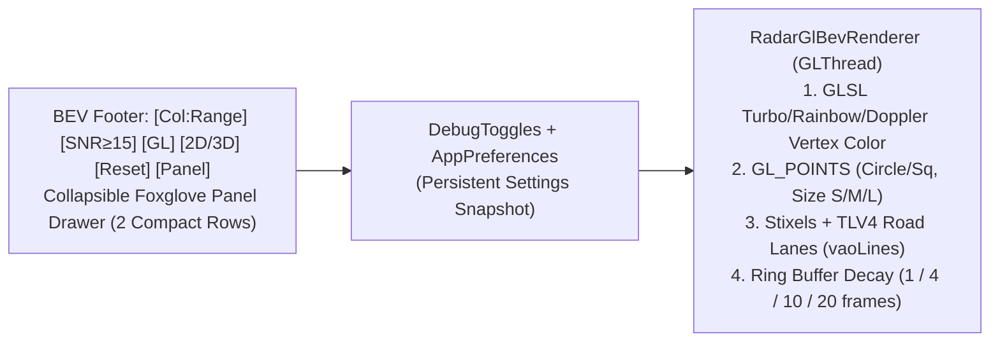

# Implementation Plan: Foxglove-Style 3D Panel Settings, GL Headroom Overlays & Tier C Documentation

> **Document ID:** `Plan 116` (`intel/Implementations/06_UI_AND_PERFORMANCE/116_plan_foxglove_3d_panel_settings.md`)  
> **Builds On:** `Plan 115` (Tier C OpenGL ES 3.0 2D & 3D BEV Renderer, `P95 = 1.09–1.82 ms` on `Mali-G52 MC2`)  
> **Foxglove Reference:** `D:\ARAS\Foxglove_SRC\foxglove-opensource\packages\studio-base\src\panels\ThreeDeeRender\renderables\` (`PointClouds.ts`, `pointExtensionUtils.ts`, `colorMode.ts`)

---

## 1. Goal Description

Now that the Radar BEV plot runs on a decoupled **OpenGL ES 3.0** `GLSurfaceView` taking only **`~1.1–1.8 ms` GPU time** per frame (`> 9×` below the `16.67 ms` VSync ceiling), we have substantial GPU/CPU headroom to bring Foxglove Studio's rich **3D Panel Inspector Controls** and **radar perception overlays** directly onto the smartphone cockpit — without touching Skia/Compose hot paths (`0` Compose 20 Hz invalidations preserved).

In parallel, this plan includes **complete architectural documentation** of the Tier C GLES 3.0 2D/3D subsystem across RoadSense's knowledge base (`Bug #38`), `context/` guides, and walkthrough mirrors.

---

## 2. User Review Required

> [!IMPORTANT]
> **Bottom Bar Button Mapping (`Moving` → `Color` Cycling Pill):**  
> As requested, we propose mapping the leftmost footer button slot (previously `Moving`) on [RadarBevPlot.kt](file:///c:/Users/rakadu1.AHEAD/AndroidStudioProjects/RoadSense/app/src/main/java/com/bajajauto/roadsense/ui/components/RadarBevPlot.kt#L365-L518) to a **1-tap Point Color Scheme cycler**:
> - Cycles cleanly through Foxglove-style color modes: **`Col:Vel`** (Doppler Velocity) → **`Col:Rng`** (Longitudinal Range) → **`Col:SNR`** (Signal-to-Noise dB) → **`Col:Z`** (Height Elevation) → **`Col:Clst`** (Hardware Cluster ID).
> - Moving-only (`dynamicOnly`) remains 1 tap away inside a sleek expandable **3D/GL Panel Settings drawer** (replacing or consolidating with `Bench` so the footer stays uncluttered with `5–6` equal-width pills!).

> [!NOTE]
> **All 3D Overlays Reuse Existing Decoded TLVs (`0` UART/Decoder Overhead):**  
> Every new visualization below (SNR, Elevation Z, Cluster ID, Vertical Stixels, Decay Trails, `TLV 4` Road Boundaries, Outlier/Deadzone highlights) uses fields **already decoded** inside [RadarFrame.kt](file:///c:/Users/rakadu1.AHEAD/AndroidStudioProjects/RoadSense/app/src/main/java/com/bajajauto/roadsense/models/RadarFrame.kt) (`RadarPoint`, `RadarCluster`, `RadarTrack`, `RadarTrackerDiagnostics`), with colormaps (`Turbo`, `Rainbow`, `Doppler`) evaluated directly inside the OpenGL ES 3.0 **vertex shader**.

### Open Questions for Your Approval

1. **Bottom Bar `Bench` vs `3D Settings` Consolidation:**  
   Right now the footer shows `[Color: ...]` | `[SNR≥15]` | `[GL/Skia]` | `[2D/3D]` | `[Reset]` | `[Bench]`.  
   Should tapping **`Bench` → renamed to `Panel`** (or keeping `Bench` with 2 compact rows inside its collapsible tray: Row 1 = **Foxglove 3D Settings** (`Moving`, `Map:Turbo/Rnbw`, `Stixels`, `Decay:0..1s`, `Size:S/M/L`, `Circle/Sq`), Row 2 = **Scene Layers & Debug** (`Pts`, `Trk`, `Clst`, `Lanes`, `Grid`, `Outliers`, `Log`)) house both? *(Recommended — keeps the always-visible bar at `≤ 6` equal-width buttons while giving rich Foxglove-style live tuning on tap.)*
2. **Default Color Schemes When Switching 2D ↔ 3D:**  
   - **Recommended:** Allow separate defaults or auto-follow: if user leaves color mode on `Auto`, 2D uses `Vel` (Doppler) and 3D uses `Range` (longitudinal depth) as today — **or** once the user taps the **`Col:...`** button, their chosen explicit color scheme (`SNR`, `Range`, `Vel`, `Elev Z`, `Cluster ID`) applies immediately in **both 2D and 3D**!
3. **Priority of Performance-Headroom Additions (Select Any/All):**  
   Below are all Foxglove + ADAS additions enabled by our GL headroom. Please confirm which you want included right now:
   - **A. Foxglove Point Color Schemes + Colormaps:** `Velocity`, `Range`, `SNR (5–35 dB)`, `Elevation Z (-1..+5 m)`, `Cluster ID`, with `Turbo` (Foxglove default!) & `Rainbow` GLSL shader colormaps + `Circle` / `Square` shape & `S / M / L` point size presets.
   - **B. Foxglove Stixels (`GL_LINES` `< 0.12 ms` GPU):** Vertical drop-lines connecting every 3D point `(x, y, z)` down to its ground shadow `(x, y, 0)` — makes target height & road vs. overhead clutter effortless to read in 3D.
   - **C. Configurable Decay Trails (`decayTime`):** Selectable `OFF (1f)` / `0.2s (4f)` / `0.5s (10f)` / `1.0s (20f)` fading ring-buffer persistence.
   - **D. `TLV 4` Road Boundaries + Ego Corridor Overlay:** Renders firmware `roadBoundaryLeftX` & `roadBoundaryRightX` lines + `±4.5 m` FCW corridor guide rails directly on the `z = 0` ground plane, plus an optional mini EKF Speed / Motion-State badge in the plot corner.
   - **E. Hardware Outlier / Deadzone Filtering & Highlighting (`TLV 1/2`):** Toggle to hide or dim `pt.isOutlier` reflections (clean road-vehicle point cloud vs raw noisy clutter).
   - **F. 3D Quick Camera Angle Presets (`Chase 20°`, `Iso 42°`, `Top 80°`, `Bumper 5°`):** 1-tap viewpoints inside the Panel drawer in addition to free finger orbit/pan/pinch.

---

## 3. Architecture & Technical Design

### 3.1 Foxglove Point Cloud Shader Upgrade (`POINT_VERTEX_SHADER`)

We generalize [BevGlShaders.kt](file:///c:/Users/rakadu1.AHEAD/AndroidStudioProjects/RoadSense/app/src/main/java/com/bajajauto/roadsense/ui/components/gl/BevGlShaders.kt) so **all** Foxglove color schemes evaluate directly on GPU at **0 CPU cost per point**:

- Per-point vertex attribute layout (`POINT_FLOATS = 5`, `20 B/pt`):  
  `x, y, z, normVal, trailAlpha` — keeps VBO memory at `20 KB` per 1,000 points while supporting every scheme:
  - `VELOCITY`: `aMeta.x` encodes `-1 / 0 / +1` (or normalized Doppler `[-15..+15 m/s]` for continuous Turbo/Rainbow velocity!)
  - `RANGE`: `aMeta.x = clamp(y / maxRangeMeters, 0, 1)`
  - `SNR`: `aMeta.x = clamp((snrDb - 5.0) / 30.0, 0, 1)` (`5 dB → 35 dB`)
  - `ELEVATION_Z`: `aMeta.x = clamp((z + 1.0) / 6.0, 0, 1)` (`-1 m → +5 m`)
  - `CLUSTER_ID`: `aMeta.x = (clusterId == 0) ? -1.0 : float((clusterId * 37) % 12) / 12.0` (categorical high-contrast hues; unclustered points subtle dim slate).
- **Exact Foxglove `turbo()` Polynomial GLSL Function** (ported from Foxglove `colorMode.ts#L135-L155`) + **`rainbow()`** + **`uPointShape` (`0 = circle`, `1 = rounded square`)**:
  ```glsl
  vec3 foxgloveTurbo(float pct) {
      float x = clamp(pct, 0.0, 1.0) * 0.99 + 0.01;
      vec4 v4 = vec4(1.0, x, x * x, x * x * x);
      vec2 v2 = vec2(v4.z, v4.w) * v4.z;
      float r = clamp(dot(v4, vec4(0.13572138, 4.6153926, -42.66032258, 132.13108234)) + dot(v2, vec2(-152.94239396, 59.28637943)), 0.0, 1.0);
      float g = clamp(dot(v4, vec4(0.09140261, 2.19418839,   4.84296658, -14.18503333)) + dot(v2, vec2(   4.27729857,  2.82956604)), 0.0, 1.0);
      float b = clamp(dot(v4, vec4(0.10667330, 12.64194608, -60.58204836, 110.36276771)) + dot(v2, vec2( -89.90310912, 27.34824973)), 0.0, 1.0);
      return vec3(r, g, b);
  }
  ```
- **Legend Dynamic Sync:** Top-left floating legend in `RadarBevPlot.kt` dynamically adapts its bottom row to the active scheme (e.g., `● 5dB  ● 20dB  ● 35+dB`, `● -1m  ● +1m  ● +5m`, `● Clst  ● Free`, `● Appr  ● Rec`, `● 0m  ● Mid  ● 100m`).

### 3.2 Foxglove Stixels + `TLV 4` Road Boundaries (`GL_LINES` Pass — `0` Extra Draw Calls)

All 3D lines already render in Pass 4 (`vaoLines`, `LINES_VERTEX_FLOATS = 7`: `x, y, z, r, g, b, a`):
1. **Stixels (when `bevStixelsEnabled && is3dActive`):** For each packed 3D point `(x, y, z)` with `|z| >= 0.15 m`, emit 1 vertical segment `(x, y, 0.04f) → (x, y, z)` using a muted (`0.38` alpha) version of the point's color! Cost: ~200 extra vertices = **`< 0.08 ms`** on Mali-G52.
2. **`TLV 4` Road Boundaries & FCW Corridor (when `bevShowRoadLanes`):** Reads `frame.diagnostics?.roadBoundaryLeftX` and `roadBoundaryRightX` (clamped/validated if non-zero & finite `[-25..-1]` / `[1..25] m`) and draws crisp cyan-slate boundary rails (`y = 0..maxRangeMeters`) + subtle `±4.5 m` corridor dashes along the ground plane (`z = 0.05 m` in 3D, or projected lines in 2D solid pass).

### 3.3 Dynamic Shader & Settings Plumbing



---

## 4. Proposed File Changes

### 4.1 Settings Model, Persistence & ViewModel

#### [NEW] `app/src/main/java/com/bajajauto/roadsense/ui/components/gl/BevPanelSettings.kt`
- Pure-Kotlin enums & constants for Foxglove-style BEV panel settings:
  - `enum class BevPointColorMode(val shortLabel: String, val displayLabel: String)`:
    `AUTO("Auto", "Auto (2D:Vel / 3D:Rng)")`, `VELOCITY("Vel", "Velocity")`, `RANGE("Rng", "Range")`, `SNR("SNR", "SNR dB")`, `ELEVATION_Z("Elev", "Height Z")`, `CLUSTER_ID("Clst", "Cluster ID")`
  - `enum class BevColorMap(val label: String)`: `TURBO("Turbo")`, `RAINBOW("Rainbow")`, `CLASSIC("Classic")`
  - `enum class BevPointShape(val label: String)`: `CIRCLE("Circle")`, `SQUARE("Square")`
  - `enum class BevPointSizePreset(val label: String, val size2DPx: Float, val size3DBasePx: Float)`: `SMALL("S", 6.5f, 7.0f)`, `MEDIUM("M", 9.2f, 9.8f)`, `LARGE("L", 13.0f, 13.8f)`
  - `enum class BevDecayPreset(val label: String, val frameCount: Int)`: `OFF("Off", 1)`, `SHORT("0.2s", 4)`, `MEDIUM("0.5s", 10)`, `LONG("1.0s", 20)`
  - `enum class BevCameraPreset(val label: String, val yawDeg: Float, val pitchDeg: Float, val orbitDistScale: Float)`: `CHASE("Chase", 0f, 20f, 0.45f)`, `ISO("Iso", -28f, 38f, 0.58f)`, `TOP("Top", 0f, 80f, 0.72f)`, `BUMPER("Low", 0f, 6f, 0.25f)`

#### [MODIFY] [DebugToggles.kt](file:///c:/Users/rakadu1.AHEAD/AndroidStudioProjects/RoadSense/app/src/main/java/com/bajajauto/roadsense/DebugToggles.kt) & [AppPreferences.kt](file:///c:/Users/rakadu1.AHEAD/AndroidStudioProjects/RoadSense/app/src/main/java/com/bajajauto/roadsense/storage/AppPreferences.kt) & [RadarViewModel.kt](file:///c:/Users/rakadu1.AHEAD/AndroidStudioProjects/RoadSense/app/src/main/java/com/bajajauto/roadsense/ui/RadarViewModel.kt)
- Persist and publish `bevPointColorMode`, `bevColorMap`, `bevPointShape`, `bevPointSizePreset`, `bevDecayPreset`, `bevStixelsEnabled`, `bevShowRoadLanes`, and `bevHideOutliers`.
- Add camera preset application trigger (`bevCameraPresetRequest`) so 1-tap `Chase` / `Iso` / `Top` / `Low` snaps `BevCameraController` cleanly in 3D mode.

---

### 4.2 Camera Controller, Shaders, Vertex Packer & Renderer

#### [MODIFY] [BevCameraController.kt](file:///c:/Users/rakadu1.AHEAD/AndroidStudioProjects/RoadSense/app/src/main/java/com/bajajauto/roadsense/ui/components/gl/BevCameraController.kt)
- Add `fun applyPreset(preset: BevCameraPreset): BevCameraState` (sets `is3D = true`, `yaw3DDeg`, `pitch3DDeg`, `orbitDistScale`, clears lateral/longitudinal pan offsets).

#### [MODIFY] [BevGlShaders.kt](file:///c:/Users/rakadu1.AHEAD/AndroidStudioProjects/RoadSense/app/src/main/java/com/bajajauto/roadsense/ui/components/gl/BevGlShaders.kt)
- Update `POINT_VERTEX_SHADER` & `POINT_FRAGMENT_SHADER` with:
  - `foxgloveTurbo(float)` & `foxgloveRainbow(float)` GLSL functions,
  - `uniform int uColorScheme` (`0 = Doppler`, `1 = Longitudinal Classic`, `2 = Scalar Turbo`, `3 = Scalar Rainbow`, `4 = Cluster Categorical Palette`),
  - `uniform int uPointShape` (`0 = Circle AA`, `1 = Rounded Square AA`).

#### [MODIFY] [BevGlVertexPacker.kt](file:///c:/Users/rakadu1.AHEAD/AndroidStudioProjects/RoadSense/app/src/main/java/com/bajajauto/roadsense/ui/components/gl/BevGlVertexPacker.kt)
- Expand ring buffer capacity dynamically up to `20` frames (`BevDecayPreset.LONG`) with zero steady-state allocations.
- Filter `pt.isOutlier` cleanly when `hideOutliers = true`.
- Encode scalar `aMeta.x` per `BevPointColorMode` (`VELOCITY`, `RANGE`, `SNR`, `ELEVATION_Z`, `CLUSTER_ID`).
- Emit **3D Vertical Stixels** into `linesPool` when `stixelsEnabled = true` (`(pt.x, pt.y, 0.04f) → (pt.x, pt.y, pt.z)` using point's RGB at `0.38f` alpha).
- Emit **`TLV 4` Road Boundaries (`roadBoundaryLeftX` / `roadBoundaryRightX`) & Ego FCW Corridor** in 3D (`linesPool`) and 2D (`solidPool` thin segments).

#### [MODIFY] [RadarGlBevRenderer.kt](file:///c:/Users/rakadu1.AHEAD/AndroidStudioProjects/RoadSense/app/src/main/java/com/bajajauto/roadsense/ui/components/gl/RadarGlBevRenderer.kt) & [RadarGlBevView.kt](file:///c:/Users/rakadu1.AHEAD/AndroidStudioProjects/RoadSense/app/src/main/java/com/bajajauto/roadsense/ui/components/gl/RadarGlBevView.kt)
- Wire new `BevRenderConfig` uniforms (`uColorScheme`, `uPointShape`, `uPointSizePx`) and `LaunchedEffect(cameraPresetEvent)` inside `RadarGlBevView`.

---

### 4.3 Cockpit & Fullscreen SBS UI Controls

#### [MODIFY] [RadarBevPlot.kt](file:///c:/Users/rakadu1.AHEAD/AndroidStudioProjects/RoadSense/app/src/main/java/com/bajajauto/roadsense/ui/components/RadarBevPlot.kt)
- Replace `"Moving"` in the primary bottom footer bar with **`Col:<mode>`** (`Col:Vel`, `Col:Rng`, `Col:SNR`, `Col:Elev`, `Col:Clst`) that cycles color schemes with a single tap (`Skia` fallback still renders `"Moving"` cleanly if GL is off).
- Expand the collapsible tray (`Panel` / `Bench`) into 2 compact equal-width rows when GL is active:
  - **Row 1 (Foxglove 3D/Point Controls):** `Moving` | `Map:Turbo/Rnbw` | `Pt:S/M/L` | `Shape:●/■` | `Stixels` | `Decay:0/0.2/0.5/1s`
  - **Row 2 (Layers & 3D Camera):** `Pts` | `Trk` | `Clst` | `Lanes` | `Grid` | `Cam:Chase/Iso/Top` | `Log`
- Sync the top-left compact floating legend to reflect the active `BevPointColorMode` & `BevColorMap`.

#### [MODIFY] [FullscreenSbsPreview.kt](file:///c:/Users/rakadu1.AHEAD/AndroidStudioProjects/RoadSense/app/src/main/java/com/bajajauto/roadsense/ui/components/FullscreenSbsPreview.kt)
- Add `Color`, `Stixels`, and `Decay` chips to the expandable Quick Settings drawer in Fullscreen SBS.

---

### 4.4 Comprehensive Tier C & 3D Engineering Documentation

#### [MODIFY] [debugging_and_troubleshooting_knowledge_base.md](file:///c:/Users/rakadu1.AHEAD/AndroidStudioProjects/RoadSense/intel/debugging_and_troubleshooting_knowledge_base.md)
- Document **Bug #38: Tier C Native OpenGL ES 3.0 2D/3D BEV Renderer, Foxglove-Style Controls & Critical Z-Order / Semi-Axis / Frustum Fixes**, plus **Engineering Rules 44–47** (HWC MediaOverlay dual-SurfaceView Z-order, semi-axis vs full-dimension TLV 3 convention, unclamped 3D elevation + frustum pitch/FOV budget, GLSL Foxglove Turbo vertex colormaps).

#### [MODIFY] [00_MASTER_EXECUTIVE_HANDOVER.md](file:///c:/Users/rakadu1.AHEAD/AndroidStudioProjects/RoadSense/context/00_MASTER_EXECUTIVE_HANDOVER.md) & [01_ARCHITECTURE_AND_STORAGE.md](file:///c:/Users/rakadu1.AHEAD/AndroidStudioProjects/RoadSense/context/01_ARCHITECTURE_AND_STORAGE.md) & [07_ENVIRONMENT_PITFALLS_AND_RUNBOOK.md](file:///c:/Users/rakadu1.AHEAD/AndroidStudioProjects/RoadSense/context/07_ENVIRONMENT_PITFALLS_AND_RUNBOOK.md)
- Add `ui/components/gl/` to the package architecture map, document `profile_ui_perf.py` + `GL / Skia` / `2D / 3D` runtime toggles, and update milestone status tables.

---

## 5. Verification Plan

### 5.1 Automated Tests
1. **`BevPanelSettingsTest.kt` [NEW] & `BevGlVertexPackerTest.kt` [MODIFY]**
   - Verify scalar normalization for `SNR` (`5..35 dB`), `ELEVATION_Z` (`-1..+5 m`), `RANGE` (`0..maxRange`), `CLUSTER_ID`, and `VELOCITY`.
   - Verify 3D Stixel line emission count (`2` line vertices per point with `|z| >= 0.15 m`), `TLV 4` road boundary line emission, `hideOutliers` filtering, and `20`-frame `LONG` decay ring buffer wrapping with zero overflow.
2. **`BevCameraControllerTest.kt` [MODIFY] & `DebugTogglesTest.kt` [MODIFY]**
   - Verify `applyPreset` (`Chase`, `Iso`, `Top`, `Bumper`) and reactive persistence of all new panel settings.
3. **Full Android Build + JVM Unit Tests + Python Profiler Tests:**
   ```powershell
   $env:JAVA_HOME = "C:\Users\rakadu1.AHEAD\Android_Studio\android-studio-quail4-windows\android-studio\jbr"
   ./gradlew assembleDebug testDebugUnitTest --no-daemon "-Dorg.gradle.java.home=$env:JAVA_HOME"
   python -m unittest discover -s scripts/tests -p "test_profile_ui_perf.py" -v
   ```

### 5.2 Manual On-Device Verification (`SM-M325F`)
1. Tap the bottom-left **`Col:...`** pill to cycle `Vel` → `Rng` → `SNR` → `Elev` → `Clst` and verify live point recoloring + top-left legend update in both 2D and 3D modes.
2. Open the **`Panel`** drawer and toggle `Stixels ON`, `Decay 0.5s`, `Map:Turbo/Rainbow`, `Pt:L`, `Shape:■`, `Lanes ON`, and `Cam:Iso` → verify crisp 3D depth perception and equal button alignment in both `Radar` and `SBS` tabs.
3. Run 30 s `python .\scripts\profile_ui_perf.py --duration 30 --label radar_tierC_3d_foxglove_debug` in 3D mode with `Stixels ON` + `0.5s Decay` and verify `GL_BEV_5S P95 ≤ 2.5 ms` at `20+ FPS`.
