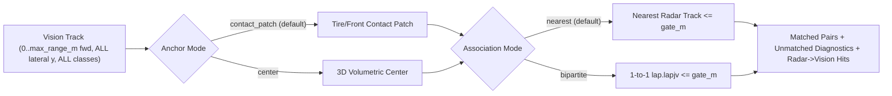

# Implementation Plan: Vision-vs-Radar Benchmarking Methodology & Pitch Back-Calculation Fix

## Goal Description

Fix the systematic methodological flaws in the RoadSense Vision-vs-Radar evaluation pipeline ([tools/vision/eval/](file:///c:/Users/rakadu1.AHEAD/AndroidStudioProjects/RoadSense/tools/vision/eval/)) and integrate an automated **session-wide pitch back-calculation & re-benchmarking solver** ([dynamic_pitch_solver.py](file:///c:/Users/rakadu1.AHEAD/AndroidStudioProjects/RoadSense/tools/vision/geometry/dynamic_pitch_solver.py)).

> [!NOTE]
> **Audit of Existing Pitch Regression Scripts:** We searched `tools/`, `scripts/`, and `intel/Implementations/`. While [60_plan_dynamic_pitch_auto_calibration.md](file:///c:/Users/rakadu1.AHEAD/AndroidStudioProjects/RoadSense/intel/Implementations/03_IMU_AND_KINEMATICS/60_plan_dynamic_pitch_auto_calibration.md) originally proposed `analyze_track_pitch_dynamics.py` (Phase 2) and `dynamic_pitch_solver.py` (Phase 3), only Phase 1 ([box_dimensions.py](file:///c:/Users/rakadu1.AHEAD/AndroidStudioProjects/RoadSense/tools/vision/geometry/box_dimensions.py) cuboid center offset) was ever implemented. No pitch regression script currently exists in the repository, so this plan implements `dynamic_pitch_solver.py` and wires it directly into [evaluate_vision_vs_radar.py](file:///c:/Users/rakadu1.AHEAD/AndroidStudioProjects/RoadSense/tools/vision/eval/evaluate_vision_vs_radar.py).

### Finalized Design Decisions
1. **Tunable Forward Scope (`<= 50.0 m` default) & Zero Lateral Filtering:** Top-level benchmark metrics (`summary.matched_count`, `summary.total_vision_tracks`, `summary.match_rate_pct`, `summary.overall`) evaluate all vision detections in front of the vehicle up to `max_range_m` (`50.0 m` default, tunable via CLI `--max-range` and the Web Dashboard), with **zero lateral filtering** (`y_left` completely unfiltered). Detections past `max_range_m` are still tracked separately in `summary.all_ranges` and multi-band range bins (`50_75m`, `75m_plus`) to expose correlation falloff beyond `50 m`.
2. **All Classes Included by Default:** Both the benchmark evaluation and the session-wide pitch back-calculation solver use **all target classes** (`car`, `truck`, `bus`, `motorcycle`, `bicycle`, `person`) by default, with `--exclude-classes` available as an optional tuning flag.
3. **Front Contact Patch Anchor (`contact_patch` default):** Match vision's front/tire ground contact point (`contact_patch`) against radar tracks / cluster centroids rather than `position_3d` volumetric centers (`+length/2` inside the vehicle), while keeping `position_3d` selectable as a tunable option.
4. **Nearest-Radius Existence Check (`nearest` default):** Check whether *any* correlating radar track exists within `max_gate_m` (`3.5 m` default) instead of rejecting valid neighbors via strict 1-to-1 `lapjv`, while keeping `bipartite` selectable for 1-to-1 localization studies.
5. **Backward-Compatible Enriched JSON Schema:** Preserve all legacy keys (`session_name`, `evaluation_timestamp`, `summary.matched_count`, `summary.total_vision_tracks`, `summary.total_radar_tracks`, `summary.match_rate_pct`, `summary.overall`, `summary.range_bins`, `matched_pairs`) while adding `summary.all_ranges`, `summary.extended_range_bins`, `summary.by_class`, `summary.radar_to_vision`, `summary.unmatched_breakdown`, `summary.pitch_calibration_analysis`, and `summary.ideal_pitch_benchmark`.
6. **Session-Wide Pitch Back-Calculation & Re-Evaluation:** Using `bbox_2d` already saved in `*_vision_tracks.json`, back-calculate the ideal camera pitch $\theta^*$ across the full session, report the pitch error $\Delta\theta = \theta^* - \theta_{\text{calib}}$, and automatically run a second benchmark pass at $\theta^*$ to display both **configured-pitch** and **ideal-pitch** results.

---

## User Review Required

> [!IMPORTANT]
> All open questions from the previous draft have been resolved per your feedback (`<= 50.0 m` tunable forward scope at top level, zero lateral filtering, all classes included by default, `contact_patch` default with tunable Web Dashboard controls, strict JSON backward compatibility, and integrated pitch solver + re-benchmark pass). Ready for execution upon approval.

---

## Proposed Changes

### Component 1: Spatio-Temporal Associator ([tools/vision/eval/spatial_associator.py](file:///c:/Users/rakadu1.AHEAD/AndroidStudioProjects/RoadSense/tools/vision/eval/spatial_associator.py))



#### [MODIFY] [spatial_associator.py](file:///c:/Users/rakadu1.AHEAD/AndroidStudioProjects/RoadSense/tools/vision/eval/spatial_associator.py)
* Add `anchor_mode: str = "contact_patch"` (`"contact_patch"` or `"position_3d"`) and `association_mode: str = "nearest"` (`"nearest"` or `"bipartite"`).
* Extract vision `(x_fwd_m, y_left_m)` via `_get_vision_xy(vt, anchor_mode)` reading `vt["contact_patch"]` first when `anchor_mode == "contact_patch"` (with safe fallback to `vt["position_3d"]` if missing).
* Implement `"nearest"` mode: for each vision track, find the closest radar track in 2D ground Euclidean distance; match if `min_dist <= max_gate_m`.
* Keep `"bipartite"` (`lap.lapjv`) selectable, and in both modes record `lost_in_bipartite_1to1` diagnostics and reverse `radar_matched_flags` (`Radar → Vision` hits within `max_gate_m`) in the same pass.

---

### Component 2: Error & Coverage Metrics Calculator ([tools/vision/eval/error_metrics.py](file:///c:/Users/rakadu1.AHEAD/AndroidStudioProjects/RoadSense/tools/vision/eval/error_metrics.py))

#### [MODIFY] [error_metrics.py](file:///c:/Users/rakadu1.AHEAD/AndroidStudioProjects/RoadSense/tools/vision/eval/error_metrics.py)
* Preserve all legacy return keys (`matched_count`, `total_vision_tracks`, `total_radar_tracks`, `match_rate_pct`, `overall`, `range_bins`) for backward compatibility, scoped to the configured `max_range_m` (`<= 50.0 m` by default, zero lateral filtering).
* Compute true **per-bin match rates** across:
  * Legacy `range_bins` keys (`near_0_15m`, `mid_15_30m`, `far_above_30m`) enriched with `vision_count`, `match_rate_pct`, `mean_signed_fwd_m`, and `left_mae_m`.
  * Finer `extended_range_bins` (`0_15m`, `15_30m`, `30_50m`, `50_75m`, `75m_plus`) computed across **all ranges** so camera falloff past `50 m` is explicitly visible even when top-level `max_range_m` is set to `50.0 m`.
* Add **`all_ranges`** summary block (unbounded `0–∞ m` totals & match rate) alongside the primary `max_range_m`-scoped top-level summary.
* Add **`by_class`** stats (`vision_count`, `matched_count`, `match_rate_pct`, `mean_signed_fwd_m`, `fwd_mae_m`, `left_mae_m`) across `car`, `truck`, `bus`, `motorcycle`, `bicycle`, `person`.
* Add **`radar_to_vision`** precision summary (`evaluated_radar_tracks`, `matched_radar_tracks`, `match_rate_pct`, `empty_radar_frames`, `behind_bumper_tracks_le_0m`) and **`unmatched_breakdown`** (`no_radar_tracks_in_frame`, `lost_in_bipartite_1to1`, `near_miss_gate_to_6m`, `miss_6_to_10m`, `far_gt_10m`).

---

### Component 3: Dynamic Pitch Back-Calculation Solver ([tools/vision/geometry/dynamic_pitch_solver.py](file:///c:/Users/rakadu1.AHEAD/AndroidStudioProjects/RoadSense/tools/vision/geometry/dynamic_pitch_solver.py))

> [!WARNING]
> **Clutter-Collapse Guard (Verified on `session_20261120_112453`):** A naive solver that maximizes raw match count over pitch $\theta$ over-tilts downward (`> 7.5°`), squashing far vehicles into dense `0–10 m` radar clutter and worsening `mean_dist` (`2.11 m` vs `1.75 m`). Using Huber-weighted Euclidean residual + range-bias zeroing on `session_20261120_112453` (`5.23°` configured) cleanly finds the true geometric minimum around `~4.0°–4.2°` (`med_dist = 1.624 m`, `med_bias ≈ 0 m`).

#### [NEW] [dynamic_pitch_solver.py](file:///c:/Users/rakadu1.AHEAD/AndroidStudioProjects/RoadSense/tools/vision/geometry/dynamic_pitch_solver.py)
* **Vectorized Re-Projection (`GroundPlaneProjector` math in NumPy):** Re-projects `(cx, bottom_y)` from `bbox_2d` stored in `*_vision_tracks.json` using session `camera_extrinsics` / `radar_camera_calib.json` across candidate pitch angles in milliseconds — **no YOLO re-inference required**.
* **All-Class Robust Pitch Optimization (`<= max_range_m`, zero lateral filter):**
  1. **Coarse Grid + Fine Brent/Golden Refinement** over $\theta \in [\theta_{\text{calib}} - 3.5^\circ, \theta_{\text{calib}} + 3.5^\circ]$.
  2. **Huber-Loss + Range-Slope Objective:** Associates re-projected vision detections (`0 < x_fwd <= max_range_m`, all lateral positions, all classes by default) with radar tracks within `5.0 m` and minimizes **Huber-weighted 2D Euclidean residual + longitudinal bias slope penalty** across `5–40 m`, preventing false downward over-tilting into `0–10 m` clutter.
  3. **Closed-Form Per-Pair Sanity Stats:** Reports `configured_pitch_deg`, `ideal_pitch_deg`, `pitch_error_deg` (`ideal - configured`), and inlier pair count / median residual improvement.
* **Re-Projection Helper:** Exposes `reproject_vision_frames(vision_frames, extrinsics, intrinsics, target_pitch_deg)` to produce re-projected vision tracks at $\theta^*$ for the second benchmark pass.

---

### Component 4: CLI Evaluation Runner & Ideal-Pitch Re-Benchmarking ([tools/vision/eval/evaluate_vision_vs_radar.py](file:///c:/Users/rakadu1.AHEAD/AndroidStudioProjects/RoadSense/tools/vision/eval/evaluate_vision_vs_radar.py))

#### [MODIFY] [evaluate_vision_vs_radar.py](file:///c:/Users/rakadu1.AHEAD/AndroidStudioProjects/RoadSense/tools/vision/eval/evaluate_vision_vs_radar.py)
* **Fix `load_radar_tracks_from_mcap()`:** Parse real hardware `track_id` (`ID #<tid>`) and `vx_fwd_mps` from `entity.texts[idx].text` via regex instead of `idx + 1`.
* **New CLI Flags (tunable & backward-compatible):**
  * `-g / --gate_m` (`float`, default `3.5`)
  * `--max-range` (`float`, default `50.0`; pass `0` for unlimited forward range; **no lateral filtering**)
  * `--anchor` (`contact_patch` | `center`, default `contact_patch`)
  * `--assoc-mode` (`nearest` | `bipartite`, default `nearest`)
  * `--exclude-classes` (optional, e.g. `person`; empty by default so **all classes** are evaluated)
  * `--min-conf` (`float`, default `0.0`)
  * `--solve-pitch` / `--no-solve-pitch` (default `--solve-pitch` enabled)
* **Dual Benchmark Pass & Terminal Summary:**
  1. Runs benchmark at configured `pitchDeg` (reports `0–50 m` primary metrics + `extended_range_bins` beyond `50 m`, `by_class`, `radar_to_vision`, `unmatched_breakdown`).
  2. Runs `dynamic_pitch_solver` across the full session, prints `"Configured pitch X° vs Ideal pitch Y° (off by Δ°)"`, and re-runs the full benchmark using `ideal_pitch_deg`, exporting both in `*_benchmark_report.json` (`summary.pitch_calibration_analysis` and `summary.ideal_pitch_benchmark`).

---

### Component 5: Web Dashboard Tunable Config ([tools/web_dashboard/index.html](file:///c:/Users/rakadu1.AHEAD/AndroidStudioProjects/RoadSense/tools/web_dashboard/index.html))

#### [MODIFY] [index.html](file:///c:/Users/rakadu1.AHEAD/AndroidStudioProjects/RoadSense/tools/web_dashboard/index.html)
* Extend the Vision Benchmark card (lines `958–980`) and `runVisionBenchmark()` (lines `1929–1942`) with clean tunable controls:
  * **Distance Gate (`-g`):** numeric input (default `3.5 m`)
  * **Max Forward Range (`--max-range`):** numeric/select input (default `50 m`, tunable to `30 m`, `75 m`, `100 m`, or `0` for All)
  * **Vision Anchor (`--anchor`):** selector (`Contact Patch (Default)`, `3D Box Center`)
  * **Matching Mode (`--assoc-mode`):** selector (`Nearest Radius (Default)`, `1-to-1 Hungarian`)
  * **Exclude Pedestrians (`--exclude-classes person`):** checkbox (unchecked by default)
  * **Back-Calculate Ideal Pitch (`--solve-pitch`):** checkbox (checked by default)

---

### Component 6: Automated Unit Tests ([tools/vision/tests/test_vision_eval.py](file:///c:/Users/rakadu1.AHEAD/AndroidStudioProjects/RoadSense/tools/vision/tests/test_vision_eval.py))

#### [NEW] [test_vision_eval.py](file:///c:/Users/rakadu1.AHEAD/AndroidStudioProjects/RoadSense/tools/vision/tests/test_vision_eval.py)
* `test_contact_patch_vs_center_anchor`: Verify `contact_patch` matches a radar bumper reflection (`truck` at `10.2 m` vs `10.0 m`) while `position_3d` (`14.45 m`) exceeds `3.5 m`.
* `test_nearest_radius_vs_bipartite`: Verify two nearby vision detections within `3.5 m` of one radar track both match under `nearest`, while `bipartite` flags `lost_in_bipartite_1to1`.
* `test_no_lateral_filtering_and_max_range_cutoff`: Verify wide lateral detections (`|y_left| = 12.0 m`) within `50.0 m` forward are retained in primary metrics, while `x_fwd > 50.0 m` go into `50_75m` / `75m_plus` and `all_ranges` without polluting `0–50 m`.
* `test_backward_compatible_summary_keys`: Verify legacy keys (`matched_count`, `total_vision_tracks`, `total_radar_tracks`, `match_rate_pct`, `overall`, `range_bins`) remain present and valid.
* `test_parse_radar_label_extracts_id_and_speed`: Verify `ID #42 | -2.5 m/s` parses `track_id=42` and `vx_fwd_mps=-2.5`.
* `test_dynamic_pitch_solver_recovers_injected_pitch_error`: Generate synthetic ground-truth tracks across all classes at `pitch = 4.0°`, shift configured `pitch = 5.5°`, and verify `dynamic_pitch_solver` recovers `~4.0°` (within `0.15°`) even with dense `0–8 m` radar clutter present.

---

## Verification Plan

### Automated Tests
```powershell
C:\ProgramData\miniconda3\envs\cv313\python.exe -m unittest discover -s tools/vision/tests -v
```

### Session Verification
1. Run the upgraded benchmark on `logs/session_20261120_112453`:
   ```powershell
   C:\ProgramData\miniconda3\envs\cv313\python.exe tools/vision/eval/evaluate_vision_vs_radar.py logs/session_20261120_112453
   ```
   Verify:
   * Backward-compatible JSON schema loads cleanly and preserves all legacy keys.
   * Top-level `match_rate_pct` reflects `0–50 m` across all classes and all lateral positions, while `extended_range_bins` (`0–15`, `15–30`, `30–50`, `50–75`, `>75 m`) exposes correlation falloff beyond `50 m`.
   * Pitch solver identifies the `~1.1°` pitch offset on `session_20261120_112453` (`5.23°` configured vs `~4.1°` ideal) without collapsing into `0–10 m` clutter, and prints + saves the ideal-pitch re-benchmark summary.
2. Verify Web Dashboard UI card renders cleanly without layout/reflow issues and passes the tuned `--max-range`, `--anchor`, `--assoc-mode`, `--exclude-classes`, and `--solve-pitch` flags to `evaluate_vision_vs_radar.py`.
