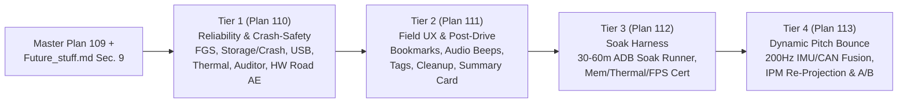

# Master Roadmap Plan (`109`): RoadSense Reliability, Field UX, Soak Certification & Dynamic Pitch Compensation

> **Document ID:** `109_plan_reliability_ux_soak_and_pitch_master_roadmap.md`  
> **Scope:** Broad-level, tier-gated master plan covering all selected high-ROI improvements across the Android app and PC validation stack, plus mirroring the full November 2026 audit backlog into `Future_stuff.md`.  
> **Execution Model:** **One Tier at a Time.** Upon approval of this Master Roadmap, we first update `Future_stuff.md` (Section 9) to persist the full audit backlog, and then create a dedicated, code-level **Individual Tier Detailed Plan** (`110_`, `111_`, `112_`, `113_`) before writing code for that tier.

---

## Goal Description

RoadSense's core acquisition, 60 FPS `SurfaceView` UI, CANedge2 ingestion, and MCAP/benchmark toolchains are now verified and stable (`43bedc3`). To transition from a rock-solid engineering logger into a **field-proof, crash-resilient ADAS test platform** capable of unattended 45-minute drives and dynamic pitch-compensated perception, we will execute four sequenced tiers:

1. **Tier 1 (`110_`):** Critical Reliability & Crash-Safety Shield (all 6 audit gaps)
2. **Tier 2 (`111_`):** Field UX, Bookmarks, Audio Alerts, Session Metadata, Cleanup & Post-Drive Summary Card
3. **Tier 3 (`112_`):** Automated Long-Duration Soak & Reliability Verification Harness
4. **Tier 4 (`113_`):** Dynamic Pitch Bounce & Road-Grade Compensation (Research Track)

---

## Architecture & Tier Dependency Flow

---

## Pre-Work (Executed Immediately Before Tier 1 Implementation)

### 0.1 Baseline Backup Snapshot & `Overhaul` Branch Isolation
- **APK Backup Snapshot:** Copy the verified `validation` build (`app/build/outputs/apk/debug/app-debug.apk`, `62.2 MB`, built `2026-11-20` after the final Nov 19 Android commit `04bcc1c`) to `APK versions/v1.0 (stable).apk` in the repository root as a permanent rollback archive.
- **Git Hygiene:** Add `APK versions/` to `.gitignore` (recommended so 62 MB APK binaries remain local backups without bloating Git object storage).
- **Branch Isolation:** Create and switch to a dedicated **`Overhaul`** branch (`git checkout -b Overhaul`) from `validation` so all Tier 1–4 reliability, UX, soak, and dynamic-pitch work develops cleanly without destabilizing `validation`.

### 0.2 Mirror Full November 2026 Audit Backlog into `Future_stuff.md`
#### [MODIFY] [Future_stuff.md](../../../Future_stuff.md)
Append **Section 9: System Reliability, Field UX, Capability & Research Audit Backlog (Nov 2026)** preserving the exact 4-category structure from our audit so both selected items (`[PLANNED — TIER 1..4]`) and deferred items (`[BACKLOG]`) remain tracked in one authoritative place:
- **9.1 Critical Reliability & Crash-Safety Gaps** (`[PLANNED — TIER 1]` — all 6 items)
- **9.2 UI/UX & Field Usability Improvements** (Items 1, 2, 4, 5 `[PLANNED — TIER 2]`; Item 3 Pre-Drive Mount-Slippage Canary `[BACKLOG]`)
- **9.3 Capability Additions** (Items 2 & 3 `[PLANNED — TIER 3 / TIER 2]`; Item 1 On-Device MF4 Quick-Peek `[BACKLOG]`)
- **9.4 Open ADAS & Perception Research Gaps** (Item 1 Dynamic Pitch Bounce `[PLANNED — TIER 4]`; Items 2–6 Rolling-Shutter Row Compensation, Targetless Multi-DOF Auto-Calibration, CLEAR MOT / HOTA, Cross-Axis 3×3 IMU Calibration, CANedge2 Hardware NTP/GPS-PPS `[BACKLOG]`)

---

## Tier-by-Tier Master Breakdown

### Tier 1 (`110_plan_tier1_reliability_and_crash_safety.md`) — Critical Reliability & Crash-Safety Shield
**Objective:** Eliminate every verified single-point failure that can corrupt or silently degrade a 30–60 minute vehicle test.

| Sub-Topic | Target Components | High-Level Scope |
|---|---|---|
| **1.1 Foreground Service & Background Survival** | `AndroidManifest.xml`, `[NEW] RecordingForegroundService.kt`, `RadarViewModel.kt` | Add `FOREGROUND_SERVICE` + typed permissions (`CAMERA`, `LOCATION`, `CONNECTED_DEVICE`, `POST_NOTIFICATIONS` required for `targetSdk = 37`), dynamic type mask matching granted permissions, partial `WakeLock`, and ongoing notification with live elapsed duration + `STOP` action so recording survives Home/Power/calls on Samsung One UI. |
| **1.2 Protected `MediaRecorder`, Disk Guard & Crash Flush** | `CameraEngine.kt`, `SessionManager.kt`, `[NEW] CrashRecoveryHandler.kt` | Keep **single `camera_video.mp4`** (zero PC stitching complexity); wire `MediaRecorder.OnErrorListener` + `OnInfoListener`; add `StatFs` storage guard (warn `< 1.5 GB`, graceful auto-stop `< 500 MB` before corrupting `moov`); add `Thread.setDefaultUncaughtExceptionHandler` emergency flush closing timeline, logs, and MP4 cleanly. |
| **1.3 USB Hot-Plug Detach & Auto-Recovery** | `RadarConnectionManager.kt`, `RadarViewModel.kt` | Register `ACTION_USB_DEVICE_DETACHED` / `ACTION_USB_DEVICE_ATTACHED` receivers; cleanly tear down broken ports on vibration disconnect and auto-reconnect + resume streaming into the active recording session without manual intervention. |
| **1.4 Thermal Throttling Monitor** | `[NEW] ThermalMonitor.kt`, `LiveMetricsBar.kt`, `SessionManager.kt` | Subscribe to `PowerManager.addThermalStatusListener` (API 29+) + battery temperature fallback; log thermal transitions to `session_timeline.csv` / `AppLogger` and surface `AMBER` (`MODERATE`) / `RED` (`SEVERE+`) alerts in the HUD (warn + log only). |
| **1.5 `SessionSyncAuditor` Parity Fixes** | `SessionSyncAuditor.kt` | Update IMU nominal rate `100 -> 200 Hz` (`10 ms` jitter threshold), compute adaptive/configurable Radar nominal cadence (`20–60 Hz`), and serialize `sequenceDrops`, `salvagedFrames`, and `meanIntervalMs` inside `"radar"` in `session_metadata.json`. |
| **1.6 Static Hardware Road AE (Option A)** | `CameraEngine.kt` | Remove dead `startLuminanceAnalyzerLegacyDisabled()` `getBitmap()` stub; apply pure static Camera2 hardware `CONTROL_AE_REGIONS` restricted to the lower 65% road zone **once** when `AUTO_ROAD` is active (**0% CPU, 0% GPU, 0 mid-drive `setRepeatingRequest()` calls**). |

**Exit Gate (Tier 1):** All new unit tests pass (`./gradlew testDebugUnitTest`), background/Home-button survival verified on `SM-M325F`, USB pull-and-replug recovers mid-session cleanly, and `AUTO_ROAD` visibly lifts shadowed asphalt with 0 ms UI overhead.

---

### Tier 2 (`111_plan_tier2_field_ux_bookmarks_and_post_drive_card.md`) — Field UX, Bookmarks, Audio, Tagging, Cleanup & Post-Drive Summary
**Objective:** Make live vehicle testing effortless, eyes-free safe, and immediately verifiable in the cabin.

| Sub-Topic | Target Components | High-Level Scope |
|---|---|---|
| **2.1 One-Tap Event Bookmarking (`EVENT_MARKER`)** | `MainActivity.kt`, `RadarViewModel.kt`, `FullscreenSbsPreview.kt`, `FullscreenCameraPreview.kt`, `SbsDashboardCard.kt`, `CameraDashboardCard.kt`, `tools/convert_session_to_mcap.py` | On-screen thumb bookmark buttons across SBS, SBS Fullscreen, Camera Preview, and Camera Fullscreen (physical volume keys stay standard to prevent mount shake) logging timestamped `EVENT_MARKER` rows (`CUT_IN`, `BRAKE`, `FALSE_ALARM`, `BUMP`, `NOTE`) into `session_timeline.csv`, exported by PC converter into Foxglove `/events` annotations. |
| **2.2 Eyes-Free Audio Health Alerts** | `[NEW] AudioAlertManager.kt`, `RadarViewModel.kt`, `AppPreferences.kt` | Lightweight `ToneGenerator` acoustic feedback: distinct chime on `REC` start/stop, subtle click on bookmark, double-beep alert on radar disconnect / camera error / thermal severe / low storage, with persistent Mute toggle. |
| **2.3 Structured Session Metadata Tagging** | `SessionInfo.kt`, `AppPreferences.kt`, `SessionDeckCard.kt` | Compact selector stamping `vehicleId`, `dspFirmwareBuild`, `mountType`, `lightingCondition`, and `notes` into `session_metadata.json` (remembering last selection for 1-tap repeat runs and enabling automated PC A/B DSP grouping). |
| **2.4 Post-Drive Summary Card** | `[NEW] PostDriveSummaryOverlay.kt`, `MainActivity.kt`, `RadarViewModel.kt` | Dismissible full-screen dark modal modeled on `LaunchBuildOverlay.kt` (auto-dismiss progress bar + tap-to-Hold) shown right after stopping recording: duration, sync grade badge, radar frames/drops/salvaged, camera FPS, GNSS lock %, CAN chunks staged/pending, thermal peak, and bookmark count. |
| **2.5 Pre-Drive Preflight Sheet & Codebase Hygiene** | `[NEW] PreflightChecklistDialog.kt`, `[DELETE] AcquisitionPlaceholder.kt`, `[DELETE] RecordingPlaceholder.kt`, `[DELETE] AutoFitTextureView.kt` | Optional 1-tap preflight readout summarizing all 5 sensor pills + storage + battery + thermal prior to recording, plus removing dead placeholder/legacy files. |

**Exit Gate (Tier 2):** Unit tests pass (`./gradlew testDebugUnitTest` + Python MCAP `/events` test), hardware/UI bookmark verified end-to-end in Foxglove, Post-Drive Summary Card renders accurately on stop with single-line reflow safety (`gemini.md` Sec. 5.6).

---

### Tier 3 (`112_plan_tier3_soak_test_and_reliability_harness.md`) — Automated Long-Duration Soak & Reliability Harness
**Objective:** Catch memory leaks, queue drift, thermal FPS collapse, and long-session file corruption automatically on the bench before real vehicle tests.

| Sub-Topic | Target Components | High-Level Scope |
|---|---|---|
| **3.1 Unattended ADB Soak Orchestrator** | `[NEW] scripts/run_soak_test.py` | Runs configurable 15–60 min continuous bench soak via ADB while periodically polling `dumpsys meminfo`, `dumpsys gfxinfo`, `dumpsys thermalservice`, `dumpsys battery`, and live logcat watermarks (`rawByteQueue` peak, `UiFrameMetricsProfiler`, `RADAR_FRAME_DROP`, `THERMAL`). |
| **3.2 Automated Certification Scorecard** | `[NEW] scripts/soak_analyzer.py`, `scripts/tests/test_soak_analyzer.py` | Computes Java/Native heap growth slope (`MB/hr`), frame-time P95 trend vs `16.67 ms`, thermal curve, USB drop/recovery counts, and chains `session_health_check.py` + `verify_conversion_parity.py` into a pass/fail `soak_report.json` + ANSI terminal summary. |
| **3.3 Dashboard Preset (Optional)** | `tools/web_dashboard/index.html`, `tools/roadsense_web_server.py` | Expose a clean bench soak runner button with live SSE progress and pass/fail badge. |

**Exit Gate (Tier 3):** Python unit tests pass + a full 30-minute bench soak completes on `SM-M325F` with zero unbounded heap growth, zero unhandled exceptions, and passing post-soak `session_health_check.py`.

---

### Tier 4 (`113_plan_tier4_dynamic_pitch_bounce_and_grade_compensation.md`) — Dynamic Pitch Bounce & Road-Grade Compensation (Research Track)
**Objective:** Mitigate the quadratic monocular IPM pitch sensitivity ($\frac{dX}{d\theta} \approx -\frac{X^2}{h_{\text{cam}}}$, where $0.5^\circ$ bump oscillation injects $2.5$–$4.0\text{ m}$ range jumps and $75$–$120\text{ m/s}$ false velocity spikes).

| Sub-Topic | Target Components | High-Level Scope |
|---|---|---|
| **4.1 Pitch Disturbance Detector & High-Pass Complementary Filter** | `[NEW] tools/vision/geometry/dynamic_pitch_compensator.py` | Fuse 200 Hz phone IMU + CAN `pitch_rate_radps` / `lin_az` via high-pass / complementary filter to isolate transient chassis pitch $\Delta\theta(t)$ around static baseline $\theta_0$ without integrating long-term gyro drift; cross-check against Method B multi-track quadratic co-movement ($\kappa_i = \Delta X_i / X_i^2$). |
| **4.2 Dynamic IPM Ray Re-Projection & A/B Benchmark** | `tools/vision/geometry/ground_plane_projector.py`, `tools/vision/eval/evaluate_vision_vs_radar.py`, `tools/vision/tests/` | Inject $\theta_{\text{eff}}(t) = \theta_0 + \Delta\theta(t)$ behind `--dynamic-pitch` flag and run strict A/B comparisons on real road drives (`session_20261120_112453` + future hard-mounted drives) measuring longitudinal MAE, bump spike suppression, and range-bin match rates. |
| **4.3 Live On-Device Horizon / Lollipop De-Warping (Gated Phase 4B)** | `SpatialProjectionEngine.kt`, `ImuManager.kt` | Only after PC benchmarks confirm measurable improvement, port the lightweight complementary pitch filter to Android for stabilized live viewfinder range rings and radar lollipops over bumps. |

**Exit Gate (Tier 4):** Unit tests pass on synthetic bump impulses + real-drive A/B evaluation demonstrates statistically significant reduction in longitudinal range variance during braking/bump events without degrading flat-road MAE.

---

## Confirmed Architectural Decisions (User Approved)

1. **4-Tier Sequencing:** Approved (`Tier 1 -> Tier 2 -> Tier 3 -> Tier 4`, one tier at a time).
2. **Release Backup & Branching:** Copy `app/build/outputs/apk/debug/app-debug.apk` $\rightarrow$ `APK versions/v1.0 (stable).apk` as the `validation` rollback snapshot, then branch to **`Overhaul`** before starting Plan `110`.
3. **Single-File MP4:** Keep one `camera_video.mp4` protected by Foreground Service, `1.5 GB` warn / `500 MB` graceful auto-stop, and `UncaughtExceptionHandler` emergency flush (no multi-part stitching).
4. **Road AE (Option A):** Pure static hardware `CONTROL_AE_REGIONS` (lower 65% road zone set once on open/toggle — **0% CPU, 0% GPU, 0 dynamic `setRepeatingRequest()` calls**).
5. **Tier 2 Event Bookmarks:** On-screen touch buttons only across SBS / SBS Fullscreen / Camera / Camera Fullscreen (physical volume keys remain standard so the mount never shakes).
6. **Tier 4 Rollout:** Validate Dynamic Pitch Bounce Compensation offline in Python first before porting live de-warping to Android.

---

## Verification Plan (Master Level)

Each individual tier (`110_` through `113_`) will include its own concrete unit test, ADB/hardware verification, and walkthrough artifact mirrored under `intel/Implementations/`:
- **Android Tiers (1 & 2):** `$env:JAVA_HOME = "C:\Users\rakadu1.AHEAD\Android_Studio\android-studio-quail4-windows\android-studio\jbr"; ./gradlew testDebugUnitTest` (user builds/installs APK per `gemini.md` Rule 5).
- **PC / Vision Tiers (2, 3, 4):** `roadsense-mcap` & `cv313` `unittest` suites + live session validation.
