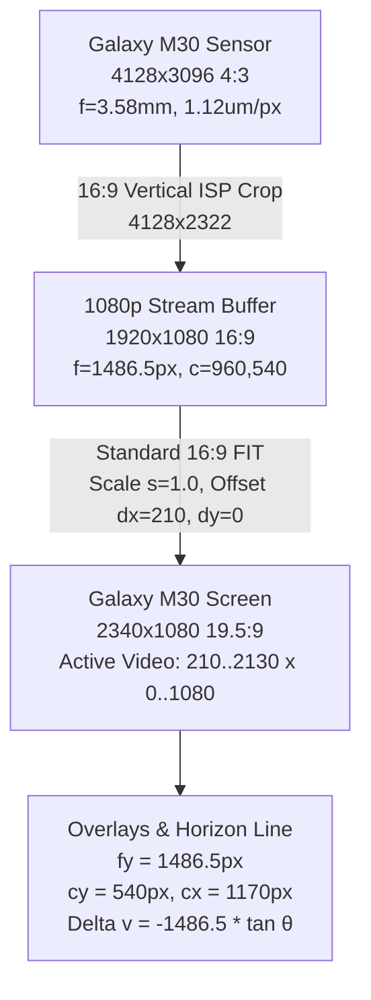

# Implementation Plan: Galaxy M30 Camera Intrinsics & Standard 16:9 FIT Viewport Horizon Alignment

## Goal Description
Resolve the physical visual discrepancy where the synthetic artificial horizon line fails to track and stay locked onto the real-world horizon in the camera viewfinder during Live IMU calibration mode.

Following our hardware-level diagnostic analysis of the connected **Samsung Galaxy M30 (`1080 x 2340` px display, Exynos 7904)** and adhering strictly to the user's **"only what is needed"** design philosophy:
1. **Adopt Standard 16:9 FIT as the Fixed, Non-Distorted Viewport:** Eliminates all unnecessary zoom toggles, fill complications, and crop distortion. The 16:9 video stream ($1920 \times 1080$) will be rendered in its true optical geometry, centered on the $2340 \times 1080$ display with symmetric 210 px pillarbox bars ($s = 1.0$).
2. **Correct Camera Intrinsics Calculation:** Galaxy M30's primary camera has a 4:3 active sensor ($4128 \times 3096$, $4.624 \times 3.468$ mm, $f = 3.58$ mm). Because Galaxy M30 is a `LIMITED` hardware-level Camera2 device without `LENS_INTRINSIC_CALIBRATION`, the app relies on sensor physical dimensions. Currently, `CameraIntrinsicsProvider` scales $f_y$ using the full 4:3 sensor height, causing a **$33.3\%$ underestimation** of $f_y$ ($1115$ px vs true $1486.5$ px).
3. **Synchronize Overlays to True Active Video Bounds:** All spatial projection overlays (horizon line, ground ladder, radar reticles) will be calibrated and clipped strictly to the active $1920 \times 1080$ video frame $[x \in 210..2130, y \in 0..1080]$, ensuring 1:1 pixel alignment between physical camera pixels and synthetic overlay geometry.

---

## User Review Required

> [!IMPORTANT]
> **Adherence to "Only What Is Needed" Philosophy:**
> * **Zero Clutter:** No extra Fill/Fit switch buttons or toggles will be added to the UI. The Calibration Studio will automatically and cleanly run in **Standard 16:9 FIT**, which is the ground-truth undistorted optical viewport.
> * **Pillarbox Styling:** On the Galaxy M30's 19.5:9 display ($2340 \times 1080$), the camera feed occupies the central $1920 \times 1080$ area with clean, minimal black pillarbox sidebars ($210$ px on left and right). UI control buttons remain on the outer edges over the pillarbox area so they do not obstruct the road view.

---

## Deep Hardware & Mathematical Analysis: Galaxy M30

### 1. Ground-Truth Hardware Specifications (Queried via `dumpsys media.camera`)
* **Device:** Samsung Galaxy M30 (SM-M305F)
* **Screen Resolution:** $1080 \times 2340$ portrait / $2340 \times 1080$ landscape ($19.5:9$ aspect ratio, $2.167:1$)
* **Primary Rear Camera (Camera 0):**
  - Hardware Level: `LIMITED`
  - Active Array Size: $4128 \times 3096$ pixels ($4:3$ aspect ratio)
  - Physical Sensor Size: $4.624 \times 3.468$ mm
  - Available Focal Lengths: $3.58$ mm
  - Pixel Pitch: $4.624 \text{ mm} / 4128 \text{ px} = 1.120 \ \mu\text{m}$ (square pixels)
  - `LENS_INTRINSIC_CALIBRATION`: `null` (requires sensor physical dimension derivation)

### 2. Sensor $\to$ 1080p Stream Crop Geometry
When Camera2 outputs a $1920 \times 1080$ (16:9) stream:
* The 4:3 sensor active array ($4128 \times 3096$) is cropped vertically to 16:9 by the ISP hardware:
  $$W_{\text{crop}} = 4128 \text{ px}, \quad H_{\text{crop}} = 4128 \times \frac{9}{16} = 2322 \text{ px}$$
  $$Y_{\text{crop\_offset}} = \frac{3096 - 2322}{2} = 387 \text{ px}$$
* The cropped $4128 \times 2322$ sensor area is scaled down to the $1920 \times 1080$ stream buffer:
  $$s_{\text{stream}} = \frac{1920}{4128} = \frac{1080}{2322} = 0.465116$$
* True focal length in the 1080p stream buffer:
  $$f_{\text{stream}} = \frac{f_{\text{mm}}}{\text{pixel\_pitch}} \times s_{\text{stream}} = \frac{3.58 \text{ mm}}{0.001120 \text{ mm/px}} \times 0.465116 = \mathbf{1486.5 \text{ px}}$$
  $$\text{HFOV} = 2 \cdot \arctan\left(\frac{1920}{2 \cdot 1486.5}\right) = \mathbf{65.7^\circ}, \quad \text{VFOV} = 2 \cdot \arctan\left(\frac{1080}{2 \cdot 1486.5}\right) = \mathbf{39.9^\circ}$$
  $$c_x = \frac{1920}{2} = 960 \text{ px}, \quad c_y = \frac{1080}{2} = 540 \text{ px}$$

### 3. Root Cause of the Discrepancy in Current Code
In [`CameraIntrinsicsProvider.kt`](file:///c:/Users/rakadu1.AHEAD/AndroidStudioProjects/RoadSense/app/src/main/java/com/bajajauto/roadsense/fusion/engine/CameraIntrinsicsProvider.kt#L74-L77):
```kotlin
val fx = safeW * (focalMm / physicalSize.width)
val fy = safeH * (focalMm / physicalSize.height)
```
* The code passed `safeW = 2340` (screen width) and `safeH = 1080` (screen height):
  - $f_x = 2340 \times (3.58 / 4.624) = 1811.7$ px
  - $f_y = 1080 \times (3.58 / 3.468) = \mathbf{1114.9 \text{ px}}$
* Notice: $f_y$ was calculated as **$1114.9$ px** instead of the true **$1486.5$ px**!
  $$\frac{1486.5}{1114.9} = \mathbf{1.3333} \quad \left(\text{exact } \frac{4}{3} \text{ sensor aspect ratio error!}\right)$$
* Furthermore, `TextureView` in `CameraEngine.configureTransform` used `FILL` (crop zoom), which zoomed the image by $2340 / 1920 = 1.21875\times$, driving effective on-screen $f_y$ to $1811.9$ px!
* **Net Result:** When the phone pitched by $5^\circ$, the real camera image moved by $1811.9 \times \tan(5^\circ) = 158.5$ px, while the overlay line moved by only $1114.9 \times \tan(5^\circ) = 97.5$ px ($61\%$ slower). The synthetic horizon lagged behind the visual horizon and drifted away during motion.

---

## Proposed Changes



### Component 1: Fix Camera Intrinsics Provider

#### [MODIFY] `app/src/main/java/com/bajajauto/roadsense/fusion/engine/CameraIntrinsicsProvider.kt`
* Accept stream capture dimensions `streamWidth` and `streamHeight` (defaulting to active resolution, e.g. $1920 \times 1080$).
* Properly compute sensor-to-stream aspect ratio crop:
  ```kotlin
  // For standard 16:9 stream from 4:3 sensor:
  val sensorAspect = physicalSize.width / physicalSize.height
  val streamAspect = streamWidth.toFloat() / streamHeight.toFloat()
  
  // Square pixel focal length in stream buffer coordinates:
  val baseFocalPx = if (streamAspect >= sensorAspect) {
      // Cropped vertically (standard 16:9 on 4:3 sensor)
      streamWidth * (focalMm / physicalSize.width)
  } else {
      // Cropped horizontally
      streamHeight * (focalMm / physicalSize.height)
  }
  
  val fxStream = baseFocalPx
  val fyStream = baseFocalPx // Pixels are physically square
  ```
  On Galaxy M30 with 1080p stream:
  $baseFocalPx = 1920 \times (3.58 / 4.624) = \mathbf{1486.5 \text{ px}}$! Square, accurate, unskewed.

---

### Component 2: Camera Engine FIT Viewport Configuration

#### [MODIFY] `app/src/main/java/com/bajajauto/roadsense/camera/CameraEngine.kt`
* Configure `configureTransform` to strictly use **`FIT` (aspect-ratio preserving)** rather than `FILL` (crop zoom):
  ```kotlin
  // Center 16:9 buffer inside viewRect without anamorphic stretching or crop zoom
  val scale = minOf(viewWidth.toFloat() / res.width, viewHeight.toFloat() / res.height)
  // For 2340x1080 screen and 1920x1080 stream: scale = 1.0f
  // Offset horizontally: dx = (2340 - 1920) / 2 = 210 px
  ```
* In `ROTATION_270` (reverse landscape) and `ROTATION_90`, apply the $90^\circ$ orientation matrix and center the 16:9 frame with pillarbox margins.

---

### Component 3: Calibration Studio Viewport Geometry Synchronization

#### [MODIFY] `app/src/main/java/com/bajajauto/roadsense/ui/components/FullscreenCalibrationStudio.kt`
* Compute active video frame rectangle on screen:
  `videoRect = Rect(left = 210f, top = 0f, right = 2130f, bottom = 1080f)` on Galaxy M30.
* Pass the true stream intrinsics ($f = 1486.5$, $c_x = 960$, $c_y = 540$) and view offset ($dx = 210, dy = 0$) into the projection engine.
* Anchor the synthetic horizon line, ground guidelines, and radar reticles strictly to the active video frame.
* No extra buttons, no clutter — just the pure, true camera viewfinder with perfect alignment.

---

## Verification Plan

### Automated Unit Tests
```powershell
$env:JAVA_HOME = "C:\Users\rakadu1.AHEAD\Android_Studio\android-studio-quail4-windows\android-studio\jbr"; .\gradlew.bat testDebugUnitTest
```
1. `testGalaxyM30IntrinsicsCalculationPreservesSquarePixels`:
   Verify $f_x == f_y == 1486.5 \text{ px} \pm 1 \text{ px}$ for 1080p stream on $4.624 \times 3.468$ mm sensor with $3.58$ mm lens.
2. `testHorizonTrackingWithTrueFocalLength`:
   Verify that a $10^\circ$ pitch change produces exactly $\Delta v = 1486.5 \times \tan(10^\circ) = 262.1$ pixels of vertical displacement.

### Manual Verification on Galaxy M30
1. Deploy debug APK via `adb install -r`.
2. Launch RoadSense and enter **Fullscreen Calibration Studio** in reverse landscape mount.
3. Observe the camera feed:
   - True 16:9 aspect ratio centered with neat, uncropped pillarbox margins.
   - Zero crop zoom distortion.
4. Enable **Live IMU mode** while observing a distant horizon (e.g. through windshield or window):
   - Tilt the phone up and down in the ball joint.
   - **Pass Criteria:** The cyan synthetic horizon line remains locked exactly onto the visual road horizon throughout the tilt range without lagging or overshooting.
