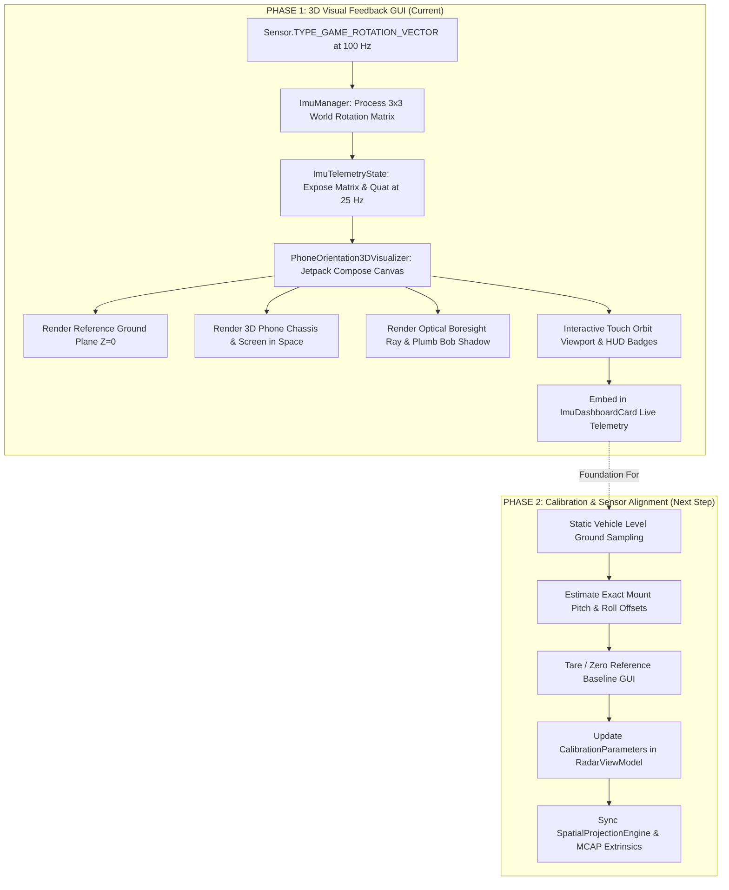

# Implementation Plan: IMU Game Rotation Vector & 3D Level Ground Orientation

## Goal Description
Implement an interactive, real-time **3D Phone Orientation Visualizer** in the RoadSense Android cockpit application under the **IMU tab &rarr; Live Telemetry sub-tab** of `ImuDashboardCard.kt`. 

The implementation is divided into two distinct, decoupled phases:
* **Phase 1 (Current Scope): 3D Visual Feedback GUI & Real-Time Orientation Engine** &mdash; Focuses purely on visual observation and feedback. Renders a live 3D smartphone model hovering above a reference level ground plane using Android's `Sensor.TYPE_GAME_ROTATION_VECTOR` without altering calibration or camera extrinsics.
* **Phase 2 (Next Step): IMU-Driven Windshield Calibration & Extrinsics Alignment** &mdash; Uses the gravitationally leveled orientation to calculate exact physical windshield pitch/roll offsets, integrate with `CalibrationParameters`, and auto-align `SpatialProjectionEngine`.

---

## 1. Sensor Analysis: Value of the GAME Rotation Sensor

### 1.1 Why `Sensor.TYPE_GAME_ROTATION_VECTOR` is Ideal for Vehicle Cabins
Android provides two primary orientation vectors:
1. **`Sensor.TYPE_ROTATION_VECTOR` (Accel + Gyro + Magnetometer):** Anchors yaw to Magnetic North. In a vehicle cabin, however, the car engine, battery cables, steel chassis, and dashboard speaker magnets cause severe local magnetic field distortions. This produces erratic yaw swings, false heading jumps, and corrupts orientation estimates.
2. **`Sensor.TYPE_GAME_ROTATION_VECTOR` (Accel + Gyro ONLY, Zero Magnetometer):** 
   - **Magnet-Free:** Completely immune to vehicular electromagnetic interference.
   - **Gravitationally Leveled:** The Android Sensor HAL running the Extended Kalman Filter (EKF) uses the low-frequency Accelerometer gravity vector ($\vec{g} = [0, 0, 9.81]\text{ m/s}^2$) to continuously null out gyroscope integration drift along the **Pitch** and **Roll** axes.
   - **Dynamic Filtering:** Unlike raw accelerometer readings which spike violently during acceleration, braking, or road bumps ($\vec{a} = \vec{a}_{\text{linear}} - \vec{g}$), the Game Rotation Vector fuses high-rate gyro angular velocities ($\vec{\omega}$) to maintain an ultra-smooth, stable attitude estimate.
   - **Absolute Pitch & Roll with Respect to Level Ground:** Because gravity points perpendicular to level ground, Pitch (elevation) and Roll (bank) relative to the horizontal plane are **absolute and drift-free**. Yaw is arbitrary/relative.

### 1.2 Resolving the Windshield Camera Pitch Calibration Issue
In the previous session log (`session_20261006_095609`), vision-to-radar matching was low (13%) because the physical phone mounting pitch on the windshield was suspected to be steeper than the hardcoded $4.14^\circ$. 
- When the vehicle is parked on flat ground, `GAME_ROTATION_VECTOR` directly measures the exact static mounting pitch angle $\theta_{\text{pitch}}$ and roll angle $\phi_{\text{roll}}$.
- Phase 1 provides the visual tools to inspect this in real-time. Phase 2 will apply this measurement directly to calibration.

---

## 2. Two-Phase Execution Roadmap



---

## 3. Phase 1 Detailed Specifications (Visual Feedback GUI)

### 3.1 Architecture & Visual Design
The visualizer will be embedded into `LiveTelemetryContent` in `ImuDashboardCard.kt` as an interactive 3D card directly above the numerical accelerometer and gyroscope breakdowns:

```
+-----------------------------------------------------------------------------------+
|  IMU Cockpit Card -> [ Sensor Audit ] [ Rate Profiler ] [ LIVE TELEMETRY * ]      |
+-----------------------------------------------------------------------------------+
|  [ Multi-Sensor Live Stream Switch ]  Streaming at 25 Hz                         |
+-----------------------------------------------------------------------------------+
|  [NEW] 3D VEHICLE ATTITUDE & GROUND LEVEL VISUALIZER (Phase 1)                    |
|                                                                                   |
|    +-----------------------------+----------------------------------------------+ |
|    |  3D Interactive Viewport    |  Live Orientation HUD                        | |
|    |                             |                                              | |
|    |         [Camera Lens]       |  PITCH (Camera Tilt): +5.4°                  | |
|    |              /              |  ROLL (Bank Angle):   -0.2°  [LEVEL OK]      | |
|    |      +------+ [Phone 3D]    |  YAW (Relative):     +12.1°                  | |
|    |     /  O   /|               |                                              | |
|    |    +------+ |               |  STATUS: OPTIMAL WINDSHIELD MOUNT            | |
|    |    |Screen| /               |  - Boresight: 5.4° Downward Road Intersection| |
|    |    +------+                 |  - Lateral Tilt: < 0.5° (Near Zero Bank)     | |
|    |        | (Plumb Bob)        |                                              | |
|    |    ----+------------------  |  [ Touch Drag to Orbit 3D Viewport ]         | |
|    |   / Level Ground Grid   /   |  [ Reset View to 3/4 Isometric ]             | |
|    |  +---------------------+    |                                              | |
|    +-----------------------------+----------------------------------------------+ |
+-----------------------------------------------------------------------------------+
|  Accelerometer Comparison (Raw vs Linear)                                         |
+-----------------------------------------------------------------------------------+
|  Gyroscope Angular Velocity (Roll, Pitch, Yaw Rates)                              |
+-----------------------------------------------------------------------------------+
```

### 3.2 Visual Components in `PhoneOrientation3DVisualizer.kt`
1. **Reference Level Ground Plane ($Z = 0$):**
   - Perspective grid representing the flat road surface directly beneath the vehicle.
   - Forward vehicle heading axis indicator and concentric distance rings.
2. **Realistic 3D Smartphone Model:**
   - 3D cuboid with smartphone aspect ratio (bezel, screen face, chassis back, camera module).
   - Rotates in real-time in full 3D according to `GAME_ROTATION_VECTOR`.
   - Screen face rendered with dark gloss and cyan border; back face rendered with metallic chassis and camera bump.
3. **Optical Boresight Ray:**
   - Luminous cyan/green ray projecting out from the rear camera lens toward the ground grid, visually illustrating where the camera optical axis intersects the road ahead.
4. **Plumb Bob & Drop Shadow:**
   - Vertical line dropping from the center of the phone to the ground grid with a soft projection disc/shadow, showing elevation above the ground plane.
5. **Interactive Orbit Controls:**
   - Single-finger touch drag on the 3D Canvas orbits the camera viewpoint around the phone (azimuth and elevation) so the user can inspect the phone from any angle (side view for pitch, front view for roll, or 3/4 isometric).
   - "Reset View" button snaps back to the default 3/4 perspective.
6. **Live Orientation HUD:**
   - High-contrast telemetry badges: Pitch, Roll, Yaw, and Gravitational Magnitude ($|\vec{g}|$).
   - Dynamic alignment badge: Green when roll is level ($|\phi| < 1.0^\circ$) and pitch is in standard automotive mount range ($3^\circ$ to $12^\circ$), Amber if tilted.

### 3.3 Mathematical Transformations
Android's `SensorManager.getRotationMatrixFromVector(R, event.values)` outputs a $3 \times 3$ matrix $R$ mapping vectors from phone body coordinates to world coordinates:
$$\vec{v}_{\text{world}} = R \cdot \vec{v}_{\text{device}}$$

In world coordinates:
- $Z_{\text{world}}$ is vertical, pointing upward (normal to level ground).
- $X_{\text{world}}, Y_{\text{world}}$ form the horizontal ground plane ($Z = 0$).

For 8 local vertices of the phone cuboid $\vec{p}_i \in \{\pm w/2, \pm h/2, \pm t/2\}$:
$$\vec{p}_{i,\text{world}} = R \cdot \vec{p}_i + \begin{bmatrix} 0 \\ 0 \\ z_{\text{hover}} \end{bmatrix}$$

Using an axonometric/perspective viewport projection matrix, points are projected to 2D Canvas coordinates $(x_{\text{canvas}}, y_{\text{canvas}})$ and sorted by depth for face rendering.

---

## 4. Phase 2 Preview: Calibration & Sensor Alignment (Next Step)

Phase 2 will build directly upon Phase 1's telemetry foundation:
1. **Static Level Ground Calibration Workflow:**
   - A dedicated calibration routine that samples the phone's orientation while the vehicle is stationary on known flat ground.
   - Computes low-pass filtered baseline mounting pitch $\theta_{\text{mount}}$ and roll $\phi_{\text{mount}}$.
2. **"Tare / Zero Reference" Action:**
   - Allows taring current orientation as the vehicle's nominal zero-grade baseline.
3. **Automatic Synchronization with `CalibrationParameters`:**
   - Feeds the measured pitch/roll directly into `RadarViewModel.updateExtrinsics()` and saves it into the active calibration profile (`radar_camera_calib.json`).
4. **Projection Alignment:**
   - `SpatialProjectionEngine.kt` and MCAP recording extrinsics will use this physically validated pitch, eliminating manual calibration guesswork.

---

## 5. Proposed Changes (Phase 1 Only)

### Component 1: `com.bajajauto.roadsense.imu` (Telemetry State & Manager)

#### [MODIFY] [`ImuTelemetryState.kt`](file:///c:/Users/rakadu1.AHEAD/AndroidStudioProjects/RoadSense/app/src/main/java/com/bajajauto/roadsense/imu/ImuTelemetryState.kt)
- Add `rotationMatrix: FloatArray = floatArrayOf(...)` (3x3 row-major world rotation matrix).
- Add `quat: FloatArray = floatArrayOf(0f, 0f, 0f, 1f)`.
- Update `equals` and `hashCode` implementations.

#### [MODIFY] [`ImuManager.kt`](file:///c:/Users/rakadu1.AHEAD/AndroidStudioProjects/RoadSense/app/src/main/java/com/bajajauto/roadsense/imu/ImuManager.kt)
- In `liveTelemetryListener`, pass `rotationMatrix` and `currentQuat` into `ImuTelemetryState` emitted to the UI at 25 Hz.

---

### Component 2: `com.bajajauto.roadsense.ui.components` (3D Visualizer Component)

#### [NEW] [`PhoneOrientation3DVisualizer.kt`](file:///c:/Users/rakadu1.AHEAD/AndroidStudioProjects/RoadSense/app/src/main/java/com/bajajauto/roadsense/ui/components/PhoneOrientation3DVisualizer.kt)
- Interactive 3D Canvas visualizer:
  - 3D level ground grid with heading axis and circular rings.
  - 3D phone model cuboid with front screen, rear camera module, and chamfered edges.
  - Real-time rotation driven by `telemetry.rotationMatrix`.
  - Camera optical boresight projection ray.
  - Plumb bob drop line with projected shadow.
  - Touch drag gestures to orbit view azimuth and elevation.
  - Integrated attitude HUD with Pitch, Roll, Yaw, Level Status badge, and Viewport Reset button.

---

### Component 3: `com.bajajauto.roadsense.ui.screens` (Dashboard Integration)

#### [MODIFY] [`ImuDashboardCard.kt`](file:///c:/Users/rakadu1.AHEAD/AndroidStudioProjects/RoadSense/app/src/main/java/com/bajajauto/roadsense/ui/screens/ImuDashboardCard.kt)
- Embed `PhoneOrientation3DVisualizer` inside `LiveTelemetryContent` directly above the accelerometer and gyroscope breakdown cards.

---

## 6. Verification Plan (Phase 1)

### Automated Tests
1. **JVM Unit Tests:**
   ```powershell
   $env:JAVA_HOME = "C:\Users\rakadu1.AHEAD\Android_Studio\android-studio-quail4-windows\android-studio\jbr"; ./gradlew testDebugUnitTest
   ```
2. **Android App Compilation:**
   ```powershell
   $env:JAVA_HOME = "C:\Users\rakadu1.AHEAD\Android_Studio\android-studio-quail4-windows\android-studio\jbr"; ./gradlew assembleDebug
   ```

### Manual Verification
1. Launch RoadSense app on device.
2. Navigate to the **IMU** tab and tap **Live Telemetry**.
3. Toggle the **Multi-Sensor Live Stream** switch ON.
4. Tilt and rotate the phone:
   - Observe the 3D phone model mirroring physical movement in real-time at 60 FPS.
   - Verify that when the phone is held flat on a desk, Pitch and Roll read near $0.0^\circ$ and the 3D phone sits flat above the ground grid.
   - Verify that tilting the phone back (like a car windshield) displays positive pitch and projects the camera boresight forward onto the ground plane.
   - Drag with a finger to orbit the 3D viewport around the phone and verify "Reset View" snaps back cleanly.
