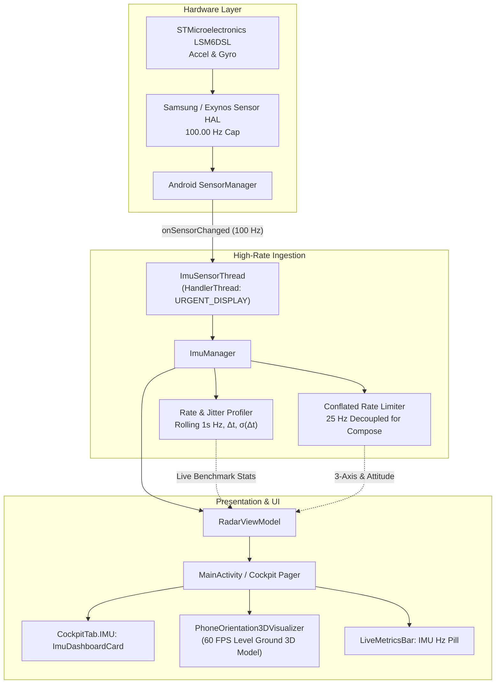

# RoadSense: Sensors Subsystem Documentation Index

> **Directory:** `intel/Implementations/Sensors/`  
> **Status:** Active / Production Ready  
> **Target Hardware:** Samsung Galaxy M30s / M21 family (`SM-M305F` / Exynos 7904/9611)  
> **Last Updated:** 2026-10-12  

---

## 1. Subsystem Directory Categories

This directory organizes all sensor hardware audits, architectural plans, empirical benchmarks, and implementation walkthroughs into dedicated sensor domains:

| Category | Directory | Scope & Highlights |
|---|---|---|
| **IMU & Motion** | [`IMU/`](IMU/README.md) | High-rate 100 Hz LSM6DSL ingestion, 6-DOF `GAME_ROTATION_VECTOR` attitude estimation, 3D interactive Compose visualizer, reverse landscape mounting math, zero-lag table yaw, dynamic road alignment, and orthogonal pitch view. |
| **Camera & Vision** | [`CAMERA/`](CAMERA/README.md) | Camera2 capture pipelines, automated checkerboard calibration, hardware-accelerated MediaCodec video encoding, and monocular feature tracking. |
| **Hardware Audits** | [`DEVICE_SENSOR_AND_CAMERA_CAPABILITIES.md`](DEVICE_SENSOR_AND_CAMERA_CAPABILITIES.md) | Live ADB extraction (`dumpsys sensorservice`, `dumpsys media.camera`) covering all 18 phone sensors, 100 Hz HAL cap, and all 4 camera HAL devices. |
| **Raw Dumps** | [`raw_dumps/`](raw_dumps/) | Unprocessed ADB dumps (`raw_sensorservice_dump.txt`, `raw_camera_dump.txt`) and automated extraction parser (`parse_device_capabilities.py`). |

---

## 2. IMU Architecture Overview

---

## 3. Recommended Sensor Suite for In-Vehicle Logging

1. **`LSM6DSL Accelerometer` (100 Hz):** Raw specific force ($m/s^2$) with $1g$ gravity component.
2. **`LSM6DSL Gyroscope` (100 Hz):** Vehicle angular rates ($\omega_x, \omega_y, \omega_z$ in $^\circ/s$).
3. **`Samsung Linear Acceleration` (100 Hz):** "Accelerometer without $g$". Direct longitudinal braking/acceleration and lateral cornering forces.
4. **`Samsung Game Rotation Vector` (100 Hz):** 6-DOF orientation quaternion $[x,y,z,w]$ without magnetometer (**immune to vehicle chassis magnetic interference**).
