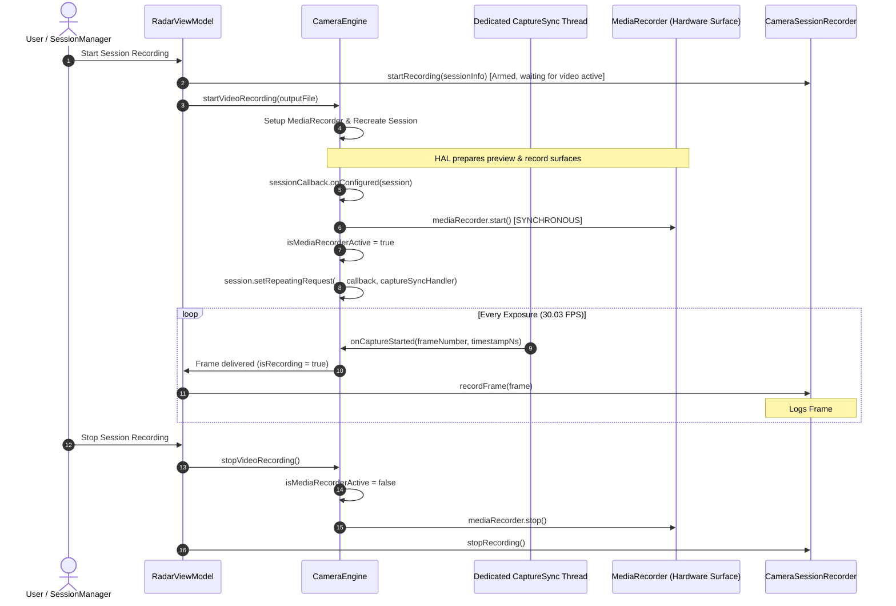

# Implementation Plan: Android Camera Synchronization & Latency Hardening

Eliminate the Android-side video recording startup delay, prevent userspace camera callback drops under heavy load, and guarantee 100% deterministic, zero-pre-roll synchronization between `camera_video.mp4`, `camera_frames.csv`, and `session_timeline.csv`.

---

## User Review Required

> [!IMPORTANT]
> **No Sensor Protocol or UI Breaking Changes**:
> All proposed changes are strictly internal to the Android camera capture and logging pipeline (`CameraEngine.kt`, `CameraFrameMetadata.kt`, `CameraSessionRecorder.kt`, `RadarViewModel.kt`). No changes to external file formats or sensor packet structures are introduced.

> [!NOTE]
> **Backward Compatibility**:
> The PC post-processing pipeline (`master_timeline_synchronizer.py` and `convert_session_to_mcap.py`) remains 100% compatible with both old sessions (which contain pre-roll gaps and dropped callbacks) and new sessions (which will have zero pre-roll and zero callback drops).

---

## Problem & Root Cause Summary

In recent driving sessions (e.g. `session_20261019_150946`), deep inspection revealed two Android-side root causes:

1. **300 ms Asynchronous `MediaRecorder` Startup Delay**:
   - `CameraEngine.startVideoRecording()` reconfigures the capture session, and then posts a delayed task (`postDelayed(..., 300)`) to call `mediaRecorder?.start()`.
   - Meanwhile, `CameraSessionRecorder` was already active and immediately logging frames from `onCaptureStarted`.
   - Result: 10–20 preview frames were recorded to `camera_frames.csv` before `camera_video.mp4` contained a single packet.
2. **Userspace Callback Drops Under CPU/GC Contention**:
   - `CameraCaptureSession.CaptureCallback.onCaptureStarted` was executed on the shared `CameraEngine-Worker` `HandlerThread`.
   - That thread was also handling AF/AE metering post-delayed loops, tap-to-focus triggers, and UI event notifications. Under peak system load (radar streaming at 3.125 Mbps + IMU at 100 Hz + Compose UI rendering), Android userspace dropped **91 callbacks**, while the hardware encoder pipeline (`MediaRecorder.surface`) dropped 0 frames.
3. **Trailing Post-Roll Frame Contamination**:
   - When stopping video recording, `cameraEngine.stopVideoRecording()` and `cameraSessionRecorder.stopRecording()` stop independently, allowing 2–5 frames to be logged to CSV after `MediaRecorder` has finalized its MP4 container.

---

## Architecture & Proposed Solution



---

## Proposed Changes

### Component 1: `com.bajajauto.roadsense.camera`

#### [MODIFY] `CameraFrameMetadata.kt`
- Add `val isRecording: Boolean = false` to distinguish frames captured while `MediaRecorder` is actively encoding to the MP4 file from idle viewfinder preview frames.

```diff
 data class CameraFrameMetadata(
     val frameNumber: Long,
     val shutterTimestampNs: Long,
     val exposureTimeNs: Long = 0L,
     val iso: Int = 0,
-    val utcTimestampMs: Long = System.currentTimeMillis()
+    val utcTimestampMs: Long = System.currentTimeMillis(),
+    val isRecording: Boolean = false
 )
```

---

#### [MODIFY] `CameraEngine.kt`
1. **Dedicated High-Priority `CaptureSync` Thread**:
   - Create a dedicated `HandlerThread("CameraEngine-CaptureSync", Process.THREAD_PRIORITY_URGENT_DISPLAY)`.
   - Direct `repeatingCaptureCallback` exclusively to this thread so shutter exposure callbacks are never blocked by AE/AF routines, lock sweeps, or UI events.
2. **Synchronous `MediaRecorder.start()` in `onConfigured`**:
   - Remove the `postDelayed(..., 300)` block.
   - Start `mediaRecorder` synchronously inside `sessionCallback.onConfigured()` right after surfaces are attached and before starting `session.setRepeatingRequest(...)`.
3. **Atomic `isMediaRecorderActive` State**:
   - Maintain a thread-safe `@Volatile var isMediaRecorderActive: Boolean = false`.
   - Tag each frame in `onCaptureStarted` with `isRecording = isRecordingVideo && isMediaRecorderActive`.
   - Set `isMediaRecorderActive = false` synchronously in `stopVideoRecording()` before closing the recorder.

```kotlin
// In CameraEngine.kt
private var captureSyncThread: HandlerThread? = null
private var captureSyncHandler: Handler? = null
@Volatile private var isMediaRecorderActive: Boolean = false

// In startBackgroundThread()
captureSyncThread = HandlerThread("CameraEngine-CaptureSync", Process.THREAD_PRIORITY_URGENT_DISPLAY).apply { start() }
captureSyncHandler = Handler(captureSyncThread!!.looper)

// Inside sessionCallback.onConfigured():
if (isRecordingVideo && mediaRecorder != null) {
    try {
        mediaRecorder?.start()
        isMediaRecorderActive = true
        AppLogger.i(TAG, "MediaRecorder started synchronously inside onConfigured")
    } catch (e: Exception) {
        AppLogger.e(TAG, "Failed to start MediaRecorder in onConfigured", e)
    }
}
session.setRepeatingRequest(requestBuilder.build(), captureCallback, captureSyncHandler)
```

---

### Component 2: `com.bajajauto.roadsense.recording` & `ui`

#### [MODIFY] `RadarViewModel.kt`
- Gate frame recording in the listener: only forward frames to `cameraSessionRecorder.recordFrame(frame)` if `frame.isRecording == true`.
- Ensures zero pre-roll preview frames and zero trailing post-roll frames ever touch `camera_frames.csv` or `session_timeline.csv`.

```diff
 cameraEngine.addFrameListener { frame ->
     cameraFramesThisSec++
-    cameraSessionRecorder.recordFrame(frame)
+    if (frame.isRecording) {
+        cameraSessionRecorder.recordFrame(frame)
+    }
 }
```

---

#### [MODIFY] `CameraSessionRecorder.kt`
- Add explicit first-frame tagging: On the very first frame recorded for the session, emit an explicit `CAMERA:VIDEO_START` event in `session_timeline.csv` containing `first_hw_frame=${frame.frameNumber}`.
- Guarantees that any post-processing tool can identify the exact hardware sequence start boundary in $O(1)$ without heuristic gap scanning.

```kotlin
// Inside recordFrame():
if (isFirstVideoFrame) {
    sessionManager?.recordTimelineEvent(
        elapsedRealtimeNs = frame.shutterTimestampNs,
        sensor = "CAMERA",
        event = "VIDEO_START",
        sequenceId = frame.frameNumber,
        relativePath = "camera/$CAMERA_VIDEO_NAME",
        summary = "first_hw_frame=${frame.frameNumber};res=$currentResolution"
    )
    isFirstVideoFrame = false
}
```

---

### Component 3: `scripts/master_timeline_synchronizer.py`

#### [MODIFY] `master_timeline_synchronizer.py`
- Enhance `_detect_video_start_boundary()` to check for the explicit `CAMERA:VIDEO_START` event first.
- If present, anchor `video_start_seq_id` and `video_start_mono_ns` directly to that event; otherwise fall back to the existing gap/offset detector for legacy sessions.

---

## Verification Plan

### Automated Tests
1. **JVM Unit Tests**:
   ```powershell
   $env:JAVA_HOME = "C:\Users\rakadu1.AHEAD\Android_Studio\android-studio-quail4-windows\android-studio\jbr"; ./gradlew testDebugUnitTest
   ```
2. **Python Timeline Synchronizer Unit Tests**:
   ```powershell
   & "C:\Users\rakadu1.AHEAD\.conda\envs\roadsense-mcap\python.exe" -m unittest scripts/tests/test_master_timeline_synchronizer.py
   ```

### Manual Device Verification
1. Build and install debug APK on test device (`samsung SM-M305F`).
2. Record a 30-second driving or bench session.
3. Inspect `camera_frames.csv` and `session_timeline.csv`:
   - Verify `frame_number` row 0 matches the first packet in `camera_video.mp4` with **zero missing pre-roll frames**.
   - Verify `VIDEO_START` is recorded at sequence ID = frame row 0.
   - Verify callback drops = 0.
