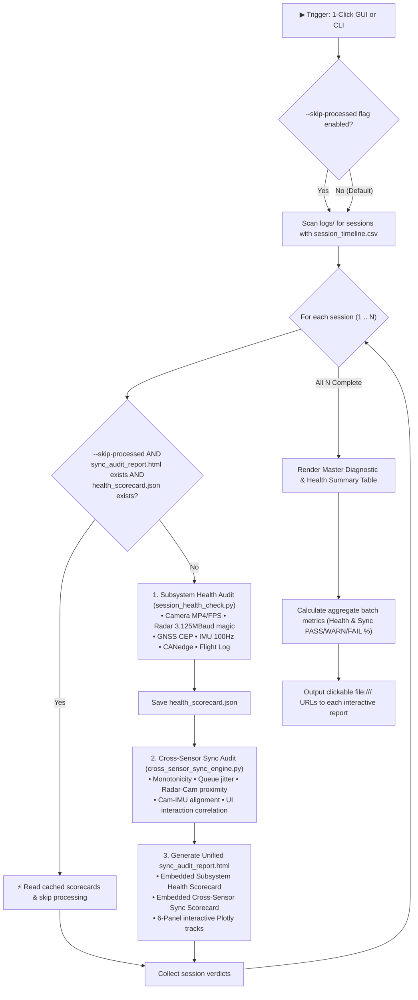

# Implementation Plan: 1-Click Automated Batch Health Check & Sync Audit Pipeline

Automate the full 8-point subsystem health check (`session_health_check.py`) and cross-sensor synchronization audit (`audit_cross_sensor_sync.py` / `cross_sensor_sync_engine.py`) across all recording sessions in `logs/` into a unified, single-click GUI and single-command CLI pipeline with configurable re-processing and skip-already-processed support.

---

## User Review Required

> [!IMPORTANT]
> **Default Processing Behavior**: As requested, the pipeline will **re-calculate and process all logs by default** to ensure metrics and reports always reflect the latest synchronization algorithms.
>
> When the user explicitly activates **"Skip already processed logs"** (`--skip-processed` in CLI or the GUI checkbox), sessions containing both valid `sync_audit_report.html` and `health_scorecard.json` will be instantly skipped, displaying their cached verdicts in the batch table in milliseconds.

> [!NOTE]
> **Unified HTML Report Experience**: We propose embedding the 8-point Subsystem Health Scorecard directly into `sync_audit_report.html` alongside the Cross-Sensor Synchronization Scorecard. This provides a single, unified, interactive visual report for every session.

---

## Proposed Architecture & Workflow



---

## Proposed Changes

### Component 1: Engine & Subsystem Health Modularization

#### [MODIFY] `scripts/session_health_check.py`
- Refactor `audit_session(sess_dir, quiet=False, save_json=True)` from a print-only script into a clean, reusable library function that:
  1. Returns a structured 2-tuple: `(scorecard: dict, overall: str)`.
  2. Persists `health_scorecard.json` into `sess_dir` containing metadata, duration, per-subsystem ratings, and timestamp.
  3. Supports `--all`, `--skip-processed`, and `--quiet` directly from CLI when invoked standalone.

#### [MODIFY] `scripts/cross_sensor_sync_engine.py`
- Incorporate `health_scorecard` into `generate_sync_html_report`:
  - When `health_scorecard.json` exists in `sess_dir` (or is passed directly), render an accordion/tab or split scorecard displaying:
    - **Subsystem Health Status** (Camera, Radar, GNSS, IMU, CANedge, Timeline, Flight Recorder)
    - **Cross-Sensor Temporal Alignment** (Monotonicity, Nyquist limits, jitter, UI correlation)
  - Produces a single, all-in-one interactive diagnosis for every session.

---

### Component 2: Unified Master Diagnostic Runner

#### [NEW] `scripts/batch_audit_and_health_check.py`
Create the dedicated master orchestration CLI script that coordinates both health checks and synchronization audits:
- **CLI Arguments**:
  - `--all`: Process all sessions found in `logs/` (default behavior if no specific session is given).
  - `--skip-processed`: Skip sessions that already contain generated `sync_audit_report.html` and `health_scorecard.json`.
  - `--latest`: Run unified audit on the latest session only.
  - `session`: Positional optional argument for targeting a single session folder.
  - `--plot`: Enable optional legacy Matplotlib 6-panel PNG plot (disabled by default; fast HTML standard).
  - `--quiet` / `-q`: Quiet mode showing clean 1-line progress per session and the final summary table.
- **Master Batch Summary Table**:
  Prints an aligned summary table with colorized badges:
  ```text
  ========================================================================================================================
  ROADSENSE MASTER DIAGNOSTIC & HEALTH AUDIT SUMMARY (60 SESSIONS)
  ========================================================================================================================
  #    | Session Name                  | Duration | Health   | Sync     | Overall  | Interactive HTML Report URL
  -----+-------------------------------+----------+----------+----------+----------+--------------------------------------
  1    | session_20260909_111842       | 34.50s   | PASS     | PASS     | PASS     | file:///C:/.../sync_audit_report.html
  ...
  ========================================================================================================================
  AGGREGATE BATCH METRICS:
    Total Sessions Audited: 60 (Processed: 60, Skipped: 0)
    Subsystem Health:  PASS: 54 (90.0%) | WARN: 6 (10.0%) | FAIL: 0 (0.0%)
    Sensor Sync:       PASS: 32 (53.3%) | WARN: 26 (43.3%) | FAIL: 2 (3.3%)
    Combined Verdict:  PASS: 31 (51.7%) | WARN: 27 (45.0%) | FAIL: 2 (3.3%)
  ========================================================================================================================
  ```
- **Exit Code**: Returns `0` if all sessions pass or warn, and `1` if any session experiences a critical failure (`FAIL`).

---

### Component 3: Web Automation Hub GUI Integration

#### [MODIFY] `tools/web_dashboard/index.html`
- **1-Click Master Audit Action Card**:
  In Tab 3 (*Diagnostics & Sensor Health*), add a dedicated **Master Audit Hub** banner at the top:
  - Header: `⚡ Unified Health Check & Sync Audit Pipeline`
  - Description: `Run full 8-point subsystem diagnostics and 6-panel interactive sync report generation across all recorded logs.`
  - Controls:
    - Primary Button: `🚀 Run Complete Diagnostics on All Sessions`
    - Checkbox: `[ ] Skip already processed sessions (--skip-processed)` *(Unchecked by default to recalculate all)*
    - Checkbox: `[x] Fast Mode (Skip PNG plot; HTML report is standard)` *(Checked by default)*
    - Checkbox: `[ ] Quiet Mode (Batch summary only)`
- **Diagnostic Tool Dropdown Update**:
  Add `batch_audit_and_health_check.py` as the top-level option in `diagToolSelect`:
  `<option value="batch_audit_and_health_check.py" selected>⚡ Complete Health & Sync Suite (batch_audit_and_health_check.py)</option>`
- **Live Event Stream**:
  The existing Server-Sent Events (SSE) stream will capture progress lines in real time and render dynamic interactive report action cards as each session completes.

---

### Component 4: Documentation & Knowledge Base

#### [MODIFY] `intel/debugging_and_troubleshooting_knowledge_base.md`
- Document Rule 22: *Unified Multi-Tier Diagnostic Pipeline Pattern* (combining subsystem layer validation with cross-stream temporal synchronization in a single idempotent runner).

#### [MODIFY] `intel/Implementations/walkthrough_interactive_sync_audit_and_refactoring.md`
- Document the new unified runner, CLI flags, skip-processed caching mechanics, and Web GUI integration.

---

## Verification Plan

### Automated Tests
1. **JVM Unit Tests**:
   Ensure zero regressions in Android codebase:
   ```powershell
   cmd.exe /c "set JAVA_HOME=C:\Users\rakadu1.AHEAD\Android_Studio\android-studio-quail4-windows\android-studio\jbr&& gradlew.bat testDebugUnitTest"
   ```
2. **Single-Session Unified Audit**:
   Verify `session_health_check.py` and `cross_sensor_sync_engine.py` run together cleanly:
   ```powershell
   python scripts/batch_audit_and_health_check.py --latest
   ```
   Verify that `session_health_scorecard.json` and `sync_audit_report.html` are generated and valid.

3. **Full Batch Recalculation Test (Default Mode)**:
   Verify running across all 60 sessions without skipping:
   ```powershell
   python scripts/batch_audit_and_health_check.py --all -q
   ```
   Verify execution time, summary table, and metrics.

4. **Skip-Processed Verification Test**:
   Immediately run a second time with `--skip-processed`:
   ```powershell
   python scripts/batch_audit_and_health_check.py --all --skip-processed -q
   ```
   Verify that all 60 sessions are recognized as already processed and skipped in `< 0.5 seconds`.

5. **Web Server Initialization**:
   Validate Web Automation Hub server status:
   ```powershell
   python tools/roadsense_web_server.py --test-init
   ```
