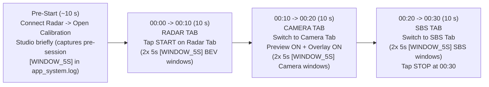

# Bench Test & Before/After Verification Plan (Phase 1 & Multi-Phase Baseline)

> **Status:** Ready for Bench Execution (No Source Code Changes Needed)  
> **Hardware Mode:** Offline Bench (Phone connected via USB-OTG to TI AWR1843BOOST radar; PC ADB disconnected during recording)  
> **Purpose:** Capture an apples-to-apples **30-second Baseline recording** on the pre-Phase-1 APK, then repeat the identical 30-second test after installing the **Phase 1 APK**, and verify every metric offline using RoadSense's diagnostic pipeline.

---

## Goal Description

When testing on the bench with the TI AWR1843BOOST connected, the phone's USB-C port is occupied by the radar OTG adapter, so **live `adb logcat` is unavailable during recording**. Instead, RoadSense writes all multi-sensor streams and `UiPerf` timing summaries directly to internal app storage:
- `sessions/session_YYYYMMDD_HHMMSS/session_debug.log` (`[WINDOW_5S]`, breadcrumbs, and in Baseline: 40 Hz `[DisplayPacer]` spam)
- `app_logs/app_run_YYYYMMDD_HHMMSS/app_system.log` (pre-session idle / Calibration Studio `[WINDOW_5S]` metrics)
- `radar/radar_frames.bin` & `radar/radar_raw_stream.bin` (raw binary continuity & bimodal USB jitter)
- `camera/camera_video.mp4` & `camera/camera_frames.csv` (30 FPS HAL cadence)
- `imu/imu_frames.csv`, `gnss/gnss_track.csv`, `session_timeline.csv` (100 Hz IMU spikes & monotonic cross-sensor sync)

This plan standardizes a deterministic **30-second bench recording script** so we can quantitatively compare **Run #0 (Current Baseline APK)** vs **Run #1 (Phase 1 APK)** — and reuse Run #0 + Run #1 as our benchmark ladder across Phases 2–6.

---

## Standardized 30-Second Offline Bench Protocol

Keep the phone stationary on the bench pointed at a consistent scene (ideally with a moving fan/person/object or corridor view in front of the radar/camera so `TLV 1` points and `TLV 3` tracks stay active cleanly), with `Viewfinder Preview` **unmuted** and `Radar Overlay` **enabled**:



> [!IMPORTANT]
> **Why this exact `10 s / 10 s / 10 s` split matters:**
> `UiFrameMetricsProfiler` emits `[WINDOW_5S]` summaries once every `5.0 s`, and `AppLogger` records `[UI]` tab-switch breadcrumbs. Holding each tab steady for `10 s` guarantees **at least two clean, unmixed `[WINDOW_5S]` windows per tab** inside `session_debug.log` without tab-switch transition bias!

> [!NOTE]
> Make sure you **unplug ADB / close any extra phone apps** before running Run #0 and Run #1, and note down the session timestamps (`Baseline = session_...`, `Phase 1 = session_...`) if you record anything else in between.

---

## Step-by-Step Execution & Analysis Workflow (No Code Edits)

### Step 1: Record Baseline Run #0 (Before Updating APK)
1. Using the **currently installed APK** on your phone, connect the AWR1843BOOST radar via USB OTG.
2. Execute the **30-second protocol** above (`~10 s` Calibration preview idle -> Start on **Radar Tab** `00:00–00:10` -> **Camera Tab** `00:10–00:20` -> **SBS Tab** `00:20–00:30` -> Stop).
3. Unplug the radar, reconnect your phone to the PC via USB, and pull the newly created baseline session + `app_logs`:
   ```powershell
   $ADB = "C:\Users\rakadu1.AHEAD\AppData\Local\Android\Sdk\platform-tools\adb.exe"
   & $ADB shell ls -lt /sdcard/Android/data/com.bajajauto.roadsense/files/sessions/
   # Replace <BASELINE_SESSION> with the newest folder name (e.g. session_20261113_153500)
   & $ADB pull /sdcard/Android/data/com.bajajauto.roadsense/files/sessions/<BASELINE_SESSION> logs/
   ```
   *(Optional: also pull the matching `app_system.log` run folder so pre-session Calibration `[WINDOW_5S]` frames are preserved)*:
   ```powershell
   & $ADB shell ls -lt /sdcard/Android/data/com.bajajauto.roadsense/files/app_logs/
   & $ADB pull /sdcard/Android/data/com.bajajauto.roadsense/files/app_logs/<BASELINE_APPRUN> logs/app_logs/
   ```

---

### Step 2: Build, Install & Record Phase 1 Run #1
1. Build and install the **Phase 1 debug APK** (`DebugToggles.DEFAULT_MASTER_DEBUG = false`, async `AppLogger`, phase-split `UiFrameMetricsProfiler`):
   ```powershell
   $env:JAVA_HOME = "C:\Users\rakadu1.AHEAD\Android_Studio\android-studio-quail4-windows\android-studio\jbr"
   ./gradlew assembleDebug
   ```
   Install `app\build\outputs\apk\debug\app-debug.apk` onto the phone.
2. Unplug PC USB, reconnect AWR1843BOOST via USB OTG, and repeat the **exact same 30-second `10s / 10s / 10s` bench test** (Run #1).
3. Reconnect phone to PC via ADB and pull Run #1:
   ```powershell
   $ADB = "C:\Users\rakadu1.AHEAD\AppData\Local\Android\Sdk\platform-tools\adb.exe"
   & $ADB shell ls -lt /sdcard/Android/data/com.bajajauto.roadsense/files/sessions/
   & $ADB pull /sdcard/Android/data/com.bajajauto.roadsense/files/sessions/<PHASE1_SESSION> logs/
   ```

---

### Step 3: Post-Pull Forensic Analysis & Verification Pipeline

Once both `logs/<BASELINE_SESSION>` and `logs/<PHASE1_SESSION>` are pulled onto the PC, we will run the following verification checks **against existing repository tools** (without modifying any code):

1. **Multi-Sensor Integrity & Zero-Drop UART Check (`session_health_check.py`):**
   ```powershell
   python scripts/session_health_check.py logs/<BASELINE_SESSION>
   python scripts/session_health_check.py logs/<PHASE1_SESSION>
   ```
   - Confirms `radar_frames.bin` & `radar_raw_stream.bin` continuity, Camera2 FPS (`~30 FPS`), 100 Hz IMU count/rate, GNSS fixes, and flight recorder warning/error counts.

2. **Cross-Sensor Monotonic Timeline Audit (`audit_cross_sensor_sync.py`):**
   ```powershell
   python scripts/audit_cross_sensor_sync.py logs/<BASELINE_SESSION> --no-plot --no-html
   python scripts/audit_cross_sensor_sync.py logs/<PHASE1_SESSION> --no-plot --no-html
   ```
   - Confirms zero timeline monotonicity violations and verifies whether IMU `>16 ms` / Radar gaps drop under reduced `AppLogger` I/O pressure.

3. **Raw Binary Radar Timing (`validate_radar_stream.py`):**
   ```powershell
   python scripts/validate_radar_stream.py logs/<BASELINE_SESSION>
   python scripts/validate_radar_stream.py logs/<PHASE1_SESSION>
   ```

4. **DisplayPacer Log Volume & Timer Jitter Check (`analyze_display_pacer_log.py`):**
   ```powershell
   python scripts/analyze_display_pacer_log.py --file logs/<BASELINE_SESSION>/session_debug.log --refresh-rate 60
   python scripts/analyze_display_pacer_log.py --file logs/<PHASE1_SESSION>/session_debug.log --refresh-rate 60
   ```
   - On **Baseline**, extracts exact `[ENQUEUE]`, `[EMIT]`, `[DROP]`, and `Timer Wakeup Jitter` stats over the 30s bench run.
   - On **Phase 1**, verifies `[ENQUEUE]` / `[EMIT]` / `[STARVATION]` count is **`0`** (confirming `DebugToggles` master kill-switch eliminated the `~40 lines/sec` flush spam).

5. **Direct `[WINDOW_5S]` + IMU + I/O Before-vs-After Comparison:**
   Inspect both `session_debug.log` files directly (matching `[WINDOW_5S]` windows to `[UI]` tab switches at `0s / 10s / 20s`) and compute the **Phase 1 Acceptance Scorecard** below.

---

## Phase 1 Acceptance Scorecard & Diagnostic Questions Answered

| Metric Category | What We Measure | Baseline Run #0 Expectation | Phase 1 Run #1 Pass Criteria |
| :--- | :--- | :--- | :--- |
| **Log & Flash Contention** | `session_debug.log` byte size & `[DisplayPacer]` line count (`[ENQUEUE]` + `[EMIT]`) | ~`1,200+` lines over 30 s (`~40 lines/sec`), ~`180–220 KB` | **`0` verbose `[ENQUEUE]`/`[EMIT]` lines**; log file **>90% smaller**; zero `[LOGGER_OVERFLOW]` |
| **Rare Drop Visibility** | `[DisplayPacer] [DROP]` count in `session_debug.log` | Tracked if `Dispatchers.Default` stalled | Still logged if real drop occurs (`displayPacerDropWarnings = true`) |
| **UI Frame Timing — Radar Tab (`00:00–00:10`)** | `[WINDOW_5S]` `p50`, `p95`, `max`, `jank %` | High variance when flushes collide with Draw | `max` spike tail reduced vs Baseline; note baseline `p50` before Phase 3 BEV caching |
| **UI Frame Timing — Camera & SBS (`00:10–00:30`)** | `[WINDOW_5S]` `p50`/`p95` + **NEW** `drawP50`, `drawP95`, `layoutP95`, `syncP95`, `gpuP95` | Only `total` (`p50/p95/max`) available | **Crucial Diagnostic Answer:** Reveals how much of Camera `>= 35 ms` is **`drawP50`/`drawP95`** (Viewfinder Compose cost -> Phase 4 target) vs **`syncP95`/`gpuP95`** (Samsung 30 FPS HAL wait) |
| **Background Worker & IMU Stalls** | `imu/imu_frames.csv` `>16 ms` spikes/sec & `Radar` max inter-frame gap | Potentially impacted by concurrent `AppLogger` flush bursts | Clean 100 Hz IMU (`<=` Baseline spikes/sec), zero UART magic-sync breaks |

### Decision Tree After Phase 1 Comparison
- **If `session_debug.log` spam is `0` lines, `[LOGGER_OVERFLOW]` is absent, and `[WINDOW_5S]` phase breakdowns cleanly report `drawP50/drawP95/layoutP95/syncP95/gpuP95`:** -> **Phase 1 Verified! Proceed to Phase 2** (`RadarDisplayPacer` `THREAD_PRIORITY_DISPLAY` isolation + `<= 1` frame low-latency queue recovery + CP2105 connect RX buffer purge).
- **Important Check from Camera `[WINDOW_5S]` Phase Split:** We will specifically inspect the ratio `drawP95` vs `(p95 - drawP95)` on Camera/SBS tabs so Phase 3 (`RadarBevPlot`) and Phase 4 (`ViewfinderRadarOverlay` Track-Only `< 80m` / Simple Boxes + `CameraEngine` AE) have verified numerical targets!

