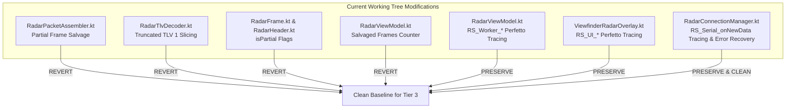

# Implementation Plan: Pre-Commit Codebase Cleanup & Clean Baseline Preparation

> **Document:** `codebase_cleanup_and_commit_plan.md`  
> **Target:** Codebase Hygiene, Reverting Interim Bandages & Preserving Diagnostic Telemetry  
> **Status:** **PROPOSED PLAN (USER REVIEW REQUIRED)**

---

## 1. Goal Description

Before proceeding to implement the **Tier 3 Android Scheduling Hardening** (which will be executed in a fresh conversation), we need to ensure the working tree is clean, hygienic, and free of interim experiments.

During the investigation, two distinct categories of changes were introduced into `.kt` files:
1. **High-Value Diagnostic Instrumentation:** `android.os.Trace` markers (`RS_Serial_onNewData`, `RS_Worker_Assemble`, `RS_Worker_DecodeTLV`, `RS_UI_DrawLollipops`, etc.) and USB auto-recovery logic that enable live Perfetto tracing without overhead.
2. **Interim Partial-Salvage Heuristics:** Code in `RadarPacketAssembler` and `RadarTlvDecoder` that attempted to salvage truncated frames (`isPartial = true`). Since our empirical trace proved that frame truncation is caused by **CPU scheduler starvation (5.18 ms preemption)** and will be permanently solved at the root cause by Tier 3 scheduling priority, these interim salvage bandages should be **reverted**.

This plan details which changes to keep, which to revert, and provides a clean baseline for the final pre-commit review.

---

## 2. Audit of Current `.kt` Changes: Keep vs. Revert



### Detailed File-by-File Breakdown:

| File | Changes Made | Recommendation | Justification |
| :--- | :--- | :--- | :--- |
| **`RadarPacketAssembler.kt`** | Partial frame emission (`isPartial = true`) on premature magic word detection | **REVERT** | Bandage heuristic. The assembler should cleanly discard truncated frames and realign immediately on the new magic word (Bug #28 fix) so dropouts remain strictly visible in telemetry until Tier 3 eliminates them. |
| **`RadarTlvDecoder.kt`** | Slicing truncated point buffers when `remaining < tlvLength` | **REVERT** | Revert to standard strict TLV validation. |
| **`RadarFrame.kt`** | Added `isPartial: Boolean = false` | **REVERT** | No longer needed once partial salvage is removed. |
| **`RadarHeader.kt`** | Added `isPartial: Boolean = false` to `RawRadarPacket` | **REVERT** | No longer needed once partial salvage is removed. |
| **`RadarViewModel.kt`** | 1. Added `totalRadarSalvagedFrames` counter & telemetry<br/>2. Added `RS_Worker_Assemble`, `RS_Worker_WriteFrame`, `RS_Worker_DecodeTLV` `Trace` calls | **REVERT** item 1<br/>**PRESERVE** item 2 | Trace calls are essential for Perfetto profiling and zero-overhead when tracing is off. |
| **`ViewfinderRadarOverlay.kt`** | Added `RS_UI_DrawArcs`, `RS_UI_CalculateLollipops`, `RS_UI_DrawLollipops` `Trace` calls | **PRESERVE** | Crucial diagnostic telemetry measuring Canvas render time on the UI thread. |
| **`RadarConnectionManager.kt`** | 1. Added `RS_Serial_onNewData` `Trace` calls<br/>2. Extracted `startDataIoManager` with clean auto-recovery loop<br/>3. In-situ `Process.setThreadPriority` inside `onNewData` | **PRESERVE** items 1 & 2<br/>**CLEAN UP** item 3 | `startDataIoManager` prevents crashes on USB glitches. Setting thread priority inside `onNewData` will be replaced cleanly in Tier 3 by a proper `ThreadFactory`. |
| **Unit Tests (`*Test.kt`)** | Tests asserting `isPartial = true` behavior | **REVERT** | Revert back to Bug #28 tests verifying clean recovery without Frankenstein frames. |

---

## 3. Documentation & Context Files (All Preserved & Updated)

The following documentation and context files are complete, verified, and will be committed:
1. **`context/09_HANDOVER_RADAR_SCHEDULER_STARVATION_BUG29.md`:** Moved into `context/` as the 9th authoritative intelligence file.
2. **`context/00_MASTER_EXECUTIVE_HANDOVER.md`:** Updated context map and quick lookup guide.
3. **`GEMINI.md`:** Updated context file inventory and references.
4. **`intel/debugging_and_troubleshooting_knowledge_base.md`:** Added **Bug #29** post-mortem and **Core Engineering Rule #29**.
5. **`intel/trace_forensic_analysis_sbs_camera_load.md`:** Deep-dive forensic report on the 62.24 MB SBS trace.
6. **`intel/Implementations/radar_android_scheduling_and_priority_hardening_plan.md`:** The architectural blueprint for Tier 3 implementation.
7. **`scripts/pull_and_analyze_trace.py`:** Standalone Python tool to extract and query Perfetto traces via ADB.

---

## 4. Proposed Execution Steps

### Step 1: Revert Partial Frame Salvage
Revert `RadarPacketAssembler.kt`, `RadarTlvDecoder.kt`, `RadarFrame.kt`, `RadarHeader.kt`, `RadarPacketAssemblerTest.kt`, `RadarTlvDecoderTest.kt`, and `totalRadarSalvagedFrames` in `RadarViewModel.kt`.

### Step 2: Clean Up `RadarConnectionManager.kt`
Retain `RS_Serial_onNewData` tracing and `startDataIoManager` auto-recovery. Remove the in-situ `threadPrioritySet` flag from `onNewData` so the incoming Tier 3 implementation can establish thread priority via `ThreadFactory` cleanly.

### Step 3: Run Full Verification Suite
Execute local JVM unit tests:
```powershell
$env:JAVA_HOME = "C:\Users\rakadu1.AHEAD\Android_Studio\android-studio-quail4-windows\android-studio\jbr"
./gradlew testDebugUnitTest
```
Verify 100% passing tests and clean compilation.

### Step 4: Final Review & Commit
Present the final clean `git status` and diff to the user for explicit commit authorization.

---

## 5. User Review Required

> [!IMPORTANT]
> Please confirm if you approve reverting the partial frame salvage heuristics while preserving all Perfetto `Trace` instrumentation and USB auto-recovery. Upon your approval, we will perform the cleanup and run unit tests.

