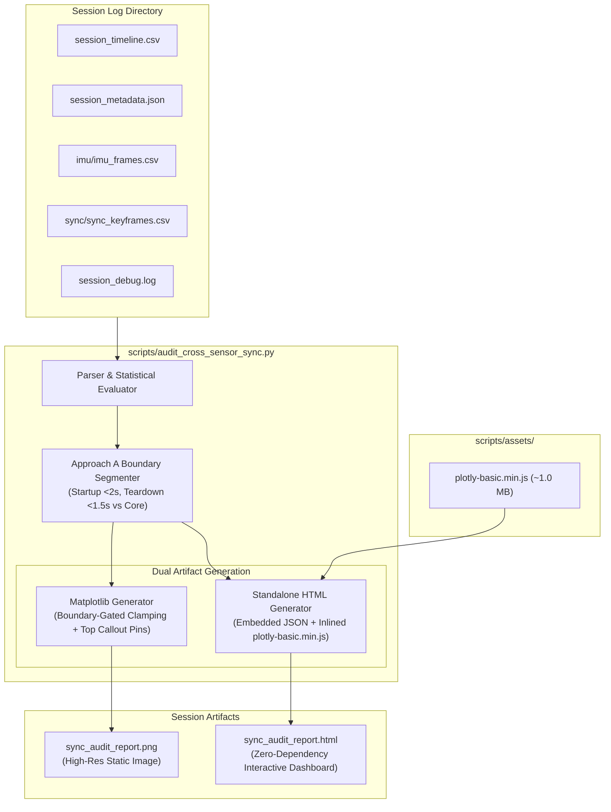

# Implementation Plan: Boundary-Gated Dynamic Scaling & Standalone Interactive HTML Audit Report

## 1. Goal Description
Automotive ADAS logging requires high-fidelity inspection of microsecond-level timing jitter across multi-modal sensor streams (Camera 30 FPS, IMU 100 Hz, Radar 20 Hz). Currently:
1. **Static PNG Scaling Defect**: Camera2 initialization ($t \approx 0.5\text{--}0.8\text{s}$, $\Delta t \approx 480\text{--}550\text{ms}$) and session teardown ($t \ge T_{\text{end}} - 1.5\text{s}$, $\Delta t \approx 380\text{ms}$) create massive boundary spikes. In `scripts/audit_cross_sensor_sync.py`, autoscaling stretches the y-axes to $400\text{--}800\text{ms}$, squishing the nominal $0\text{--}25\text{ms}$ steady-state data into an unreadable flat line at the bottom.
2. **Static Image Limitations**: Engineers inspecting a session cannot zoom in, pan across synchronized streams, inspect individual frame timestamps, or toggle traces.
3. **User Objective**:
   - Implement **Approach A** (Boundary-Gated Auto-Ranging) in the static PNG report so the steady-state jitter is clearly visible while mid-stream anomalies still expand the axes.
   - Implement an **Interactive HTML Audit Report** (`sync_audit_report.html`) powered by **Plotly.js**, saved directly in each session folder alongside the PNG.
   - **Crucial Requirement**: The HTML report must be a **single standalone file with zero external dependencies**, capable of opening on any air-gapped PC or field laptop without internet connection or local web servers.

---

## 2. Feasibility & Architecture Evaluation

### 2.1 Feasibility Matrix

| Requirement | Feasibility | Technical Approach |
| :--- | :---: | :--- |
| **Zero Python Dependencies** | **100% Feasible** | Do NOT require `pip install plotly`. Python only formats session arrays into JSON. Standard Python library (`json`, `os`, `sys`) is used exclusively. |
| **Zero Browser / Internet Dependencies** | **100% Feasible** | Pre-bundle a minified Plotly.js runtime (`plotly-basic.min.js`, ~1 MB) in `scripts/assets/plotly-basic.min.js`. Python reads and inlines this script directly into `<script>...</script>`. Double-clicking `sync_audit_report.html` opens instantly in Chrome/Edge/Firefox via `file:///` protocol without Wi-Fi. |
| **Approach A Dynamic Y-Scaling** | **100% Feasible** | Segment timeline into Transient Boundaries ($[0, 2.0\text{s}]$ and $[T_{\text{end}}-1.5\text{s}, T_{\text{end}}]$) vs Steady-State Core. Compute steady-state maximums to dynamically window axes, with top-pinned markers for boundary warmup/teardown. |
| **Multi-Track Synchronized X-Zoom** | **100% Feasible** | Plotly subplot feature `xaxis: { matches: 'x' }` ensures panning or zooming into any feature on Panel 1 zooms all 6 subplots simultaneously. |
| **Executive Scorecard & KPIs Embedded** | **100% Feasible** | Embed responsive HTML/CSS KPI cards, certification grade badge (`GOLD`/`SILVER`/`WARN`), stream health summaries, and full audit table directly in the HTML file. |



---

## 3. User Review Required

> [!IMPORTANT]
> **Zero External Dependencies Strategy**:
> We will store the vendor asset `scripts/assets/plotly-basic.min.js` (~1.0 MB) in the repository once.
> The Python script will inline this asset directly into the generated `sync_audit_report.html`.
> - **Advantage**: The resulting HTML report works on any offline PC, vehicle laptop, or test dyno computer via `file:///` without internet, node.js, or pip packages.
> - **File Size**: Each generated `sync_audit_report.html` will be $\approx 1.5\text{--}2.5\text{ MB}$ (including data points and plotting runtime).
> - **Matplotlib PNG Retained**: The PNG file (`sync_audit_report.png`) will continue to be generated for instant preview, with Approach A scaling applied.

---

## 4. Proposed Changes

### Component: Cross-Sensor Audit Toolchain (`scripts/`)

#### [NEW] `scripts/assets/plotly-basic.min.js`
- Minified, official Plotly Basic bundle supporting 2D scatter, line plots, subplots, hover tooltips, shapes, and annotations.
- Committed to `scripts/assets/` to ensure offline reproducibility across all platforms.

---

#### [MODIFY] `scripts/audit_cross_sensor_sync.py`

##### 1. Implement Approach A in `generate_sync_plots()` (Matplotlib PNG)
- Compute steady-state core data:
  ```python
  # Core window: t >= 2.0s and t <= (total_dur_s - 1.5s)
  core_rad = [off for t, off in zip(rad_t_s, rad_offsets_ms) if 2.0 <= t <= (total_dur_s - 1.5)]
  core_cam_dt = [dt for t, dt in zip(cam_t_s, cam_dt_ms) if 2.0 <= t <= (total_dur_s - 1.5)]
  core_rad_dt = [dt for t, dt in zip(rad_frame_t_s, rad_frame_dt_ms) if 2.0 <= t <= (total_dur_s - 1.5)]
  ```
- **Panel 1 Y-Limits**:
  - `rad_core_max = max(core_rad) if core_rad else 25.0`
  - `y1_max = max(45.0, rad_core_max * 1.25)`
  - `ax0.set_ylim(-2.0, y1_max)`
  - Startup spikes ($t < 2.0\text{s}$) and teardown spikes ($t > T - 1.5\text{s}$) that exceed `y1_max` receive a top-pinned callout badge (e.g., `▲ Startup Init: 221ms` and `▲ Teardown: 387ms`).
- **Panel 2 Y-Limits**:
  - `cam_core_max = max(core_cam_dt) if core_cam_dt else 35.0`
  - `rad_core_max = max(core_rad_dt) if core_rad_dt else 52.0`
  - `y2_max = max(75.0, max(cam_core_max, rad_core_max) * 1.2)`
  - `ax1.set_ylim(-5.0, y2_max)`
  - Startup drop ($t < 2.0\text{s}$) exceeding `y2_max` is annotated with a top-pinned badge: `▲ Startup Pause: 484ms (Camera2 Init)`.
  - Mid-session drops automatically raise `y2_max` so that true in-flight faults are never clipped!

##### 2. Add `generate_interactive_html_report()`
- Creates `sync_audit_report.html` in the session directory.
- Inlines `scripts/assets/plotly-basic.min.js`.
- Downsamples or bundles the 6 tracks into compressed JSON payloads:
  1. Radar-to-Camera Latency Offset & Nyquist thresholds (16.67ms, 33.33ms).
  2. Frame Intervals: Camera (30 FPS nominal) and Radar (20 Hz nominal).
  3. UI Flight Recorder events (taps, fullscreen toggles).
  4. IMU 100 Hz $\Delta t$ and 5s Sync Anchors.
  5. Camera-to-Nearest-IMU Proximity (100 Hz $\Delta t$) with 5.0ms Nyquist threshold.
  6. Multithreaded Write Buffer Latency.
- Builds a responsive, dark-mode automotive QA interface:
  - Header: Session ID, Duration, Hardware Model, Monotonic Timestamps.
  - Overall Certification Badge: `GOLD` (emerald), `SILVER` (green), `WARN` (amber), `FAIL` (red).
  - KPI Stat Grid: 6 cards displaying Mean Latencies, P50, P95, P99, Percent Compliant, and Sample Counts.
  - Interactive Plotly Div with synchronized x-axis (`matches: 'x'`).
  - View presets toolbar:
    - `[Steady-State Focus (Default)]`
    - `[Show All Spikes / Full Horizon]`
    - `[Startup Phase (First 5s)]`
  - Executive Audit Checklist Table (10 scorecard items with pass/warn/fail badges).
  - Session Metadata details & active streams list.

##### 3. CLI Argument Support
- `--no-html`: Skip HTML generation if only terminal output is desired.
- Both PNG and HTML are generated by default when auditing a session.

---

## 5. Verification Plan

### Automated Verification
1. Download `plotly-basic.min.js` to `scripts/assets/plotly-basic.min.js` using Python standard library.
2. Run `audit_cross_sensor_sync.py` on the two latest test sessions:
   ```powershell
   python scripts/audit_cross_sensor_sync.py logs/session_20261016_143148
   python scripts/audit_cross_sensor_sync.py logs/session_20261016_144844
   ```
3. Verify output files exist and are non-empty:
   - `logs/session_20261016_144844/sync_audit_report.png`
   - `logs/session_20261016_144844/sync_audit_report.html`
4. Inspect `sync_audit_report.html` for single-file integrity:
   - Verify zero external `<script src="http...">` or `<link rel="stylesheet" href="http...">` network requests.
   - Verify file opens cleanly in browser and renders interactive charts.
   - Verify Approach A zoom: Panel 1 y-axis defaults to $\approx 45\text{--}50\text{ ms}$, Panel 2 y-axis defaults to $\approx 75\text{ ms}$.
   - Verify clicking `[Show All Spikes]` expands axes to show boundary spikes ($221\text{ ms}$ and $387\text{ ms}$).

### Manual Verification
- The user can double-click `logs/session_20261016_144844/sync_audit_report.html` in Chrome/Edge on Windows, test hovering over data points, panning, zooming, and switching view presets.
