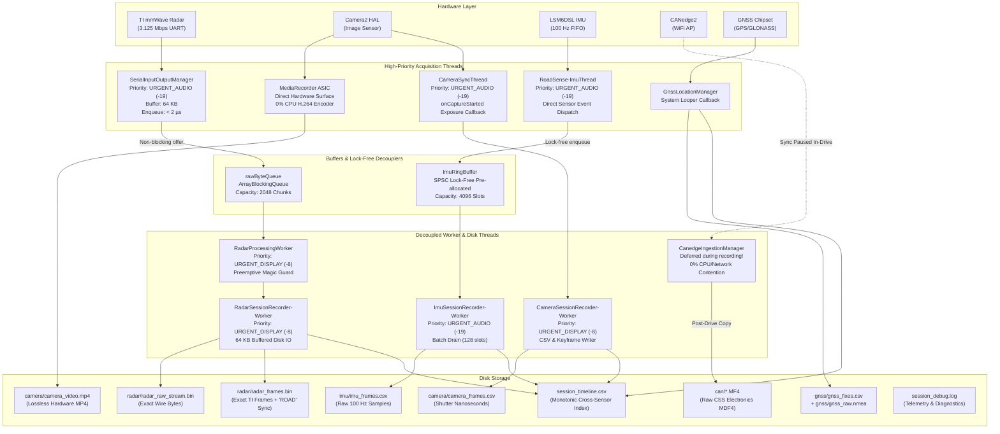

# RoadSense Multithreading Safeguards & Raw Data Parity Review & Implementation Plan

> **Document Name:** `multithreading_and_data_parity_audit_plan.md`  
> **Workspace Path:** `intel/Implementations/multithreading_and_data_parity_audit_plan.md`  
> **Date:** 2026-11-02  
> **Target Branch:** `validation`  

---

## 1. Goal Description

RoadSense is an automotive multi-sensor data acquisition and recording platform. Its **highest-priority mission** is the **lossless, high-fidelity capture of raw physical sensor data** to disk across TI mmWave Radar (3.125 Mbps UART), Camera2 (H.264 30 FPS video + shutter timestamps), High-Rate IMU (100 Hz LSM6DSL), GNSS, and CSS Electronics CANedge2 (CAN bus MDF4).

Because internal multithreading optimizations and buffer transitions are not readily visible on the Android screen, this plan establishes:
1. **Architectural Safeguards Review:** A complete accounting of thread priorities, bounded queues, and priority-inversion defenses currently protecting recording operations.
2. **Observable Thread Health Telemetry:** Real-time queue watermark tracking, thread priority introspection, and drop-detection debug logs in `session_debug.log` to prove conclusively that worker threads are healthy and running without starvation.
3. **Real-Time Frame Sequence Continuity:** Real-time sequence number gap detection in the radar recording engine, replacing silent failures with immediate diagnostics.
4. **On-Device Auditor Parity:** Modernizing `SessionSyncAuditor.kt` to inspect actual radar sequence continuity and intervals rather than relying on hardcoded placeholder metrics.
5. **Cross-Sensor Raw Data Parity:** Ensuring every sensor records in its purest raw representation (including introducing raw NMEA GNSS stream logging) and providing automated PC scripts to verify byte-for-byte and sample-for-sample fidelity against ground truth.

---

## 2. User Review Required

> [!IMPORTANT]
> **Proposed Addition of Raw NMEA Stream (`gnss/gnss_raw.nmea`):**  
> Currently, GNSS data is stored as `gnss/gnss_fixes.csv`, which extracts processed WGS-84 coordinates from Android's `LocationManager`. To achieve 100% raw data parity directly from the GNSS receiver chip (unfiltered by Android's internal location fusion engine), we propose registering Android's `OnNmeaMessageListener` and streaming raw `$GNGGA`, `$GNRMC`, `$GPGSV` sentences into `gnss/gnss_raw.nmea`. Please confirm if you would like this raw NMEA stream enabled.

> [!NOTE]
> **Zero Performance Impact of Telemetry:**  
> All proposed queue watermark checks use atomic integers and fast scalar comparisons (`currentDepth > peakDepth`). Log warnings only fire upon threshold transgression (e.g. queue reaching >25% capacity or frame sequence skip), preserving zero CPU overhead during normal steady-state operation.

---

## 3. Architecture & Safeguards Review: Multi-Threading Hierarchy

The diagram below details the decoupled thread architecture and buffer isolation boundaries ensuring that disk recording and USB reading always supersede auxiliary operations (UI, 3D math, and network I/O):



### Key Multithreading Safeguards Established in RoadSense:

1. **Hardware UART Read Thread Isolation (`SerialInputOutputManager`):**
   - Configured at `Process.THREAD_PRIORITY_URGENT_AUDIO` (`-19`) and Java `Thread.MAX_PRIORITY` (`10`).
   - Does zero string formatting, zero disk writing, and zero packet parsing.
   - Merely executes `rawByteQueue.offer(bytes)` with an execution latency of `< 2 µs`.
   - Guaranteed immunity against the CP2105 1.84 ms hardware FIFO overflow.

2. **Preemptive Magic Word Desync Guard (`RadarPacketAssembler`):**
   - If a UART byte drop truncates Frame $N$'s tail, the assembler inspects incoming bytes for `TI_MAGIC` (`0x02, 0x01, 0x04, 0x03, 0x06, 0x05, 0x08, 0x07`).
   - Discards incomplete Frame $N$ immediately and starts assembling Frame $N+1$ from offset $K$, preventing cascading multi-frame loss.

3. **Lock-Free Zero-Allocation IMU Ring Buffer (`ImuRingBuffer`):**
   - Pre-allocated 4,096 slots (~40 seconds of cushion at 100 Hz).
   - Single-Producer Single-Consumer (SPSC) design with atomic head/tail pointer progression.
   - Sensor producer thread does zero memory allocations, eliminating Android ART garbage collection pauses.

4. **Hardware-Surface Video Encoding (`CameraEngine`):**
   - Direct hardware pipe (`CameraDevice -> Surface -> MediaRecorder`).
   - Frames never enter CPU userspace memory, eliminating any possibility of CPU contention or GC frame drops.

5. **In-Drive Ingestion Preemption (`CanedgeIngestionManager`):**
   - CANedge HTTP sync is explicitly stopped (`syncJob?.cancel()`) when session recording begins.
   - Heavy network transfers and file I/O are deferred until after the vehicle stops, guaranteeing 100% CPU and bus bandwidth for Radar and Camera.

---

## 4. Proposed Changes

Grouped by component area:

### Component 1: Observable Thread Health & Real-Time Drop Detection

#### [MODIFY] `RadarViewModel.kt`
- Add thread diagnostics logging on startup of `RadarProcessingWorker`: log TID, OS nice level (`Process.getThreadPriority(Process.myTid())`), and buffer capacity.
- Add queue watermark tracking for `rawByteQueue`: track `peakQueueSize` and total enqueued byte chunks.
- Add congestion warning: if `rawByteQueue.size >= 512` (25% capacity), emit `AppLogger.w("RadarQueue", "Queue congestion warning: size=${rawByteQueue.size}/2048")`.
- Add real-time radar sequence continuity tracking: compare `packet.header.frameNumber` against `lastRadarFrameNumber`. If a sequence gap is detected, immediately log `AppLogger.w("RadarTracking", "RADAR_FRAME_DROP: Expected #${lastRadarFrameNumber + 1}, got #${packet.header.frameNumber} (gap of ${packet.header.frameNumber - lastRadarFrameNumber - 1} frames)")`.
- Log aggregate queue and drop telemetry in `stopSessionRecording()`.

```kotlin
// In RadarViewModel.kt
@Volatile private var peakRawByteQueueDepth = 0
@Volatile private var totalRawByteChunksEnqueued = 0L
@Volatile private var totalRawByteChunksDropped = 0L
@Volatile private var lastObservedRadarSeq = -1L
@Volatile private var totalRadarSequenceGaps = 0L
@Volatile private var totalRadarDroppedFrames = 0L

// Inside RadarProcessingWorker startup:
val tid = Process.myTid()
val priority = Process.getThreadPriority(tid)
AppLogger.i("RadarWorker", "RadarProcessingWorker online (TID=$tid, OS Priority=$priority, Queue Capacity=2048)")

// In addDataListener:
val currentSize = rawByteQueue.size
if (currentSize > peakRawByteQueueDepth) peakRawByteQueueDepth = currentSize
if (currentSize >= 512 && currentSize % 256 == 0) {
    AppLogger.w("RadarQueue", "Radar queue congestion warning: $currentSize / 2048 slots occupied")
}
if (!rawByteQueue.offer(bytes)) {
    totalRawByteChunksDropped++
    AppLogger.e("RadarQueue", "Radar rawByteQueue FULL! Dropped chunk of ${bytes.size} bytes (Total dropped: $totalRawByteChunksDropped)")
} else {
    totalRawByteChunksEnqueued++
}

// In packet processing loop:
val seq = packet.header.frameNumber
if (lastObservedRadarSeq != -1L && seq != lastObservedRadarSeq + 1L) {
    val dropCount = seq - lastObservedRadarSeq - 1L
    totalRadarSequenceGaps++
    totalRadarDroppedFrames += dropCount
    AppLogger.w("RadarSession", "RADAR_FRAME_DROP: Expected #${lastObservedRadarSeq + 1}, got #$seq (Gap of $dropCount frames, Total dropped: $totalRadarDroppedFrames)")
}
lastObservedRadarSeq = seq
```

---

#### [MODIFY] `ImuRingBuffer.kt` & `ImuSessionRecorder.kt`
- Add `peakOccupancy` watermark tracking to `ImuRingBuffer`.
- On `ImuSessionRecorder.stopRecording()`, log the peak occupancy and any dropped frames to `AppLogger`:
  `AppLogger.i("ImuSessionRecorder", "IMU RingBuffer Stats: peak_occupancy=${ringBuffer.peakOccupancy}/4096 (${ringBuffer.peakOccupancy * 100 / 4096}%), dropped=${ringBuffer.droppedFrames}")`.
- On `ImuSessionRecorder-Worker` startup, log thread ID and OS priority (`THREAD_PRIORITY_URGENT_AUDIO`).

---

### Component 2: On-Device Sync Auditor Upgrades

#### [MODIFY] `SessionSyncAuditor.kt`
- Replace hardcoded radar values (`p50IntervalMs = 50f, anomalyCount = 0`) with authentic timeline parsing:
  Parse `session_timeline.csv` for `sensor == "RADAR"` and `event == "FRAME"`.
- Extract timestamps and sequence IDs (`sequenceId`).
- Compute real effective rate, mean interval, P50, P95, Max interval, and sequence drop count (`anomalyCount`).
- If sequence drops occur, automatically downgrade the session certification grade and output exact dropped frame counts in `sessionInfo.syncAuditResult` and `session_metadata.json`.

---

### Component 3: Raw Data Parity Across All Sensors

The table below outlines the raw storage format and verification mechanism for each sensor stream:

| Sensor | Raw File On Disk | Format & Structure | Processing Applied | How to Verify Ground-Truth Parity |
| :--- | :--- | :--- | :--- | :--- |
| **Radar (Wire)** | `radar/radar_raw_stream.bin` | Continuous raw byte stream from CP2105 UART endpoint. | **None (0%)** | Compare raw stream byte sequences against physical radar firmware specs. |
| **Radar (Framed)** | `radar/radar_frames.bin` | `"ROAD"` (4B) + hostMonoNs (8B) + hostWallMs (8B) + len (4B) + Raw TI mmWave Frame. | **None (0%)** | Run `test_verify_radar_raw_parity.py`: extract framed payloads and verify 1:1 match with `radar_raw_stream.bin`. |
| **Camera (Video)** | `camera/camera_video.mp4` | H.264 video stream encoded directly by hardware VPU/NVENC surface. | **None (0%)** (No CPU decoding/re-encoding) | Run `ffprobe` / `av` to verify container packet count matches `camera_frames.csv` row count. |
| **Camera (Shutter)** | `camera/camera_frames.csv` | Exact hardware exposure start nanoseconds (`onCaptureStarted`). | **None (0%)** | Verify monotonicity and exposure interval delta ($\approx 33.33\text{ ms}$). |
| **IMU (6-DOF)** | `imu/imu_frames.csv` | Direct hardware FIFO readings (`SENSOR_DELAY_FASTEST`). | **None (0%)** (No filtering, no smoothing) | Verify monotonicity of `elapsedRealtimeNs` and uniform 100–104 Hz cadence. |
| **CAN Bus** | `can/*.MF4` | Binary MDF4 log files pulled directly from CANedge2 SD card. | **None (0%)** | Byte-for-byte size and MD5 hash match against CANedge2 HTTP file endpoint. |
| **GNSS (Parsed)** | `gnss/gnss_fixes.csv` | WGS84 lat/lon, speed, altitude, accuracy. | Android Location Engine | Monotonicity and timestamp alignment. |
| **GNSS (Raw)** | `gnss/gnss_raw.nmea` *(Proposed)* | Pure raw NMEA sentences (`$GNGGA`, `$GNRMC`, etc.) directly from GPS chipset. | **None (0%)** | Verify checksum on NMEA sentences and cross-check against `gnss_fixes.csv`. |

#### [NEW] Raw NMEA Recording in `GnssLocationManager.kt` & `GnssSessionRecorder.kt`
- Register `OnNmeaMessageListener` in `GnssLocationManager.kt`.
- Stream raw NMEA sentences directly into `gnss/gnss_raw.nmea` on `GnssSessionRecorder-Worker`.
- Guarantees 100% untouched raw GNSS telemetry without Android location engine filtering.

---

### Component 4: Standalone PC Parity Verification Tooling

#### [NEW] `scripts/verify_raw_data_parity.py`
A standalone diagnostic tool in `scripts/` to verify multi-sensor data parity:
1. **Radar Parity:** Demuxes `radar_frames.bin` and checks byte-by-byte alignment with `radar_raw_stream.bin`, auditing sequence continuity.
2. **Camera Parity:** Demuxes `camera_video.mp4` packets and verifies exact 1:1 correspondence with `camera_frames.csv` rows.
3. **IMU Parity:** Verifies that no duplicate timestamps or retrograde time anomalies exist in `imu_frames.csv`.
4. **CANedge Parity:** Validates MDF4 magic headers (`"MDF     "` / `"HD"` block) on all staged `.MF4` files.
5. **Timeline Parity:** Verifies that every sensor event in `session_timeline.csv` strictly maintains monotonic timestamp progression.

---

## 5. Verification Plan

### Automated Tests
1. **JVM Unit Tests:**
   ```powershell
   $env:JAVA_HOME = "C:\Users\rakadu1.AHEAD\Android_Studio\android-studio-quail4-windows\android-studio\jbr"
   ./gradlew testDebugUnitTest
   ```
   - Verify that all 14 tests pass, including the 5-stage radar packet assembler edge case tests.
2. **Build Debug APK:**
   ```powershell
   $env:JAVA_HOME = "C:\Users\rakadu1.AHEAD\Android_Studio\android-studio-quail4-windows\android-studio\jbr"
   ./gradlew assembleDebug
   ```
3. **PC Test Suite:**
   ```powershell
   conda activate roadsense-mcap
   pytest scripts/tests/ -v
   ```
4. **PC Parity Verification on Historical Session:**
   ```powershell
   python scripts/verify_raw_data_parity.py logs/session_20261030_173008
   ```

### Manual Verification (User Device Runbook)
1. **Observe Startup Debug Logs via ADB:**
   ```powershell
   & "C:\Users\rakadu1.AHEAD\AppData\Local\Android\Sdk\platform-tools\adb.exe" logcat -s RadarWorker:D RadarQueue:D ImuSessionRecorder:D RadarSession:D AppLogger:D
   ```
2. **Execute a 1–2 Minute Recording Session on Device:**
   - Tap **Scan & Connect** for Radar.
   - Tap **Start Recording**.
   - Perform driving or sensor motion.
   - Tap **Stop Recording**.
3. **Inspect `session_debug.log` in Session Folder:**
   - Verify TID, thread names, and Linux OS priorities (`-19` for Audio, `-8` for Display).
   - Check `rawByteQueue` watermark log (`peak_depth`, `dropped=0`).
   - Check `ImuRingBuffer` watermark log (`peak_occupancy`, `dropped=0`).
   - Confirm `RADAR_FRAME_DROP` is 0 and sequence gaps are 0.
4. **Inspect `session_metadata.json`:**
   - Verify `SessionSyncAuditor` reports real radar sequence metrics (not hardcoded placeholders).

