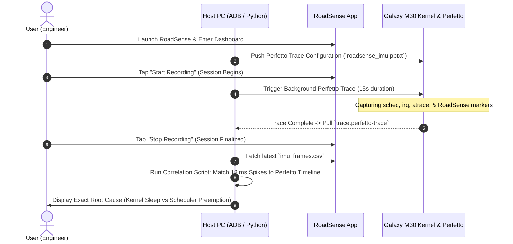

# Implementation Plan: On-Device Perfetto Trace & IMU Jitter Analysis

Investigate the underlying physical / kernel-level cause of the periodic 18 ms IMU timestamp spikes ($\Delta t_{\text{prev}} + \Delta t_{\text{spike}} = 30.00\text{ ms}$) on the connected **Samsung Galaxy M30 (`SM-M305F`, Exynos 7904, Android 10)** using nanosecond-precision **Perfetto** system tracing.

---

## 1. Goal Description

### Context & Problem Statement
From our empirical testing across 6 sessions:
- **Baseline Jitter**: $\sigma = \pm 0.860$ ms, 0.74 spikes/s (device idling).
- **Current Production Candidate (Lead 1)**: $\sigma = \pm 0.993$ ms, 0.988 spikes/s at 98.49 Hz with zero steady-state camera frame drops.
- **The Remaining Quirk**: Approximately once every ~1.0–1.2 seconds, a single sensor tick is omitted, producing an interval of $\approx 17.5$–$18.0$ ms preceded by an interval of $\approx 12.0$–$12.5$ ms (summing exactly to $30.00\text{ ms} \pm 0.1\text{ ms}$).

### What Perfetto Tracing Will Reveal
By capturing a synchronized 20-second trace during an active RoadSense recording session, we will determine with absolute certainty:
1. **Thread State during the 18 ms window**: Was `RoadSense-ImuThread` actively sleeping in `epoll_wait` (proving the HAL/kernel simply delivered no event), or was it in `Runnable` state blocked waiting for CPU cores?
2. **CPU Preemption & Core Affinity**: Did high-priority system tasks (Camera ISP daemon, `surfaceflinger`, `system_server`) preempt the IMU thread?
3. **Hardware Interrupt Frequency**: Did the physical ST LSM6DSL hardware IRQ fire at 104 Hz uninterrupted, or did the interrupt line stall at the kernel level?
4. **App Execution Slice**: Verify that the execution duration of `RoadSense:onSensorChanged` remains strictly sub-millisecond ($< 0.05$ ms).

```
   [ ST LSM6DSL MEMS ]
            │ (Physical Hardware IRQ)
            ▼
   [ Kernel SPI / I2C Driver ]  <── Track irq/irq_handler_entry in Perfetto
            │ (Wakeup & DMA)
            ▼
   [ Linux CFS Scheduler ]      <── Track sched/sched_switch & sched_wakeup
            │ (Thread Preemption?)
            ▼
   [ RoadSense-ImuThread ]      <── Track RoadSense:onSensorChanged slice
```

---

## 2. User Review Required

> [!IMPORTANT]
> **No Permanent App Code Modifications Needed**:
> The app already includes high-precision `Trace.beginSection("RoadSense:onSensorChanged")` markers on the IMU thread. We do not need to alter production code logic, ensuring that trace data directly reflects real-world operational performance.

> [!NOTE]
> **Tracing Overhead**:
> Perfetto is Android's official zero-overhead tracing daemon. On Android 10 (`SM-M305F`), it writes directly to a memory-mapped circular ring buffer with $< 1\%$ CPU impact, preserving realistic scheduler dynamics.

---

## 3. Proposed Execution Strategy & Workflow



---

## 4. Trace Configuration & Tools

### A. Trace Configuration Profile (`scratch/roadsense_imu.pbtxt`)
The trace will record:
- **Scheduler Events**: `sched/sched_switch`, `sched/sched_wakeup`, `sched/sched_blocked_reason`
- **Interrupts & Bottom-Halves**: `irq/irq_handler_entry`, `irq/irq_handler_exit`, `irq/softirq_entry`, `irq/softirq_exit`
- **Application Trace Slices**: Atrace categories `am`, `app`, `view`, `camera`, `hal`, targeting `com.bajajauto.roadsense`
- **CPU Frequency & Power States**: `power/cpu_frequency`, `power/cpu_idle`
- **Buffer Size**: 32 MB in-memory ring buffer for 15–20 seconds duration.

```protobuf
buffers: {
    size_kb: 32768
    fill_policy: RING_BUFFER
}
data_sources: {
    config: {
        name: "linux.ftrace"
        ftrace_config: {
            ftrace_events: "sched/sched_switch"
            ftrace_events: "sched/sched_wakeup"
            ftrace_events: "sched/sched_waking"
            ftrace_events: "irq/irq_handler_entry"
            ftrace_events: "irq/irq_handler_exit"
            ftrace_events: "power/cpu_frequency"
            ftrace_events: "power/cpu_idle"
            atrace_categories: "am"
            atrace_categories: "app"
            atrace_categories: "view"
            atrace_categories: "camera"
            atrace_categories: "hal"
            atrace_apps: "com.bajajauto.roadsense"
        }
    }
}
data_sources: {
    config: {
        name: "linux.process_stats"
        process_stats_config: {
            proc_stats_poll_ms: 100
        }
    }
}
duration_ms: 20000
```

---

### B. Automated Correlation Script ([NEW] `scripts/analyze_perfetto_imu_sync.py`)
To avoid manual visual searching across millions of timeline events in the browser:
- Reads the newly captured `imu/imu_frames.csv` to identify the exact timestamps of all intervals $> 16.0$ ms.
- Queries the Perfetto trace using the Perfetto Trace Processor SQL interface.
- For each spike:
  - Prints what thread was executing on each CPU core.
  - Reports the exact state of `RoadSense-ImuThread` (`Running`, `Runnable` [waiting for CPU], or `Sleeping` [waiting on HAL socket]).
  - Reports whether any hardware IRQs fired in that interval.

---

## 5. Verification & Analysis Plan

### Step-by-Step Verification Procedure
1. **Host Verification**:
   Verify ADB connectivity and verify that `persist.traced.enable=1` is active on device.
2. **Interactive Run**:
   - Start recording in RoadSense on the phone.
   - Run the trace capture command from host:
     ```powershell
     python scripts/run_perfetto_trace.py --duration 15
     ```
   - Stop recording in RoadSense.
3. **Automated Analysis**:
   - Run `python scripts/analyze_perfetto_imu_sync.py --latest`
   - Evaluate the state report.
4. **Visual Inspection**:
   - Open the generated `.perfetto-trace` in [ui.perfetto.dev](https://ui.perfetto.dev).
   - Inspect the `RoadSense-ImuThread` track alongside `sched_switch` and CPU frequency graphs.

### Expected Decision Trees from Trace Findings
- **Case A: `RoadSense-ImuThread` is Sleeping (`S`) throughout the 18 ms**:
  - *Meaning*: The application and OS scheduler are completely innocent. The Samsung sensor driver / ST LSM6DSL hardware FIFO simply did not deliver an event for 18 ms.
  - *Conclusion*: Confirms that 0.98 spikes/s is the physical hardware floor of the ST LSM6DSL crystal on this platform.
- **Case B: `RoadSense-ImuThread` is Runnable (`R`) but not Scheduled**:
  - *Meaning*: An event arrived from the HAL, but the Linux scheduler starved the thread because another task (e.g. camera processing or UI) occupied the CPU core.
  - *Solution*: Set Linux real-time `SCHED_FIFO` priority or pin the IMU thread to an isolated CPU cluster.
