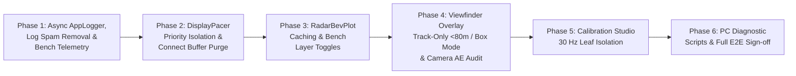

# Phased Mitigation & Verification Plan: UI Stutter, DisplayPacer Bufferbloat & Instrumentation

> **Status:** Proposed Implementation Plan (Awaiting Review)  
> **Baseline Audit:** [`session_20261113_101048_forensic_performance_audit.md`](file:///C:/Users/rakadu1.AHEAD/AndroidStudioProjects/RoadSense/intel/session_20261113_101048_forensic_performance_audit.md)  
> **Target Device Profile:** Samsung Galaxy M32 (`SM-M325F`, Exynos / Mali GPU, `60.0 Hz` UI lock, Camera2 HAL max `30 FPS` recording/preview)

---

## Executive Summary & Design Goals

Following the forensic audit of `session_20261113_101048` and your inline review comments, this plan systematically addresses all **6 root causes** across **6 incremental, independently verifiable phases**. Every phase modifies a bounded set of files, compiles cleanly, passes JVM unit tests, and provides an explicit **Bench / Device Verification Gate** before proceeding to the next phase.



### Mapping of User Review Decisions to Phases

| Audit Finding | User Directive | Planned Resolution | Phase |
| :--- | :--- | :--- | :---: |
| **#5 AppLogger Contention (80+ flushes/s)** | Disable noisy `[DisplayPacer]` debug spam by default; we needed it for bug hunting but can skip it now. | Gate `RadarDisplayPacer` `[ENQUEUE]`/`[EMIT]`/`[DROP]`/`[STARVATION]` behind a default-`false` flag (`enableVerboseLogging`), and refactor `AppLogger` onto a single non-blocking async queue writer thread. | **Phase 1** |
| **#6 DisplayPacer Jitter (122 ms) & 250 ms Lag** | Design a proper solution to eliminate stalls, false drops, and permanent `qDepth=5` lag. | Isolate `RadarDisplayPacer` onto a dedicated prioritized single-thread dispatcher (`THREAD_PRIORITY_DISPLAY`), enforce low-latency steady-state queue cap (`maxQueueDepth = 2`, target `qDepth <= 1`) with catch-up trim, and purge stale CP2105 HW RX buffers on connect. | **Phase 2** |
| **#3 RadarBevPlot Stutter & Recomposition** | Add debug logs + enable/disable flags so it can be isolated and debugged right on the bench. | Cache `egoPath` & hoist `Stroke` instances out of loops, stabilize BEV recomposition, add toggleable layer/debug flags + `[DRAW_BEV]` timing logs compatible with `scripts/analyze_display_pacer_log.py`. | **Phase 3** |
| **#2 Viewfinder Overlay Overload** | Simplify real-time debug drawing: **(1)** draw lollipops **only for identified tracks (`TLV 3`) closer than `80 m`** (~`4.8` tracks/frame vs up to `200` raw points -> **>90% reduction**), and **(2)** support **simple rectangular boxes** fallback. | Update `SpatialProjectionEngine.calculateRadarLollipops` (`includeUntrackedPoints = false`, `maxRangeM = 80f`), add overlay render mode (`TRACK_LOLLIPOPS_80M`, `SIMPLE_BOXES_80M`, `ALL_POINTS_LEGACY`), hoist `Stroke`s, and add `[DRAW_OVERLAY]` debug toggle. | **Phase 4** |
| **#1 Camera Preview `>= 35 ms` & Luminance Readback** | Note that Samsung Camera2 HAL limits recording/preview to **30 FPS (`33.3 ms`)**. | Report exact `layout`/`draw`/`sync`/`gpu` phase medians in `[WINDOW_5S]` (Phase 1) to empirically prove HAL/GPU wait vs main-thread Compose draw, and optimize `CameraEngine.startLuminanceAnalyzer` to yield/skip redundant GPU readbacks. | **Phases 1 & 4** |
| **#4 Fullscreen Calibration Studio Lag** | Throttle live IMU calibration studio update to **30 Hz** (`<= 33.3 ms`). | Enforce `<= 30 Hz` telemetry cap (`ImuManager` already defaults to `40 ms` / `25 Hz`; make `30 Hz` explicit ceiling and verify) AND move `imuTelemetry` collection out of `FullscreenCalibrationStudio` root composable into a leaf horizon canvas with cached `Path`/`Stroke`/`Paint`. | **Phase 5** |

---

## Phase 1: Non-Blocking `AppLogger`, Spam Suppression & Granular Frame/Canvas Profiling

### Goal
Eliminate disk I/O lock contention across `RadarProcessingWorker`, `DisplayPacer`, `main`, and `UiFrameMetricsProfiler` **first**, while unlocking per-phase GPU/draw/canvas visibility needed to measure every subsequent optimization objectively.

### Proposed Changes

#### 1. Asynchronous Non-Blocking `AppLogger`
- **File:** [`app/src/main/java/com/bajajauto/roadsense/logging/AppLogger.kt`](file:///C:/Users/rakadu1.AHEAD/AndroidStudioProjects/RoadSense/app/src/main/java/com/bajajauto/roadsense/logging/AppLogger.kt)
- **Design:**
  - Replace inline synchronous formatting + dual `writer.flush()` inside `log()` with a bounded lock-free queue (`LinkedBlockingQueue<LogEntry>(4096)`).
  - Spawn a single dedicated daemon writer thread (`"RS-LogWriter"`, `Process.THREAD_PRIORITY_BACKGROUND`) that drains queued entries in batches (`drainTo(batch, 64)`), formats timestamps with its thread-local `SimpleDateFormat`, writes to `appLogWriter` and `activeWriter` (`session_debug.log`), and flushes once per batch (`<= 4` times/sec or immediately on `WARN`/`ERROR` or `attachSession`/`detachSession`).
  - Keep `synchronized(writerLock)` strictly around writer open/close/drain transitions on the writer thread — caller threads (`RadarProcessingWorker`, `main`, `DisplayPacer`) **never block on flash I/O**.
  - Add an atomic dropped-log counter (`AtomicLong`) logged once as `[LOGGER_OVERFLOW]` if the `4096`-entry queue ever saturates (graceful drop-oldest or drop-incoming on debug logs rather than blocking real-time threads).

#### 2. Suppress High-Frequency `RadarDisplayPacer` & Add Runtime Diagnostic Toggles
- **Files:**
  - [`app/src/main/java/com/bajajauto/roadsense/sync/RadarDisplayPacer.kt`](file:///C:/Users/rakadu1.AHEAD/AndroidStudioProjects/RoadSense/app/src/main/java/com/bajajauto/roadsense/sync/RadarDisplayPacer.kt)
  - [`app/src/main/java/com/bajajauto/roadsense/storage/AppPreferences.kt`](file:///C:/Users/rakadu1.AHEAD/AndroidStudioProjects/RoadSense/app/src/main/java/com/bajajauto/roadsense/storage/AppPreferences.kt)
  - [`app/src/main/java/com/bajajauto/roadsense/ui/RadarViewModel.kt`](file:///C:/Users/rakadu1.AHEAD/AndroidStudioProjects/RoadSense/app/src/main/java/com/bajajauto/roadsense/ui/RadarViewModel.kt)
- **Design:**
  - Gate `[ENQUEUE]`, `[EMIT]`, `[DROP]`, and `[STARVATION]` in `RadarDisplayPacer` behind `@Volatile var enableVerboseLogging: Boolean = false` (default **OFF**, removing `~98.3%` of `session_debug.log` spam). Still expose a runtime bench toggle so `analyze_display_pacer_log.py` traces can be captured on demand.
  - Wire a persistent/reactive `isCanvasTimingDebugEnabled` toggle (`AppPreferences` + `RadarViewModel`, default **OFF**) for `[DRAW_BEV]` and `[DRAW_OVERLAY]` emissions when benchmarking on the bench.

#### 3. Phase-Split Frame Metrics in `[WINDOW_5S]`
- **File:** [`app/src/main/java/com/bajajauto/roadsense/diagnostics/UiFrameMetricsProfiler.kt`](file:///C:/Users/rakadu1.AHEAD/AndroidStudioProjects/RoadSense/app/src/main/java/com/bajajauto/roadsense/diagnostics/UiFrameMetricsProfiler.kt)
- **Design:**
  - Inside each 5-second window, accumulate `layoutMs`, `drawMs`, `syncMs`, and `gpuIssueMs` alongside `totalMs`.
  - Append compact phase medians/p95s to `[WINDOW_5S]` logged to `AppLogger.d`:
    `drawP50=...ms | drawP95=...ms | layoutP95=...ms | syncP95=...ms | gpuP95=...ms`
  - This directly resolves Samsung Camera2 `30 FPS` HAL/GPU stall attribution vs main-thread Compose draw cost.

### Phase 1 Verification Gate
1. **JVM Unit Tests:** Add `AppLoggerAsyncTest` validating high-concurrency multi-threaded logging (`10` producer threads x `1,000` lines), non-blocking caller latency (`< 2 ms` per 100 logs), strict FIFO per producer, `detachSession()` flush completeness, and overflow accounting. Verify existing `UiFrameMetricsProfilerTest` (or add phase-summary test) passes:
   ```powershell
   $env:JAVA_HOME = "C:\Users\rakadu1.AHEAD\Android_Studio\android-studio-quail4-windows\android-studio\jbr"
   ./gradlew testDebugUnitTest --tests "*AppLogger*" --tests "*UiFrameMetrics*"
   ```
2. **Bench ADB Verification (User builds & installs debug APK):**
   - Connect radar / sit on Radar & Camera tabs for `30 s`.
   - Confirm `session_debug.log` no longer contains 40 Hz `[ENQUEUE]`/`[EMIT]` spam by default.
   - Confirm `[WINDOW_5S]` now prints `drawP50`/`drawP95`/`gpuP95` cleanly on logcat (`adb logcat -s UiPerf:D AppLogger:W`).

---

## Phase 2: `RadarDisplayPacer` Thread Isolation, Bufferbloat Fix & Stale UART Connect Purge

### Goal
Eliminate the **122 ms wakeup jitter**, **10 UI frame drops**, **permanent 250 ms (`qDepth=5`) lag**, and **pre-connect stale byte leakage** (`#5479 -> #11723`) reported at session start.

### Proposed Changes

#### 1. Dedicated Prioritized Dispatcher & Low-Latency Queue Policy
- **File:** [`app/src/main/java/com/bajajauto/roadsense/sync/RadarDisplayPacer.kt`](file:///C:/Users/rakadu1.AHEAD/AndroidStudioProjects/RoadSense/app/src/main/java/com/bajajauto/roadsense/sync/RadarDisplayPacer.kt)
- **Root Cause Fixed:** Currently, `RadarDisplayPacer` runs on unprioritized `Dispatchers.Default` (`maxQueueDepth = 6`) and only trims when `queue.size > 6`, meaning once `qDepth` reaches `5`, steady-state `20 Hz in == 20 Hz out` locks visual latency at `250 ms` forever.
- **Design:**
  - Replace default `Dispatchers.Default` with a dedicated single-thread `ExecutorCoroutineDispatcher` backed by a thread configured with `Process.setThreadPriority(Process.THREAD_PRIORITY_DISPLAY)` (`-4`) named `"RS-DisplayPacer"`.
  - Keep constructor injection `scope: CoroutineScope? = null` so deterministic unit tests using `TestScope` or direct `step()` continue to work unchanged, while `release()` cleanly shuts down the owned executor.
  - Fix queue bufferbloat policy:
    - Reduce `maxQueueDepth` default from `6` to `2` (`~50-100 ms` max buffering instead of `300 ms`).
    - When `queue.size > maxQueueDepth`, trim down to **at most `1` newest buffered frame** (keeping the latest smooth frame transition rather than sitting saturated at depth `5` forever).
    - Additionally track sustained queue latency: if `queue.size >= 2` for more than `3` consecutive ticks (`150 ms` bloat), drop one extra oldest frame to self-heal back down to `qDepth = 1` (`<= 50 ms` display lag).
  - Fix loop sleep compensation: track absolute `nextTickMonoNs` and cap catch-up drift (if delayed `> 2 * frameIntervalMs`, reset `nextTickMonoNs = nowNs` rather than firing rapid back-to-back ticks).

#### 2. Purge Stale Hardware RX Buffers on Connect & Reset Assembler on First Valid Frame
- **Files:**
  - [`app/src/main/java/com/bajajauto/roadsense/acquisition/RadarConnectionManager.kt`](file:///C:/Users/rakadu1.AHEAD/AndroidStudioProjects/RoadSense/app/src/main/java/com/bajajauto/roadsense/acquisition/RadarConnectionManager.kt)
  - [`app/src/main/java/com/bajajauto/roadsense/ui/RadarViewModel.kt`](file:///C:/Users/rakadu1.AHEAD/AndroidStudioProjects/RoadSense/app/src/main/java/com/bajajauto/roadsense/ui/RadarViewModel.kt)
- **Design:**
  - In `RadarConnectionManager.connectToDevice`, right after opening `dataPort` (`setParameters`, `dtr = true`, `rts = true`) and before starting `SerialInputOutputManager`, invoke `try { port.purgeHwBuffers(true, true) } catch (_: Exception) {}` (guarded, since some USB bridge firmware throws `UnsupportedOperationException` on one direction).
  - Also reset `RadarPacketAssembler`, `RadarClockDiscipliner`, and sequence continuity baselines cleanly whenever a new recording session starts (`startSession`) OR when the first frame after `connectToDevice` arrives (discarding any partial/stale leftover first-read fragment `< 150 ms` after connect if the next magic header jumps by `> 100` sequence IDs). Log any purged jump explicitly (`[CONNECT_PURGE]`).

### Phase 2 Verification Gate
1. **JVM Unit Tests:** Expand `RadarDisplayPacerTest`:
   - Test **250 ms Bufferbloat Recovery**: burst `8` frames then stall `130 ms`, then resume steady `50 ms` cadence -> assert `qDepth` self-heals back to `<= 1` within `4` ticks instead of staying pinned at `5`.
   - Test **`maxQueueDepth = 2` Pruning**: assert oldest stale frames drop cleanly leaving the newest frames intact and zero permanent multi-frame lag.
   - Test **Wakeup Drift Guard**: simulate `> 250 ms` scheduler pause and assert `nextTickMonoNs` re-anchors without spin-bursting.
   ```powershell
   $env:JAVA_HOME = "C:\Users\rakadu1.AHEAD\Android_Studio\android-studio-quail4-windows\android-studio\jbr"
   ./gradlew testDebugUnitTest --tests "*RadarDisplayPacer*" --tests "*RadarPacketAssembler*"
   ```
2. **Bench ADB Verification (with AWR1843 connected):**
   - Disconnect/reconnect radar mid-stream -> verify zero stale `#5479 -> #11723` jump.
   - Temporarily toggle verbose pacer logging ON for `20 s`, capture logcat, and run:
     `python scripts/analyze_display_pacer_log.py --adb` -> verify `qDepth` remains `0–1`, `Timer Wakeup Jitter` stays tight without `100+ ms` spikes, and `0` permanent bufferbloat.

---

## Phase 3: `RadarBevPlot` & `RadarDashboardCard` Optimization + Bench Debug Toggles

### Goal
Reduce Radar-tab median frame duration (`p50 = 22.3 ms` baseline in `session_20261113_101048`) to comfortably `< 16.67 ms` (`60 Hz`) and provide user-requested runtime layer/debug toggles for bench isolation.

### Proposed Changes

#### 1. Eliminate Per-Frame Allocations & Self-Invalidation in `RadarBevPlot`
- **File:** [`app/src/main/java/com/bajajauto/roadsense/ui/components/RadarBevPlot.kt`](file:///C:/Users/rakadu1.AHEAD/AndroidStudioProjects/RoadSense/app/src/main/java/com/bajajauto/roadsense/ui/components/RadarBevPlot.kt)
- **Design:**
  - Replace all inline `Stroke(width = ...)` instantiations inside range-ring, cluster-box (`L319`), FCW/ACC halo (`L446`, `L458`), and track ring (`L471`) loops with `remember`-cached constants outside `Canvas` (e.g., `val strokeFcwOuter = remember { Stroke(1.8f) }`, `val strokeClusterBox = remember { Stroke(1.5f) }`, etc.).
  - Eliminate `egoPath.reset()` inside `Canvas`: replace per-frame `Path` clearing + curve construction with a cached static `Path` rebuilt only inside `remember(width, height, maxRange)` OR direct lightweight primitives so Compose Skia never marks the path dirty every radar frame.
  - Ensure `RadarBevPlot` accepts an explicit `frameProducer: () -> RadarFrame?` consistently (never triggering parent `RadarDashboardCard` recomposition on 20 Hz radar arrivals).
  - Add `[DRAW_BEV]` timing emission (`seq=#... | deltaDrawMs=... | durationMs=...`) gated behind `enableTimingLog: Boolean` (matching `RE_DRAW_BEV` in `scripts/analyze_display_pacer_log.py`).

#### 2. Isolate State Subscriptions & Add Bench Layer Toggles in `RadarDashboardCard` / `TopSessionHeader`
- **Files:**
  - [`app/src/main/java/com/bajajauto/roadsense/ui/screens/RadarDashboardCard.kt`](file:///C:/Users/rakadu1.AHEAD/AndroidStudioProjects/RoadSense/app/src/main/java/com/bajajauto/roadsense/ui/screens/RadarDashboardCard.kt)
  - [`app/src/main/java/com/bajajauto/roadsense/ui/components/TopSessionHeader.kt`](file:///C:/Users/rakadu1.AHEAD/AndroidStudioProjects/RoadSense/app/src/main/java/com/bajajauto/roadsense/ui/components/TopSessionHeader.kt)
  - [`app/src/main/java/com/bajajauto/roadsense/ui/RadarViewModel.kt`](file:///C:/Users/rakadu1.AHEAD/AndroidStudioProjects/RoadSense/app/src/main/java/com/bajajauto/roadsense/ui/RadarViewModel.kt)
  - [`app/src/main/java/com/bajajauto/roadsense/storage/AppPreferences.kt`](file:///C:/Users/rakadu1.AHEAD/AndroidStudioProjects/RoadSense/app/src/main/java/com/bajajauto/roadsense/storage/AppPreferences.kt)
- **Design:**
  - Move `val radarFrameState = viewModel.latestFrame.collectAsState()` out of `RadarDashboardCard` root (`L59`) so passing `frameProducer = { viewModel.latestFrame.value }` (or reading inside `RadarBevPlot` draw lambda via `State`) stops `RadarDashboardCard` from recomposing at 20 Hz!
  - Optimize `TopSessionHeader` to read live GNSS/Camera counters inside compact leaf `Text` composables rather than recomposing the outer `Card`.
  - Add compact **BEV Bench Debug Strip** (expandable/collapsible chip row below BEV or inside status card) with flags backed by `RadarViewModel` + `AppPreferences`:
    1. `Pts` (Toggle Raw Points rendering on BEV — isolates 200-point `drawCircle` cost vs tracks!)
    2. `Trk` (Toggle Tracked Objects `TLV 3`)
    3. `Clust` (Toggle Cluster Boxes `TLV 2`)
    4. `Grid` (Toggle Range Rings & FOV Arcs)
    5. `LogTiming` (Toggle `[DRAW_BEV]`, `[DRAW_OVERLAY]`, and `[DisplayPacer]` debug logs)

### Phase 3 Verification Gate
1. **Build & Unit Test Check:** Run full debug unit test suite & Kotlin compile check:
   ```powershell
   $env:JAVA_HOME = "C:\Users\rakadu1.AHEAD\Android_Studio\android-studio-quail4-windows\android-studio\jbr"
   ./gradlew testDebugUnitTest
   ```
2. **Bench ADB A/B Benchmark (Radar Tab, Live or Replay Stream):**
   - Enable `LogTiming`, run `20 s` per toggle matrix on the bench:
     - All layers ON vs `Pts OFF` vs `Grid OFF`
   - Run `python scripts/analyze_display_pacer_log.py --adb --refresh-rate 60` -> verify `[4] RADAR BEV SCOPE CANVAS` prints valid `Mean / StdDev / Min / Max` draw durations (`< 5 ms`) and compare `[WINDOW_5S]` `p50` before vs after (`target: p50 <= 16.67 ms, jank < 10%`).

---

## Phase 4: `ViewfinderRadarOverlay` Track-Only `< 80m` / Simple Box Mode & Camera HAL Readback Hardening

### Goal
Eliminate main-thread projection allocations & Canvas overload on the Camera/SBS tabs (`p50 = 83.7 ms, p95 = 244.5 ms` during dense traffic), implement your exact two visualization simplifications, and optimize `CameraEngine` luminance readbacks around the Samsung 30 FPS HAL limit.

### Proposed Changes

#### 1. Projection Filtering (`Tracks Only` & `< 80 m`) in `SpatialProjectionEngine`
- **File:** [`app/src/main/java/com/bajajauto/roadsense/fusion/engine/SpatialProjectionEngine.kt`](file:///C:/Users/rakadu1.AHEAD/AndroidStudioProjects/RoadSense/app/src/main/java/com/bajajauto/roadsense/fusion/engine/SpatialProjectionEngine.kt)
- **Design:**
  - Extend `calculateRadarLollipops(...)` with backwards-compatible defaulted parameters:
    - `includeUntrackedPoints: Boolean = false` (default **false** — projects **tracks only (`TLV 3`)**, skipping raw clutter loop completely! Only runs raw point loop when explicitly requested).
    - `maxRangeM: Float = 80f` (skips any target beyond `80 m` radial/longitudinal range before allocating `ScreenPoint` or `ProjectedRadarLollipop`).
  - Keep `filterUntrackedClutter: Boolean = true` compatibility so existing callers/tests compile and can opt into legacy behavior if needed.
  - On `session_20261113_101048`, this cuts average projected primitives from **`71.2` (max `200`)** down to **`4.80` tracks/frame (< `80 m`)** — a **`> 93%` reduction** in projection math, object allocations, and Skia draw calls!

#### 2. Lightweight Render Modes (`Track Lollipops <80m` vs `Simple Boxes <80m`) in `ViewfinderRadarOverlay`
- **Files:**
  - [`app/src/main/java/com/bajajauto/roadsense/ui/components/ViewfinderRadarOverlay.kt`](file:///C:/Users/rakadu1.AHEAD/AndroidStudioProjects/RoadSense/app/src/main/java/com/bajajauto/roadsense/ui/components/ViewfinderRadarOverlay.kt)
  - [`app/src/main/java/com/bajajauto/roadsense/storage/AppPreferences.kt`](file:///C:/Users/rakadu1.AHEAD/AndroidStudioProjects/RoadSense/app/src/main/java/com/bajajauto/roadsense/storage/AppPreferences.kt)
  - [`app/src/main/java/com/bajajauto/roadsense/ui/RadarViewModel.kt`](file:///C:/Users/rakadu1.AHEAD/AndroidStudioProjects/RoadSense/app/src/main/java/com/bajajauto/roadsense/ui/RadarViewModel.kt)
  - Overlay call sites (`CameraDashboardCard.kt`, `SbsDashboardCard.kt`, `FullscreenCameraPreview.kt`, `FullscreenCalibrationStudio.kt`)
- **Design:**
  - Introduce enum `HudOverlayMode`:
    - `TRACKS_LOLLIPOP_80M` **(New Default)**: Projects `TLV 3` tracks `< 80 m` with hoisted `Stroke` instances (zero per-loop `Stroke(...)` allocations, zero FOV/arc `Stroke` allocations).
    - `SIMPLE_BOXES_80M` **(Ultra-Light Fallback)**: Draws crisp rectangular target marker boxes at projected azimuth/range + minimal ID/distance tag (`drawRect`), skipping ground ellipses, stems, halo circles, and dashed polygons entirely for minimum GPU/Skia fill cost.
    - `RAW_POINTS_LEGACY`: Optional bench diagnostic mode showing raw points (`<= 80 m`) if ever needed.
  - Wire HUD mode selector chip into Camera/SBS overlay toolbar (persisted in `AppPreferences`), plus optional `[DRAW_OVERLAY]` timing logs matching `analyze_display_pacer_log.py`.

#### 3. Reduce `CameraEngine.startLuminanceAnalyzer` GPU Contention Under 30 FPS HAL Limit
- **File:** [`app/src/main/java/com/bajajauto/roadsense/camera/CameraEngine.kt`](file:///C:/Users/rakadu1.AHEAD/AndroidStudioProjects/RoadSense/app/src/main/java/com/bajajauto/roadsense/camera/CameraEngine.kt)
- **Design:**
  - Check Phase 1 `[WINDOW_5S]` metrics (`drawP95` vs `syncP95`/`gpuP95`) to quantify exact Samsung `SM-M325F` 30 FPS HAL wait (`~33.3 ms`).
  - Optimize `startLuminanceAnalyzer()`:
    - Pause `textureView.getBitmap(32, 24)` completely whenever `roadAeMode != RoadAeMode.AUTO_ROAD` OR while `isPreviewMuted` OR when the Camera/SBS/Calibration preview is not active/visible (`engineState` check + `Dispatchers.Main.immediate` short readback budget guard).
    - Double interval from `250 ms` (`4 Hz`) to `500 ms` (`2 Hz`) during active H.264 recording so `getBitmap` synchronous SurfaceTexture readbacks do not contend with MediaRecorder encoder frames every 250 ms (AE doesn't need 4 Hz steps; 2 Hz converges exposure cleanly with half the bus contention).

### Phase 4 Verification Gate
1. **JVM Unit Tests:** Add/update `SpatialProjectionEngineTest`:
   - Assert default `calculateRadarLollipops` ignores raw clutter points when `includeUntrackedPoints = false` and retains valid `TLV 3` tracks.
   - Assert `maxRangeM = 80f` filters out a track at `85 m` while retaining a track at `75 m`.
   ```powershell
   $env:JAVA_HOME = "C:\Users\rakadu1.AHEAD\Android_Studio\android-studio-quail4-windows\android-studio\jbr"
   ./gradlew testDebugUnitTest --tests "*SpatialProjectionEngineTest*"
   ```
2. **Bench / Short Road Test (Camera & SBS Tabs, 60 s Recording):**
   - Test both `TRACKS_LOLLIPOP_80M` and `SIMPLE_BOXES_80M` with dense radar targets (`~150–200` points).
   - Compare `[WINDOW_5S]` `totalMs` AND **`drawP50`/`drawP95`** against baseline `session_20261113_101048` (`83.7 ms` median / `244.5 ms` p95): confirm UI `drawP95` stays `< 8 ms` and total frame period converges cleanly to Samsung's `30 FPS` (`~33.3 ms`) Camera HAL pace without multi-frame `150–244 ms` stalls!

---

## Phase 5: `FullscreenCalibrationStudio` 30 Hz IMU Throttle & Root Recomposition Removal

### Goal
Eliminate the pre-session calibration UI stutter (`p50 = 23.1–51.4 ms`, `87–100%` jank even with zero radar connected) while keeping the live IMU horizon smooth at `<= 30 Hz`.

### Proposed Changes

#### 1. Enforce Explicit 30 Hz Ceiling & Document Calibration Telemetry Rate
- **File:** [`app/src/main/java/com/bajajauto/roadsense/imu/ImuManager.kt`](file:///C:/Users/rakadu1.AHEAD/AndroidStudioProjects/RoadSense/app/src/main/java/com/bajajauto/roadsense/imu/ImuManager.kt)
- **Observation Verified:** `UI_UPDATE_INTERVAL_NS` is currently `40_000_000L` (`25 Hz`, with `0 Hz` during recording), so `ImuManager` is already below `30 Hz` (`33_333_333L`), meaning the `87–100%` jank came from **what** recomposed on each tick (`FullscreenCalibrationStudio` root) and per-frame `Canvas` allocations. Set `UI_UPDATE_INTERVAL_NS = 33_333_333L` (`30 Hz` cap, matching your request) — or keep `33–40 ms` strictly isolated to the leaf horizon canvas so higher refresh smoothness doesn't recompose anything heavy!

#### 2. Isolate `imuTelemetry` Out of Root Composable & Cache `Path`/`Stroke`/`Paint`
- **File:** [`app/src/main/java/com/bajajauto/roadsense/ui/components/FullscreenCalibrationStudio.kt`](file:///C:/Users/rakadu1.AHEAD/AndroidStudioProjects/RoadSense/app/src/main/java/com/bajajauto/roadsense/ui/components/FullscreenCalibrationStudio.kt)
- **Design:**
  - **Remove** `val imuTelemetry by viewModel.imuTelemetry.collectAsState()` from `FullscreenCalibrationStudio` root (`L85`) and decouple `activeDisplayParams` from root recomposition.
  - Extract a dedicated leaf `@Composable private fun CalibrationHorizonAndGuidesOverlay(...)` that:
    - Collects `viewModel.imuTelemetry` (for horizon draw) inside its own scope, OR reads `viewModel.imuTelemetry.collectAsState().value` solely inside its `Canvas` draw phase!
    - Pre-allocates & caches static `Path` objects (`remember { Path() }`), dashed `PathEffect` (`remember { PathEffect.dashPathEffect(...) }`), `Stroke`s, and the native `Paint` (`remember(density) { Paint().apply { ... } }`) outside `Canvas` — zero allocations per frame.
  - Pass a `calibrationParamsProvider: () -> CalibrationParameters` (combining manual `calibrationParams` + latest IMU offset at draw-time when `isLiveImuHorizonEnabled` is true) into `ViewfinderRadarOverlay` so `AutoFitTextureView`, toolbar buttons, and calibration sliders **never recompose** at `30 Hz`!

### Phase 5 Verification Gate
1. **Build & Unit Test Check:** Run Calibration & IMU unit tests:
   ```powershell
   $env:JAVA_HOME = "C:\Users\rakadu1.AHEAD\Android_Studio\android-studio-quail4-windows\android-studio\jbr"
   ./gradlew testDebugUnitTest --tests "*Imu*" --tests "*SpatialProjection*"
   ```
2. **Bench ADB Verification (Calibration Fullscreen Studio, No Radar Needed):**
   - Open Fullscreen Calibration Studio for `20 s` with `Live Horizon ON` and tilt phone smoothly left/right/pitch.
   - Verify `[WINDOW_5S]` `drawP95 < 5 ms` and total frame rate tracks smooth UI / `30 FPS` HAL cadence without `51 ms` `100%` jank spikes.
   - Verify horizon tilt sign remains upright (no roll regression from prior IMU fix).

---

## Phase 6: Diagnostic Script Hardening & End-to-End Sign-Off

### Goal
Ensure all offline Python forensics scripts accurately verify new sessions without stale assumptions or false positives.

### Proposed Changes
1. [`scripts/analyze_interframe_timing.py`](file:///C:/Users/rakadu1.AHEAD/AndroidStudioProjects/RoadSense/scripts/analyze_interframe_timing.py)
   - Remove hardcoded path (`session_20261112_212809`); accept CLI session folder argument or auto-select the newest `logs/session_*` folder.
2. [`scripts/verify_raw_data_parity.py`](file:///C:/Users/rakadu1.AHEAD/AndroidStudioProjects/RoadSense/scripts/verify_raw_data_parity.py)
   - Add explicit MF4 `"UnFinMF "` unfinalized header awareness (explain CANedge cyclic split finalization vs active recording) and cleanly label `TLV 3` as `TRACKS` (matching [`RadarTlvDecoder.kt`](file:///C:/Users/rakadu1.AHEAD/AndroidStudioProjects/RoadSense/app/src/main/java/com/bajajauto/roadsense/decoding/RadarTlvDecoder.kt) `TLV_TRACKS = 3` instead of confusing OOB `"NOISE_PROFILE"` wording if shared).
3. [`scripts/analyze_display_pacer_log.py`](file:///C:/Users/rakadu1.AHEAD/AndroidStudioProjects/RoadSense/scripts/analyze_display_pacer_log.py)
   - Change default `--refresh-rate` from `90.0` to `60.0` (matching `MainActivity` enforced `60.0 Hz` display lock) and update summary text `"Dispatchers.Main"` -> `"RS-DisplayPacer / worker thread contention"`.

### Phase 6 End-to-End Sign-Off Verification
1. Run complete JVM unit test suite:
   ```powershell
   $env:JAVA_HOME = "C:\Users\rakadu1.AHEAD\Android_Studio\android-studio-quail4-windows\android-studio\jbr"
   ./gradlew testDebugUnitTest --rerun-tasks
   ```
2. Run a full multi-tab bench + drive test recording (`Radar`, `Camera`, `SBS`, `Calibration`, active `Canedge` + `IMU` + `GNSS` + `AWR1843`) on `SM-M325F`.
3. Pull session via ADB and execute full script suite:
   - `python scripts/session_health_check.py logs/<new_session>`
   - `python scripts/audit_cross_sensor_sync.py logs/<new_session>`
   - `python scripts/analyze_display_pacer_log.py --file logs/<new_session>/session_debug.log --refresh-rate 60` (on diagnostic-enabled verification pass)
   - Compare before (`session_20261113_101048`) vs after (`drawP50`/`drawP95`, dropped frames `0`, `0` false connect drops, `session_debug.log` size compact).
4. Mirror final walkthrough & benchmarks to `intel/Implementations/` per project convention.

---

## Execution Rules
- **Stop & Confirm Policy:** No application source edits will be made until you review and approve this plan (or request adjustments).
- **Phase-by-Phase Execution:** We will execute **one phase at a time**, run its Verification Gate, confirm numbers with you on device where ADB build/install is needed, and only then advance to the next phase.

