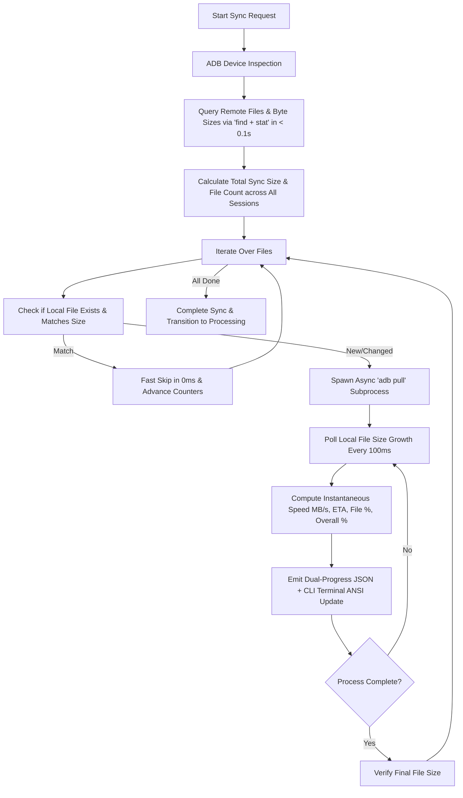

# Implementation Plan: Real-Time Dual-Progress ADB Log Synchronization

## Goal Description
During device synchronization (`sync_and_process_logs.bat` or via the RoadSense Web Dashboard), pulling gigabyte-scale recording sessions (especially `camera_video.mp4` ~800MB+ and radar binaries) runs as a synchronous, opaque `adb pull <remote_session_dir> <local_dir>`. 

Because `subprocess.run` blocks until all files are transferred and `adb pull` produces no non-TTY output:
1. The UI terminal freezes with no updates for 30–90+ seconds.
2. The user has no feedback on which file is currently copying.
3. No transfer speed (MB/s), copied megabytes, or Estimated Time of Arrival (ETA) is shown.
4. No progress bar reflects file-level or overall session transfer progress.

This plan introduces:
1. **Intelligent File-Level ADB Pull Engine** in [`tools/sync_and_process_sessions.py`](file:///c:/Users/rakadu1.AHEAD/AndroidStudioProjects/RoadSense/tools/sync_and_process_sessions.py): Pre-queries remote file sizes via ADB in < 0.1s, pulls files with non-blocking local disk size sampling, and computes instantaneous/rolling transfer rate (MB/s) and ETA.
2. **Dual-Progress Reporting Protocol**: Emits structured `[PROGRESS]` events containing both file-level (`sub`) metrics and overall multi-session (`overall`) metrics.
3. **Dual Progress Bar Web Dashboard Widget** in [`tools/web_dashboard/index.html`](file:///c:/Users/rakadu1.AHEAD/AndroidStudioProjects/RoadSense/tools/web_dashboard/index.html): Displays both the primary overall synchronization progress bar and a dedicated animated file-level progress bar.
4. **Interactive CLI Progress Indicator**: Formats live carriage-return terminal updates with ASCII progress bars, transfer rates, and ETAs when running via `sync_and_process_logs.bat --cli`.

---

## User Review Required

> [!IMPORTANT]
> **Zero Changes to Data Integrity & Compatibility:**
> The file transfer protocol continues to use native `adb pull` under the hood. Existing directory structures (`camera/`, `radar/`, `imu/`, `gnss/`, `can/`, `sync/`) and file contents remain 100% identical.

> [!NOTE]
> **Zero External Dependencies:**
> All progress calculation and formatting are built in pure Python standard library (`subprocess`, `threading`, `time`, `os`, `json`) without requiring extra pip packages like `tqdm` or `rich`.

---

## Proposed Changes



---

### Component 1: Python ADB Pull Engine with Real-Time Monitoring
**File:** [`tools/sync_and_process_sessions.py`](file:///c:/Users/rakadu1.AHEAD/AndroidStudioProjects/RoadSense/tools/sync_and_process_sessions.py)

#### Detailed Changes:
1. **`get_remote_session_files(adb_path, device_id, remote_session_dir)`**:
   - Executes `adb -s <id> shell "find <dir> -type f -exec stat -c '%s %n' {} \;"` to inspect all files in the session.
   - Falls back gracefully to `ls -l` parsing if `stat` is unavailable on legacy ROMs.
   - Returns a structured dictionary of relative file paths and byte sizes.
2. **`pull_file_with_progress(...)`**:
   - Spawns `adb -s <id> pull <remote_file> <local_file>` with `subprocess.Popen`.
   - Polling loop samples `os.path.getsize(local_file)` every 100ms.
   - Calculates rolling average transfer speed (MB/s) and remaining ETA (seconds).
   - Emits structured `[PROGRESS]` JSON lines to `sys.stdout` for SSE broadcasting:
     ```json
     [PROGRESS] {
       "step": "adb_sync",
       "desc": "Syncing session_20261023_111120 (1/2)",
       "overall_pct": 42.5,
       "overall_current": 4,
       "overall_total": 11,
       "overall_mb": 420.5,
       "overall_total_mb": 988.0,
       "sub": {
         "file_name": "camera/camera_video.mp4",
         "file_pct": 51.4,
         "current_mb": 430.7,
         "total_mb": 837.9,
         "speed_mb_s": 33.2,
         "eta_s": 12.3
       }
     }
     ```
   - Renders a responsive single-line CLI terminal progress meter using `\r`.
3. **Session-Level Coordination**:
   - Loops through un-synced sessions, aggregating overall bytes and total file counts so the master progress bar accurately spans the entire synchronization job.

---

### Component 2: Dual Progress Bar Web Dashboard Widget
**File:** [`tools/web_dashboard/index.html`](file:///c:/Users/rakadu1.AHEAD/AndroidStudioProjects/RoadSense/tools/web_dashboard/index.html)

#### Detailed Changes:
1. **DOM Markup Enhancement in `#progressWidget`**:
   - Keep the primary bar for overall operation/session progress.
   - Add a nested `#subProgressContainer` beneath the primary bar:
     - Header line: File icon (`📁`), current file name (`#subProgressFile`), size progress (`#subProgressSize`), current transfer speed (`#subProgressSpeed`), and file ETA (`#subProgressEta`).
     - Progress Bar: `#subProgressBarFill` (stylish 5px bar with cyan/emerald glowing gradient).
2. **JavaScript `updateProgressBar(payload)`**:
   - Detects whether `payload.sub` is present:
     - **If present (Dual Mode):**
       - `#subProgressContainer.style.display = 'block'`
       - Updates overall progress text: `Session X of Y • 450 MB / 1.1 GB (41%)`
       - Sets main `#progressBarFill.style.width = overall_pct + '%'`
       - Updates sub progress text: `camera_video.mp4 (430.7 / 837.9 MB • 33.2 MB/s • ETA: 12s)`
       - Sets sub `#subProgressBarFill.style.width = file_pct + '%'`
     - **If absent (Single Mode):**
       - `#subProgressContainer.style.display = 'none'`
       - Operates as the standard single bar for MCAP conversion, video re-encoding, and YOLO tracking without visual clutter.

---

## Verification Plan

### Automated & Unit Tests
1. **Unit Test for Remote File Stat Parsing**:
   - Test `get_remote_session_files` output parsing against known Android `stat -c '%s %n'` and `ls -l` outputs.
2. **Speed & ETA Calculator Verification**:
   - Test rolling average speed calculation with synthetic time/byte steps to verify stability without jitter or division-by-zero on fast transfers.

### Manual Verification
1. **CLI Execution**:
   - Connect the Android device (`32001991d42c86d9`).
   - Run:
     ```powershell
     python tools/sync_and_process_sessions.py --sync-only
     ```
   - Verify terminal displays the dual progress meter with real-time transfer speed (`~30 MB/s`), changing MB count, and countdown ETA.
2. **Web Dashboard Execution**:
   - Launch:
     ```powershell
     sync_and_process_logs.bat
     ```
   - Open Web Dashboard at `http://localhost:8088`.
   - Click **Sync from Device (ADB)**.
   - Verify the progress widget smoothly reveals the dual progress bars:
     - Primary bar tracks overall session sync progress.
     - Secondary bar tracks individual file transfer (e.g. `camera_video.mp4`) with live speed, byte counts, and ETA.
   - Verify no UI freezes or unresponsive states occur during the entire transfer.
