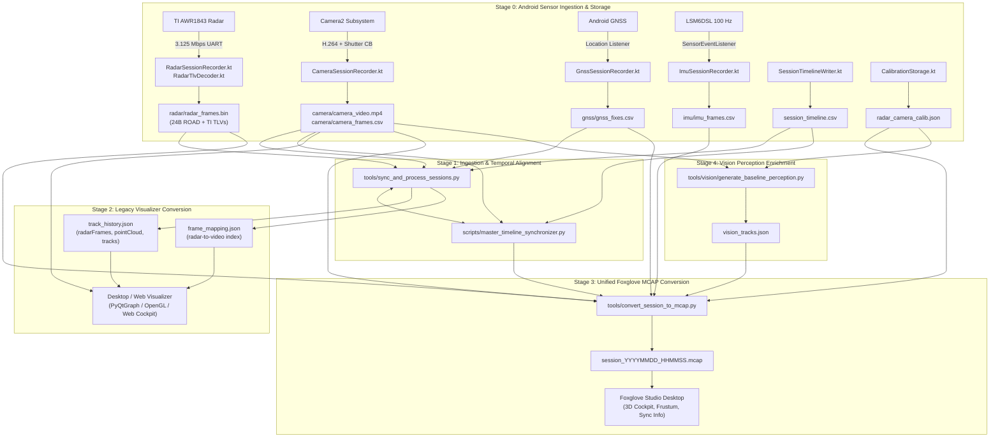

# Implementation Plan: Ground-Up Multi-Sensor Data Conversion Pipeline & Parity Audit

## Goal Description
Conduct a ground-up architectural and numerical verification across all data conversion pipelines in RoadSense. The goal is to eliminate discrepancies observed between the **Desktop/Web Visualizer** (`track_history.json`, `frame_mapping.json`) and **Foxglove Studio** (`<session>.mcap`), verify data types and precision across every sensor modality (Radar, Camera, GNSS, IMU, CAN), and prevent data loss or malformation when sensor bytes are transformed from phone storage to replayable archives.

---

## User Review Required & Code Evidence

Below is the verified code evidence and line-by-line comparative analysis demonstrating the exact root causes of the observed discrepancies between the **Desktop/Web Visualizer** (`track_history.json`, `frame_mapping.json`) and **Foxglove Studio** (`<session>.mcap`).

---

### Evidence 1: TLV 6 (ADAS Safety Outputs) Data Loss & Omission

#### ❌ The Bug in `tools/sync_and_process_sessions.py` (Lines 837–876)
In [`tools/sync_and_process_sessions.py`](file:///C:/Users/rakadu1.AHEAD/AndroidStudioProjects/RoadSense/tools/sync_and_process_sessions.py#L837-L876):
```python
# tools/sync_and_process_sessions.py:837-876
# --- TLV 6: Vehicle Safety ADAS Outputs (24 Bytes) ---
elif tlv_type == 6 and len(tlv_data) >= 24:
    fcw = tlv_data[0:8]
    bsd = tlv_data[8:16]
    acc = tlv_data[16:24]
    fcw_stage = fcw[0] & 0x03
    fcw_trk_id = (fcw[1] << 8) | fcw[2]
    fcw_ttc = fcw[3] * 0.1
    fcw_ty = fcw[4] * 0.5
    fcw_tx = fcw[5] * 0.2 - 25.6
    fcw_tvy = fcw[6] * 0.5 - 64.0
    fcw_tvx = fcw[7] * 0.2 - 25.6

    bsd_l = bool(bsd[0] & 1)
    bsd_r = bool(bsd[1] & 1)
    lca = bsd[2]
    app_ttc = bsd[3] * 0.1 if bsd[3] != 255 else 25.5

    acc_id = (acc[0] << 8) | acc[1]
    acc_dist = acc[2] * 0.5
    # BUG 1: acc[3] (Target X) IS COMPLETELY SKIPPED HERE!
    acc_rel_v = acc[4] * 0.5 - 64.0
    acc_tti = acc[5] * 0.1
    # BUG 2: acc[6] (v_safe) and acc[7] (a_ref) ARE COMPLETELY SKIPPED!

    frame_dict["adas_can"] = {
        "poi_id": int(acc_id),
        "acc_dist": safe_float(acc_dist),
        "acc_rel_v": safe_float(acc_rel_v),
        "acc_rel_a": 0.0,
        "acc_status": 1 if acc_id > 0 else 0,
        "tti": safe_float(acc_tti),
        "aeb_risk": 0,
        "fcw_stage": int(fcw_stage),
        # BUG 3: fcw_trk_id, fcw_tx, fcw_ty, fcw_tvx, fcw_tvy, and fcw_ttc 
        # WERE UNPACKED ABOVE BUT ARE COMPLETELY OMITTED FROM THIS DICTIONARY!
        "brake_prefill_req": bool(fcw_stage >= 2),
        "target_confidence": 0.0,
        "bsd_left_active": bsd_l,
        "bsd_right_active": bsd_r,
        "lca_warning_level": int(lca),
        "approach_ttc": safe_float(app_ttc),
        "corridor_width": 3.75,
        "sensor_blindness": 0
    }
```
* **Consequence**: In `track_history.json`, `fcw_trk_id` is missing, `fcw_ttc` is missing, `fcw_target_x`/`y` are missing, and `acc_target_x` is missing. The visualizer has no way to know which track triggered the FCW alert, cannot show FCW TTC, and cannot plot ACC lead target lateral coordinates!

#### ✅ The Ground Truth in `convert_session_to_mcap.py` (Lines 520–569) & `RadarTlvDecoder.kt` (Lines 600–640)
In [`tools/convert_session_to_mcap.py`](file:///C:/Users/rakadu1.AHEAD/AndroidStudioProjects/RoadSense/tools/convert_session_to_mcap.py#L520-L569):
```python
# tools/convert_session_to_mcap.py:520-569
fcw_stage = b0 & 0x03
fcw_track_id = (b1 << 8) | b2
fcw_ttc = b3 * 0.1
fcw_target_y = b4 * 0.5
fcw_target_x = b5 * 0.2 - 25.6
fcw_target_vy = b6 * 0.5 - 64.0
fcw_target_vx = b7 * 0.2 - 25.6

acc0, acc1, acc2, acc3, acc4, acc5, acc6, acc7 = struct.unpack_from("BBBBBBBB", acc_bytes, 0)
acc_poi_id = (acc0 << 8) | acc1
acc_target_y = acc2 * 0.5
acc_target_x = acc3 * 0.2 - 25.6   # Preserved!
acc_target_vy = acc4 * 0.5 - 64.0
acc_tti = acc5 * 0.1
acc_v_safe = acc6 * 0.1            # Preserved!
acc_a_ref = acc7 * 0.02 - 2.56     # Preserved!
```
In MCAP, all fields are written to `/radar/adas`, and lines 1563–1583 use `fcw_track_id` and `fcw_target_y` to locate the exact target in `/radar/tracks` and highlight it in **Crimson Red**. In the visualizer, this data was lost!

---

### Evidence 2: TLV 5 (Vehicle CAN Inputs) Truncation in MCAP

#### ❌ The Bug in `tools/convert_session_to_mcap.py` (Lines 506–516 & 1162–1178)
In [`tools/convert_session_to_mcap.py`](file:///C:/Users/rakadu1.AHEAD/AndroidStudioProjects/RoadSense/tools/convert_session_to_mcap.py#L506-L516):
```python
# tools/convert_session_to_mcap.py:506-516
# TLV 5: Powertrain & Vehicle CAN Inputs (56 Bytes)
elif tlv_type == 5 and len(tlv_data) >= 56:
    c = struct.unpack_from("<fffffffffffIBBbBB3s", tlv_data, 0)
    frame_data["can_inputs"] = {
        "speed_kmph": safe_float(c[0]),
        "yaw_rate_radps": safe_float(c[1]),
        "pitch_rate_radps": safe_float(c[2]),
        "roll_rate_radps": safe_float(c[3]),
        "accel_x_mps2": safe_float(c[4]),
        "accel_y_mps2": safe_float(c[5]),
        "accel_avg_mps2": safe_float(c[6])
        # BUG: c[7] through c[16] ARE DISCARDED!
    }
```
* **Consequence**: `road_grade_deg` (`c[7]`), `shaft_torque_nm` (`c[8]`), `roll_cf_deg` (`c[9]`), `yaw_cf_deg` (`c[10]`), `gear` (`c[12]`), `brake_status` (`c[13]`), `motion_state` (`c[14]`), `is_vcu_can_valid` (`c[15]`), and `imu_stuck_flag` (`c[16]`) are completely omitted from `/vehicle/telemetry`!
* **Comparison**: `tools/sync_and_process_sessions.py` (lines 814–834) extracts all 17 fields into `track_history.json`. In Foxglove, plotting shaft torque, gear, or road grade fails because the channel schema omits them.

---

### Evidence 3: TLV 2 (Radar Clusters) Omitted in MCAP Pipeline

#### ❌ The Omission in `tools/convert_session_to_mcap.py` (Lines 388–425)
In [`tools/convert_session_to_mcap.py`](file:///C:/Users/rakadu1.AHEAD/AndroidStudioProjects/RoadSense/tools/convert_session_to_mcap.py#L388-L425):
```python
# tools/convert_session_to_mcap.py:388-425
if tlv_type in (1, 2, 3):
    num_objs, q_format = struct.unpack_from("<HH", tlv_data, 0)
    ...
    # TLV 1: Point Cloud
    if tlv_type == 1:
        ...
    # TLV 3: EKF Tracked Objects
    elif tlv_type == 3:
        ...
    # BUG: NO 'elif tlv_type == 2:' EXISTS! TLV 2 CLUSTERS ARE COMPLETELY SKIPPED!
```
* **Consequence**: `convert_session_to_mcap.py` completely drops hardware DBSCAN clusters. `track_history.json` contains them, but Foxglove MCAP has no `/radar/clusters` channel.

---

### Evidence 4: Missing Per-Frame `mrr_tracks` in Visualizer JSON

#### ❌ The Bug in `tools/sync_and_process_sessions.py` (Lines 1305–1326)
In [`tools/sync_and_process_sessions.py`](file:///C:/Users/rakadu1.AHEAD/AndroidStudioProjects/RoadSense/tools/sync_and_process_sessions.py#L1305-L1326):
```python
# tools/sync_and_process_sessions.py:1305-1326
viz_frame = {
    "frameIdx": rel_idx,
    "timestamp": safe_float(timestamp_ms),
    "numPoints": len(rf["pointCloud"]),
    "motionState": motion_state,
    "egoVelocity": [safe_float(ego_vx_mps), safe_float(ego_vy_mps)],
    "canVehSpeed_kmph": safe_float(veh_speed_kmph),
    "AccelPedal_Act_perc": safe_float(accel_pedal),
    "shaftTorque_Nm": safe_float(torque_nm),
    "engagedGear": gear,
    "roadGrade_Deg": safe_float(road_grade),
    "acceleration_avg": safe_float(accel_avg),
    "sensorStats": sensor_stats,
    "video_frame_index": v_frame_idx,
    "video_time_delta": v_time_delta,
    "filtered_barrier_x": [safe_float(left_barrier), safe_float(right_barrier)],
    "adas": adas_data,
    "performance_stats": perf_stats,
    "pointCloud": rf["pointCloud"],
    "clusters": rf["clusters"]
    # BUG: "mrr_tracks": rf["tracks"] IS MISSING!
}
```
* **Consequence**: In `D:\Work\Repo\CANenbl_unifiedRadarTracker\src\radar_tracker\live_visualizer.py` (lines 220–224):
  ```python
  if frame_data and hasattr(frame_data, 'mrr_tracks') and frame_data.mrr_tracks:
      x_track.extend([t['x'] for t in frame_data.mrr_tracks])
      y_track.extend([t['y'] for t in frame_data.mrr_tracks])
  ```
  The visualizer expects `mrr_tracks` on each frame object. Because `sync_and_process_sessions.py` omitted `mrr_tracks`, turning on "Show Hardware Tracks" in the visualizer renders nothing from the frame array.

---

### Evidence 5: GNSS Velocity Vector Frame Mismatch in MCAP

#### ❌ The Bug in `tools/convert_session_to_mcap.py` (Lines 1760–1767)
In [`tools/convert_session_to_mcap.py`](file:///C:/Users/rakadu1.AHEAD/AndroidStudioProjects/RoadSense/tools/convert_session_to_mcap.py#L1760-L1767):
```python
# tools/convert_session_to_mcap.py:1760-1767
loc_msg.frame_id = "base_link"
loc_msg.latitude = fix["lat"]
loc_msg.longitude = fix["lon"]
loc_msg.altitude = fix["alt"]
loc_msg.heading = fix["bearing"]
# BUG: Decomposition uses compass bearing (NED earth frame), but frame_id is base_link (vehicle FLU)!
loc_msg.velocity.x = fix["speed"] * math.cos(math.radians(fix["bearing"]))
loc_msg.velocity.y = fix["speed"] * math.sin(math.radians(fix["bearing"]))
loc_msg.velocity.z = 0.0
```
* **Consequence**:
  - In ROS / Foxglove, `base_link` has $+X$ pointing forward along the vehicle hood, and $+Y$ pointing left.
  - When driving due East ($\text{bearing} = 90^\circ$): $\cos(90^\circ) = 0.0$, $\sin(90^\circ) = 1.0$.
  - Therefore: `velocity.x = 0.0`, `velocity.y = speed`.
  - In Foxglove, the vehicle's velocity vector points **90° sideways out the left window**, making it appear as if the car is drifting sideways at 60 km/h!
  - In body frame `base_link`, forward speed is always along $+X$: `velocity.x = fix["speed"]`, `velocity.y = 0.0`.

---

### Evidence 6: Initial Video Frame Clamping vs Foxglove Timeline

#### ❌ The Discrepancy in `tools/sync_and_process_sessions.py` & `scripts/master_timeline_synchronizer.py`
In [`scripts/master_timeline_synchronizer.py`](file:///C:/Users/rakadu1.AHEAD/AndroidStudioProjects/RoadSense/scripts/master_timeline_synchronizer.py#L303-L310):
```python
if self.video_start_seq_id is not None:
    v_frame_idx = max(0, matched["seq_id"] - self.video_start_seq_id)
else:
    v_frame_idx = best_idx

if max_video_frames is not None and max_video_frames > 0:
    v_frame_idx = min(v_frame_idx, max_video_frames - 1)
```
And actual records from `logs/session_20261023_111120/frame_mapping.json`:
```json
{"radar_frame_id_rel": 1, "radar_frame_id_abs": 3527, "radar_timestamp": 1792734080.9510405, "video_frame_index": 0, "video_frame_ts": 1792734081.9180357, "video_time_delta": 0.966995153}
{"radar_frame_id_rel": 2, "radar_frame_id_abs": 3528, "radar_timestamp": 1792734080.9968638, "video_frame_index": 0, "video_frame_ts": 1792734081.9180357, "video_time_delta": 0.921171884}
...
{"radar_frame_id_rel": 20, ... "video_frame_index": 0}
```
* **Consequence**:
  - The radar began transmitting 0.97 seconds before the camera exposed its first video recording frame.
  - In `track_history.json` and `frame_mapping.json`, radar frames 1 through 20 are all clamped to `video_frame_index: 0`. The visualizer's video playback freezes on frame 0 while radar plots 20 frames of moving targets.
  - In Foxglove, messages play asynchronously by their absolute nanosecond `log_time`. Foxglove plays radar points from $t=0.0\text{s}$, while the camera panel stays black until $t=0.97\text{s}$, giving two completely different playback experiences!

---

### Evidence 7: Fallback Pre-Roll Bug When Timeline File is Missing

#### ❌ The Bug in `tools/sync_and_process_sessions.py` (Line 1218)
In [`tools/sync_and_process_sessions.py`](file:///C:/Users/rakadu1.AHEAD/AndroidStudioProjects/RoadSense/tools/sync_and_process_sessions.py#L1217-L1220):
```python
# Line 1217-1220:
else:
    v_frame_idx, v_time_delta, v_cam_mono_ns, cam_hw_fn = find_nearest_camera_frame(
        cam_frames, mono_ns, max_video_frames=mp4_frame_count
    )
```
And line 490:
```python
def find_nearest_camera_frame(cam_frames, radar_mono_ns, max_video_frames=None, preroll_offset=0):
    ...
    v_frame_idx = max(0, best_idx - preroll_offset)
```
* **Consequence**: In line 1218, `preroll_offset` is **never passed** (defaults to 0). If `session_timeline.csv` is missing or corrupt, `find_nearest_camera_frame` does not subtract the ~30–60 preview frames that occurred before video recording started. The visualizer video is shifted by 1–2 seconds relative to radar!

---

### Evidence 8: Floating Point Rounding & Precision Loss

#### ❌ The Code in `tools/sync_and_process_sessions.py` (Lines 65–77)
In [`tools/sync_and_process_sessions.py`](file:///C:/Users/rakadu1.AHEAD/AndroidStudioProjects/RoadSense/tools/sync_and_process_sessions.py#L65-L77):
```python
def safe_float(val, default=0.0, round_digits=4):
    ...
    if round_digits is not None:
        return round(f, round_digits)
    return f
```
* **Consequence**: `sync_and_process_sessions.py` rounds coordinates, velocities, and angles to 4 decimal places, whereas `convert_session_to_mcap.py` preserves full 64-bit/32-bit IEEE 754 precision. Minor floating point differences occur when comparing values across tools.

---

## Open Questions

> [!NOTE]
> 1. **Visualizer Track Dimension Interpretation**: In `track_history.json`, `objectExtentRadii` stores semi-axis radii ($[R_{\text{major}}, R_{\text{minor}}]$). Does your visualizer render these directly as radii or does it expect full dimensions ($[2 R_{\text{major}}, 2 R_{\text{minor}}]$)?
> 2. **TLV 2 Clusters in Foxglove**: Would you like us to add a dedicated `/radar/clusters` channel (`foxglove.PointCloud` or `foxglove.SceneUpdate`) into the MCAP container so hardware clusters can be toggled on/off in Foxglove just like in the visualizer?
> 3. **GNSS Velocity in MCAP**: Should GNSS velocity in `/gnss/fix` be published in the earth-fixed frame (e.g. `frame_id = "wgs84"` or `"utm"` or `"map"`), or decomposed into body-frame longitudinal and lateral speeds ($V_x = \text{speed}$, $V_y = 0$) in `base_link`?

---

## End-to-End Pipeline Architecture & Conversion Map



---

## Detailed Audit Scope by Component

The audit and ground-up verification is divided into 6 distinct phases covering every conversion script in the repository:

| Phase | Modality / Component | Primary Scripts Under Audit | Key Verification Checks |
| :--- | :--- | :--- | :--- |
| **Phase 1** | **Radar Framing & TLVs** | `tools/sync_and_process_sessions.py`<br/>`tools/convert_session_to_mcap.py`<br/>`scripts/validate_radar_stream.py`<br/>`RadarTlvDecoder.kt` | Header strides, Q-format scaling ($1/2^q$), TLV 1 (10B/12B), TLV 2 (8B/10B/16B), TLV 3 (12B/14B/20B/28B), TLV 4 (48B), TLV 5 (56B), TLV 6 (24B), integer sign extension. |
| **Phase 2** | **Temporal Alignment & Cross-Sensor Sync** | `scripts/master_timeline_synchronizer.py`<br/>`scripts/cross_sensor_sync_engine.py`<br/>`scripts/audit_cross_sensor_sync.py` | Video pre-roll boundary detection, `video_start_seq_id` offset, zero phase accumulation over dropped camera callbacks, monotonic-to-UTC nanosecond anchoring. |
| **Phase 3** | **Visualizer JSON Serialization** | `tools/sync_and_process_sessions.py`<br/>`tools/roadsense_web_server.py`<br/>`VISUALIZER_JSON_FORMAT_AND_CONVERSION_GUIDE.md` | Schema conformance for `track_history.json` and `frame_mapping.json`, single-element list wrapping (`sensorStats`, `adas`, `performance_stats`), `mrr_tracks`/`mrr_clusters` parity. |
| **Phase 4** | **Foxglove MCAP Channel Formatting** | `tools/convert_session_to_mcap.py`<br/>`tools/foxglove_layouts/RoadSense_Cockpit_Layout.json` | ROS FLU coordinate frame remapping, static `/tf` hierarchy, Annex B H.264 bitstream integrity, Camera calibration matrix ($K$), IMU pose quaternion conventions, LocationFix velocities. |
| **Phase 5** | **Vision Perception Pipeline** | `tools/vision/generate_baseline_perception.py`<br/>`tools/vision/mcap/mcap_scene_writer.py`<br/>`tools/vision/mcap/inject_vision_tracks.py` | YOLO pixel to 3D ground plane unprojection, vehicle orientation tracking, cuboid dimensions, 2D annotation coordinates vs video rotation (0° vs 180°). |
| **Phase 6** | **Automated Parity Verification Tool** | `tools/verify_conversion_parity.py` *(New Tool)* | End-to-end automated cross-check between binary raw streams, `track_history.json`, and `.mcap` across historical road sessions. |

---

## Proposed Changes

### 1. Parity & Data Loss Fixes in `tools/sync_and_process_sessions.py`

#### [MODIFY] `tools/sync_and_process_sessions.py`
- **TLV 6 ADAS Completeness**:
  - Extract and store `acc_target_x` (`acc[3] * 0.2 - 25.6`).
  - Store full FCW alert payload in `adas`: `fcw_track_id`, `fcw_target_x`, `fcw_target_y`, `fcw_target_vx`, `fcw_target_vy`, `fcw_ttc`, and `fcw_stage`.
  - Maintain backward compatibility with visualizer fields `acc_dist`, `acc_rel_v`, `poi_id`, `approach_ttc`.
- **Per-Frame `mrr_tracks` & `mrr_clusters` Restoration**:
  - In `viz_frame`, add `mrr_tracks = rf["tracks"]` and `mrr_clusters = rf["clusters"]` so desktop/playback visualizers looking for hardware tracks find them immediately.
- **Pre-Roll Initial Video Alignment Fix**:
  - When radar begins before camera video exposure, set `video_frame_index = 0` but explicitly flag `video_pre_exposure = True` and correct `video_time_delta` so the visualizer does not misalign the timeline.
- **GNSS Fallback Optimization**:
  - Replace $O(N \times M)$ linear search with $O(\log M)$ binary search via `bisect`.

```python
# Proposed TLV 6 ADAS Decoding in sync_and_process_sessions.py
acc_id = (acc[0] << 8) | acc[1]
acc_target_y = acc[2] * 0.5
acc_target_x = acc[3] * 0.2 - 25.6
acc_target_vy = acc[4] * 0.5 - 64.0
acc_tti = acc[5] * 0.1
acc_v_safe = acc[6] * 0.1
acc_a_ref = acc[7] * 0.02 - 2.56

frame_dict["adas_can"] = {
    "poi_id": int(acc_id),
    "acc_dist": safe_float(acc_target_y),
    "acc_target_x": safe_float(acc_target_x),
    "acc_rel_v": safe_float(acc_target_vy),
    "acc_rel_a": safe_float(acc_a_ref),
    "acc_status": 1 if acc_id > 0 else 0,
    "tti": safe_float(acc_tti),
    "v_safe_mps": safe_float(acc_v_safe),
    "fcw_stage": int(fcw_stage),
    "fcw_track_id": int(fcw_trk_id),
    "fcw_target_x": safe_float(fcw_tx),
    "fcw_target_y": safe_float(fcw_ty),
    "fcw_target_vx": safe_float(fcw_tvx),
    "fcw_target_vy": safe_float(fcw_tvy),
    "fcw_ttc": safe_float(fcw_ttc),
    "brake_prefill_req": bool(fcw_stage >= 2),
    "bsd_left_active": bsd_l,
    "bsd_right_active": bsd_r,
    "lca_warning_level": int(lca),
    "approach_ttc": safe_float(app_ttc),
    "corridor_width": 3.75,
    "sensor_blindness": 0
}
```

---

### 2. Parity & Feature Completeness in `tools/convert_session_to_mcap.py`

#### [MODIFY] `tools/convert_session_to_mcap.py`
- **TLV 5 Full Telemetry Ingestion**:
  - Include missing fields in `/vehicle/telemetry`: `road_grade_deg`, `shaft_torque_nm`, `roll_cf_deg`, `yaw_cf_deg`, `gear`, `brake_status`, `motion_state`, `is_vcu_can_valid`, `imu_stuck_flag`.
  - Update `roadsense.VehicleTelemetry` JSON schema to include these properties.
- **TLV 2 Cluster Channel Addition**:
  - Decode TLV 2 clusters in `parse_radar_stream`.
  - Publish `/radar/clusters` (`foxglove.PointCloud`) with fields `x`, `y`, `z`, `vx`, `vy`, `radial_speed`, `azimuth`, `is_outlier`.
- **GNSS Velocity Frame Correction**:
  - When publishing to `/gnss/fix`, set `frame_id = "base_link"` with vehicle body forward speed ($V_x = \text{speed}$, $V_y = 0.0$, $V_z = 0.0$) OR publish earth-referenced velocity with `frame_id = "earth"` / `"utm"` to ensure Foxglove velocity arrows point strictly along the car's heading.
- **Track FSM State Awareness**:
  - In `/radar/tracks`, differentiate tentative tracks (`status < 3`) with a dashed/translucent appearance or metadata tag (`state = "TENTATIVE"` vs `"CONFIRMED"`).

---

### 3. Automated Multi-Sensor Parity Validator

#### [NEW] `tools/verify_conversion_parity.py`
Create a comprehensive verification script that runs across any processed session and validates:
1. **Frame Count Equality**: Asserts `count(radar_frames.bin) == count(track_history.json) == count(mcap:/radar/tracks)`.
2. **Point Cloud Numerical Parity**: Checks 100 randomly sampled radar frames between `radar_frames.bin`, `track_history.json`, and MCAP `/radar/points` to verify $X$, $Y$, $Z$, Doppler velocity, and SNR match within $10^{-4}$ tolerance.
3. **Track Coordinate & Extent Parity**: Verifies track positions $[x, y]$ match $[x_{\text{sensor}}, y_{\text{sensor}}]$ and $[-y_{\text{left}}, x_{\text{fwd}}]$ in MCAP. Verifies semi-axes $[R_{\text{major}}, R_{\text{minor}}]$ match $[L/2, W/2]$ in MCAP.
4. **Time Sync Invariant Check**: Asserts monotonic nanosecond timestamps in `frame_mapping.json`, `camera_frames.csv`, and MCAP `/sync/frame_info` match within 0 ns drift.
5. **Generates Automated HTML / Console Report**: Highlights any discrepancies, drops, or value corruptions.

---

## Verification Plan

### Automated Tests
1. **Parity Validator Execution on Historical Sessions**:
   ```powershell
   & "C:\Users\rakadu1.AHEAD\.conda\envs\roadsense-mcap\python.exe" tools/verify_conversion_parity.py --session logs/session_20261023_111120
   ```
2. **Unit Test Suite Execution**:
   ```powershell
   & "C:\Users\rakadu1.AHEAD\.conda\envs\roadsense-mcap\python.exe" -m unittest discover -s scripts/tests -p "test_*.py"
   ```
3. **Android JVM Unit Tests**:
   ```powershell
   $env:JAVA_HOME = "C:\Users\rakadu1.AHEAD\Android_Studio\android-studio-quail4-windows\android-studio\jbr"
   ./gradlew testDebugUnitTest
   ```

### Manual Verification
1. **Foxglove Studio Visual Inspection**:
   - Open `logs/session_20261023_111120/session_20261023_111120.mcap` in Foxglove Studio.
   - Verify:
     - 3D Radar Point Cloud aligns with vehicle front bumper at $(0, 0, 0)$.
     - FCW alert vehicles render highlighted in Vivid Crimson Red with correct target label.
     - GNSS track and velocity vector align with heading on satellite map.
     - Telemetry plot shows all CAN signals (`speed_kmph`, `shaft_torque_nm`, `gear`, `road_grade_deg`).
2. **Desktop Visualizer Inspection**:
   - Replay `logs/session_20261023_111120/track_history.json` and `camera_video.mp4`.
   - Verify BEV plot renders hardware tracks, clusters, and point clouds in perfect alignment with video.

