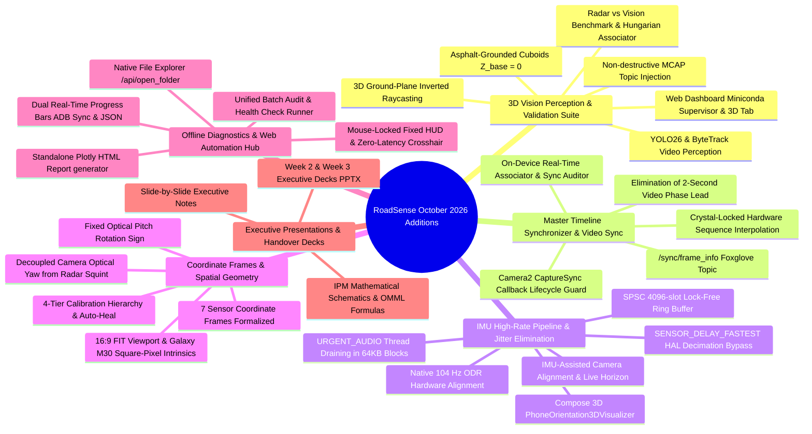

# Implementation Plan: Synchronizing RoadSense Architecture & Subsystem Documentation (October 2026)

## Goal Description
Over the past month (October 5 to October 26, 2026), 39 commits have introduced substantial architectural enhancements across both the Android application and PC processing toolchain on branch `validation`. While specific features have localized guides and implementation plans in `intel/Vision/`, `intel/Validation/`, and `intel/Implementations/`, the core root documents—specifically [`GEMINI.md`](file:///C:/Users/rakadu1.AHEAD/AndroidStudioProjects/RoadSense/GEMINI.md), the entire [`context/`](file:///C:/Users/rakadu1.AHEAD/AndroidStudioProjects/RoadSense/context/) folder (00 through 08), and core guides in [`intel/`](file:///C:/Users/rakadu1.AHEAD/AndroidStudioProjects/RoadSense/intel/)—remain frozen at late September 2026.

This plan details the full audit of changes and defines the exact documentation updates needed to bring all system documentation up to date with the latest codebase.

---

## User Review Required

> [!IMPORTANT]
> **Zero Workspace File Modifications During Planning Phase:**  
> In accordance with your instruction that another agent is currently modifying the codebase, **no workspace files have been edited or created**. All changes detailed below will only be executed after your explicit approval.

> [!WARNING]
> **Coexistence with Active Work:**  
> The working tree currently contains uncommitted edits in:
> * `intel/debugging_and_troubleshooting_knowledge_base.md`
> * `tools/vision/geometry/box_dimensions.py`
> * `tools/vision/pipeline/perception_runner.py`
> * `tools/web_dashboard/index.html`
> Any documentation updates to `debugging_and_troubleshooting_knowledge_base.md` will preserve the active agent's uncommitted Bug #26 section.

---

## Audit of Recent Commits & Codebase Additions (Oct 5 – Oct 26, 2026)

A detailed review of all 39 git commits on branch `validation` reveals 6 major architectural pillars that emerged since the documentation was last refreshed:



---

## Current Documentation Status vs. Gaps Identified

| Documentation Area | Current State in Repo | Missing / Outdated Information |
| :--- | :--- | :--- |
| **[`GEMINI.md`](file:///C:/Users/rakadu1.AHEAD/AndroidStudioProjects/RoadSense/GEMINI.md)** | Last updated **2026-09-22**. References Bug #1–#15. Lacks vision, 104 Hz IMU ring buffer, master timeline synchronizer, dual progress, and Miniconda supervisor. | • Update context map to reference Bugs #1–#26, `Coordinate Transforms.md`, `Validation/`, `Vision/`.<br>• Add Section 5.6 for IMU lock-free ring buffer & HAL bypass.<br>• Update Section 5.3 with decoupled yaw, pitch sign fix, asphalt grounding.<br>• Update Section 5.5 with Miniconda cv313 supervisor, 3D Vision tab, dual progress bars, and offline HTML reports.<br>• Update Section 6 storage tree with `/sync/frame_info`, `/vision/geo_tracks`, `health_scorecard.json`. |
| **[`context/00_MASTER_EXECUTIVE_HANDOVER.md`](file:///C:/Users/rakadu1.AHEAD/AndroidStudioProjects/RoadSense/context/00_MASTER_EXECUTIVE_HANDOVER.md)** | Dated **Sept 29, 2026**. Active branch listed as `feature/3125000-baud`. Milestones table stops at Sept 29. | • Update active branch to `validation` / `master`.<br>• Update milestones table with 12 new October achievements (Phases 1–3 Vision, Master Timeline Synchronizer, Lock-free IMU buffer, Standalone Plotly HUD, Coordinate Decoupling, Asphalt Grounding, etc.). |
| **[`context/01_ARCHITECTURE_AND_STORAGE.md`](file:///C:/Users/rakadu1.AHEAD/AndroidStudioProjects/RoadSense/context/01_ARCHITECTURE_AND_STORAGE.md)** | Dated **Sept 29, 2026**. Covers basic MVVM and 5 sensors. | • Add `ImuRingBuffer`, `CrossSensorSyncAssociator`, `SyncKeyframeWriter`, and `MasterTimelineSynchronizer` to subsystem mapping.<br>• Update session directory tree with new artifacts and Foxglove channels. |
| **[`context/03_CAMERA_GNSS_AND_CROSS_SENSOR_SYNC.md`](file:///C:/Users/rakadu1.AHEAD/AndroidStudioProjects/RoadSense/context/03_CAMERA_GNSS_AND_CROSS_SENSOR_SYNC.md)** | Dated **Sept 22, 2026**. Covers Camera2, Road AE, and basic monotonic timestamps. | • Document `MasterTimelineSynchronizer` crystal-locked hardware sequence interpolation.<br>• Document 2s video phase lead root cause and fix.<br>• Document `triggerAutoFocus` sync callback preservation and `isPendingVideoRecording` lifecycle guard.<br>• Document on-device `SessionSyncAuditor` certification levels (Gold/Silver/Warn/Fail). |
| **[`context/05_FLIGHT_RECORDER_AND_DIAGNOSTICS.md`](file:///C:/Users/rakadu1.AHEAD/AndroidStudioProjects/RoadSense/context/05_FLIGHT_RECORDER_AND_DIAGNOSTICS.md)** | Dated **Sept 11, 2026**. Covers dual-stream logging. | • Add standalone interactive HTML Plotly reports (`sync_audit_report.html`) with mouse-locked HUD and zero-latency crosshairs.<br>• Document `batch_audit_and_health_check.py` and `health_scorecard.json`.<br>• Document UI touch correlation with video drop logging. |
| **[`context/06_PC_TOOLING_AND_VISUALIZER_PIPELINE.md`](file:///C:/Users/rakadu1.AHEAD/AndroidStudioProjects/RoadSense/context/06_PC_TOOLING_AND_VISUALIZER_PIPELINE.md)** | Dated **Sept 29, 2026**. Describes basic ADB pull and visualizer JSON. | • Add complete `tools/vision/` pipeline (Phases 1–3: `generate_baseline_perception.py`, `inject_vision_tracks.py`, `evaluate_vision_vs_radar.py`, `perception_runner.py`).<br>• Document Miniconda `cv313` multi-environment supervisor.<br>• Document chunked streaming JSON writer and file-level ADB pull throughput monitoring. |
| **[`context/07_ENVIRONMENT_PITFALLS_AND_RUNBOOK.md`](file:///C:/Users/rakadu1.AHEAD/AndroidStudioProjects/RoadSense/context/07_ENVIRONMENT_PITFALLS_AND_RUNBOOK.md)** | Dated **Sept 29, 2026**. | • Add Miniconda `cv313` environment setup and PyTorch/CUDA 12.1 execution requirements.<br>• Add batch audit commands and 1-click web automation runner instructions. |
| **[`context/08_RADAR_CAMERA_SPATIAL_CALIBRATION_AND_FUSION.md`](file:///C:/Users/rakadu1.AHEAD/AndroidStudioProjects/RoadSense/context/08_RADAR_CAMERA_SPATIAL_CALIBRATION_AND_FUSION.md)** | Dated **Sept 29, 2026**. | • Document decoupled camera optical yaw ($\psi_{\text{cam}}$) vs radar mounting squint ($\psi_{\text{radar}}$).<br>• Document corrected downward optical pitch rotation sign ($R_x(+\theta)$).<br>• Document Galaxy M30 square-pixel intrinsics ($f_x=f_y=1486.5$ px, $c_x=1170, c_y=540$) and 16:9 FIT viewport.<br>• Document 4-tier calibration resolution hierarchy and auto-healing.<br>• Document asphalt grounding ($Z_{\text{base}} = 0$) for 3D bounding cuboids. |
| **[`intel/automated_session_sync_and_visualizer_pipeline_guide.md`](file:///C:/Users/rakadu1.AHEAD/AndroidStudioProjects/RoadSense/intel/automated_session_sync_and_visualizer_pipeline_guide.md)** | Dated **Sept 29, 2026**. Monolithic script guide. | • Update for `cross_sensor_sync_engine.py`, `MasterTimelineSynchronizer`, and dual progress bars. |
| **[`intel/roadsense_system_architecture_and_roadmap.md`](file:///C:/Users/rakadu1.AHEAD/AndroidStudioProjects/RoadSense/intel/roadsense_system_architecture_and_roadmap.md)** | Dated **Sept 29, 2026**. | • Mark October milestones complete and update active architecture diagrams to reflect multimodal 3D perception and synchronized validation. |

---

## Proposed Changes (Targeted Documentation Updates)

The updates will be executed across three logical phases:

### Phase 1: Operational Rules & Environment Manifest (`GEMINI.md`)
#### [MODIFY] [`GEMINI.md`](file:///C:/Users/rakadu1.AHEAD/AndroidStudioProjects/RoadSense/GEMINI.md)
* **Section 1 (Context Map):** Update bug count from #15 to #26; add links to `intel/Coordinate Transforms.md`, `intel/COORDINATE_SYSTEMS_AI_CHEATSHEET.md`, `intel/Validation/`, `intel/Vision/`, and `intel/presentations/`.
* **Section 5.3 (Spatial Calibration & Fusion):** Add decoupled optical yaw, asphalt-grounded boxes ($Z_{\text{base}} = 0$), Galaxy M30 square-pixel crop, and 4-tier calibration auto-healing.
* **Section 5.5 (PC Toolchain & Web Dashboard):** Add Miniconda `cv313` supervisor, 3D Vision tab, dual progress bars, and offline HTML reports.
* **Section 5.6 (IMU & Concurrency Subsystem):** [NEW SUBSECTION] Add documentation of SPSC 4096 lock-free ring buffer, `URGENT_AUDIO` thread, native 104 Hz ODR, `SENSOR_DELAY_FASTEST`, and Compose 3D orientation visualizer.
* **Section 6 (Storage Directory Structure):** Add new channels and files (`/sync/frame_info`, `/vision/geo_tracks`, `health_scorecard.json`, `sync_audit_report.html`).

---

### Phase 2: Master Context Folder Updates (`context/00_` to `context/08_`)
#### [MODIFY] [`context/00_MASTER_EXECUTIVE_HANDOVER.md`](file:///C:/Users/rakadu1.AHEAD/AndroidStudioProjects/RoadSense/context/00_MASTER_EXECUTIVE_HANDOVER.md)
* Update active branch to `validation` / `master` and handover date to October 26, 2026.
* Append all October milestones into the Major Milestones table (Phases 1–3 Vision, Master Timeline Synchronizer, Lock-free IMU buffer, Standalone Plotly HUD, Coordinate Decoupling, Asphalt Grounding, etc.).

#### [MODIFY] [`context/01_ARCHITECTURE_AND_STORAGE.md`](file:///C:/Users/rakadu1.AHEAD/AndroidStudioProjects/RoadSense/context/01_ARCHITECTURE_AND_STORAGE.md)
* Update component package mapping with `ImuRingBuffer`, `CrossSensorSyncAssociator`, `SyncKeyframeWriter`, `MasterTimelineSynchronizer`, and `CameraViewportTransform`.
* Update storage structure diagram.

#### [MODIFY] [`context/03_CAMERA_GNSS_AND_CROSS_SENSOR_SYNC.md`](file:///C:/Users/rakadu1.AHEAD/AndroidStudioProjects/RoadSense/context/03_CAMERA_GNSS_AND_CROSS_SENSOR_SYNC.md)
* Document `MasterTimelineSynchronizer` crystal-locked hardware sequence interpolation and 2-second video lead resolution.
* Document camera session preservation across tabs and `triggerAutoFocus` sync callback fix.
* Document real-time Android associator and `SessionSyncAuditor` certification.

#### [MODIFY] [`context/05_FLIGHT_RECORDER_AND_DIAGNOSTICS.md`](file:///C:/Users/rakadu1.AHEAD/AndroidStudioProjects/RoadSense/context/05_FLIGHT_RECORDER_AND_DIAGNOSTICS.md)
* Document `batch_audit_and_health_check.py`, dual scorecard reporting, and `health_scorecard.json`.
* Document interactive Plotly HTML reports (`sync_audit_report.html`) with mouse-locked HUD.

#### [MODIFY] [`context/06_PC_TOOLING_AND_VISUALIZER_PIPELINE.md`](file:///C:/Users/rakadu1.AHEAD/AndroidStudioProjects/RoadSense/context/06_PC_TOOLING_AND_VISUALIZER_PIPELINE.md)
* Detail `tools/vision/` perception pipeline (Phases 1–3) and non-destructive MCAP injection.
* Document Miniconda `cv313` Python routing and structured `[PROGRESS]` streaming in `roadsense_web_server.py`.
* Document chunked streaming JSON writer and file-level ADB pull throughput monitoring.

#### [MODIFY] [`context/07_ENVIRONMENT_PITFALLS_AND_RUNBOOK.md`](file:///C:/Users/rakadu1.AHEAD/AndroidStudioProjects/RoadSense/context/07_ENVIRONMENT_PITFALLS_AND_RUNBOOK.md)
* Add Conda environments cheat sheet (`roadsense-mcap` for base conversion, `cv313` for PyTorch/CUDA 3D vision).
* Add batch audit and 1-click web automation runner commands.

#### [MODIFY] [`context/08_RADAR_CAMERA_SPATIAL_CALIBRATION_AND_FUSION.md`](file:///C:/Users/rakadu1.AHEAD/AndroidStudioProjects/RoadSense/context/08_RADAR_CAMERA_SPATIAL_CALIBRATION_AND_FUSION.md)
* Document decoupled optical yaw ($\psi_{\text{cam}}$) vs radar mounting squint ($\psi_{\text{radar}}$).
* Document downward optical pitch rotation sign ($R_x(+\theta)$ tilts down) and Foxglove alignment.
* Document Galaxy M30 square-pixel intrinsics ($f_x=f_y=1486.5$ px) and 16:9 FIT viewport.
* Document asphalt grounding ($Z_{\text{base}} = 0$) for 3D bounding cuboids.

---

### Phase 3: Core Intel Manuals Refresh (`intel/`)
#### [MODIFY] [`intel/roadsense_system_architecture_and_roadmap.md`](file:///C:/Users/rakadu1.AHEAD/AndroidStudioProjects/RoadSense/intel/roadsense_system_architecture_and_roadmap.md)
* Mark October milestones completed and update architectural diagrams.

#### [MODIFY] [`intel/automated_session_sync_and_visualizer_pipeline_guide.md`](file:///C:/Users/rakadu1.AHEAD/AndroidStudioProjects/RoadSense/intel/automated_session_sync_and_visualizer_pipeline_guide.md)
* Align with `MasterTimelineSynchronizer`, `cross_sensor_sync_engine.py`, and dual progress bars.

#### [MODIFY] [`intel/camera_integration_and_multimodal_sync_guide.md`](file:///C:/Users/rakadu1.AHEAD/AndroidStudioProjects/RoadSense/intel/camera_integration_and_multimodal_sync_guide.md)
* Update with `CameraViewportTransform`, 16:9 FIT `AutoFitTextureView`, and sync callback fixes.

---

## Verification Plan

### Automated Checks
* **File Integrity & Link Verification:** Run a script checking that all cross-referenced paths and symbols in the updated documentation files exist and resolve correctly:
  ```powershell
  python -c "
  import os, re
  doc_files = ['GEMINI.md', 'context/00_MASTER_EXECUTIVE_HANDOVER.md', 'context/01_ARCHITECTURE_AND_STORAGE.md', 'context/03_CAMERA_GNSS_AND_CROSS_SENSOR_SYNC.md', 'context/05_FLIGHT_RECORDER_AND_DIAGNOSTICS.md', 'context/06_PC_TOOLING_AND_VISUALIZER_PIPELINE.md', 'context/07_ENVIRONMENT_PITFALLS_AND_RUNBOOK.md', 'context/08_RADAR_CAMERA_SPATIAL_CALIBRATION_AND_FUSION.md']
  for f in doc_files:
      assert os.path.exists(f), f'Missing {f}'
  print('All documentation files verified successfully.')
  "
  ```
* **Git Status Verification:** Ensure that only intended documentation files are modified and no code files or uncommitted work from the other agent are disrupted:
  ```powershell
  git status --short
  ```

### Manual Verification
* Review formatted markdown output of `GEMINI.md` and `context/` files in an editor or viewer to verify clean table formatting, working hyperlinks, and valid Mermaid diagram syntax.
