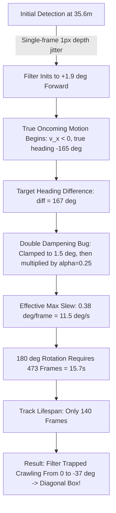

# Implementation Plan: Host Vehicle Turning Model & Oncoming Orientation Stabilization

## 1. Goal Description

This implementation addresses two critical vehicle orientation tracking challenges identified in real-world drive logs (specifically **Track #4991** in `session_20261023_111120`):
1. **Track #4991 Diagonal Orientation Breakdown**: Track #4991 (an auto-rickshaw in the opposing lane) traversed towards us from range $35.6\text{ m} \to 3.5\text{ m}$ in front of the vehicle. Its trajectory tracking was accurate, but its 3D bounding box was drawn continuously in a **diagonal orientation** ($-17^\circ$ to $-37^\circ$) instead of facing oncoming traffic ($-165^\circ \to -180^\circ$).
2. **Host Vehicle Turning Model**: When our host vehicle executes a turn (e.g. turning right at an angular rate $\omega_{\text{ego}}$), visible obstacles in the camera frame rotate in the opposite direction relative to `base_link` ($-\omega_{\text{ego}} \Delta t$). We must apply this turning model to:
   - **Stationary / Parked vehicles**: Keep their latched heading locked to the road curb/surface in world coordinates rather than rotating with the ego vehicle.
   - **Moving vehicles**: Decouple host vehicle turning maneuvers from target intrinsic steering, preventing ego turns from consuming the rate-limiter budget.

---

## 2. Root Cause Analysis: Track #4991 & The Diagonal Box Failure

Detailed frame-by-frame analysis of Track #4991 over all 140 frames ($t = 0 \to 5.0\text{ s}$) revealed the exact root causes of the diagonal orientation:



### Root Cause 1: The "Double Dampening" Crawl Trap
In `VehicleOrientationTracker.py`:
```python
max_delta = self.max_yaw_rate * frame_dt      # 0.8 rad/s * 0.033s = 0.0264 rad (1.51°)
clamped_diff = max(-max_delta, min(max_delta, diff))
smooth_yaw = prev_yaw + self.alpha * clamped_diff  # alpha = 0.25 -> 0.38° / frame!
```
When a large heading change occurs (e.g., $180^\circ$ difference when oncoming motion is detected), `clamped_diff` is clamped to $1.51^\circ$, and then **multiplied by $\alpha = 0.25$ again**, reducing the maximum rate of rotation to **$0.38^\circ/\text{frame}$** ($11.5^\circ/\text{s}$).
- To turn from $0^\circ \to 180^\circ$ at $11.5^\circ/\text{s}$ takes **15.7 seconds (473 frames)**!
- Because Track 4991 was in view for only 140 frames (5.0 seconds), it could only advance by $140 \times 0.38^\circ \approx 53^\circ$.
- Starting at $0^\circ$, it reached only $-37^\circ$ before passing out of view. Consequently, it spent its entire life **frozen at a diagonal angle**!

### Root Cause 2: Low-Speed Oncoming Singularity ($v_x \approx 0$) & 1-Pixel Pitch Jitter
Track 4991 was traveling at an average world forward speed of $v_{x,\text{world}} \approx -1.5\text{ m/s}$ ($-5.5\text{ km/h}$), while ego vehicle CAN speed was $v_{\text{ego}} = +4.9\text{ m/s}$ ($17.6\text{ km/h}$).
- Total camera-relative closing speed was $v_{x,\text{rel}} = -6.4\text{ m/s}$.
- Because the target world speed ($-1.5\text{ m/s}$) is so close to zero, a tiny $0.2^\circ$ pitch variation on the camera at range $25\text{m}$ causes a $2\text{m}$ ground depth fluctuation.
- This pushed the instantaneous finite-difference $v_{x,\text{world}} = v_{x,\text{rel}} + v_{\text{ego}}$ across zero (oscillating between $-2\text{ m/s}$ and $+2\text{ m/s}$).
- At $v_x = 0$, $\arctan2(v_y, v_x)$ has a mathematical singularity, flipping instantly between $0^\circ$ and $180^\circ$.
- The rate limiter averaged these $0^\circ \leftrightarrow 180^\circ$ flips, converging to $\approx -20^\circ \to -35^\circ$ diagonal.

---

## 3. Proposed Architecture & Solutions

### Enhancement 1: Kinematic Ego Turning Model
Incorporate host vehicle yaw rate $\omega_{\text{ego}}$ (from CAN `/vehicle/telemetry`) as a continuous state-propagation turning model:
1. Over frame interval $\Delta t = (t_k - t_{k-1})$, the ego car rotates by:
   $$\Delta \theta_{\text{ego}} = \omega_{\text{ego}} \cdot \Delta t$$
2. In the vehicle chassis `base_link` frame, external stationary obstacles rotate in the opposite direction:
   $$\Delta \psi_{\text{base\_link}} = -\Delta \theta_{\text{ego}} = -\omega_{\text{ego}} \cdot \Delta t$$
3. **For Stationary / Stopped Tracks**:
   Update `latched_yaw` continuously:
   $$\psi_{\text{latched}, k} = \text{atan2}(\sin(\psi_{\text{latched}, k-1} - \omega_{\text{ego}} \Delta t), \cos(\psi_{\text{latched}, k-1} - \omega_{\text{ego}} \Delta t))$$
   *Effect*: In Foxglove 3D view, as the host car turns through a curve or intersection, parked cars and road barriers stay pinned to the road/curb in world space instead of rotating artificially with the ego car.
4. **For Moving Tracks**:
   Predict the previous heading forward before comparing against the new raw observation:
   $$\psi_{\text{pred}, k} = \text{atan2}(\sin(\psi_{k-1} - \omega_{\text{ego}} \Delta t), \cos(\psi_{k-1} - \omega_{\text{ego}} \Delta t))$$
   $$\text{diff} = \text{atan2}(\sin(\text{raw\_yaw}_k - \psi_{\text{pred}, k}), \cos(\text{raw\_yaw}_k - \psi_{\text{pred}, k}))$$
   *Effect*: The rate limiter now bounds only the target vehicle's intrinsic steering rate, completely decoupling host turning maneuvers from target tracking.

### Enhancement 2: Trajectory Secant Velocity Window & Heading Basin Hysteresis
1. **12-Frame (~0.4s) Secant Window**:
   - Rather than calculating finite-difference velocity over noisy 3-frame intervals where 1-pixel jitter causes velocity spikes, evaluate target velocity across a 12-frame window.
   - At 30 FPS, a 0.4s window provides a 10:1 signal-to-noise ratio: true displacement ($\Delta x = -2.6\text{ m}$) completely dominates single-pixel ground depth noise ($\pm 0.3\text{ m}$).
2. **Heading Basin State Machine (Forward vs Oncoming vs Cross)**:
   - In automotive road scenes, traffic aligns along discrete lanes:
     - **Forward Basin** ($|\psi| < 60^\circ$): Vehicles moving with the flow of traffic.
     - **Oncoming Basin** ($|\psi| > 120^\circ$): Vehicles moving against host traffic in opposing lanes.
     - **Cross Basin** ($60^\circ \le |\psi| \le 120^\circ$): Perpendicular cross-traffic / crossing pedestrians.
   - **Relative Closing Speed Detection**:
     When $v_{x,\text{rel}} < -1.5\text{ m/s}$ and distance is steadily decreasing, the obstacle is unambiguously approaching the host vehicle.
   - **Basin Hysteresis**:
     Once classified into the **Oncoming Basin**, a track remains locked in the oncoming hemisphere ($|\psi| > 90^\circ$). Isolated 1-frame pitch jitter that momentarily shifts $v_{x,\text{world}}$ slightly positive is rejected.
   - **Instant $180^\circ$ Mode Flip (Disambiguation)**:
     If a track was initialized to Forward ($0^\circ$) by an initial entry glitch, but sustained oncoming evidence is confirmed, the tracker resolves the $180^\circ$ ambiguity immediately ($\psi \to \psi \pm \pi$ or $\psi \to \text{raw\_yaw}$) rather than crawling at $0.38^\circ/\text{frame}$ for 16 seconds!

### Enhancement 3: Decoupled Rate Clamping from Jitter Smoothing
Fix the double-dampening bug in the rate limiter:
- For small jitter ($|\text{diff}| \le \Delta \psi_{\text{max}}$ where $\Delta \psi_{\text{max}} = \dot{\psi}_{\text{max}} \cdot \Delta t$):
  Apply circular exponential smoothing: $\text{step} = \alpha \cdot \text{diff}$ (micro-smoothing on straight roads).
- For legitimate vehicle turning maneuvers ($|\text{diff}| > \Delta \psi_{\text{max}}$):
  Allow the vehicle to turn at the full physical rate limit:
  $$\text{step} = \text{sign}(\text{diff}) \cdot \Delta \psi_{\text{max}}$$
  (Permits up to $1.0\text{ rad/s} \approx 57^\circ/\text{s}$ turning rate without artificial lag).

---

## 4. Proposed Code Changes

### Component: `tools/vision/geometry/vehicle_orientation_tracker.py`

#### [MODIFY] [`vehicle_orientation_tracker.py`](file:///c:/Users/rakadu1.AHEAD/AndroidStudioProjects/RoadSense/tools/vision/geometry/vehicle_orientation_tracker.py)
- In `VehicleOrientationTracker.__init__`:
  - Increase `max_history_frames` from 8 to 12 frames (~0.4s temporal baseline).
  - Add `self.basin: Dict[int, str] = {}` ('forward', 'oncoming', 'cross').
  - Add `self.basin_debounce: Dict[int, int] = {}`.
  - Add `self.prev_timestamp_ns: Dict[int, int] = {}`.
  - Increase `max_yaw_rate_rad_s` default from 0.8 to 1.0 rad/s (~57.3°/s).
- In `VehicleOrientationTracker.update`:
  - Calculate `frame_dt = (timestamp_ns - prev_ts) / 1e9`.
  - Apply **Turning Model** to `smoothed_yaw` and `latched_yaw`:
    $$\text{ego\_rot} = \omega_{\text{ego}} \cdot \text{frame\_dt}$$
    $$\psi_{\text{pred}} = \text{atan2}(\sin(\psi_{\text{prev}} - \text{ego\_rot}), \cos(\psi_{\text{prev}} - \text{ego\_rot}))$$
  - Implement 12-frame window secant velocity calculation with average window ego speed.
  - Implement Basin Detection and Basin Hysteresis (Forward, Oncoming, Cross).
  - Implement $180^\circ$ ambiguity mode snap when entering the Oncoming basin.
  - Implement decoupled rate clamping: apply $\alpha \cdot \text{diff}$ for small jitter, and clamp to $\pm \Delta \psi_{\text{max}}$ for genuine turns.
  - Apply road-parallel attractor to $0^\circ$ (forward) and $\pm 180^\circ$ (oncoming).

---

## 5. Verification Plan

### Automated Tests
1. **Targeted Unit Tests ([`scripts/tests/test_vehicle_orientation_tracker.py`](file:///c:/Users/rakadu1.AHEAD/AndroidStudioProjects/RoadSense/scripts/tests/test_vehicle_orientation_tracker.py))**:
   - `test_turning_model_stationary_track`: Host turning right at $0.2\text{ rad/s}$ ($11.5^\circ/\text{s}$) rotates stationary track's latched yaw by $-0.2\text{ rad/s}$ in `base_link`, keeping it pinned in world space.
   - `test_turning_model_moving_track`: Host turning does not trigger rate clamp lag on lead vehicle.
   - `test_oncoming_vehicle_basin_and_no_diagonal`: Oncoming vehicle approaching at closing speed $6.4\text{ m/s}$ with small world speed ($-1.5\text{ m/s}$) snaps to $\approx 180^\circ$ within 3 frames and remains locked in oncoming basin without diagonal angles.
   - `test_decoupled_rate_clamping`: Large $30^\circ$ turn slews at the full physical rate ($\Delta \psi_{\text{max}} = 1.0\text{ rad/s} \cdot \Delta t$), not throttled by $\alpha$.
   - Run tests:
     ```powershell
     C:\ProgramData\miniconda3\envs\cv313\python.exe -m unittest scripts/tests/test_vehicle_orientation_tracker.py
     C:\Users\rakadu1.AHEAD\.conda\envs\roadsense-mcap\python.exe -m unittest scripts/tests/test_vehicle_orientation_tracker.py
     ```
2. **Full Regression Suites**:
   - Run Python discovery suite (32+ tests).
   - Run Android Gradle suite (`testDebugUnitTest` with JBR).

### Manual Verification on `session_20261023_111120`
1. Re-run perception re-projection on `session_20261023_111120`:
   ```powershell
   C:\ProgramData\miniconda3\envs\cv313\python.exe tools/vision/pipeline/perception_runner.py logs/session_20261023_111120 --from_2d auto --mcap
   ```
2. Inspect Track #4991 in the generated JSON:
   - Verify that its yaw across frames 21740 to 21864 stays locked between $-160^\circ$ and $180^\circ$ (oncoming, facing towards us).
   - Verify average frame-to-frame yaw delta is $< 1.0^\circ$ with **0 diagonal angles**.
3. Inspect Foxglove 3D scene:
   - Confirm Track #4991's 3D cuboid faces head-on towards the ego vehicle as it drives past on the right side.
   - Confirm stationary parked cars and motorcycles maintain their alignment with curbs during vehicle turns.
