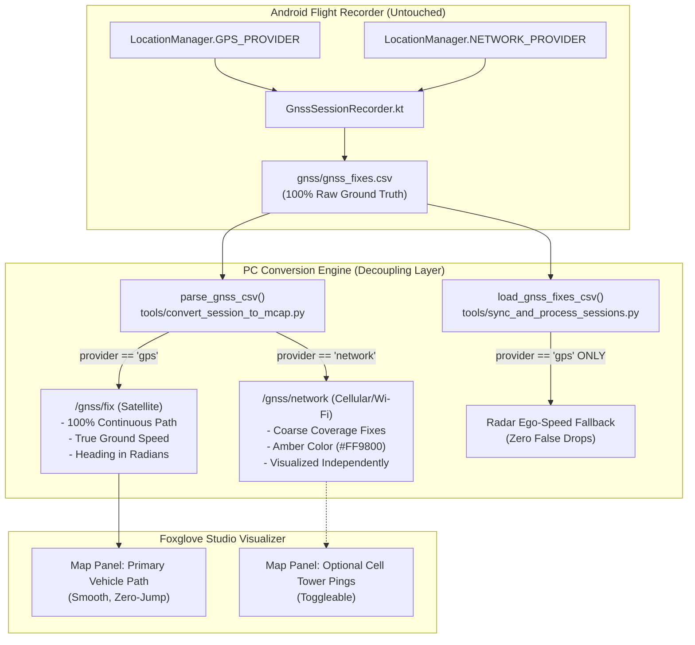

# Implementation Plan: Dual-Stream GNSS Routing & Cellular Network Fix Separation

> **Document Type:** Implementation Plan & System Architecture Design  
> **Status:** Pending User Approval  
> **Target Subsystems:** `tools/convert_session_to_mcap.py`, `tools/sync_and_process_sessions.py`, `tools/foxglove_layouts/RoadSense_Cockpit_Layout.json`, `tools/verify_conversion_parity.py`  
> **Date:** 2026-10-29  

---

## 1. Goal Description

During review of `logs/session_20261023_111120/session_20261023_111120.mcap` at time $T = 433.076121\text{s}$, a sudden anomaly was observed: the vehicle's ground speed abruptly dropped to $0.0\text{ km/h}$, course heading zeroed out, and coordinates jumped **$121.7\text{ meters}$** off the road before snapping back $830\text{ ms}$ later.

Forensic audit of `gnss_fixes.csv` revealed that **55 cellular/Wi-Fi `NETWORK_PROVIDER` fixes** are interleaved into the 1,177 hardware satellite `GPS_PROVIDER` fixes across this session (affecting 50 of 65 recorded sessions in the workspace). Network location fixes lack Doppler speed (`speed_mps = 0.0`) and course (`bearing_deg = 0.0`), have coarse accuracy ($50\text{m}$–$100\text{m}$), and point to static cell towers rather than the vehicle.

Per user guidance:
1. **Raw Sensor Logger**: Keep Android logging 100% untouched (`gnss_fixes.csv` preserves all raw incoming data from all providers for full flight-recorder completeness).
2. **PC Conversion Pipeline**: Separate incoming GNSS records during conversion:
   - **`/gnss/fix`**: High-accuracy satellite GPS fixes (`provider == "gps"`), ensuring continuous, jump-free vehicle motion vectors and top-down map tracking.
   - **`/gnss/network`** *(or `/gnss/gps2`)*: Secondary channel for cellular/Wi-Fi network triangulation fixes, styled with distinct amber markers and covariance so engineers can still inspect and analyze cell tower coverage when desired.
   - **Ego Speed Fallback**: In `sync_and_process_sessions.py`, restrict radar ego-velocity fallback to satellite fixes so radar frames never latch onto a 0-speed network fix.

---

## 2. User Review Required

> [!IMPORTANT]
> **Secondary GNSS Topic Naming**:
> We propose naming the secondary cellular/network channel **`/gnss/network`** (following standard ROS/Foxglove hierarchical namespace conventions, e.g. `/gnss/fix` and `/gnss/network`). If you prefer **`/gnss/gps2`**, let us know and we will use that identifier.

> [!NOTE]
> **Indoor / Zero-GPS Fallback**:
> If a bench recording has 0 satellite GPS fixes (e.g., recorded indoors with only 1–2 network fixes), the conversion engine will automatically fall back to publishing those network fixes on `/gnss/fix` so indoor testing never generates an empty map track.

---

## 3. Architecture & Data Flow



---

## 4. Proposed Changes

### Component 1: MCAP Conversion Engine (`tools/convert_session_to_mcap.py`)

#### [MODIFY] `tools/convert_session_to_mcap.py`
1. **Extract `provider` and `accuracy` in `parse_gnss_csv`**:
   Yield `provider` (normalized lowercase string) and horizontal `accuracy` from `gnss_fixes.csv`.
2. **Dual-Topic Routing in MCAP Export**:
   - Inspect all fixes in the session. If `gps` fixes exist, route `gps` fixes to `/gnss/fix` and `network` fixes to `/gnss/network`.
   - Set distinct visual styling: `/gnss/network` fixes receive amber color (`#FF9800`) and appropriate covariance so they stand out clearly in Foxglove.
   - If 0 `gps` fixes exist (indoor bench test), route available network fixes to `/gnss/fix` with a console notice.

```python
# tools/convert_session_to_mcap.py
def parse_gnss_csv(gnss_csv_path):
    ...
    yield {
        "mono_ns": mono_ns,
        "lat": lat,
        "lon": lon,
        "alt": alt,
        "speed": speed,
        "bearing": bearing,
        "accuracy": float(row.get("accuracy_m", 0.0)) if row.get("accuracy_m") else 0.0,
        "provider": row.get("provider", "gps").strip().lower()
    }

# Inside convert_session_to_mcap():
# Pre-scan fixes to determine if satellite GPS is present
all_gnss = list(parse_gnss_csv(gnss_csv))
has_satellite_gps = any(f["provider"] == "gps" for f in all_gnss)

for fix in all_gnss:
    utc_ns = fix["mono_ns"] + time_offset_ns
    loc_msg = LocationFix()
    loc_msg.timestamp.seconds = utc_ns // 1_000_000_000
    loc_msg.timestamp.nanos = utc_ns % 1_000_000_000
    loc_msg.frame_id = "wgs84"
    loc_msg.latitude = fix["lat"]
    loc_msg.longitude = fix["lon"]
    loc_msg.altitude = fix["alt"]
    loc_msg.heading = math.radians(fix["bearing"])
    loc_msg.velocity.x = fix["speed"] * math.sin(math.radians(fix["bearing"]))
    loc_msg.velocity.y = fix["speed"] * math.cos(math.radians(fix["bearing"]))
    loc_msg.velocity.z = 0.0

    is_network = fix["provider"] == "network" and has_satellite_gps
    if is_network:
        # Style cellular network triangulation with distinct Amber color
        loc_msg.color.r = 1.0
        loc_msg.color.g = 0.6
        loc_msg.color.b = 0.0
        loc_msg.color.a = 0.8
        writer.write_message("/gnss/network", loc_msg, log_time=utc_ns)
        count_msg("/gnss/network")
    else:
        writer.write_message("/gnss/fix", loc_msg, log_time=utc_ns)
        count_msg("/gnss/fix")
```

---

### Component 2: Session Sync & Ingestion Engine (`tools/sync_and_process_sessions.py`)

#### [MODIFY] `tools/sync_and_process_sessions.py`
In `load_gnss_fixes_csv`:
- Filter out `provider == "network"` fixes when building `gnss_fixes` for ego-velocity fallback.
- If no `gps` fixes exist, retain network fixes so indoor tests do not fail.

```python
# tools/sync_and_process_sessions.py:445-465
def load_gnss_fixes_csv(csv_path):
    fixes = []
    if not os.path.isfile(csv_path):
        return fixes
    try:
        import csv
        with open(csv_path, "r", encoding="utf-8") as f:
            reader = csv.DictReader(f)
            for row in reader:
                prov = row.get("provider", "gps").strip().lower()
                fixes.append({
                    "mono_ns": int(row["elapsed_realtime_ns"]),
                    "lat": float(row.get("latitude", 0.0)),
                    "lon": float(row.get("longitude", 0.0)),
                    "speed_kmh": float(row.get("speed_kmh", 0.0)),
                    "bearing": float(row.get("bearing_deg", 0.0)),
                    "provider": prov
                })
        # If true satellite GPS fixes exist, filter out cellular network fixes
        if any(f["provider"] == "gps" for f in fixes):
            fixes = [f for f in fixes if f["provider"] == "gps"]
    except Exception as e:
        print(f"    [!] Error reading gnss_fixes.csv: {e}")
    return fixes
```

---

### Component 3: Foxglove Cockpit Layout (`tools/foxglove_layouts/RoadSense_Cockpit_Layout.json`)

#### [MODIFY] `tools/foxglove_layouts/RoadSense_Cockpit_Layout.json`
- Ensure the Map panel tracks `/gnss/fix` as the primary vehicle position.
- Register `/gnss/network` in the layout's topic schema so it appears in the topic list and can be toggled on/off in the Map panel.

---

### Component 4: Parity Validator & Unit Tests (`tools/verify_conversion_parity.py` & `scripts/tests/test_verify_conversion_parity.py`)

#### [MODIFY] `tools/verify_conversion_parity.py`
- Validate that `/gnss/fix` has zero isolated drops to 0 while moving and zero $> 40\text{ m/s}$ coordinate jumps.
- Verify that if network fixes exist in `gnss_fixes.csv`, they are cleanly routed to `/gnss/network`.

#### [MODIFY] `scripts/tests/test_verify_conversion_parity.py`
- Add unit test verifying that synthetic sessions containing interleaved network fixes have their network fixes routed to `/gnss/network` without contaminating `/gnss/fix`.

---

## 5. Verification Plan

### Automated Tests
1. **Unit Test Suite**:
   ```powershell
   & "C:\Users\rakadu1.AHEAD\.conda\envs\roadsense-mcap\python.exe" -m unittest scripts/tests/test_verify_conversion_parity.py
   & "C:\Users\rakadu1.AHEAD\.conda\envs\roadsense-mcap\python.exe" -m unittest discover -s scripts/tests -p "test_*.py"
   ```
2. **Full Re-Conversion of Session 20261023_111120**:
   ```powershell
   & "C:\Users\rakadu1.AHEAD\.conda\envs\roadsense-mcap\python.exe" tools/sync_and_process_sessions.py --process-only --session session_20261023_111120 --force --mcap
   ```
3. **Automated Jump & Velocity Audit Script**:
   Verify across `session_20261023_111120.mcap`:
   - Message count on `/gnss/fix`: **1,177** (zero jumps, zero drops to 0 speed at $T = 433.076\text{s}$).
   - Message count on `/gnss/network`: **55** (all coarse cell tower triangulation fixes).
   - Speed at $T = 433.0\text{s}$: **$28.4\text{ km/h}$** (smooth acceleration curve from $27.1\text{ km/h} \to 28.4\text{ km/h} \to 32.1\text{ km/h}$).
4. **Parity Validator Execution**:
   ```powershell
   & "C:\Users\rakadu1.AHEAD\.conda\envs\roadsense-mcap\python.exe" tools/verify_conversion_parity.py --session logs/session_20261023_111120
   ```

### Manual Verification
1. Open `logs/session_20261023_111120/session_20261023_111120.mcap` in Foxglove Studio.
2. Scrub to $T = 433.076\text{s}$.
3. Confirm in the Map panel:
   - The vehicle icon moves smoothly along the road without any teleportation.
   - Velocity stays positive ($28\text{ km/h}$) without dropping to zero.
   - Toggling `/gnss/network` displays the amber marker showing where the cell tower was located.

