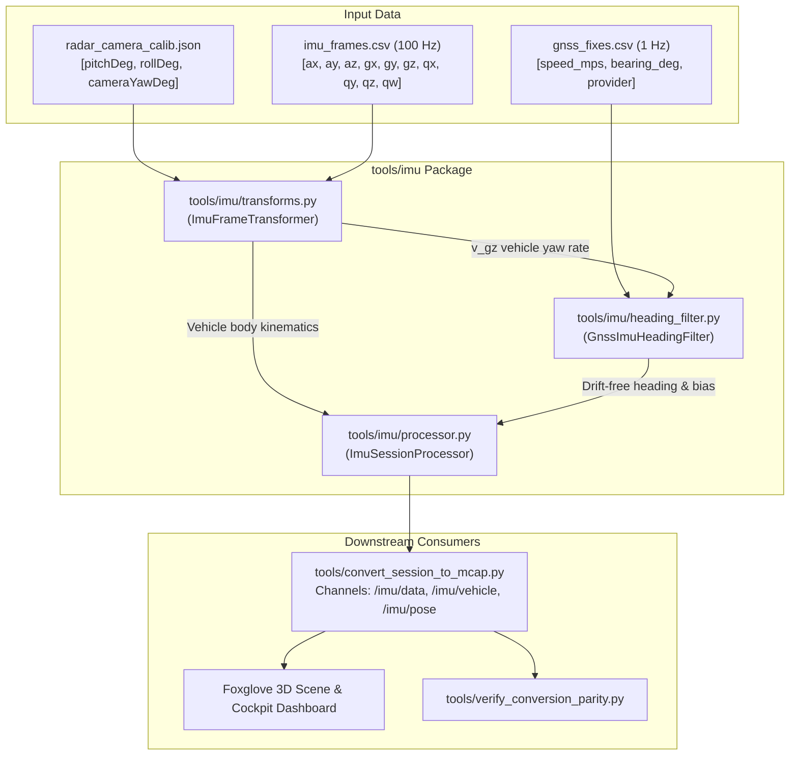

# Implementation Plan: Modular `tools/imu/` Package & GNSS-IMU Heading Fusion Engine

## Goal Description
Resolve the persistent yaw drift observed in every RoadSense recording session by implementing **Option A**: an automotive **GNSS-IMU Heading Filter (ZUPT + GPS Course Fusion)**.

Per architectural guidelines, all IMU algorithms and transformations will be extracted from monolithic scripts (such as `tools/convert_session_to_mcap.py`) into a dedicated, reusable, modular package: `tools/imu/`. This package will house 6-DOF vehicle extrinsics transformations, stationary zero-velocity update (ZUPT) gyro bias autocalibration, and 100 Hz inertial course fusion.

---

## User Review Required

> [!IMPORTANT]
> **Heading Coordinate Definition**:
> In `/imu/vehicle`, `yaw_deg` and `/imu/pose` will be referenced to geographic navigation coordinates ($0^\circ = \text{North}, 90^\circ = \text{East}, 180^\circ = \text{South}, 270^\circ = \text{West}$):
> 1. When the vehicle is moving ($> 1.5\text{ m/s}$), vehicle heading tracks the true GPS course over ground.
> 2. When the vehicle stops at a traffic light, ZUPT locks the gyro bias so yaw drift is reduced from $> 56^\circ$ to $< 1.0^\circ$.
> 3. In `/imu/data`, raw unreferenced phone yaw will be preserved for debugging.

> [!NOTE]
> **Upcoming Sprints**:
> Adding 9-DOF `Sensor.TYPE_ROTATION_VECTOR` on the Android app side (`ImuManager.kt`) will be scheduled in subsequent sprints as requested.

---

## System Architecture: `tools/imu/`



---

## Proposed Changes

### Module 1: `tools/imu/` Package Creation

#### [NEW] `tools/imu/__init__.py`
Exports public classes:
- `ImuFrameTransformer`: Handles phone-to-camera optical and camera-to-vehicle `base_link` FLU 3D transformations.
- `GnssImuHeadingFilter`: 2-state EKF estimating vehicle heading $\psi$ and gyroscope zero-rate bias $b_z$.
- `ImuSessionProcessor`: High-level generator processing `imu_frames.csv` + `gnss_fixes.csv` + calibration.

#### [NEW] `tools/imu/transforms.py`
Extracted from `convert_session_to_mcap.py` lines 647–834:
- `build_phone_to_base_matrix(pitch_deg, roll_deg, camera_yaw_deg)`:
  $$R_{\text{base\_from\_phone}} = (R_z(\phi) \, R_x(\theta) \, R_y(\psi) \, R_0)^T \cdot R_{\text{opt\_from\_phone}}$$
- `transform_vector(v, R)`: Rotates acceleration, angular velocity, and linear acceleration into vehicle body frame.
- `quaternion_from_euler(roll_rad, pitch_rad, yaw_rad)`: Generates normalized quaternion $q = [q_x, q_y, q_z, q_w]$ from ISO 8855 Tait-Bryan angles.
- `euler_from_quaternion(q)`: Extracts roll, pitch, yaw from quaternion.

#### [NEW] `tools/imu/heading_filter.py`
Automotive GNSS-IMU 2-state Extended Kalman Filter:
- **State Vector**: $\mathbf{x} = [\psi, b_z]^T$ (heading in rad, gyro bias in rad/s).
- **100 Hz Predict Step**:
  $$\omega_{\text{bearing}} = -v\_gz_k$$
  $$\psi_k = \text{wrap\_pi}(\psi_{k-1} + (\omega_{\text{bearing}} - b_z) \Delta t)$$
  $$P_{k|k-1} = F P_{k-1} F^T + Q, \quad F = \begin{bmatrix} 1 & -\Delta t \\ 0 & 1 \end{bmatrix}$$
- **Zero Velocity Update (ZUPT)**:
  - Triggered when vehicle speed $< 0.3\text{ m/s}$ (or moving window acceleration variance $< \epsilon$).
  - Measured rate is purely bias: $z = \omega_{\text{bearing}}$, $H = [0, 1]$.
  - Locks gyro bias to physical DC offset within seconds of vehicle stop.
- **GPS Doppler Course Update**:
  - Triggered when `speed_mps` $> 1.5\text{ m/s}$ and `provider == 'gps'`.
  - Measured heading is GPS bearing: $z = \text{bearing\_deg} \cdot \frac{\pi}{180}$, $H = [1, 0]$.
  - $R_{\text{gps}}$ dynamic variance scaled inversely by vehicle speed.

#### [NEW] `tools/imu/processor.py`
- Coordinates reading raw CSV streams, running the transformer, feeding GNSS fixes to the heading filter, and yielding dual structured dictionaries:
  - `raw_sample`: Preserves ground-referenced phone readings for `/imu/data`.
  - `vehicle_sample`: Contains extrinsics-compensated accelerations ($A_x, A_y, A_z$), gravity decoupling ($A_z \approx +9.81\text{ m/s}^2$), zero-centered pitch/roll ($\approx 0.0^\circ$), and drift-free fused heading ($\psi_{\text{fused}}$) for `/imu/vehicle` and `/imu/pose`.

#### [NEW] `tools/imu/README.md`
- Documentation outlining frame conventions, sensor characteristics, EKF equations, and usage guide.

---

### Module 2: MCAP Exporter & Validation Refactoring

#### [MODIFY] `tools/convert_session_to_mcap.py`
- Refactor `parse_imu_csv(imu_csv_path, calib_params=None)` to accept `gnss_csv_path=None`.
- Replace inline 150-line transformation and matrix math with:
  ```python
  from tools.imu.processor import ImuSessionProcessor

  def parse_imu_csv(imu_csv_path, gnss_csv_path=None, calib_params=None):
      processor = ImuSessionProcessor(calib_params=calib_params)
      return processor.process_stream(imu_csv_path, gnss_csv_path=gnss_csv_path)
  ```
- Pass `gnss_csv_path` into `parse_imu_csv()` in `convert_session_to_mcap()`.

#### [MODIFY] `tools/verify_conversion_parity.py`
- Add Category 8 sanity assertions for heading drift:
  - Assert that during stationary intervals ($> 15\text{ s}$), total yaw drift is $\le 3.0^\circ$ (was previously $56.3^\circ$).
  - Assert that median moving heading error vs GPS bearing is $\le 15.0^\circ$.

---

### Module 3: Test Suite

#### [NEW] `scripts/tests/test_imu_module.py`
Unit tests for `tools/imu/`:
1. `test_transforms_matrix_orthogonality()`: Verifies determinant $= 1.0$ and $R R^T = I$.
2. `test_transforms_phone_to_vehicle_axes()`: Verifies Reverse Landscape mapping ($Z_{\text{base}} \approx -X_{\text{phone}}$).
3. `test_heading_filter_zupt_bias_convergence()`: Verifies that stationary rate of $-0.0254\text{ rad/s}$ converges to estimated bias within $0.001\text{ rad/s}$ in $< 2\text{ s}$.
4. `test_heading_filter_gps_course_tracking()`: Verifies that during straight and curved driving, EKF tracks GPS Doppler bearing with zero long-term drift.
5. `test_imu_processor_integration()`: Verifies complete end-to-end stream parsing and dual sample output.

---

## Verification Plan

### Automated Tests
1. **New IMU Module Unit Tests**:
   ```powershell
   & "C:\Users\rakadu1.AHEAD\.conda\envs\roadsense-mcap\python.exe" -m unittest scripts/tests/test_imu_module.py
   ```
2. **Existing Conversion Parity Unit Tests**:
   ```powershell
   & "C:\Users\rakadu1.AHEAD\.conda\envs\roadsense-mcap\python.exe" -m unittest scripts/tests/test_verify_conversion_parity.py
   ```
3. **Full Python Test Suite**:
   ```powershell
   & "C:\Users\rakadu1.AHEAD\.conda\envs\roadsense-mcap\python.exe" -m unittest discover -s scripts/tests
   ```
4. **Android JVM Unit Tests**:
   ```powershell
   $env:JAVA_HOME = "C:\Users\rakadu1.AHEAD\Android_Studio\android-studio-quail4-windows\android-studio\jbr"; ./gradlew testDebugUnitTest
   ```

### Empirical Verification on `session_20261023_111120`
1. **Re-Export MCAP**:
   ```powershell
   & "C:\Users\rakadu1.AHEAD\.conda\envs\roadsense-mcap\python.exe" tools/sync_and_process_sessions.py --process-only --session session_20261023_111120 --force --mcap
   ```
2. **Run Parity Validator**:
   ```powershell
   & "C:\Users\rakadu1.AHEAD\.conda\envs\roadsense-mcap\python.exe" tools/verify_conversion_parity.py --session logs/session_20261023_111120
   ```
3. **Inspect Output MCAP**:
   - Compare stationary Period 1 (39s at red light): verify drift $< 1.0^\circ$.
   - Verify vehicle world heading tracks road trajectory in Foxglove 3D scene.

