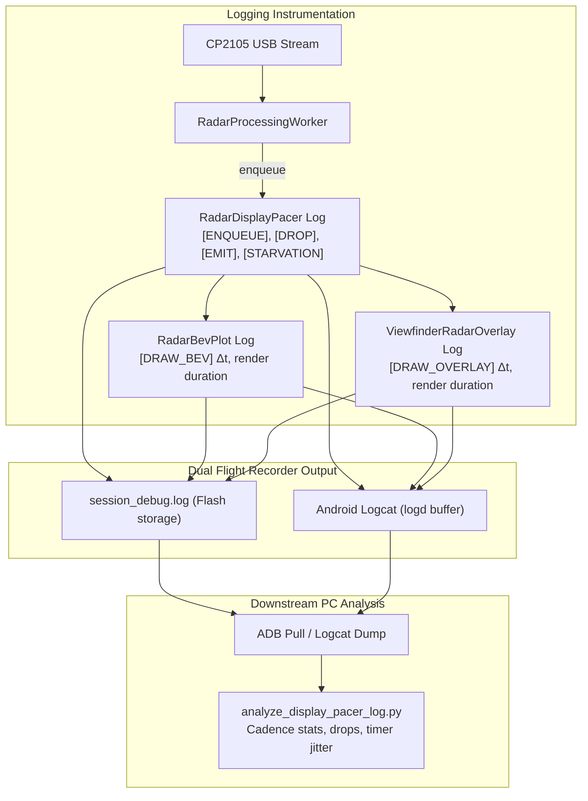

# Implementation Plan: Radar Display Pacer & UI Choppiness Logcat Diagnostics

## Goal Description
The user observed that after introducing `RadarDisplayPacer`, the SBS tab looks slightly smoother, but the dedicated Radar tab plot became even choppier. 
Because the phone has a single USB port, the user must run the Radar on the phone disconnected from the PC, record data on both tabs, then disconnect the Radar and connect the phone to the PC via ADB.

This plan adds high-resolution diagnostic logging across [`RadarDisplayPacer`](file:///c:/Users/rakadu1.AHEAD/AndroidStudioProjects/RoadSense/app/src/main/java/com/bajajauto/roadsense/sync/RadarDisplayPacer.kt), [`RadarBevPlot`](file:///c:/Users/rakadu1.AHEAD/AndroidStudioProjects/RoadSense/app/src/main/java/com/bajajauto/roadsense/ui/components/RadarBevPlot.kt), and [`ViewfinderRadarOverlay`](file:///c:/Users/rakadu1.AHEAD/AndroidStudioProjects/RoadSense/app/src/main/java/com/bajajauto/roadsense/ui/components/ViewfinderRadarOverlay.kt), ensuring all timing events are dual-written to both Android Logcat and persistent session flight logs (`session_debug.log`). An automated diagnostic analysis script will then evaluate the captured logs upon ADB reconnection.

---

## User Review Required

> [!IMPORTANT]
> **Single USB Port Workflow:** Since the phone cannot connect to both the Radar and PC simultaneously, logs must be buffered on the phone. Dual-logging via `AppLogger` guarantees that even if Android's transient logcat buffer rolls over while recording, the full unclipped diagnostic trail will be safely persisted in `session_debug.log` on the device storage.

> [!NOTE]
> Diagnostic logging will be lightweight (nanosecond timestamp arithmetic and formatted string emission) so that it introduces zero measurable overhead or GC pressure to the 20 Hz / 60 Hz rendering pipeline.

---

## Proposed Changes



---

### 1. Radar Display Pacer Diagnostics

#### [MODIFY] [`app/src/main/java/com/bajajauto/roadsense/sync/RadarDisplayPacer.kt`](file:///c:/Users/rakadu1.AHEAD/AndroidStudioProjects/RoadSense/app/src/main/java/com/bajajauto/roadsense/sync/RadarDisplayPacer.kt)
* Instrument `enqueueFrame(frame)`:
  * Record arrival interval `deltaArrivalMs = (nowNs - lastEnqueueNs) / 1_000_000.0`.
  * Log: `[ENQUEUE] seq=#$frameNumber | deltaArrMs=%.2f | qDepth=$size`.
* Instrument queue depth bounding:
  * Track and log dropped frames:
    `[DROP] seq=#${dropped.header.frameNumber} | qDepth=$size | totalDrops=$totalDrops`.
* Instrument frame emission & timing loop:
  * Track actual dispatch interval: `deltaEmitMs = (nowNs - lastEmitNs) / 1_000_000.0`.
  * Track timer wakeup jitter: `timerJitterMs = (nowNs - nextTargetNs) / 1_000_000.0`.
  * Track queue starvation: `[STARVATION] queue empty at tick, holding previous frame`.
  * Log: `[EMIT] seq=#$frameNumber | deltaEmitMs=%.2f | jitterMs=%.2f | qDepth=$size | totalDrops=$totalDrops`.
* Use `AppLogger.d("DisplayPacer", ...)` and `android.util.Log.d("DisplayPacer", ...)`.

---

### 2. Canvas Rendering Diagnostics

#### [MODIFY] [`app/src/main/java/com/bajajauto/roadsense/ui/components/RadarBevPlot.kt`](file:///c:/Users/rakadu1.AHEAD/AndroidStudioProjects/RoadSense/app/src/main/java/com/bajajauto/roadsense/ui/components/RadarBevPlot.kt)
* In `Canvas { ... }`:
  * Measure time between draw calls: `deltaDrawMs = (nowNs - lastDrawNs) / 1_000_000.0`.
  * Measure execution duration of the draw pass: `drawDurationMs = (endNs - startNs) / 1_000_000.0`.
  * Log throttled/sampled diagnostic every 5 frames:
    `[DRAW_BEV] frame=#$frameNumber | deltaDrawMs=%.2f | drawDurationMs=%.2f`.

#### [MODIFY] [`app/src/main/java/com/bajajauto/roadsense/ui/components/ViewfinderRadarOverlay.kt`](file:///c:/Users/rakadu1.AHEAD/AndroidStudioProjects/RoadSense/app/src/main/java/com/bajajauto/roadsense/ui/components/ViewfinderRadarOverlay.kt)
* In `Canvas { ... }`:
  * Measure draw intervals and duration for SBS overlay:
    `[DRAW_OVERLAY] frame=#$frameNumber | deltaDrawMs=%.2f | drawDurationMs=%.2f`.

---

### 3. PC Analysis Tooling

#### [NEW] `scripts/analyze_display_pacer_log.py`
* Standalone Python script that accepts either an exported log file (`session_debug.log` or logcat dump).
* Automatically extracts and computes:
  1. **Arrival Cadence ($\Delta t_{arrival}$):** Mean, Min, Max, StdDev from USB stream.
  2. **Pacer Emission Cadence ($\Delta t_{emit}$):** Mean, Min, Max, StdDev, identifying any gaps or clustering.
  3. **Canvas Draw Cadence ($\Delta t_{draw}$):** Actual frame refresh interval on screen.
  4. **Dropped Frame Forensic:** Exact count and sequence numbers of frames discarded by the queue buffer.
  5. **Timer Jitter Distribution:** Quantifies how much `delay(50)` deviates on the Android runtime.

---

## Verification Plan

### Automated Tests
1. **JVM Unit Tests:**
   ```powershell
   $env:JAVA_HOME = "C:\Users\rakadu1.AHEAD\Android_Studio\android-studio-quail4-windows\android-studio\jbr"; ./gradlew testDebugUnitTest
   ```
2. **Assemble Debug APK:**
   ```powershell
   $env:JAVA_HOME = "C:\Users\rakadu1.AHEAD\Android_Studio\android-studio-quail4-windows\android-studio\jbr"; ./gradlew assembleDebug
   ```

### User Operational Verification Steps (Step-by-Step Runbook)

1. **Build & Install Updated APK:**
   * User flashes `app-debug.apk` onto the phone.
2. **Capture Test Session on Phone (Radar Connected):**
   * Connect TI mmWave radar to phone via USB-OTG cable.
   * Open RoadSense, start a recording session (`REC`).
   * Spend **15 seconds on the dedicated Radar tab** (`BEV Scope`).
   * Switch to the **SBS tab** and spend **15 seconds** there.
   * Stop recording (`STOP REC`).
3. **Connect Phone to PC via ADB:**
   * Disconnect radar from phone.
   * Plug phone into PC via USB cable.
4. **Trigger Log Extraction & Analysis:**
   * Agent runs ADB command to extract Logcat and `session_debug.log`.
   * Agent runs `analyze_display_pacer_log.py` and presents complete statistical diagnosis.

