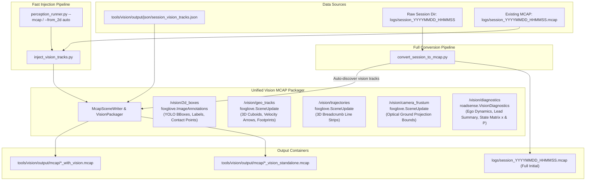
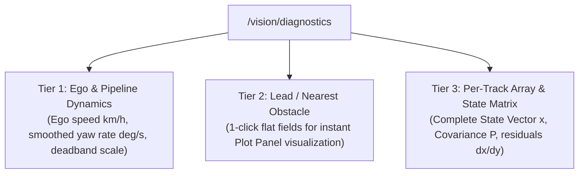

# Implementation Plan: Enriching Foxglove MCAP with Vision Debug Sub-Topics & State Matrix Observability

## Goal Description
Enhance Foxglove MCAP creation and injection to publish a rich, organized suite of vision debugging topics under the `/vision/` namespace. Specifically:
1. **2D Image Annotations (`/vision/2d_boxes`)**: Publish YOLO 2D bounding boxes, track ID/class/confidence labels, and bottom-center ground contact points using `foxglove.ImageAnnotations` so they can be overlaid directly onto the `/camera/video` feed in Foxglove Studio.
2. **3D Scene Enrichment (`/vision/geo_tracks`)**: Augment existing 3D cuboids with 3D velocity vectors (`arrows`), ground contact footprints (`lines`), and billboard labels.
3. **3D Trajectory History (`/vision/trajectories`)**: Render multi-second breadcrumb paths (`LINE_STRIP`) in `foxglove.SceneUpdate` to visualize vehicle path continuity and stability.
4. **Camera Field-of-View Frustum (`/vision/camera_frustum`)**: Render the optical ground projection boundary trapezoid in 3D to visualize the valid projection envelope.
5. **Structured Telemetry Diagnostics & State Matrix (`/vision/diagnostics`)**: Publish per-frame vision tracking state, ego turning model status, smoothed yaw rate, lead obstacle summary, and complete per-track **State Matrix $\mathbf{x}$** and **Covariance Matrix $\mathbf{P}$** using native JSON schema (`roadsense.VisionDiagnostics`).
6. **Dual-Pipeline Support**: Ensure all topics are seamlessly injected during:
   - **Full MCAP Creation**: [`tools/convert_session_to_mcap.py`](file:///c:/Users/rakadu1.AHEAD/AndroidStudioProjects/RoadSense/tools/convert_session_to_mcap.py) automatically discovers pre-computed vision tracks and includes them during initial conversion.
   - **FAST Method**: [`tools/vision/mcap/inject_vision_tracks.py`](file:///c:/Users/rakadu1.AHEAD/AndroidStudioProjects/RoadSense/tools/vision/mcap/inject_vision_tracks.py) and [`tools/vision/pipeline/perception_runner.py`](file:///c:/Users/rakadu1.AHEAD/AndroidStudioProjects/RoadSense/tools/vision/pipeline/perception_runner.py) inject all sub-topics non-destructively in seconds.
7. **Documentation**: Detailed guide and schema specification established in [`intel/Vision/Vision_Debug.md`](file:///c:/Users/rakadu1.AHEAD/AndroidStudioProjects/RoadSense/intel/Vision/Vision_Debug.md).

---

## Architecture & Sub-Topic Hierarchy



---

## Sub-Topic Specifications

| Topic Name | Schema | Format | Visual Target | Description |
| :--- | :--- | :--- | :--- | :--- |
| **`/vision/2d_boxes`** | `foxglove.ImageAnnotations` | Protobuf | Image Panel (`/camera/video`) | 2D YOLO bounding boxes (`LINE_LOOP`), confidence score & track ID text, and ground contact point dots (`CircleAnnotation`). |
| **`/vision/geo_tracks`** | `foxglove.SceneUpdate` | Protobuf | 3D Scene Panel (`3d_cockpit`) | 3D oriented bounding boxes (`cubes`), billboard labels (`texts`), velocity vectors (`arrows`), and road contact footprints (`lines`). |
| **`/vision/trajectories`** | `foxglove.SceneUpdate` | Protobuf | 3D Scene Panel (`3d_cockpit`) | Multi-second trajectory trails (`LINE_STRIP`) per track ID displaying historical motion path. |
| **`/vision/camera_frustum`** | `foxglove.SceneUpdate` | Protobuf | 3D Scene Panel (`3d_cockpit`) | Static/periodic 3D wireframe outline of the camera's ground-plane projection trapezoid on $Z_{\text{road}} = 0$. |
| **`/vision/diagnostics`** | `roadsense.VisionDiagnostics` | JSON Schema | Raw Messages, State Transitions, Plot | 3-Tier diagnostic schema: Frame-level ego dynamics, Lead obstacle summary (1-click plotting), and per-track State Vector $\mathbf{x}$ and Covariance Matrix $\mathbf{P}$. |

---

## Deep Dive: `/vision/diagnostics` & State Matrix Architecture

### 1. Three-Tier Diagnostic Structure



#### Tier 1: Ego Dynamics & Turning Model Context
* `frame_index`: Integer video frame sequence number.
* `timestamp_utc_ns`: Frame timestamp in UTC nanoseconds.
* `track_count`: Total active vision tracks in this frame.
* `moving_track_count`: Number of tracks currently declared moving.
* `ego_speed_mps` & `ego_speed_kmh`: Host vehicle speed from CAN.
* `ego_yaw_rate_can_radps`: Raw CAN yaw rate.
* `ego_yaw_rate_smoothed_degps`: Filtered yaw rate in degrees/second.
* `ego_turning_model_active`: Boolean (`True` when outside deadband).
* `ego_deadband_scale`: Smooth Hermite scaling factor $[0.0, 1.0]$.

#### Tier 2: Lead Obstacle Summary (Instant 1-Click Plotting)
Flat fields for the closest active obstacle in the ego path:
* `lead_obstacle.track_id`: Integer track ID.
* `lead_obstacle.range_m`: Longitudinal/radial range.
* `lead_obstacle.speed_kmh`: World speed of lead vehicle.
* `lead_obstacle.vx_mps` & `vy_mps`: World velocities.
* `lead_obstacle.yaw_deg`: Heading angle.
* `lead_obstacle.ttc_sec`: Time-To-Collision.

#### Tier 3: Per-Track Array & State Matrix (`tracks[...]`)
For each track $i$:
* **State Vector $\mathbf{x} = [x, y, v_x, v_y, \psi, \omega]^T$**:
  * `x_m`: Longitudinal position (+Forward in `base_link`).
  * `y_m`: Lateral position (+Left in `base_link`).
  * `vx_mps`: Forward velocity in world frame.
  * `vy_mps`: Lateral velocity in world frame.
  * `yaw_deg`: Stabilized heading $[-180^\circ, 180^\circ]$.
  * `yaw_rate_degps`: Target's angular turning rate.
* **Diagonal Uncertainty ($1\sigma$ Sigmas)**:
  * `covariance_diag.sigma_x_m`, `sigma_y_m`: Position uncertainties.
  * `covariance_diag.sigma_vx_mps`, `sigma_vy_mps`: Velocity uncertainties.
  * `covariance_diag.sigma_yaw_deg`: Heading uncertainty in degrees.
* **Full Covariance Matrix $\mathbf{P}$**:
  * `covariance_matrix`: Complete $6 \times 6$ 2D array including cross-correlation terms.
* **Measurement Innovation Residuals**:
  * `residuals.dx_m`: $x_{\text{meas}} - x_{\text{pred}}$ (ground projection innovation).
  * `residuals.dy_m`: $y_{\text{meas}} - y_{\text{pred}}$.
* **Tracking Classifiers**:
  * `is_moving`: Boolean.
  * `basin`: Active heading basin (`"forward"`, `"oncoming"`, `"cross"`).
  * `heading_jitter_deg`: $| \text{raw} - \text{smoothed} |$ orientation stability metric.

---

## 4 Methods for Visualizing the State Matrix in Foxglove Studio

1. **Plot Panel (Time-Series Curves)**:
   - Plot state variables: `/vision/diagnostics.tracks[:]{track_id==4991}.state_matrix.state_vector.yaw_deg`
   - Plot uncertainty bounds: `/vision/diagnostics.tracks[:]{track_id==4991}.state_matrix.covariance_diag.sigma_yaw_deg`
   - Plot innovation residuals: `/vision/diagnostics.tracks[:]{track_id==4991}.state_matrix.residuals.dx_m`
2. **Raw Messages & Table Panels (Interactive Matrix Inspection)**:
   - Scrub the session timeline frame-by-frame and view the expandable $6 \times 6$ `covariance_matrix` and `state_vector` numerical table.
3. **3D Scene Panel (Uncertainty Ellipsoid)**:
   - In `/vision/geo_tracks`, render a ground-plane uncertainty footprint ellipse scaled by $(2\sigma_x, 2\sigma_y)$ under each vehicle.
4. **User Scripts Panel (Live HUD)**:
   - Use Foxglove's built-in TypeScript scripting engine to format active tracks into a real-time HUD table beside the camera stream.

---

## Proposed Changes

### Component 1: Vision Scene & Annotation Generator

#### [MODIFY] [`tools/vision/mcap/mcap_scene_writer.py`](file:///c:/Users/rakadu1.AHEAD/AndroidStudioProjects/RoadSense/tools/vision/mcap/mcap_scene_writer.py)
Expand `McapSceneWriter` to support generating:
1. `create_image_annotations(timestamp_ns, tracks)`:
   - Uses `foxglove_schemas_protobuf.ImageAnnotations_pb2.ImageAnnotations`.
   - Adds `PointsAnnotation` (`type=LINE_LOOP`, 4 corners) for each 2D bounding box `[x1, y1, x2, y2]`.
   - Adds `TextAnnotation` above the box with `ID #{track_id} {cls.upper()} ({range:.1f}m)`.
   - Adds `CircleAnnotation` at bottom center `((x1+x2)/2, y2)` with diameter 8px to highlight the ground contact point.
   - Category-based coloring: Magenta for cars/trucks, Yellow for 2-wheelers, Cyan for pedestrians.
2. `create_scene_update(timestamp_ns, tracks, frame_id="base_link")`:
   - Adds 3D velocity vectors (`ArrowPrimitive`) pointing in direction $(v_x, v_y, 0)$ scaled by speed.
   - Adds ground contact footprint wireframes (`LinePrimitive`, `LINE_LOOP`) on $Z = 0$.
3. `create_trajectories_update(timestamp_ns, trajectory_history)`:
   - Takes a sliding window dictionary `{track_id: [(x, y, z), ...]}` and creates `LinePrimitive` (`LINE_STRIP`) paths.
4. `create_camera_frustum_update(timestamp_ns, extrinsics, intrinsics)`:
   - Generates the camera ground-plane projection trapezoid lines from $x = 1.0\text{ m}$ to $x = 60.0\text{ m}$.
5. `create_diagnostics_message(timestamp_ns, frame_data, ego_speed_mps, ego_yaw_rate_can, ego_yaw_rate_smoothed, turning_model_active, deadband_scale)`:
   - Generates the 3-tier JSON-serializable diagnostic payload containing Ego Dynamics, Lead Obstacle summary, and per-track State Matrices.

---

### Component 2: FAST Injection Pipeline

#### [MODIFY] [`tools/vision/mcap/inject_vision_tracks.py`](file:///c:/Users/rakadu1.AHEAD/AndroidStudioProjects/RoadSense/tools/vision/mcap/inject_vision_tracks.py)
1. Register new output channels:
   - `/vision/2d_boxes` (`foxglove.ImageAnnotations`, protobuf)
   - `/vision/geo_tracks` (`foxglove.SceneUpdate`, protobuf)
   - `/vision/trajectories` (`foxglove.SceneUpdate`, protobuf)
   - `/vision/camera_frustum` (`foxglove.SceneUpdate`, protobuf)
   - `/vision/diagnostics` (`roadsense.VisionDiagnostics`, JSON schema)
2. Maintain a running trajectory buffer (`trajectory_history: Dict[int, deque]`) across frames to generate `/vision/trajectories`.
3. In the streaming merge loop, emit all vision sub-topics at the corresponding UTC nanosecond timestamp.
4. Support both `--standalone` (lightweight vision-only MCAP) and full merging into the source MCAP.

---

### Component 3: Full MCAP Conversion Pipeline

#### [MODIFY] [`tools/convert_session_to_mcap.py`](file:///c:/Users/rakadu1.AHEAD/AndroidStudioProjects/RoadSense/tools/convert_session_to_mcap.py)
1. In `convert_session_to_mcap()`:
   - Check if vision tracks exist for the session:
     - `tools/vision/output/json/{session_name}_vision_tracks.json`
     - `{session_dir}/baseline_yolo_tracking.json`
     - `{session_dir}/vision_tracks.json`
   - If found:
     - Register the vision sub-topics (`/vision/geo_tracks`, `/vision/2d_boxes`, `/vision/trajectories`, `/vision/camera_frustum`, `/vision/diagnostics`).
     - Load vision frames and interleave them into the chronological message stream during initial MCAP generation.
     - Print confirmation: `[+] Found existing vision tracks: Ingesting /vision/* topics into MCAP`.
2. Add CLI argument `--with-vision` or `--vision-json <path>` to allow explicit override.

---

### Component 4: Cockpit Layout Configuration

#### [MODIFY] [`tools/foxglove_layouts/RoadSense_Cockpit_Layout.json`](file:///c:/Users/rakadu1.AHEAD/AndroidStudioProjects/RoadSense/tools/foxglove_layouts/RoadSense_Cockpit_Layout.json)
1. Update `camera_view` configuration to enable `/vision/2d_boxes` as active image annotations.
2. Update `3d_cockpit` configuration to enable `/vision/geo_tracks`, `/vision/trajectories`, and `/vision/camera_frustum`.
3. Update `telemetry_plot` to include vision turning model diagnostics paths (`/vision/diagnostics.ego_yaw_rate_smoothed_degps`, `/vision/diagnostics.lead_obstacle.speed_kmh`).

---

## Verification Plan

### Automated Tests
1. **Unit Tests for Scene & Annotation Generation**:
   - Create `scripts/tests/test_mcap_vision_enrichment.py`:
     - Test `McapSceneWriter.create_image_annotations()`: validates `PointsAnnotation`, `TextAnnotation`, and `CircleAnnotation` fields and coordinates.
     - Test `McapSceneWriter.create_scene_update()`: validates cuboids, velocity arrows, and footprints.
     - Test `McapSceneWriter.create_trajectories_update()`: validates trajectory line strips.
     - Test `McapSceneWriter.create_diagnostics_message()`: validates 3-tier structure and State Matrix numerical values.
   - Run:
     ```powershell
     C:\Users\rakadu1.AHEAD\.conda\envs\roadsense-mcap\python.exe -m unittest discover -s scripts/tests -p "test_mcap_vision_enrichment.py"
     ```
2. **Existing Regression Tests**:
   - Run full Python test suite:
     ```powershell
     C:\ProgramData\miniconda3\envs\cv313\python.exe -m unittest discover -s scripts/tests -p "test_*.py"
     ```
   - Run Gradle unit tests:
     ```powershell
     $env:JAVA_HOME = "C:\Users\rakadu1.AHEAD\Android_Studio\android-studio-quail4-windows\android-studio\jbr"; ./gradlew testDebugUnitTest
     ```

### Manual Verification
1. **Fast Injection Verification**:
   - Run:
     ```powershell
     C:\Users\rakadu1.AHEAD\.conda\envs\roadsense-mcap\python.exe tools/vision/mcap/inject_vision_tracks.py logs/session_20261023_111120
     ```
   - Verify MCAP topic list and message counts using `mcap info`:
     - `/vision/2d_boxes`
     - `/vision/geo_tracks`
     - `/vision/trajectories`
     - `/vision/camera_frustum`
     - `/vision/diagnostics`
2. **Full MCAP Creation Verification**:
   - Run:
     ```powershell
     C:\Users\rakadu1.AHEAD\.conda\envs\roadsense-mcap\python.exe tools/convert_session_to_mcap.py logs/session_20261023_111120 --output tools/vision/output/mcap/test_full_conversion.mcap
     ```
   - Verify `/vision/*` topics are present in the converted MCAP.
3. **Visual Verification in Foxglove Studio**:
   - Open the generated MCAP in Foxglove Studio.
   - Verify that 2D YOLO bounding boxes and contact points overlay cleanly onto the `/camera/video` feed.
   - Verify that rotating 3D boxes match the 2D bounding boxes.
   - Verify velocity arrows point along motion direction in the 3D scene.
   - Verify State Matrix plots and raw message tables work seamlessly.
