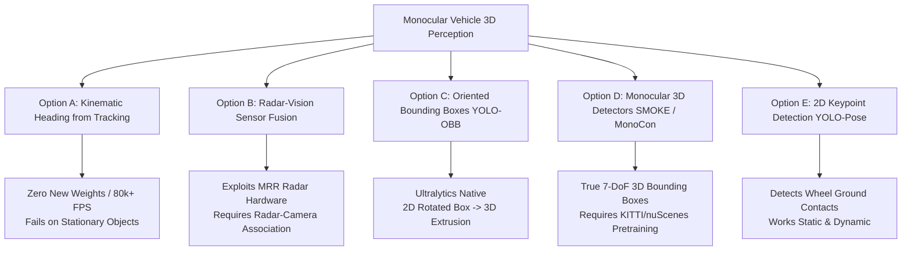
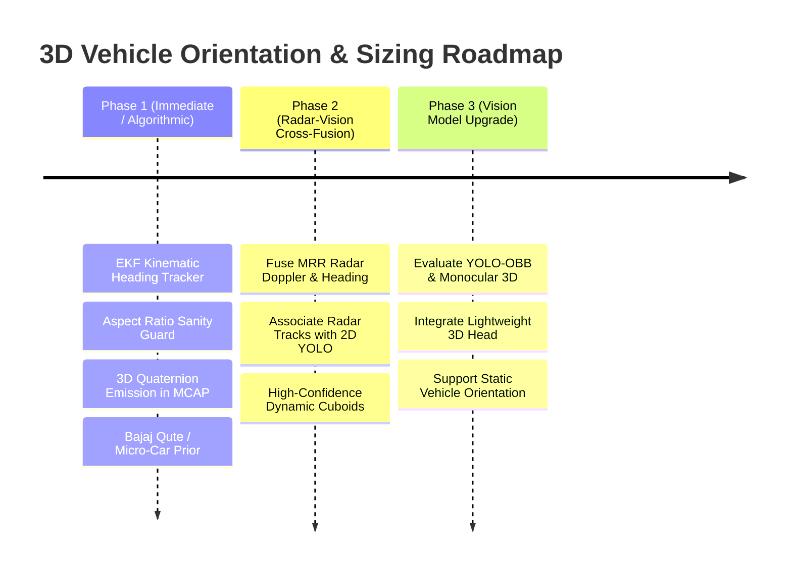

# Technical Design Plan: Vehicle Orientation Estimation & 3D Bounding Box Projection

## 1. Goal Description

In monocular 3D road perception, standard 2D object detectors (such as YOLOv8 / YOLO11 / YOLO26) output an **axis-aligned 2D bounding box** $[x_1, y_1, x_2, y_2]$ that encapsulates the entire projected silhouette of a vehicle. 

Currently, RoadSense computes 3D bounding boxes by directly mapping the 2D bounding box width $(x_2 - x_1)$ to optical transverse width ($Y$-axis in vehicle coordinates) and assuming an **identity orientation** (heading $\psi = 0^\circ$ parallel to the host vehicle):
```python
# Current implementation in McapSceneWriter
cube.pose.orientation.w = 1.0  # Fixed 0° yaw!
cube.size.x = length_m         # Extruded forward along +X
cube.size.y = width_m          # Extruded laterally along +Y
```

### The Root Cause (Illustrated by User Screenshot)
As shown in the screenshot comparing **ID #3045** (Bajaj Qute) and **ID #3513** (Parked Motorcycle):

```
+-------------------------------------------------------------------------------+
| CAMERA VIEW                                                                   |
|                                                                               |
|   [ Motorcycle #3513 ]                         [ Bajaj Qute #3045 ]           |
|   Parked SIDEWAYS (ψ ≈ 90°)                    Facing HEAD-ON (ψ ≈ 0°)        |
|                                                                               |
|   2D BBox width = Vehicle LENGTH (~2.0m)       2D BBox width = Width (~1.3m)  |
|                                                                               |
|   CURRENT 3D PROJECTION:                       CURRENT 3D PROJECTION:         |
|   - Size.y (Width) = 2.0m                      - Size.y (Width) = 1.3m        |
|   - Size.x (Length) = 2.0m (Class prior)       - Size.x (Length) = Prior      |
|   - Orientation = 0° (Facing forward!)         - Orientation = 0° (Head-on)   |
|                                                                               |
|   RESULT: Massive 2.0m x 2.0m square cube      RESULT: Box matches rear face  |
|   jutting forward into empty space,            well (except misclassified as  |
|   completely rotated 90° away from motorcycle!  TRUCK giving oversized length)|
+-------------------------------------------------------------------------------+
```

When a vehicle rotates by yaw angle $\psi$ relative to the camera optical axis:
$$\text{2D Projected Width } w_{\text{px}} \approx \frac{f_x}{Z} \left( W_{\text{true}} |\cos\psi| + L_{\text{true}} |\sin\psi| \right)$$

Because vehicle length is typically $2.5\times$ to $4\times$ greater than vehicle width ($L_{\text{car}} \approx 4.5\text{ m}$ vs $W_{\text{car}} \approx 1.8\text{ m}$; $L_{\text{moto}} \approx 2.0\text{ m}$ vs $W_{\text{moto}} \approx 0.8\text{ m}$):
1. **Aspect Swapping**: For a vehicle viewed from the side ($\psi \approx 90^\circ$), the 2D bounding box width represents vehicle **length** $L$, not width $W$.
2. **Dimension Explosion**: At intermediate angles ($\psi \approx 30^\circ - 60^\circ$, during turns or intersections), the 2D bounding box expands to cover both the front and side faces simultaneously.
3. **Ghost Orientation**: Because the 3D bounding box is rendered at fixed $0^\circ$ yaw, the 3D cuboid does not track the actual heading of the vehicle, projecting forward into empty asphalt.

---

## 2. Industry Standard Solutions & Technical Trade-Offs

Below is an objective evaluation of how production autonomous driving and ADAS systems (Tesla Vision, Mobileye, Waymo, Apollo, Autoware) address this challenge:



### Option A: Kinematic Heading Estimation via Multi-Object Tracking (EKF)
* **Mechanism**:
  - RoadSense already runs ByteTrack (`TrackManager`) which assigns persistent track IDs across frames.
  - For moving vehicles, track positions $(X_t, Y_t)$ over a sliding window $[t-k, \dots, t]$ form a trajectory vector:
    $$\vec{v} = \begin{bmatrix} \dot{X} \\ \dot{Y} \end{bmatrix}, \quad \psi = \arctan2(\dot{Y}, \dot{X})$$
  - Compensating for ego-vehicle velocity (from CAN speed or camera optical flow), $\psi$ represents the vehicle's true ground heading.
  - Sizing logic:
    - If $|\sin\psi| > |\cos\psi|$ (vehicle moving perpendicular/transversely), the 2D width corresponds to vehicle **Length** $L$. Width $W$ is assigned from class prior or aspect ratio.
    - If $|\cos\psi| \ge |\sin\psi|$ (vehicle moving parallel), the 2D width corresponds to vehicle **Width** $W$.
  - In `McapSceneWriter`, the quaternion is set to $q = \left[0, 0, \sin\frac{\psi}{2}, \cos\frac{\psi}{2}\right]$.
* **Pros**:
  - **Zero new neural network weights**: Runs on top of existing YOLOv26 detections.
  - Ultra-fast: Keeps the 80,000+ FPS fast-projection speed.
* **Cons**:
  - **Stationary vehicles** (e.g. parked motorcycle #3513, stopped vehicles at traffic lights) have $\vec{v} \approx 0$, so heading cannot be computed from kinematics alone.

---

### Option B: Radar-Camera Sensor Fusion (RoadSense's Unique Superpower)
* **Mechanism**:
  - RoadSense already has a 77GHz MRR radar logging in parallel!
  - The radar tracks (`stream_th.json` / TLV Type 3 / CAN 0x320) provide:
    - Microsecond Doppler velocity $v_r$
    - Cartesian track position $(X_{\text{radar}}, Y_{\text{radar}})$
    - Track heading $\psi_{\text{radar}}$ and cluster semi-major/minor axes.
  - By performing spatial-temporal association (e.g., GNN / Hungarian matching between radar cluster rays and vision contact patches), the radar directly supplies the vehicle's true 3D range and orientation.
* **Pros**:
  - Leverages real physical sensors already present on the test vehicle.
  - Resistant to lighting/shadow ambiguities.
* **Cons**:
  - Radar clutter filtering often notches out zero-Doppler targets (stationary roadside motorcycles).
  - Requires radar to be active and calibrated.

---

### Option C: Ultralytics YOLO-OBB (Oriented Bounding Boxes)
* **Mechanism**:
  - Ultralytics natively supports Oriented Bounding Boxes (e.g., `yolov8n-obb.pt`, `yolo11n-obb.pt`).
  - Instead of $[x_1, y_1, x_2, y_2]$, OBB predicts $[x_c, y_c, w, h, \theta]$, where $\theta \in [-\pi/2, \pi/2]$ is the 2D rotation angle of the box in the image.
  - On the road plane, the 2D angle $\theta$ of the vehicle's base directly maps to ground yaw $\psi$ via camera homography / extrinsics.
* **Pros**:
  - First-class citizen in the existing `ultralytics` Python package already installed in `cv313`.
  - Works on **both stationary and moving** objects.
* **Cons**:
  - Pre-trained COCO models for Ultralytics OBB are primarily trained on aerial/satellite imagery (DOTA dataset). Running on dashcam perspectives requires fine-tuning or a model trained on automotive OBB datasets.

---

### Option D: Direct Monocular 3D Detection (e.g., SMOKE, MonoCon, MonoFlex)
* **Mechanism**:
  - Dedicated monocular 3D detection architectures (trained on KITTI or nuScenes) predict 7-DoF 3D bounding boxes directly from RGB images:
    $$\text{Output: } [X, Y, Z, L, W, H, \text{yaw } \psi]$$
  - The network internally resolves depth via multi-level keypoint regression and solves orientation $\psi$ via Multi-Bin loss.
* **Pros**:
  - State-of-the-art accuracy in automotive benchmarks.
  - Directly eliminates all IPM flat-road planar projection heuristics.
* **Cons**:
  - Heavyweight integration: Requires PyTorch weights trained on KITTI/nuScenes, replacing or running alongside YOLO.
  - Slower inference compared to YOLO nano.

---

### Option E: 2D Keypoint Detection (YOLO-Pose / Vehicle Wheel Contact Points)
* **Mechanism**:
  - Uses keypoint detection (e.g., YOLO-Pose adapted for vehicle wheels/corners).
  - Wheels directly touch the asphalt plane. By projecting the 4 wheel contact points $[(u_1, v_1), (u_2, v_2), (u_3, v_3), (u_4, v_4)]$ via IPM:
    - Wheelbase length = distance between front and rear axle contacts.
    - Track width = distance between left and right wheel contacts.
    - Ground heading vector $\vec{h} = \text{front\_axle} - \text{rear\_axle}$.
* **Pros**:
  - High geometric precision anchored directly to the ground plane.
  - Works on both static and dynamic vehicles.
* **Cons**:
  - Requires a vehicle keypoint model (COCO-Pose is for human pose, vehicle pose requires vehicle keypoint weights).

---

## 3. Recommended Phased Strategy for RoadSense

To balance **immediate impact**, **zero-regression safety**, and **long-term architectural excellence**, we propose a 3-phase roadmap:



### Phase 1: Algorithmic & Kinematic Sizing (Immediate Implementation)
1. **Kinematic Trajectory Heading Estimator**:
   - In `TrackManager` / `PerceptionRunner`, compute smoothed velocity vectors $\vec{v} = [\dot{X}, \dot{Y}]$ for tracks with age $\ge 3$ frames.
   - For moving tracks ($|\vec{v}| > 0.5\text{ m/s}$), compute ground yaw:
     $$\psi = \arctan2(\dot{Y}, \dot{X})$$
   - Set 3D bounding box orientation quaternion in Foxglove scene:
     $$q = \left[ 0, 0, \sin(\psi/2), \cos(\psi/2) \right]$$
2. **Aspect Ratio Sanity & Orientation Decoupling**:
   - Compare the optical 2D ground span $S = \frac{x_2 - x_1}{f_x} Z_{\text{contact}}$ against the class prior width $W_{\text{prior}}$ and length $L_{\text{prior}}$:
     - If $S > 1.4 \times W_{\text{prior}}$ and $\psi \approx \pm 90^\circ$ (or for static tracks where $S \approx L_{\text{prior}}$), recognize that the vehicle is oriented **broadside / sideways**!
     - Invert dimensions: Assign $L = S$ (or $L_{\text{prior}}$), $W = W_{\text{prior}}$, and set yaw $\psi = 90^\circ$ or $-90^\circ$ instead of $0^\circ$.
     - Prevents square-block explosion on parked motorcycles (like #3513) and turning cars.
3. **Automotive Class Prior Refinement (The Qute Fix)**:
   - Bajaj Qute is currently misclassified by COCO YOLO as `truck` because of its upright boxy rear, causing the pipeline to assign truck prior length ($L = 6.5\text{ m}$) to a $2.75\text{ m}$ quadricycle!
   - Add a geometric height/width filter: A target at range $2.7\text{ m}$ with height $< 1.8\text{ m}$ and width $< 1.5\text{ m}$ cannot be a 6.5m heavy commercial truck. Clamp or reclassify to compact quadricycle/car priors.
4. **Foxglove 3D Scene Emission**:
   - Update `McapSceneWriter.create_scene_update()` to accept arbitrary orientation quaternions $[q_x, q_y, q_z, q_w]$ per track rather than hardcoding `w = 1.0`.

### Phase 2: Radar-Vision Cross-Modal Heading Fusion
- Incorporate radar track Doppler velocity and track angle from `stream_th.json` to ground truth heading for moving vehicles.

### Phase 3: Monocular 3D / OBB Model Integration
- Evaluate drop-in replacement detectors (e.g. YOLOv8-OBB fine-tuned on vehicles or a lightweight MonoCon ONNX model) in `tools/vision/detector/`.

---

## 4. Proposed Changes for Phase 1

### Component 1: Geometry & Orientation (`tools/vision/geometry/`)
#### [MODIFY] `tools/vision/geometry/box_dimensions.py`
- Add heading yaw $\psi$ parameter to `compute_3d_box()`.
- Implement aspect ratio disambiguation (detecting when optical pixel width represents vehicle length vs width).
- Refine class priors with Bajaj Qute / Indian traffic profiles (auto-rickshaw, quadricycle).
- Compute 3D bounding box rotation quaternion $[0, 0, \sin(\psi/2), \cos(\psi/2)]$.

### Component 2: Tracking & Kinematics (`tools/vision/detector/` & `pipeline/`)
#### [MODIFY] `tools/vision/detector/track_manager.py`
- Maintain a sliding history of ground coordinates $(X_t, Y_t)$ per track.
- Estimate instantaneous velocity $\vec{v} = [\dot{X}, \dot{Y}]$ and heading yaw $\psi$ with moving-average / Kalman smoothing.
- Flag tracks as `MOVING` vs `STATIC`.

#### [MODIFY] `tools/vision/pipeline/perception_runner.py`
- Pass trajectory heading and aspect ratio flags into `BoxDimensions.compute_3d_box()`.
- Store `orientation_quaternion` in output track dictionaries.

### Component 3: Visualization & MCAP Scene (`tools/vision/mcap/`)
#### [MODIFY] `tools/vision/mcap/mcap_scene_writer.py`
- Set `cube.pose.orientation` using the computed quaternion $(q_x, q_y, q_z, q_w)$ instead of fixed $w = 1.0$.
- Align text label orientation to billboard or follow vehicle yaw.

---

## 5. Verification Plan

### Automated Tests
1. **Unit Tests (`scripts/tests/test_vision_box_alignment.py`)**:
   - Test heading calculation for vehicles moving along $+X$ ($0^\circ$), $-X$ ($180^\circ$), $+Y$ ($90^\circ$), and $-Y$ ($-90^\circ$).
   - Test quaternion correctness ($q_z = \sin(\psi/2), q_w = \cos(\psi/2)$).
   - Test broadside aspect ratio disambiguation: Verify that a motorcycle with $w_{\text{px}}$ spanning $2.0\text{ m}$ is assigned length $2.0\text{ m}$, width $0.8\text{ m}$, and yaw $90^\circ$ (preventing 2.0x2.0m square blocks).
   - Run via:
     ```powershell
     C:\ProgramData\miniconda3\envs\cv313\python.exe -m unittest scripts/tests/test_vision_box_alignment.py
     C:\Users\rakadu1.AHEAD\.conda\envs\roadsense-mcap\python.exe -m unittest discover -s scripts/tests
     ```

### Manual Verification in Web Dashboard & Foxglove Studio
1. **Regenerate MCAP via Central Dashboard GUI**:
   - Run `tools/roadsense_web_server.py` -> Open `http://localhost:8080/`.
   - Select `session_20261023_111120`, choose **Instant 3D Re-projection**, and click `▶ Run 3D Vision Pipeline`.
2. **Visual Inspection in Foxglove Studio**:
   - Inspect **Motorcycle #3513**: Verify that the 3D cuboid is oriented sideways along the curb with slender width (~0.8m) and appropriate length (~2.0m), rather than a massive 2.0m square forward block.
   - Inspect **Lead Vehicle #3045** (Bajaj Qute): Verify that the length is clamped to realistic compact dimensions rather than an oversized 6.5m truck.
   - Inspect turning vehicles at curves: Verify that the 3D bounding boxes rotate smoothly along their travel path rather than staying rigidly locked at $0^\circ$ yaw.
