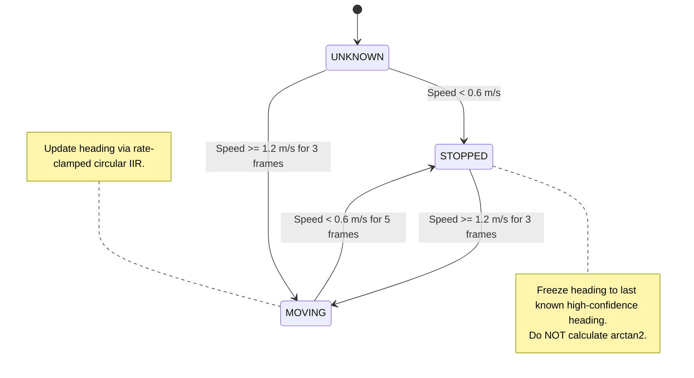

# Implementation Plan: Vehicle Orientation Stabilization & Kinematic Tracking

## Goal Description
Monocular 3D bounding box orientations currently exhibit erratic spinning, sudden $180^\circ$ front/rear flips, and frame-to-frame orientation jitter. This plan introduces industry-standard automotive stabilization techniques in two stages:
* **Stage 1 (Main Focus)**:
  1. **Ego-Motion Compensation via CAN `/vehicle/telemetry`**: Resolving relative closing-speed inversions by converting camera-relative velocity into world coordinates using host vehicle Powertrain CAN speed (`speed_kmph`) and chassis yaw rate (`yaw_rate_radps`).
  2. **Zero-Speed Latching & Hysteresis**: Eliminating the zero-speed noise singularity by freezing heading when speed drops below $1.0\text{ m/s}$.
  3. **Physical Yaw-Rate Clamping & Road Lane Prior**: Restricting frame-to-frame heading changes to physical vehicle limits ($\le 0.8\text{ rad/s} \implies 1.53^\circ/\text{frame}$ at 30 FPS) with circular shortest-arc IIR filtering and lane-keeping bimodal stabilization.
  4. **Dedicated Modular Architecture**: Implementing all ego-motion compensation and orientation tracking logic in a clean, standalone module: `tools/vision/geometry/vehicle_orientation_tracker.py`.
* **Stage 2 (Upcoming Architecture)**:
  5. **Observation Smoothing EKF**: A 5-state Constant Turn Rate and Velocity (CTRV) Extended Kalman Filter used **strictly to smooth out position and orientation visualizer overlay** (filtering sensor jitter, not for predicting vehicle trajectory).

---

## User Review & Architecture Principles

> [!IMPORTANT]
> **Host Ego Telemetry Source**:
> As specified in review, ego motion compensation will utilize host vehicle dynamics from **`/vehicle/telemetry`**:
> * `speed_kmph`: Actual vehicle ground speed derived directly from Powertrain CAN wheel speed sensors ($v_{\text{ego}} = \text{speed\_kmph} / 3.6\text{ m/s}$).
> * `yaw_rate_radps`: Host chassis angular yaw rate ($\omega_{\text{ego}}$) from vehicle ESP/IMU.
> * `accel_x_mps2`: Longitudinal acceleration.
>
> Ingested non-destructively from the session recording in $\approx 0.5\text{s}$ via indexed binary search bisect lookup.

> [!NOTE]
> **EKF Scope Clarification**:
> The EKF is designed and scoped **exclusively as a state smoothing and noise-filtering overlay estimator** for current frame visualization. It is **not** used to predict or project future vehicle trajectory. Future autonomous path prediction will be developed as a separate capability.

> [!TIP]
> **Dedicated Independent Module**:
> To ensure clean separation of concerns and maintainable code, all ego-motion compensation, zero-speed latching, rate clamping, and orientation tracking logic will be built in a new dedicated file:
> [`tools/vision/geometry/vehicle_orientation_tracker.py`](file:///c:/Users/rakadu1.AHEAD/AndroidStudioProjects/RoadSense/tools/vision/geometry/vehicle_orientation_tracker.py).

---

## In-Depth Mathematical Foundations & Mechanics

### 1. Root Cause Analysis: The Three Spinning Instabilities

```mermaid
graph TD
    subgraph Instability 1: Depth Jitter Derivative
        P1[1-2 px Vertical Bounding Box Jitter] --> P2[Ground Range X Jumps ±2m]
        P2 --> P3[Finite Difference dX/dt Spikes to ±40 m/s]
        P3 --> P4[arctan2 dY, dX Spins Wildly]
    end

    subgraph Instability 2: Ego Closing-Speed Flips
        E1[Ego Vehicle Accelerates/Brakes] --> E2[Relative Forward Speed dX/dt Inverts Sign]
        E2 --> E3[arctan2 dY, dX Flips 180°: Lead Car Points at Us!]
    end

    subgraph Instability 3: Zero-Speed Singularity
        Z1[Target Vehicle Stops at Light / Parked] --> Z2[vx ≈ 0, vy ≈ 0]
        Z2 --> Z3[arctan2 0, 0 Amplifies Sensor Noise to 360° Random Spin]
    end
```



---

### 2. Technique A: CAN Ego-Motion Compensation (World Velocity Conversion)

#### The Problem
In the camera's ego-centric coordinate frame (+X Forward, +Y Left):
$$\vec{v}_{\text{rel}} = \begin{bmatrix} \dot{X}_{\text{cam}} \\ \dot{Y}_{\text{cam}} \end{bmatrix}$$
When driving behind a lead vehicle at $50\text{ km/h}$:
* If ego speeds up to $52\text{ km/h}$, $\dot{X}_{\text{cam}} = -2\text{ km/h} < 0 \implies \psi \approx 180^\circ$ (the lead car flips around to face us).
* If ego brakes to $48\text{ km/h}$, $\dot{X}_{\text{cam}} = +2\text{ km/h} > 0 \implies \psi \approx 0^\circ$ (the lead car flips forward).

#### The Mathematical Formulation with Tangential Rotation
From `/vehicle/telemetry`, we extract host forward speed $v_{\text{ego}} = \frac{\text{speed\_kmph}}{3.6}$ and chassis yaw rate $\omega_{\text{ego}} = \text{yaw\_rate\_radps}$.
The true target velocity in the road/world frame is:
$$\vec{v}_{\text{world}} = \vec{v}_{\text{rel}} + \begin{bmatrix} v_{\text{ego}} \\ 0 \end{bmatrix} + \begin{bmatrix} -\omega_{\text{ego}} Y_{\text{cam}} \\ \omega_{\text{ego}} X_{\text{cam}} \end{bmatrix}$$
* The first term ($\vec{v}_{\text{rel}}$) is the apparent rate of change measured by camera tracking.
* The second term ($[v_{\text{ego}}, 0]^T$) compensates for host longitudinal forward motion.
* The third term ($[-\omega_{\text{ego}} Y_{\text{cam}}, \omega_{\text{ego}} X_{\text{cam}}]^T$) compensates for host turning rotation (tangential lever-arm effect across target distance).

The vehicle's true motion heading is:
$$\psi_{\text{motion}} = \text{atan2}(v_{y,\text{world}}, v_{x,\text{world}})$$

* **Why this works**:
  For a vehicle driving ahead in our direction, $v_{x,\text{world}} = \dot{X}_{\text{cam}} + v_{\text{ego}} \approx 50\text{ km/h} > 0$ **at all times**, completely independent of whether ego is accelerating, braking, or turning. The closing-speed $180^\circ$ flip is 100% eliminated.

---

### 3. Technique B: Zero-Speed Latching & Motion Hysteresis

#### The Problem
When a vehicle stops at a red light, its ground coordinates $(X, Y)$ remain stationary. Microscopic bounding box detections cause $\vec{v}_{\text{world}} = [0 \pm \epsilon_x, 0 \pm \epsilon_y]^T$. Computing $\arctan2(\epsilon_y, \epsilon_x)$ produces random angles spanning all $360^\circ$.

#### The State Machine & Hysteresis Logic


1. **State `MOVING`**:
   - Condition: $v_{\text{world}} \ge 1.2\text{ m/s}$ ($\approx 4.3\text{ km/h}$) sustained for $\ge 3$ consecutive frames.
   - Action: Continuously compute and update dynamic heading $\psi$.
2. **State `STOPPED`**:
   - Condition: $v_{\text{world}} \le 0.6\text{ m/s}$ ($\approx 2.2\text{ km/h}$) sustained for $\ge 5$ consecutive frames.
   - Action: **LATCH**. Freeze heading to $\psi_{\text{latched}}$. Do NOT evaluate $\arctan2$.
3. **Parked / Initial Stationary Vehicles**:
   - If a track begins life in the `STOPPED` state (e.g. parked motorcycle or car at curb):
   - Fall back to the broadside aspect-ratio disambiguation in `BoxDimensions`: if metric span $> 2.7\text{ m}$ (or $> 1.25\text{ m}$ for two-wheelers), assign broadside curb heading ($\pm 90^\circ$); otherwise assign road-parallel ($0^\circ$).

---

### 4. Technique C: Physical Yaw-Rate Clamping & Road Lane Prior

#### Part C.1: Circular Shortest-Arc Yaw-Rate Clamping
Vehicles are rigid physical bodies with maximum steering angles ($\approx 35^\circ$). Centripetal tire friction limits yaw rate to:
$$\dot{\psi}_{\text{max}} \approx 0.8\text{ rad/s} \quad (\approx 45.8^\circ/\text{s})$$
At 30 FPS ($\Delta t = 0.0333\text{ s}$):
$$\Delta \psi_{\text{max}} = \dot{\psi}_{\text{max}} \cdot \Delta t = 0.8 \times 0.0333 \approx \mathbf{0.0267\text{ rad}} \approx \mathbf{1.53^\circ/\text{frame}}$$

Given previous smoothed heading $\psi_{k-1}$ and raw measured heading $\psi_{\text{raw}}$:
1. **Shortest Angular Arc**:
   $$\Delta \psi = \text{atan2}(\sin(\psi_{\text{raw}} - \psi_{k-1}), \cos(\psi_{\text{raw}} - \psi_{k-1})) \quad \in [-\pi, +\pi]$$
2. **Hard Physical Clamp**:
   $$\Delta \psi_{\text{clamped}} = \max(-\Delta \psi_{\text{max}}, \min(+\Delta \psi_{\text{max}}, \Delta \psi))$$
3. **Circular Low-Pass Filter (IIR)**:
   $$\psi_k = \text{atan2}(\sin(\psi_{k-1} + \alpha \Delta \psi_{\text{clamped}}), \cos(\psi_{k-1} + \alpha \Delta \psi_{\text{clamped}}))$$
   where $\alpha \approx 0.25$ provides smooth exponential damping without lag.

#### Part C.2: Road Lane / Vanishing Point Bimodal Prior
On roads, vehicles travel in lanes aligned with the road heading ($\psi_{\text{road}} \approx 0^\circ$).
* If target lateral velocity $|v_{y,\text{world}}| < 0.35\text{ m/s}$ and $|\psi_k| < 15^\circ$:
  Attract heading toward $0^\circ$ (forward) with soft spring force:
  $$\psi_k \leftarrow (1 - \beta) \psi_k + \beta \cdot 0.0 \quad (\beta \approx 0.15)$$
* If oncoming traffic ($|\psi_k - 180^\circ| < 15^\circ$):
  Attract heading toward $180^\circ$.
* Only allow large turn angles ($30^\circ \to 90^\circ$) when sustained lateral velocity $|v_{y,\text{world}}| \ge 0.5\text{ m/s}$ persists for $\ge 5$ frames.

---

### 5. Stage 2 (Upcoming Architecture): Observation Smoothing EKF

In Stage 2, the smoothed output will be processed by a dedicated **Observation Smoothing EKF** per track ID.

#### Clarified EKF Purpose: Smoothing & Overlay Stabilization (Not Motion Prediction)
* **Goal**: Filter out bounding box pixel jitter and smooth the 3D position $(X, Y)$ and orientation $\psi$ for Foxglove visualizer overlay.
* **Non-Goal**: We are **not** using the EKF to predict future trajectory or extrapolate when detection is lost.

#### State Vector & Kinematic Motion Model
$$\mathbf{x} = \begin{bmatrix} X \\ Y \\ v \\ \psi \\ \dot{\psi} \end{bmatrix} \quad \begin{matrix} \text{Smoothed longitudinal position (m)} \\ \text{Smoothed lateral position (m)} \\ \text{Smoothed ground speed (m/s)} \\ \text{Smoothed heading yaw angle (rad)} \\ \text{Smoothed yaw rate (rad/s)} \end{matrix}$$

#### Non-Linear State Transition $f(\mathbf{x}, \Delta t)$
For $\dot{\psi} \neq 0$:
$$\mathbf{x}_{k+1} = \begin{bmatrix} 
X_k + \frac{v_k}{\dot{\psi}_k} (\sin(\psi_k + \dot{\psi}_k \Delta t) - \sin\psi_k) \\
Y_k + \frac{v_k}{\dot{\psi}_k} (-\cos(\psi_k + \dot{\psi}_k \Delta t) + \cos\psi_k) \\
v_k \\
\psi_k + \dot{\psi}_k \Delta t \\
\dot{\psi}_k
\end{bmatrix} + \mathbf{w}_k$$

#### Measurement Model
$$\mathbf{z}_k = \begin{bmatrix} X_{\text{meas}} \\ Y_{\text{meas}} \end{bmatrix} = \mathbf{H} \mathbf{x}_k + \mathbf{v}_k, \quad \mathbf{H} = \begin{bmatrix} 1 & 0 & 0 & 0 & 0 \\ 0 & 1 & 0 & 0 & 0 \end{bmatrix}$$
Measurement noise covariance accounts for perspective range degradation:
$$\mathbf{R}_k = \begin{bmatrix} \sigma_X^2 & 0 \\ 0 & \sigma_Y^2 \end{bmatrix}, \quad \text{where } \sigma_X \approx 0.05 \cdot X_k$$

The Kalman gain $\mathbf{K}_k$ automatically suppresses high-frequency pixel noise while strictly constraining position updates to be tangent to the vehicle heading (non-holonomic vehicle dynamics).

---

## Proposed Changes

### Component 1: Dedicated Orientation & Ego-Motion Tracker Module
#### [NEW] `tools/vision/geometry/vehicle_orientation_tracker.py`
A completely separate, dedicated module containing:
1. `EgoMotionProvider`:
   - Fast binary-search lookup table over `/vehicle/telemetry` loaded from `session.mcap`.
   - Returns interpolated $(v_{\text{ego}}, \omega_{\text{ego}})$ in m/s and rad/s for any frame timestamp.
   - Falls back gracefully to `(0.0, 0.0)` if telemetry is missing.
2. `VehicleOrientationTracker`:
   - Maintains track state history: `history`, `state` (MOVING / STOPPED), `latched_yaw`, `smoothed_yaw`, `consecutive_moving_frames`, `consecutive_stopped_frames`.
   - Implements **Technique A**: World velocity addition with host yaw rate tangential compensation:
     $$v_{x,\text{world}} = v_{x,\text{rel}} + v_{\text{ego}} - \omega_{\text{ego}} Y_{\text{cam}}$$
     $$v_{y,\text{world}} = v_{y,\text{rel}} + \omega_{\text{ego}} X_{\text{cam}}$$
   - Implements **Technique B**: Motion hysteresis and zero-speed latching.
   - Implements **Technique C.1**: Physical yaw-rate clamp ($\le 0.8\text{ rad/s} \implies 1.53^\circ/\text{frame}$) with circular shortest-arc smoothing.
   - Implements **Technique C.2**: Road-parallel soft bimodal attractor ($0^\circ$ and $180^\circ$).

---

### Component 2: Perception Runner Integration
#### [MODIFY] `tools/vision/pipeline/perception_runner.py`
- Import `VehicleOrientationTracker` and `EgoMotionProvider` from `tools.vision.geometry.vehicle_orientation_tracker`.
- Initialize `EgoMotionProvider(self.session_dir)` once at runner startup.
- In `run()` and `run_from_2d_detections()`:
  - Query host ego motion:
    `ego_motion = self.ego_provider.get_ego_motion(utc_ns)`
  - Pass `ego_motion` into `orientation_tracker.update(track_id, ground_pt, utc_ns, ego_motion)`.
  - Pass stabilized `yaw_rad` and `is_moving` to `BoxDimensions.compute_3d_box()`.

---

### Component 3: Unit Tests & Regression
#### [NEW] `scripts/tests/test_vehicle_orientation_tracker.py`
- Dedicated unit tests validating:
  1. **Ego Closing-Speed Flip Resistance**: A lead car moving at $12\text{ m/s}$ while ego accelerates from $10\text{ m/s}$ to $15\text{ m/s}$ maintains forward heading ($\approx 0^\circ$) without flipping to $180^\circ$.
  2. **Physical Yaw Rate Clamping**: An instantaneous measurement jump of $90^\circ$ is clamped to $\le 1.6^\circ$ per frame at 30 FPS.
  3. **Zero-Speed Latching**: A vehicle that slows from $10\text{ m/s}$ to $0\text{ m/s}$ latches onto its arrival heading and maintains zero spinning when stationary.
  4. **Ego-Motion Provider Lookup**: Verifies bisect interpolation of `/vehicle/telemetry` records.

---

## Verification Plan

### Automated Tests
```powershell
# 1. Run dedicated orientation tracker unit tests
C:\ProgramData\miniconda3\envs\cv313\python.exe -m unittest scripts/tests/test_vehicle_orientation_tracker.py

# 2. Run full vision box alignment unit tests
C:\ProgramData\miniconda3\envs\cv313\python.exe -m unittest scripts/tests/test_vision_box_alignment.py

# 3. Run full regression across environments
C:\ProgramData\miniconda3\envs\cv313\python.exe -m unittest discover -s scripts/tests
C:\Users\rakadu1.AHEAD\.conda\envs\roadsense-mcap\python.exe -m unittest discover -s scripts/tests

# 4. Verify Android Gradle unit tests
cmd /c "set JAVA_HOME=C:\Users\rakadu1.AHEAD\Android_Studio\android-studio-quail4-windows\android-studio\jbr&& gradlew.bat testDebugUnitTest"
```

### Manual Verification
1. Run a 1,000-frame slice on `session_20261023_111120`:
   ```powershell
   C:\ProgramData\miniconda3\envs\cv313\python.exe tools/vision/pipeline/perception_runner.py logs/session_20261023_111120 --from_2d auto -n 1000 --mcap
   ```
2. Open `session_20261023_111120_with_vision.mcap` in Foxglove Studio.
3. Observe vehicles in the 3D panel and video overlay:
   - Lead vehicles stay oriented forward without flipping when ego accelerates or brakes.
   - Stopped vehicles at junctions or curbs maintain stable, frozen headings without spinning.
   - Turning vehicles transition smoothly without erratic snapping.
