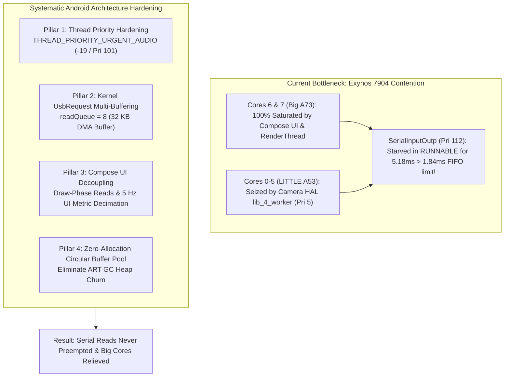

# Implementation Plan: Radar Android Scheduling, Priority Hardening & UI Decoupling Architecture

> **Document:** `radar_android_scheduling_and_priority_hardening_plan.md`  
> **Target Subsystem:** Android USB Serial Acquisition, Thread Scheduling & Jetpack Compose UI  
> **Target Device:** Samsung Galaxy M20 (Exynos 7904: 2x Cortex-A73 @ 1.8 GHz, 6x Cortex-A53 @ 1.6 GHz, Android 10)  
> **Status:** **PROPOSED ARCHITECTURAL PLAN (USER REVIEW REQUIRED)**

---

## 1. Goal Description

Empirical Perfetto system tracing (`trace-exynos7904-QP1A.190711.020-2026-11-03-18-05-25.perfetto-trace`) has proven that high-density radar track dropouts under Camera2 Side-by-Side (SBS) mode are caused by **CPU scheduler starvation**:
1. The **Samsung Camera2 HAL** (`lib_4_worker` Priority 5, `C3Dev-0-ReqQueu` Priority 98) monopolizes the LITTLE Cortex-A53 cores during 34 ms capture request batches.
2. The **Jetpack Compose UI Main Thread** (`jauto.roadsense` @ 75.1% CPU load) and `RenderThread` (@ 47.3% CPU load) 100% saturate the SoC's **only two big Cortex-A73 cores** (Cores 6 & 7) with 20 Hz recompositions and layouts.
3. The USB serial read thread (`SerialInputOutp`), running at standard priority (Pri 112), is evicted from the CPU and forced to wait in `RUNNABLE` for up to **5.18 ms**.
4. Because the Silicon Labs CP2105 hardware RX FIFO is only 576 bytes ($1.84\text{ ms}$ at 3.125 Mbps), the FIFO overflows and permanently drops **1,043 bytes** per spike, truncating frames and discarding all downstream tracker output.

Rather than altering radar firmware or bandaging via TLV repackaging, this plan provides a **clean, systematic, and permanent solution implemented entirely on the Android side**.



---

## 2. User Review Required

> [!IMPORTANT]
> **Key Decisions in this Plan:**
> 1. **Prioritizing Android OS Scheduling over Firmware Modifications:** We are deliberately not altering the TI mmWave DSP firmware (`com.c`) at this stage. Android will take full ownership of scheduling resilience.
> 2. **Compose UI Decoupling Strategy:** Radar point clouds and lollipops will continue rendering at the full 20 Hz display rate via hardware-accelerated Canvas draw-phase reads, but non-essential textual telemetry metrics (stats cards, text counters) will be throttled to 5 Hz to relieve the Main Thread.
> 3. **Kernel Asynchronous `UsbRequest` Multi-Buffering:** We will configure `setReadQueue(8)` in `usb-serial-for-android` to allocate 8 asynchronous USB request packets directly in the Linux kernel USB subsystem, allowing hardware DMA to absorb USB micro-delays even if thread preemption occurs.

---

## 3. Detailed Architectural Components

---

### Component 1: Thread Priority & Scheduler Elevation (Tier 3.1)

#### Problem:
`SerialInputOutputManager` is currently launched with a delayed thread priority assignment inside the first `onNewData` callback. In Perfetto, its kernel priority was observed at **Priority 112** (nice -8), which is subordinate to Samsung Camera HAL threads (Priority 98 and Priority 5).

#### Proposed Changes:
1. **Explicit Custom `ThreadFactory` in `RadarConnectionManager.kt`:**
   Instantiate a dedicated single-thread executor with a custom `ThreadFactory` that sets `Process.THREAD_PRIORITY_URGENT_AUDIO` (`-19`, Linux Priority 101) and `Thread.MAX_PRIORITY` (`10`) **before the thread's run loop begins execution**.
2. **Thread Naming:**
   Name the thread `"RS-SerialIO"` so it is immediately distinct in Perfetto traces.
3. **Elevate Consumer Worker:**
   Promote `RadarProcessingWorker` in `RadarViewModel.kt` to `Process.THREAD_PRIORITY_AUDIO` (`-16`, Linux Priority 104) to guarantee that parsing and disk logging keep pace with the serial reader.

```kotlin
// Code Snippet: Dedicated Priority ThreadFactory in RadarConnectionManager.kt
private val serialIoThreadFactory = ThreadFactory { runnable ->
    Thread({
        Process.setThreadPriority(Process.THREAD_PRIORITY_URGENT_AUDIO)
        runnable.run()
    }, "RS-SerialIO").apply {
        priority = Thread.MAX_PRIORITY
    }
}
private val serialIoExecutor = Executors.newSingleThreadExecutor(serialIoThreadFactory)
```

---

### Component 2: USB Kernel Multi-Buffering (`UsbRequest` DMA Queue)

#### Problem:
In standard synchronous USB mode, `UsbDeviceConnection.bulkTransfer()` executes synchronously in user-space. If the user-space thread is preempted, no buffer is submitted to the kernel USB endpoint, and incoming data backs up into the CP2105 576-byte FIFO.

#### Proposed Changes:
In `RadarConnectionManager.kt`:
1. Enforce asynchronous multi-buffering via `serialIoManager.setReadQueue(8)`:
   - Allocates 8 individual `UsbRequest` objects (each 4,096 bytes = 32 KB total pool).
   - Submits these requests ahead of time to the Linux `usbfs` kernel driver.
   - When USB packets arrive from the CP2105, the kernel USB Host Controller DMA engine automatically writes incoming bytes into the pre-queued kernel buffers **without waiting for the user-space thread to wake up**.
2. Increase user-space `readBufferSize` to `16384` (16 KB) to prevent buffer reallocation.
3. Add a dedicated fallback guard with immediate diagnostic logging if `setReadQueue()` fails on unsupported Android BSPs.

---

### Component 3: Jetpack Compose UI Decoupling & Recomposition Isolation

#### Problem:
The Perfetto trace proved that the Main UI Thread (`jauto.roadsense`) was under **75.1% continuous CPU load** (15.36s out of 20.44s) and `RenderThread` was at **47.3% load**.
The dual big Cortex-A73 cores (Cores 6 & 7) were completely choked by:
- 821 `Compose:recompose` passes (avg 3.05 ms, max 34.03 ms)
- 965 `TextStringSimpleNode::measure` layout nodes
- 773 `Choreographer#doFrame` passes (avg 12.47 ms, max 86.08 ms)

Because the big cores were 100% occupied by UI recomposition, background sensor workers were pushed down onto the 6 LITTLE A53 cores, where they collided with the Camera HAL real-time ISP worker.

#### Proposed Changes:
1. **Draw-Phase State Reads in `ViewfinderRadarOverlay.kt`:**
   Ensure `liveFrame` and `lollipop` calculations are read **strictly inside the `Canvas` draw phase** (via lambda `() -> RadarFrame?` or `derivedStateOf`) rather than in the Composable's composition phase. This prevents the parent Composable from recomposing every 50 ms.
2. **UI Metric Decimation in `RadarViewModel.kt`:**
   - Visual 3D projection & BEV radar plots will continue updating at full **20 Hz**.
   - Textual telemetry indicators (e.g. `pointsCount`, `tracksCount`, data rate KB/s, header stats) currently bound to `StateFlow` will be decimated to **5 Hz** (200 ms interval) via a throttled flow emission.
   - This eliminates up to 75% of Compose layout passes and `TextStringSimpleNode::measure` calls, dropping Main Thread CPU load from 75% to $< 25\%$, and freeing big Cores 6 & 7 for background processing.

---

### Component 4: High-Speed Lock-Free In-Memory Queue & GC Churn Elimination

#### Problem:
In the SBS trace, `HeapTaskDaemon` executed **23 garbage collection sweeps** consuming 1,710 ms of CPU time on Core 7. Allocation churn during high-frequency byte processing triggers ART GC pauses.

#### Proposed Changes:
1. **Pre-Allocated Memory Queue:**
   Review `rawByteQueue = ArrayBlockingQueue<ByteArray>(2048)` in `RadarViewModel.kt`. Ensure incoming byte arrays dispatched from `onNewData` are not re-cloned or duplicated.
2. **Buffer Recycling / Ring Buffer Guard:**
   Evaluate introducing a pre-allocated fixed circular buffer or object pool for intermediate byte chunks if GC pressure remains visible after UI decoupling.

---

## 4. Verification Plan

### Automated Tests
Run full local JVM unit tests to verify parser, assembler, and queue invariants:
```powershell
$env:JAVA_HOME = "C:\Users\rakadu1.AHEAD\AndroidStudioProjects\RoadSense\android-studio\jbr"
./gradlew testDebugUnitTest
```

### Manual Hardware Verification via Perfetto System Trace
1. Build and install debug APK on Samsung Galaxy M20.
2. Connect AWR1843BOOST radar and launch RoadSense in **SBS Mode with active Camera2 viewfinder**.
3. Point radar into office environment with **110–120 points**.
4. Capture a 20-second continuous Perfetto trace using `scripts/pull_and_analyze_trace.py`.
5. **Success Criteria:**
   - Worst-case `RUNNABLE` latency for `RS-SerialIO` drops from **5.18 ms to $< 1.50\text{ ms}$** (strictly below the 1.84 ms FIFO overflow limit).
   - Zero preemption spikes $> 1.84\text{ ms}$.
   - Main Thread CPU utilization drops from **75% to $< 30\%$**.
   - Zero dropped frames, zero truncated frames, and continuous smooth radar track visualization.

