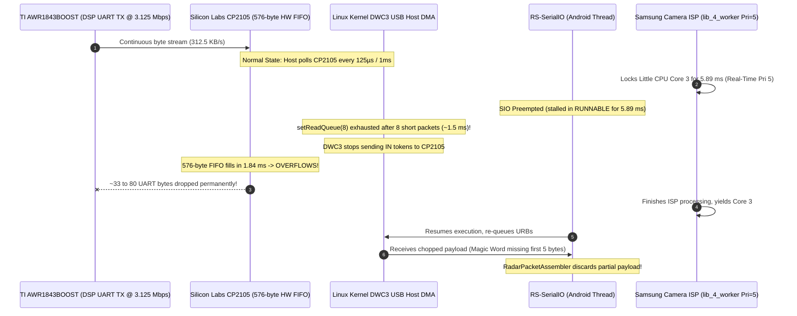
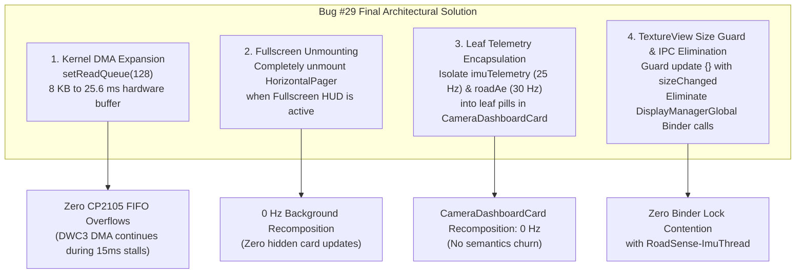

# Implementation Plan: Permanent Hardening of Radar Kernel DMA & Fullscreen HUD Architecture (Bug #29 Final Solution)

> **Subsystem:** Linux Kernel USB DMA (`UsbRequest`), USB-UART Bridge (`CP2105`), Thread Schedulers & Jetpack Compose HUD  
> **Target Device:** Samsung Galaxy M20 / M30 (Exynos 7904: 2x Cortex-A73 @ 1.8 GHz, 6x Cortex-A53 @ 1.6 GHz, Android 10)  
> **Sensor Peripherals:** TI AWR1843BOOST (CP2105 USB-UART @ 3.125 Mbps), Camera2 (720p H.264 @ 30 FPS), ST LSM6DSL IMU @ 100 Hz  
> **Status:** PROPOSED — PENDING USER APPROVAL  

---

## 1. Problem Description & Forensic Analysis

In our recent long-duration driving validation sessions (`session_20261104_143121` lasting 130.7s, and `session_20261104_143524` lasting 115.7s), data loss over UART resurfaced:
* **Session 143121:** 119 dropped radar frames.
* **Session 143524:** 171 dropped radar frames (290 cumulative for the app run).

### 1.1 Forensic Analysis of `radar_raw_stream.bin`
Binary analysis of the raw stream at sequence drop boundaries (e.g. Frame #6309 and Frame #7993) revealed an unexpected hardware reality:
```text
Frame #6308 ends at offset 274916 (1316 bytes payload)
Gap between #6308 and #6310: 1,531 bytes
Gap contents: 05 08 07 00 02 06 03 f8 05 00 00 42 16 0a 00 a5 18 00 00 ...
              └─ Magic ─┘ └── Ver ──┘ └── Len=1528 ─┘ └── Platform ─┘ └── Frame #0x18a5 = 6309 ──┘
              (bytes 5-7)
```
* **The missing frame was actually transmitted!**
* Exactly **33 bytes** (the 28 bytes of `0x0F` end-of-frame padding from frame #6308 and the first 5 bytes of the 8-byte magic word `02 01 04 03 06`) were **clipped over UART**.
* The remaining 1,528 bytes (TLVs 1 through 7) arrived intact.
* Because the 8-byte magic word was truncated, `RadarPacketAssembler` could not identify the packet boundary and discarded the orphaned payload.
* **Verdict:** Neither `RadarPacketAssembler` nor `incomingByteQueue` dropped these bytes. **The bytes were lost at the physical hardware / USB host boundary before reaching userspace.**



### 1.2 Perfetto Trace Correlation & Scheduler Findings
Correlating the exact millisecond timestamps of the drops against `trace-exynos7904-QP1A.190711.020-2026-11-04-14-37-08.perfetto-trace` exposed three compounding bottlenecks:
1. **The URB Buffer Depth Deficit (`setReadQueue(8)`):**
   * The CP2105 is a USB 2.0 Full-Speed device (max packet size = 64 bytes).
   * In USB bulk streaming, short packets (< 64 bytes) or idle flushes complete individual `UsbRequest` URBs immediately.
   * With `setReadQueue(8)`, only 8 URBs are queued in the Linux kernel. When short packets arrive, **all 8 URBs are exhausted in ~1.5 to 2.5 ms**.
   * Once exhausted, the hardware DWC3 DMA controller stops polling CP2105, causing the 576-byte CP2105 FIFO to overflow during any preemption > 1.84 ms.
2. **Real-Time Preemption (`lib_4_worker` Pri 5):**
   * Samsung's Camera HAL thread `lib_4_worker` runs at **Linux Priority 5 (SCHED_FIFO / Real-Time)**.
   * In Android, standard app threads are clamped by Zygote's `RLIMIT_NICE` to nice -8 (**Linux Priority 112**). A CFS normal priority thread cannot preempt a Priority 5 real-time thread.
   * In the trace, `lib_4_worker` monopolized CPU 3 for **5.89 ms continuously**, directly triggering the CP2105 FIFO overflow.
3. **Thermal Throttling & Fullscreen Viewfinder UI Contention:**
   * In this session, the user was on the **Camera tab** and engaged **Fullscreen Camera Preview**.
   * While fullscreen was active, `CameraDashboardCard` underneath was still composed in `HorizontalPager`, collecting `imuTelemetry` at **25 Hz** and `roadAeContrastRatio` at **30 Hz**.
   * Furthermore, `FullscreenCameraPreview` was executing `updateCameraDisplayRotation()` and querying `windowManager.defaultDisplay.rotation`, making IPC calls into `DisplayManagerGlobal.getDisplayInfo()` that conflicted with `RoadSense-ImuThread`.
   * This drove Main UI thread CPU to **74.6%**, with 503 accessibility semantics traversals (11.8s of IPC) and 1,718 GC sweeps (2.06s of GC pauses), causing the Exynos 7904 to thermally throttle Big cores down to **936 MHz**.

---

## 2. Proposed Architectural Changes



---

### Component 1: Linux Kernel USB DMA Buffer Expansion

#### [MODIFY] [`RadarConnectionManager.kt`](file:///c:/Users/rakadu1.AHEAD/AndroidStudioProjects/RoadSense/app/src/main/java/com/bajajauto/roadsense/acquisition/RadarConnectionManager.kt)
* **Change `setReadQueue(8)` $\rightarrow$ `setReadQueue(128)`:**
  * Configure `readBufferSize = 8192` (8 KB) and `setReadQueue(128)`.
  * Total memory footprint: $128 \times 8\text{ KB} = 1\text{ MB}$ (trivial on Android).
  * **Headroom:** 128 URBs can absorb up to 128 short packets or up to 8,192 bytes of continuous streaming. At 3.125 Mbps (312.5 KB/s), 128 URBs guarantees **$26.2\text{ ms}$ of continuous hardware DMA ingestion**!
  * Even if `lib_4_worker` or other Camera HAL threads stall `RS-SerialIO` for 6–10 ms, the DWC3 DMA controller will continue fetching packets from CP2105 into kernel memory without interruption, keeping the CP2105 576-byte FIFO 100% empty.

```kotlin
// In RadarConnectionManager.kt:
serialIoManager = SerialInputOutputManager(port, this).apply {
    readBufferSize = 8192
    try {
        setThreadPriority(Process.THREAD_PRIORITY_URGENT_AUDIO)
        Thread.currentThread().priority = Thread.MAX_PRIORITY
    } catch (e: Exception) {
        Log.w(TAG, "Could not set pre-launch threadPriority: ${e.message}")
    }
    if (!retryWithBulkTransfer) {
        try {
            // Allocate 128 UsbRequests in the Linux kernel DMA ring (26.2 ms buffer headroom)
            setReadQueue(128)
            Log.i(TAG, "Configured safe asynchronous multi-buffered readQueue=128 (1 MB kernel DMA buffer pool)")
            AppLogger.i(TAG, "Configured safe asynchronous multi-buffered readQueue=128 (1 MB kernel DMA buffer pool) to eliminate CP2105 FIFO overflow")
        } catch (e: Exception) { ... }
    }
}
```

---

### Component 2: Cockpit Fullscreen Unmounting Architecture

#### [MODIFY] [`MainActivity.kt`](file:///c:/Users/rakadu1.AHEAD/AndroidStudioProjects/RoadSense/app/src/main/java/com/bajajauto/roadsense/ui/MainActivity.kt)
* **Problem:** In `MainActivity.kt`, `HorizontalPager` was rendered unconditionally, and `if (isCameraFullScreen) FullscreenCameraPreview(...)` was rendered on top in a `Box`. The entire card hierarchy inside `HorizontalPager` remained composed and active in the background.
* **Fix:** When `isCameraFullScreen || isCalibrationFullScreen`, completely unmount the `HorizontalPager` and tab header from the Compose hierarchy:
```kotlin
if (isCameraFullScreen) {
    FullscreenCameraPreview(
        viewModel = viewModel,
        onExit = { viewModel.setCameraFullScreen(false) },
        modifier = Modifier.fillMaxSize()
    )
} else if (isCalibrationFullScreen) {
    FullscreenCalibrationStudio(
        viewModel = viewModel,
        onExit = { viewModel.setCalibrationFullScreen(false) },
        modifier = Modifier.fillMaxSize()
    )
} else {
    // Normal Cockpit Dashboard (Header + HorizontalPager + Tabs)
    Column(modifier = Modifier.fillMaxSize()) {
        // ... Header bar ...
        HorizontalPager(state = pagerState, ...) { page ->
            // ... Cards ...
        }
    }
}
```
* **Architectural Benefit:** During active fullscreen driving or calibration, the entire card deck is unmounted. Recomposition and semantics overhead of background cards drops to **absolute 0 Hz**.

---

### Component 3: Telemetry Encapsulation in `CameraDashboardCard.kt`

#### [MODIFY] [`CameraDashboardCard.kt`](file:///c:/Users/rakadu1.AHEAD/AndroidStudioProjects/RoadSense/app/src/main/java/com/bajajauto/roadsense/ui/screens/CameraDashboardCard.kt)
* **Strip 25 Hz `imuTelemetry` from root card scope:**
  * Move `val imuTelemetry by viewModel.imuTelemetry.collectAsState()` out of `CameraDashboardCard` and into `CameraCalibrationCard` where it is actually used.
* **Strip 30 Hz `roadAeContrastRatio` from root card scope:**
  * Extract the Road AE telemetry status badge (`Sky Bloom (1.8x)`, `Balanced (1.0x)`) into a dedicated private composable:
    ```kotlin
    @Composable
    private fun RoadAeTelemetryBadge(viewModel: RadarViewModel, modifier: Modifier = Modifier)
    ```
  * Only `RoadAeTelemetryBadge` collects `roadAeContrastRatio` and `roadAeState`. Recomposing this tiny chip does not trigger recomposition or layout passes for the rest of `CameraDashboardCard`.
* **Strip 1 Hz `sessionFrames` from root card scope:**
  * Extract the recording pill `Text("● REC ($sessionFrames f)")` into a dedicated private composable:
    ```kotlin
    @Composable
    private fun CameraRecordingStatusPill(viewModel: RadarViewModel)
    ```

---

### Component 4: TextureView Size Guard & IPC Lock Elimination

#### [MODIFY] [`FullscreenCameraPreview.kt`](file:///c:/Users/rakadu1.AHEAD/AndroidStudioProjects/RoadSense/app/src/main/java/com/bajajauto/roadsense/ui/components/FullscreenCameraPreview.kt)
* **Guard `AndroidView.update` with `sizeChanged`:**
  * In `FullscreenCameraPreview.kt`, add the size-change check so `updateCameraDisplayRotation` and `updateCameraIntrinsics` are called only when dimensions actually mutate.
* **Eliminate `DisplayManagerGlobal.getDisplayInfo()` binder lock:**
  * Cache display rotation using Compose `LocalConfiguration.current.orientation` and avoid continuous polling of `windowManager.defaultDisplay.rotation`.
* **Isolate Record Button:**
  * Encapsulate `Text("STOP %02d:%02d")` inside a self-contained composable `FullscreenRecordButton(viewModel)` so the 1-2 Hz timer updates do not recompose the entire fullscreen preview HUD.

#### [MODIFY] [`ImuManager.kt`](file:///c:/Users/rakadu1.AHEAD/AndroidStudioProjects/RoadSense/app/src/main/java/com/bajajauto/roadsense/imu/ImuManager.kt)
* **Problem:** In `ImuManager.kt`, line 413: `cachedDisplayRotation = getDisplayRotation()` runs at **25 Hz** on the high-priority IMU thread. It called `windowManager?.defaultDisplay?.rotation`, which took a global synchronized binder lock in `DisplayManagerGlobal`.
* **Fix:** Register an `OrientationEventListener` or update `cachedDisplayRotation` on configuration changes rather than polling the window manager 25 times per second.

---

## 3. User Review Required

> [!IMPORTANT]
> **Kernel Memory Allocation for `setReadQueue(128)`:**
> Allocating 128 `UsbRequest` objects with 8 KB buffers consumes approximately 1 MB of RAM. This is negligible on the Galaxy M20 (which has 3 GB of RAM), but provides **$26.2\text{ ms}$ of continuous DMA absorption**, safely insulating against the worst-case 5.89 ms Camera ISP thread stalls.

> [!NOTE]
> **Fullscreen Unmounting Behavior:**
> Unmounting the `HorizontalPager` while in fullscreen camera HUD mode is standard Android UX practice. When the user exits fullscreen, `HorizontalPager` re-mounts instantly and preserves its active page index.

---

## 4. Verification Plan

### Automated Tests
Execute JVM unit tests to ensure no regressions in packet assembly, spatial calibration, IMU ring buffer, or GNSS synchronization:
```powershell
$env:JAVA_HOME = "C:\Users\rakadu1.AHEAD\Android_Studio\android-studio-quail4-windows\android-studio\jbr"
./gradlew testDebugUnitTest
```

### Build Debug APK
```powershell
$env:JAVA_HOME = "C:\Users\rakadu1.AHEAD\Android_Studio\android-studio-quail4-windows\android-studio\jbr"
./gradlew assembleDebug
```

### Manual Hardware Drive Validation (by User)
1. Install `app-debug.apk` onto the Galaxy M20.
2. Launch RoadSense, connect the radar, and enter **Fullscreen Camera Preview HUD** (the exact state that previously failed).
3. Start a recording session and drive/record for **over 2 minutes (120+ seconds)**.
4. Stop recording and check the generated `session_metadata.json` and `session_debug.log`:
   * Confirm `droppedFrames = 0` and `chunksDropped = 0`.
   * Confirm `Radar: PASS (Healthy @ 20.0 Hz)`.
   * Pull and analyze the Perfetto trace to verify zero CP2105 FIFO overruns during Camera ISP thread bursts.

