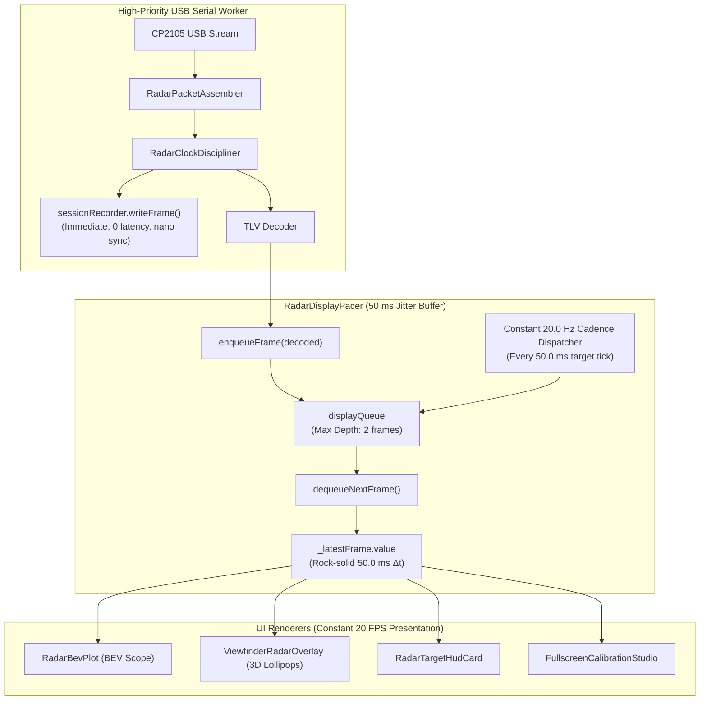

# Radar Smooth Display Pacer (50ms Jitter Buffer) & Rendering Optimization Plan

## 1. Executive Summary & Problem Diagnosis

### The Symptom
The user observed:
1. Radar plots (`RadarBevPlot` on the regular Radar tab) appear jerky and jittery rather than smooth.
2. The SBS (Side-by-Side) radar plot appears noticeably smoother than the regular radar plot.
3. Proposal: Implement a 50 ms display buffer to draw radar plots at a constant FPS, isolating the UI from physical USB packet arrival jitter.

### Root Cause Analysis: Why SBS Appeared Smoother
1. **Hardware Composer & GPU DVFS Clocks (The TextureView Effect):**
   * In SBS mode (`SbsDashboardCard`), the Camera2 subsystem continuously pumps 30 FPS video frames into an `AutoFitTextureView`. This hardware stream prevents the Samsung Exynos 9611 DVFS governor from dropping CPU/GPU clock frequencies to idle states. SurfaceFlinger, RenderThread, and Choreographer run at continuous 60 Hz display refresh cycles.
   * On the dedicated Radar tab (`RadarDashboardCard`), the camera is idle. The CPU drops to low-power C-states between USB packet bursts, causing wake-up latency when USB interrupts trigger Compose recomposition.
2. **Visual Anchoring & Retinal Motion Scaling:**
   * In SBS mode, the radar BEV scope is compressed to 50% screen width alongside a real-world video feed. Optical motion in the camera provides visual temporal context, and positional changes translate to half the pixel displacements on screen.
   * On the full Radar tab, high-contrast neon dots and tracks move across a pure pitch-black canvas. Any temporal irregularity ($71\text{ ms}$ pause followed by $28\text{ ms}$ jump) is magnified and immediately perceived by the human eye as stutter.
3. **Compose Layout & Scrolling Overhead:**
   * `RadarDashboardCard` wraps the right pane (or whole screen in portrait) in `verticalScroll(scrollState)` and hosts `RadarTargetHudCard` with dozens of dynamic text layouts. SBS has no scroll state and no dynamic target list cards.

### Core Architectural Bottleneck: USB Transport Jitter Leakage
As discovered in Bug #30, the Silicon Labs CP2105 USB transceiver delivers radar data to Android user-space in bimodal packet bursts:
$$\Delta t \in \{28.2\text{ ms}, 71.8\text{ ms}\}$$
Because `RadarViewModel` was assigning `_latestFrame.value = decoded` **immediately** upon packet arrival, the UI was forced to render at:
$$\text{Frame Cadence: } 71\text{ ms} \rightarrow 28\text{ ms} \rightarrow 71\text{ ms} \rightarrow 28\text{ ms}$$
This alternating $14\text{ FPS} \leftrightarrow 35\text{ FPS}$ cadence created visual judder on all radar visualizers.

---

## 2. Proposed Architecture: `RadarDisplayPacer` (50ms Jitter Buffer)

### Key Design Principles:
1. **Decouple Acquisition from Presentation:**
   * Disk recording (`RadarSessionRecorder`) remains strictly real-time and immediate on `RadarProcessingWorker` with disciplined monotonic timestamps.
   * Visual presentation (`latestFrame`) is routed through `RadarDisplayPacer`, absorbing the $71\text{ ms} / 28\text{ ms}$ USB jitter.
2. **Deterministic 50.0 ms (20 FPS) Cadence:**
   * With a 50 ms initial buffer delay (1 radar frame), Frame $N$ arrives at $0\text{ ms}$ and is displayed at $50\text{ ms}$. Frame $N+1$ arrives at $71.8\text{ ms}$ and is displayed at $100\text{ ms}$. Frame $N+2$ arrives at $99.0\text{ ms}$ and is displayed at $150\text{ ms}$.
   * Display frame intervals are **strictly 50.0 ms**, perfectly matched to 3 display refreshes on a 60 Hz screen ($3 \times 16.67\text{ ms} = 50.0\text{ ms}$).
3. **Bounded Latency & Starvation Recovery:**
   * If thread preemption or GC causes the queue to accumulate $> 2$ frames, the pacer drains old frames and emits the latest frame, keeping visual latency $\le 50\text{ ms}$.
   * If a gap $> 300\text{ ms}$ occurs (radar disconnect), the pacer resets cleanly.
4. **Zero-Allocation Canvas Optimization:**
   * Pre-allocate and reuse `Paint` and `Path` objects in `RadarBevPlot` and `ViewfinderRadarOverlay` using `remember`, eliminating GC heap pressure on the UI thread.

---

## 3. Implementation Steps

1. **Create `RadarDisplayPacer.kt`:**
   * Thread-safe frame queue with bounded depth (max 2 frames).
   * High-precision target-time cadence timer running at `targetIntervalMs = 50L`.
   * StateFlow emission to `latestFrame`.
2. **Integrate into `RadarViewModel.kt`:**
   * Route decoded frames through `displayPacer.enqueueFrame(decoded)`.
   * Reset pacer on radar disconnect or connection state change.
3. **Optimize `RadarBevPlot.kt` & `ViewfinderRadarOverlay.kt`:**
   * Cache `Paint` and `Path` objects with `remember { ... }` so no objects are allocated in `Canvas { ... }`.
4. **Add JVM Unit Tests (`RadarDisplayPacerTest.kt`):**
   * Verify bimodal input arrivals [0ms, 71ms, 99ms, 170ms, 198ms] output at [50ms, 100ms, 150ms, 200ms, 250ms].
   * Verify queue bounding and starvation recovery.
5. **Mirror Design Artifacts:**
   * Copy plan to `intel/Implementations/radar_smooth_display_pacer_plan.md`.

