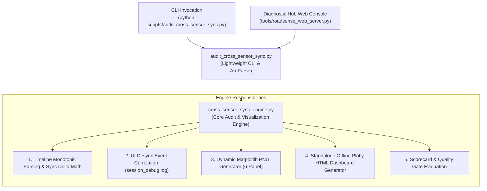

# Refactoring Cross-Sensor Synchronization Audit Architecture

## Goal Description
Refactor the monolithic [scripts/audit_cross_sensor_sync.py](file:///c:/Users/rakadu1.AHEAD/AndroidStudioProjects/RoadSense/scripts/audit_cross_sensor_sync.py) (~1,468 lines) into a clean, modular two-layer architecture:
1. **Engine Layer (`scripts/cross_sensor_sync_engine.py`)**: Houses all domain calculations, monotonic integrity verifications, UI desync correlation, Matplotlib PNG rendering (with dynamic scaling), and offline Plotly HTML report generation.
2. **CLI Runner Layer (`scripts/audit_cross_sensor_sync.py`)**: Becomes a lightweight CLI entry point (< 50 lines) that handles argument parsing, session directory resolution, and invokes the engine's public audit API.

This separation improves maintainability, enables programmatic reuse by other tools (such as automated CI pipelines, batch evaluators, and the Diagnostic Hub web server), and keeps the main script clean and readable.

---

## User Review Required
> [!IMPORTANT]
> - **Filename Choice**: The proposed engine module is named `scripts/cross_sensor_sync_engine.py`. `scripts/audit_cross_sensor_sync.py` remains the user-facing CLI command and Diagnostic Hub target to preserve 100% backward compatibility with all existing scripts and documentation.
> - **Zero Behavioral Changes**: All command-line flags (`--latest`, `--no-plot`, `--no-html`, `--show`), console output formats, scorecard metrics, file paths (`sync_audit_report.png`, `sync_audit_report.html`), and return codes remain identical.

---

## Proposed Architectural Separation



---

## Proposed Changes

### Component: Core Audit Engine & CLI Driver

#### [NEW] `scripts/cross_sensor_sync_engine.py`
Move the heavy auditing, math, visualization, and scoring logic into this module:
- **ANSI Terminal Helpers**: `colorize_status` and color constants.
- **Flight Recorder Integration**: `extract_ui_events_from_log(sess_dir, total_dur_s)`.
- **Plot Generation (PNG)**: `generate_diagnostic_plots(...)` including Approach A dynamic scaling for Camera2 startup/teardown spikes.
- **Plot Generation (Interactive HTML)**: `generate_sync_html_report(...)` with inlined `plotly-basic.min.js`.
- **Core Orchestrator**: `audit_timeline(sess_dir, make_plot=True, make_html=True, show_gui=False)` which returns the scorecard dictionary and overall verdict string.

#### [MODIFY] `scripts/audit_cross_sensor_sync.py`
Strip down the file from ~1,468 lines to a lightweight CLI driver:
- Keep module docstring and usage guide.
- Helper `resolve_session_dir(target)`.
- `argparse` configuration for `--latest`, `--no-plot`, `--no-html`, `--show`, and `target`.
- Direct call:
  ```python
  from cross_sensor_sync_engine import audit_timeline, resolve_session_dir

  if __name__ == "__main__":
      # CLI parse and call audit_timeline
  ```
- Expose `audit_timeline` from `audit_cross_sensor_sync.py` as an alias for backward compatibility in case any external script imports it.

---

## Verification Plan

### Automated Tests
1. **CLI Execution with Latest Session**:
   ```powershell
   python scripts/audit_cross_sensor_sync.py --latest
   ```
   *Verify:* Runs without import errors, prints the full 10-point scorecard, generates both `sync_audit_report.png` and `sync_audit_report.html`.

2. **CLI Execution with Specific Session**:
   ```powershell
   python scripts/audit_cross_sensor_sync.py logs/session_20261016_144844
   ```
   *Verify:* Correctly audits session 20261016_144844 and outputs results.

3. **Flags Verification (`--no-plot`, `--no-html`)**:
   ```powershell
   python scripts/audit_cross_sensor_sync.py --latest --no-plot
   ```
   *Verify:* Skips PNG generation, creates HTML.

### Manual Verification
1. Open the Diagnostic Hub (`python tools/roadsense_web_server.py`), run the **Cross-Sensor Monotonic Sync Audit** from Tab 3, and confirm the interactive Plotly iframe continues to load and display seamlessly.
