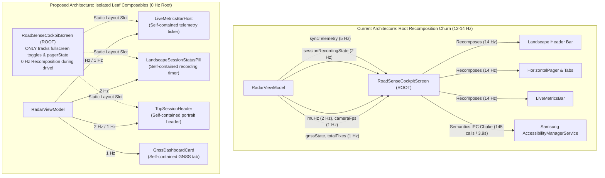

# Implementation Plan: Root UI Composition Isolation & Semantics Decoupling

> **Target Device:** Samsung Galaxy M20 (Exynos 7904: 2x Cortex-A73 @ 1.8 GHz, 6x Cortex-A53 @ 1.6 GHz, Android 10)  
> **Target Subsystem:** Jetpack Compose UI Architecture (`MainActivity.kt`, `LiveMetricsBar.kt`, `GnssDashboardCard.kt`, `TopSessionHeader.kt`)  
> **Goal:** Reduce Main UI Thread CPU load from **53.5% down to < 20%** by eliminating high-frequency sensor StateFlow collections from the root `RoadSenseCockpitScreen`.

---

## 1. Problem Statement & Root Cause

In the latest Perfetto trace (`trace-2026-11-04-12-03-22.perfetto-trace`), the Main UI thread consumed **53.5% of Core 7 CPU** (6.69s out of 12.5s).
While our initial optimizations reduced text layout churn by 84% and Semantics IPC by 69%, the trace shows that `AndroidOwner:measureAndLayout` and `checkForSemanticsChanges` still executed **145 times** (~11.6 Hz).

### Root Cause Analysis:
In [`MainActivity.kt`](file:///c:/Users/rakadu1.AHEAD/AndroidStudioProjects/RoadSense/app/src/main/java/com/bajajauto/roadsense/ui/MainActivity.kt), 15 state flows are collected directly inside the root `RoadSenseCockpitScreen` composable via `by viewModel.<flow>.collectAsState()`:
- `syncTelemetry` (emitted at ~5 Hz by `CrossSensorSyncAssociator`)
- `sessionRecordingState` (emitted at 2 Hz / 500 ms by `RadarSessionRecorder`)
- `imuHz` (emitted at 2 Hz / 500 ms)
- `cameraFps`, `radarHz`, `gnssHz`, `latestGnssFix`, `totalGnssFixes` (emitted at 1 Hz)

Because these are collected at the root level, **any single emission flags the entire root `RoadSenseCockpitScreen` for recomposition**. This forces:
1. The top-level `Column`, `LiveMetricsBar`, `HorizontalPager`, `Surface` headers, and all tab icons/labels to evaluate recomposition 12–14 times per second.
2. In landscape mode, the recording pill (`● REC %02d:%02d (%df)`) is rebuilt in the root header.
3. Every recomposition of text composables dispatches Binder transactions to Samsung's `AccessibilityManagerService` (`checkForSemanticsChanges` = 1,779 ms, `sendAccessibilitySemanticsStructureChangeEvents` = 1,548 ms).



---

## 2. Proposed Changes

### Component 1: `LiveMetricsBar.kt`
#### [MODIFY] `app/src/main/java/com/bajajauto/roadsense/ui/components/LiveMetricsBar.kt`
- Add an overloaded composable `LiveMetricsBar(viewModel: RadarViewModel, onSyncClick: () -> Unit = {}, modifier: Modifier = Modifier)`.
- Internalize the collection of:
  - `radarHz`, `cameraFps`, `gnssHz`, `imuHz`
  - `latestFix`
  - `batteryPct`, `batteryTempC`, `cpuUsagePct`, `cpuTempC`
  - `syncTelemetry`
- Retain the existing primitive-based `LiveMetricsBar` for previews, tests, or custom callers.
- *Benefit:* When any metric or sync grade changes, **only `LiveMetricsBar` recomposes**. The parent cockpit screen remains completely un-invalidated.

### Component 2: `MainActivity.kt` & Header Composables
#### [MODIFY] `app/src/main/java/com/bajajauto/roadsense/ui/MainActivity.kt`
- **Strip high-frequency state collections from `RoadSenseCockpitScreen`:**
  - Remove `syncTelemetry`, `sessionRecordingState`, `radarHz`, `cameraFps`, `gnssHz`, `imuHz`, `batteryPct`, `batteryTempC`, `cpuUsagePct`, `cpuTempC`, `gnssState`, `latestGnssFix`, `totalGnssFixes`, and `connectionState`.
  - Retain only: `isCameraFullScreen`, `isCalibrationFullScreen`, `showSyncDialog`, and `pagerState`.
- **Landscape Header Isolation:**
  - Create a dedicated private composable `LandscapeSessionControlBar(viewModel: RadarViewModel)`:
    - Collects `sessionRecordingState` internally.
    - Renders the `● REC %02d:%02d (%df)` status pill and Record/Stop button.
    - Recomposes independently at 2 Hz without touching the tab bar or screen root.
- **Portrait Header Isolation:**
  - `TopSessionHeader` is called simply as `TopSessionHeader(viewModel = viewModel, onStartSession = ..., onStopSession = ...)`.
  - It collects `sessionRecordingState` internally, isolating portrait header updates.
- **Tab Dashboard Cards:**
  - `GnssDashboardCard`: Pass `viewModel = viewModel`. The card collects `gnssState`, `latestFix`, and `totalFixes` internally.
  - `RadarDashboardCard`: Collects `connectionState` internally.

### Component 3: `GnssDashboardCard.kt`
#### [MODIFY] `app/src/main/java/com/bajajauto/roadsense/ui/screens/GnssDashboardCard.kt`
- Update default parameters:
  ```kotlin
  @Composable
  fun GnssDashboardCard(
      viewModel: RadarViewModel,
      modifier: Modifier = Modifier,
      gnssState: GnssState? = null,
      latestFix: GnssFix? = null,
      totalFixes: Long? = null
  )
  ```
- Collect missing parameters from `viewModel` internally if not passed explicitly.
- *Benefit:* GPS lock updates at 1 Hz only invalidate `GnssDashboardCard` when the user is viewing the GNSS tab.

---

## 3. Verification Plan

### Automated JVM Tests
```powershell
$env:JAVA_HOME = "C:\Users\rakadu1.AHEAD\Android_Studio\android-studio-quail4-windows\android-studio\jbr"
./gradlew testDebugUnitTest
```
Ensure all existing unit tests in `app/src/test` continue to pass 100% green with zero compilation errors.

### Build Verification
```powershell
$env:JAVA_HOME = "C:\Users\rakadu1.AHEAD\Android_Studio\android-studio-quail4-windows\android-studio\jbr"
./gradlew assembleDebug
```
Verify that `app\build\outputs\apk\debug\app-debug.apk` builds cleanly.

### Manual Hardware & Perfetto Verification
1. User installs the new debug APK on Samsung Galaxy M20.
2. Launch RoadSense and navigate to the SBS tab with camera preview and radar streaming.
3. Capture a 15-second Perfetto trace:
   - Verify Main Thread CPU load drops from **53.5% down to < 20%**.
   - Verify `checkForSemanticsChanges` drops from 145 calls down to **< 30 calls** (or zero during steady view).
   - Verify root `RoadSenseCockpitScreen` recomposition count is **0** during steady drive.

