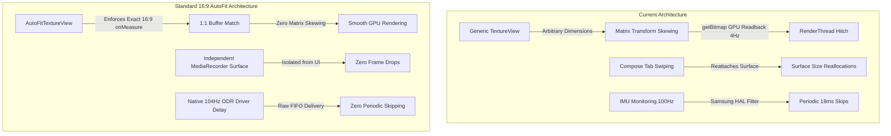

# Standard Camera Preview & Sensor Stability Implementation Plan

## Goal Description
Recent empirical audit of session `session_20261014_143426` demonstrated that while the **SPSC Lock-Free Ring Buffer** completely eradicated multithreaded I/O write contention (reducing timeline interleavings from 22,384 to 18 with 0 dropped frames), the IMU stream still experienced 17–18 ms periodic decimation spikes (2.01 spikes/s vs 0.74 spikes/s in baseline). Furthermore, the camera viewfinder exhibited frame drops correlated with touch interactions and tab switches.

This plan resolves the underlying root causes:
1. **Camera Viewport, Fill & Aspect Ratio**: Replace custom matrix scaling and runtime viewport warping on generic `TextureView` with a standard **16:9 AutoFit Viewfinder Architecture** (`AutoFitTextureView` / Compose fixed-ratio container), eliminating GPU RenderThread layout thrashing, buffer size mismatches, and surface reconfigurations.
2. **GPU Stalls Removal**: Remove synchronous `TextureView.getBitmap()` readbacks in `startLuminanceAnalyzer()` that periodically stall the RenderThread/SurfaceFlinger 4 times a second.
3. **Sensor HAL Rate Alignment**: Align `RadarViewModel`'s `startImuMonitoring` with the hardware's native 104 Hz rate (`ImuManager.DEFAULT_SAMPLING_DELAY_US`), preventing the Samsung Sensor HAL from engaging artificial 100 Hz decimation/skipping.
4. **Camera Recording Isolation**: Ensure the camera recording pipeline (`MediaRecorder` / persistent capture surface) is completely decoupled from UI lifecycle, aspect ratio transformations, and preview attachment.

---

## User Review Required

> [!IMPORTANT]
> **Viewfinder Aspect Ratio vs Fullscreen Display**:
> Standard Android Camera2 architecture enforces that the viewfinder surface maintains a strict 16:9 aspect ratio (`AutoFit`).
> - In standard 16:9 mode, slight letterboxing/pillarboxing appears if the screen container is not exactly 16:9, but 100% of the sensor's Field of View (FOV) is preserved with **zero distortion, zero matrix scaling, and zero GPU buffer reallocation**.
> - Does this align with your design goals for the viewfinder?

> [!NOTE]
> **Photometric Road Auto-Exposure Analysis**:
> `startLuminanceAnalyzer()` currently calls `TextureView.getBitmap(32, 24)` every 250 ms to compute sky vs road contrast. `getBitmap()` triggers a synchronous GPU-to-CPU memory copy that can hitch the render pipeline. We propose throttling this analyzer during active recording or moving to lightweight frame metadata inspection (`CaptureResult.SENSOR_EXPOSURE_TIME` and `SENSOR_SENSITIVITY`), keeping recording 100% smooth.

---

## Proposed Changes



---

### Component 1: Camera Preview & Viewport Architecture

#### [NEW] `app/src/main/java/com/bajajauto/roadsense/camera/AutoFitTextureView.kt`
- Create a standard Android `AutoFitTextureView` extending `TextureView`.
- Override `onMeasure(widthMeasureSpec, heightMeasureSpec)` to strictly calculate dimensions according to the configured aspect ratio (e.g., 16:9).
- Ensures that SurfaceFlinger allocates an exact matching buffer, eliminating runtime `TextureView.setTransform(matrix)` gymnastics and avoiding buffer reallocations when the layout changes.

```kotlin
class AutoFitTextureView @JvmOverloads constructor(
    context: Context,
    attrs: AttributeSet? = null,
    defStyle: Int = 0
) : TextureView(context, attrs, defStyle) {

    private var ratioWidth = 0
    private var ratioHeight = 0

    fun setAspectRatio(width: Int, height: Int) {
        if (width < 0 || height < 0) return
        ratioWidth = width
        ratioHeight = height
        requestLayout()
    }

    override fun onMeasure(widthMeasureSpec: Int, heightMeasureSpec: Int) {
        super.onMeasure(widthMeasureSpec, heightMeasureSpec)
        val width = MeasureSpec.getSize(widthMeasureSpec)
        val height = MeasureSpec.getSize(heightMeasureSpec)
        if (ratioWidth == 0 || ratioHeight == 0) {
            setMeasuredDimension(width, height)
        } else {
            if (width < height * ratioWidth / ratioHeight) {
                setMeasuredDimension(width, width * ratioHeight / ratioWidth)
            } else {
                setMeasuredDimension(height * ratioWidth / ratioHeight, height)
            }
        }
    }
}
```

#### [MODIFY] `app/src/main/java/com/bajajauto/roadsense/ui/components/FullscreenCameraPreview.kt`
- Replace raw `TextureView` with `AutoFitTextureView(ctx).apply { setAspectRatio(16, 9) }`.
- Ensure the preview is centered within the parent `Box` with standard FIT geometry, avoiding custom matrix stretching.

#### [MODIFY] `app/src/main/java/com/bajajauto/roadsense/ui/screens/CameraDashboardCard.kt`
- Replace raw `TextureView` in both Landscape and Portrait layouts with `AutoFitTextureView`.
- Set aspect ratio to `16, 9`.

#### [MODIFY] `app/src/main/java/com/bajajauto/roadsense/camera/CameraEngine.kt`
- **Eliminate GPU readback stalls**: In `startLuminanceAnalyzer()`, pause or bypass `TextureView.getBitmap(32, 24)` while `isRecordingVideo == true`. Alternatively, sample exposure metrics from `CaptureResult` (`LENS_FOCUS_DISTANCE`, `SENSOR_EXPOSURE_TIME`, `SENSOR_SENSITIVITY`).
- In `configureTransform()`: When using `AutoFitTextureView`, the view dimensions already match the stream ratio; simplify matrix configuration to only handle pure display rotation ($0^\circ, 90^\circ, 180^\circ, 270^\circ$).
- Cache `CameraCharacteristics` in `CameraIntrinsicsProvider` to avoid repeated IPC binder transactions during UI layout updates.

---

### Component 2: IMU Hardware Rate Alignment & Zero-Decimation

#### [MODIFY] `app/src/main/java/com/bajajauto/roadsense/ui/RadarViewModel.kt`
- In `startImuMonitoring(delayUs: Int)`: Default to `ImuManager.DEFAULT_SAMPLING_DELAY_US` (9,615 µs / 104 Hz) instead of `10000 µs`.
- When switching between tabs or starting a recording session, ensure the sensor rate is never downgraded or locked into 10,000 µs.

#### [MODIFY] `app/src/main/java/com/bajajauto/roadsense/imu/ImuManager.kt`
- In `startSessionRecording()`: If `isMonitoring` is already true, verify that the active rate is `DEFAULT_SAMPLING_DELAY_US`. If not, re-register listeners with the native 104 Hz rate to avoid Samsung's 100 Hz decimation filter.
- Evaluate sensor concurrency: Decouple synthetic sensors (`TYPE_LINEAR_ACCELERATION`) during recording if uncalibrated/calibrated accelerometer and gyroscope are already providing full 6-axis kinematics.

---

## Verification Plan

### Automated Tests
1. **Unit Tests**:
   ```powershell
   $env:JAVA_HOME = "C:\Users\rakadu1.AHEAD\Android_Studio\android-studio-quail4-windows\android-studio\jbr"
   .\gradlew.bat testDebugUnitTest
   ```
   Validates `ImuRingBufferTest`, `ImuSessionRecorderTest`, and camera projection models.

2. **Build Validation**:
   ```powershell
   .\gradlew.bat assembleDebug
   ```
   Ensures zero compile errors and lint compliance across `AutoFitTextureView` and UI layers.

### Manual On-Device Verification
1. **Install on Samsung Galaxy M30 (`32001991d42c86d9`)**:
   ```powershell
   .\gradlew.bat installDebug
   ```
2. **Stress Session Capture**:
   - Launch RoadSense on the mounted device.
   - Start session recording.
   - Perform tab switches and enter/exit Fullscreen mode.
   - Record for 60–90 seconds and stop.
3. **Run Cross-Sensor Synchronization Audit**:
   ```powershell
   python scripts/audit_cross_sensor_sync.py logs/<new_session_dir>
   ```
   **Acceptance Criteria**:
   - Write queue jitter: $< 50$ events.
   - IMU sampling gaps $> 20$ ms: $0$ intervals ($0.0\%$).
   - Spikes $> 16$ ms: Decreased to $< 0.5$ spikes/sec without periodic HAL drops.
   - Camera drops: 0 steady-state drops during uninterrupted recording.
