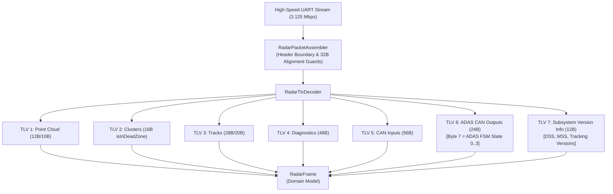

# Implementation Plan: Radar TLV MSS v1.0.1 Protocol Parity & Decoding Update

## Goal Description
Synchronize the RoadSense Android mmWave radar parsing pipeline and downstream tooling with commit [`e229fc434b02327a22244ad6d14dc6e70fb99e45`](file:///D:/Gitea/CAN_unified_radar_tracker_py) from `CAN_unified_radar_tracker_py` (*MSS v1.0.1 / Unified Master Specification v4.0*).

### Context & Commit Analysis
Commit `e229fc434b02327a22244ad6d14dc6e70fb99e45` introduces four key protocol evolutions:
1. **TLV 6 (Safety ADAS CAN Outputs, 24 Bytes)**:
   - In the ACC Frame (Bytes 16..23 of TLV 6), Byte 7 has been updated from legacy reference acceleration `ACC_ARef_mps2` (`acc7 * 0.02 - 2.56`) to **`ACC_ADAS_FSM_State_St_enum`** (`int(acc7)`: `0=IDLE`, `1=FCW_ALERT`, `2=ACC_GOVERN`, `3=AEB_OVERRIDE`).
2. **TLV 7 (Subsystem Version Information, 12 Bytes)**:
   - Unpacks 12 bytes via `<III` for `dssVersion`, `mssVersion`, and `trackingVersion`, formatted as semantic versions:
     $$\text{Major} = (v \gg 24) \ \& \ 0\text{xFF}, \quad \text{Minor} = (v \gg 16) \ \& \ 0\text{xFF}, \quad \text{Patch} = (v \gg 8) \ \& \ 0\text{xFF}$$
3. **Master Frame Header Boundary Validation & Inner Sync Re-alignment**:
   - Rejection of corrupt UART frames where `totalPacketLen < 40` or `> 16384`, `totalPacketLen % 4 != 0`, `numTLVs > 10`, `subFrameNumber > 7`, or `numDetectedObj > 2048`.
   - Inner magic word recovery when sync words are split or abandoned mid-stream.
4. **TLV 2 (DBSCAN Clusters, 16 Bytes)**:
   - Field 9 (`isInDeadZone`) clarified as near-field guardrail / bumper blind-zone flag.

---

## User Review Required

> [!IMPORTANT]
> **TLV 6 ACC Byte 7 Semantic Replacement**:
> In firmware MSS v1.0.1, Byte 7 of the ACC Frame no longer transmits `aRefMps2`. It now transmits `ACC_ADAS_FSM_State_St_enum` (`0..3`).
> In `RadarAccTarget`, we will add `val adasFsmState: Int = 0` and retain `val aRefMps2: Float = 0f` with `@Deprecated` and default parameter to ensure zero breaking changes across existing call sites and spatial projection tests.

> [!NOTE]
> **Subsystem Version Telemetry (TLV 7)**:
> TLV 7 is already broadcast by the radar hardware (23,338 occurrences observed in session `session_20261023_111120`). RoadSense Android previously ignored TLV 7. We will decode it into a domain model `RadarVersionInfo` attached to `RadarFrame.versionInfo`.

---

## Proposed Changes



---

### Component: Domain Models (`app/src/main/java/com/bajajauto/roadsense/models/`)

#### [MODIFY] [`RadarFrame.kt`](file:///C:/Users/rakadu1.AHEAD/AndroidStudioProjects/RoadSense/app/src/main/java/com/bajajauto/roadsense/models/RadarFrame.kt)
- **`RadarAccTarget`**:
  - Add `adasFsmState: Int = 0`.
  - Add enum/helper `adasFsmStateName: String` (`"IDLE"`, `"FCW"`, `"ACC"`, `"AEB"`).
  - Deprecate `aRefMps2: Float = 0f` with default value to preserve compatibility.
- **`RadarCluster`**:
  - Add `isInDeadZone: Boolean = false` (aliasing/primary with `isDeadZone`).
- **`RadarVersionInfo`** [NEW data class]:
  - `dssVersion: String`, `mssVersion: String`, `trackingVersion: String`, `rawDss: Long`, `rawMss: Long`, `rawTracking: Long`.
- **`RadarFrame`**:
  - Add `val versionInfo: RadarVersionInfo? = null`.

---

### Component: Radar Assembling & TLV Decoding (`app/src/main/java/com/bajajauto/roadsense/decoding/`)

#### [MODIFY] [`RadarTlvDecoder.kt`](file:///C:/Users/rakadu1.AHEAD/AndroidStudioProjects/RoadSense/app/src/main/java/com/bajajauto/roadsense/decoding/RadarTlvDecoder.kt)
- Define `const val TLV_VERSION_INFO = 7`.
- Update `decode()` loop:
  - Add branch for `TLV_VERSION_INFO`: parse 12 bytes via new `parseVersionInfo()` method.
- Update `parseCanOutputs()`:
  - Unpack `acc7 = accBytes[7].toInt() and 0xFF`.
  - Instantiate `RadarAccTarget` passing `adasFsmState = acc7` (and `aRefMps2 = 0f`).
- Add `parseVersionInfo(buffer: ByteBuffer, length: Int): RadarVersionInfo?`:
  - Read 3 unsigned 32-bit integers (`dssRaw`, `mssRaw`, `trkRaw`).
  - Convert each to semantic version strings using byte shifts `(v ushr 24) and 0xFF`, etc.

#### [MODIFY] [`RadarPacketAssembler.kt`](file:///C:/Users/rakadu1.AHEAD/AndroidStudioProjects/RoadSense/app/src/main/java/com/bajajauto/roadsense/decoding/RadarPacketAssembler.kt)
- Enforce physical header validation boundaries matching Rule 18:
  ```kotlin
  if (totalPacketLen !in RadarHeader.HEADER_SIZE_BYTES..MAX_PACKET_SIZE ||
      totalPacketLen % 4 != 0 ||
      numTLVs !in 0..10 ||
      subFrameNumber !in 0..7 ||
      numDetectedObj !in 0..2048) {
      // Discard invalid magic byte and resume search
  }
  ```

---

### Component: Cockpit UI Badge (`app/src/main/java/com/bajajauto/roadsense/ui/screens/`)

#### [MODIFY] [`RadarDashboardCard.kt`](file:///C:/Users/rakadu1.AHEAD/AndroidStudioProjects/RoadSense/app/src/main/java/com/bajajauto/roadsense/ui/screens/RadarDashboardCard.kt)
- Display the active ADAS FSM operational state badge (`IDLE`, `FCW`, `ACC`, `AEB`) alongside ACC lead telemetry in the radar dashboard card.

---

### Component: Downstream MCAP & Parity Tools (`tools/` & `scripts/`)

#### [MODIFY] [`tools/convert_session_to_mcap.py`](file:///C:/Users/rakadu1.AHEAD/AndroidStudioProjects/RoadSense/tools/convert_session_to_mcap.py)
- In `parse_radar_raw_stream()`:
  - Update TLV 6 ACC unpack: parse `acc_adas_fsm_state = int(acc7)`.
  - Add TLV 7 version info unpack: extract `dss_version`, `mss_version`, `tracking_version`.
  - Retain `a_ref_mps2 = 0.0` or replace cleanly in schema.
- Update `tools/sync_and_process_sessions.py` to match.
- Update `scripts/tests/test_verify_conversion_parity.py` fixtures to validate `fsm_state`.

---

### Component: Verification & Unit Tests (`app/src/test/`)

#### [MODIFY] [`RadarTlvDecoderTest.kt`](file:///C:/Users/rakadu1.AHEAD/AndroidStudioProjects/RoadSense/app/src/test/java/com/bajajauto/roadsense/decoding/RadarTlvDecoderTest.kt)
- **`decode_24ByteCanOutputs_parsesFcwBsdAccCorrectly`**:
  - Update test vector to set Byte 7 = 2 (`ACC_GOVERN`).
  - Assert `canOut.acc.adasFsmState == 2` and `canOut.acc.adasFsmStateName == "ACC"`.
- **`decode_12ByteVersionInfo_parsesDssMssTrackingVersionsCorrectly`** [NEW]:
  - Feed 12 bytes (`0x01000000`, `0x01000100`, `0x010000FF`).
  - Assert DSS version is `"1.0.0"`, MSS is `"1.0.1"`, and Tracking is `"1.0.0"`.
- **`decode_completeMultiTlvPacket_parsesAll7TlvsSimultaneously`**:
  - Feed all 7 TLVs in a single packet and verify full domain extraction.
- **`RadarPacketAssemblerTest.kt`** [NEW]:
  - Test resilient rejection of corrupted frame headers (`numTLVs > 10`, `subFrameNumber > 7`, `numDetectedObj > 2048`, unaligned `totalPacketLen`).

---

## Verification Plan

### Automated Tests
1. **JVM Unit Tests**:
   ```powershell
   $env:JAVA_HOME = "C:\Users\rakadu1.AHEAD\Android_Studio\android-studio-quail4-windows\android-studio\jbr"
   ./gradlew testDebugUnitTest
   ```
2. **Specific TLV & Assembler Unit Tests**:
   ```powershell
   $env:JAVA_HOME = "C:\Users\rakadu1.AHEAD\Android_Studio\android-studio-quail4-windows\android-studio\jbr"
   ./gradlew testDebugUnitTest --tests com.bajajauto.roadsense.decoding.*
   ```
3. **Python Conversion Parity Tests**:
   ```powershell
   conda run -n roadsense-mcap python -m unittest scripts/tests/test_verify_conversion_parity.py
   ```
4. **Real Hardware Radar Stream Validation**:
   ```powershell
   python scripts/validate_radar_stream.py --latest
   ```

### Manual Verification
- Verify terminal summary shows 100% test pass with zero regressions across spatial projection, radar recording, and TLV decoding suites.

