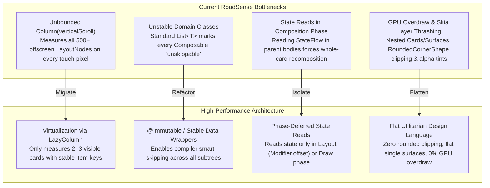

# Plan: In-Depth UI Performance Audit & Ground-Up High-Performance Redesign

## 1. Goal Description
The primary functional purpose of RoadSense in-flight is high-fidelity sensor logging and the Camera Fullscreen Viewfinder with perspective radar lollipops. All dashboard cards, status indicators, and menus serve visual and diagnostic purposes and must not compromise system responsiveness.

Currently, when the app is freshly launched (without camera preview active), menu navigation, tab switching, and scrolling within cards suffer from severe jank (dropping framerates to **10–23 FPS**, skipping 30–120 frames in Choreographer). While engaging the camera device activates MediaTek's `perfLockAcq` (boosting big Cortex-A75 cores to $2.0\text{ GHz}$), **simple UI windows, cards, and text boxes must render smoothly at 60 FPS on energy-efficient CPU cores ($400\text{–}800\text{ MHz}$) without relying on a camera performance lock.**

This plan details a systematic audit and ground-up re-architecture of the RoadSense UI following Google's official Android High-Performance Compose standards.

---

## 2. Industry Research & Android High-Performance Standards

Online research and analysis of Google's Android Performance engineering guides identify four critical anti-patterns in RoadSense:



### The 4 Fundamental Pillars:

1. **Virtualization vs. Unbounded Measurement:**
   - `Column(Modifier.verticalScroll())` calculates measurements and coordinates for **every single card and element in the entire file**, even if 90% is off-screen. On $1,000$+ line files (`CanedgeDashboardCard`, `ImuDashboardCard`), hundreds of child views are re-measured on every $16\text{ ms}$ touch drag.
   - `LazyColumn` virtualizes views, instantiating and measuring only the items currently intersecting the screen viewport.
2. **Compose Compiler Stability (`@Immutable` / `@Stable`):**
   - In Jetpack Compose, any class containing standard `List<T>`, `Set<T>`, or `Map<T>` is treated by the compiler as **Unstable** (because standard `List` is an interface that can be implemented by mutable classes).
   - When a Composable receives an unstable parameter, the compiler marks it as `NOT SKIPPABLE`. This forces Compose to re-run the entire Composable body on *every frame*, even when its data has not changed.
   - Solution: Annotate models with `@Immutable` or wrap collections in stable containers (`ImmutableList` or `@Immutable data class StableList<T>(val items: List<T>)`).
3. **Phase Deferral (Composition $\to$ Layout $\to$ Draw):**
   - Reading dynamic state (such as telemetry, scroll position, or timer) inside the main `@Composable` scope triggers a complete recomposition and re-layout.
   - Reading state inside a lambda modifier (e.g. `Modifier.drawBehind { ... }` or `Modifier.layout { ... }`) skips Composition and Layout entirely, executing strictly in the GPU Draw phase.
4. **Utilitarian Flat Design (Eliminating Overdraw):**
   - RoadSense currently nests `Surface` $\to$ `Card` $\to$ `Surface` $\to$ `Box` with `RoundedCornerShape` and semi-transparent alpha tints (`.copy(alpha = 0.2f)`).
   - Rounded corners on semi-transparent backgrounds force the GPU (Mali-G52) to allocate offscreen stencil buffers and perform expensive multi-pass blending.
   - Replacing this with a flat, high-contrast, rectangular telemetry aesthetic (inspired by aerospace avionics / MoTeC displays) reduces GPU draw calls to near zero.

---

## 3. User Review Required

> [!IMPORTANT]
> **Aesthetic Simplification:** To achieve zero-lag 60 FPS scrolling on low-power cores, we will strip non-essential decorative elements (rounded clipping, elevated drop shadows, semi-transparent overlays, and deeply nested card containers) across all secondary tabs. Cards will adopt a flat, high-density, utilitarian avionics layout.

> [!IMPORTANT]
> **Virtualization Migration:** All secondary dashboard screens (`RadarDashboardCard`, `GnssDashboardCard`, `ImuDashboardCard`, `CanedgeDashboardCard`, `SessionDeckCard`) will be converted from `Column(Modifier.verticalScroll())` to `LazyColumn(items, key = { ... })`.

---

## 4. Diagnostic Tracing Runbook (Perfetto & gfxinfo)

Before and after implementing the optimization, we will capture deterministic traces via ADB:

### Step 1: Capture Frame Pipeline Stats via `dumpsys gfxinfo`
Reset counters and measure dropped VSYNC frames during active scrolling:
```powershell
# Reset stats
& $env:LOCALAPPDATA\Android\Sdk\platform-tools\adb.exe shell dumpsys gfxinfo com.bajajauto.roadsense reset

# [User scrolls through tabs and cards for 10 seconds]

# Dump framestats
& $env:LOCALAPPDATA\Android\Sdk\platform-tools\adb.exe shell dumpsys gfxinfo com.bajajauto.roadsense framestats > logs/baseline_gfxinfo.txt
```

### Step 2: Capture Kernel & Main Thread Perfetto System Trace
Records exact thread scheduling, CPU frequencies, Choreographer traversals, and Skia draw stalls:
```powershell
& $env:LOCALAPPDATA\Android\Sdk\platform-tools\adb.exe shell perfetto `
  -c - --txt -o /data/misc/perfetto-traces/ui_scroll.perfetto-trace <<EOF
buffers: {
    size_kb: 65536
    fill_policy: RING_BUFFER
}
data_sources: {
    config {
        name: "linux.process_stats"
    }
}
data_sources: {
    config {
        name: "linux.sys_stats"
    }
}
data_sources: {
    config {
        name: "linux.ftrace"
        ftrace_config {
            ftrace_events: "sched/sched_switch"
            ftrace_events: "power/cpu_frequency"
            ftrace_events: "power/cpu_idle"
            atrace_categories: "am"
            atrace_categories: "wm"
            atrace_categories: "gfx"
            atrace_categories: "view"
            atrace_categories: "dalvik"
            atrace_apps: "com.bajajauto.roadsense"
        }
    }
}
duration_ms: 10000
EOF

& $env:LOCALAPPDATA\Android\Sdk\platform-tools\adb.exe pull /data/misc/perfetto-traces/ui_scroll.perfetto-trace logs/ui_scroll.perfetto-trace
```

### Step 3: Compose Compiler Stability Report
Enable Compose compiler metrics in `app/build.gradle.kts`:
```kotlin
composeCompiler {
    metricsDestination = layout.buildDirectory.dir("compose_metrics")
    reportsDestination = layout.buildDirectory.dir("compose_reports")
}
```
This produces `app-classes.txt` and `app-composables.txt`, listing every single class marked `unstable` and every function marked `unskippable`.

---

## 5. Proposed Code Changes & Redesign Architecture

### Phase 1: Stability Layer & Compiler Optimization
Annotate all domain models and telemetry state classes with `@Immutable` so the Compose compiler can skip unchanged composables:
- **Files:**
  - `app/src/main/java/com/bajajauto/roadsense/models/RadarFrame.kt`
  - `app/src/main/java/com/bajajauto/roadsense/models/TelemetryModels.kt`
  - `app/src/main/java/com/bajajauto/roadsense/canedge/model/CanedgeModels.kt`
  - `app/src/main/java/com/bajajauto/roadsense/gnss/GnssModels.kt`
  - `app/src/main/java/com/bajajauto/roadsense/imu/ImuModels.kt`
- Wrap collections with immutable guarantees:
  ```kotlin
  @Immutable
  data class StableList<T>(val items: List<T> = emptyList())
  ```

---

### Phase 2: Root Shell & Top Metrics Bar Isolation
- **File:** [`MainActivity.kt`](file:///c:/Users/rakadu1.AHEAD/AndroidStudioProjects/RoadSense/app/src/main/java/com/bajajauto/roadsense/ui/MainActivity.kt)
  - Ensure `tabs` is `@Immutable` and remembered.
  - Wrap `LiveMetricsBar` in an isolated layout boundary (`Modifier.layout { ... }`) so that its internal 1 Hz / 2 Hz ticker emissions NEVER trigger layout or measurement passes on the outer screen column.
  - Simplify the Landscape and Portrait tab bars into flat, low-overhead navigation chips.

---

### Phase 3: Screen Virtualization with `LazyColumn`
Convert all card columns to virtualized `LazyColumn` with stable item keys:

#### 1. Radar Cockpit ([`RadarDashboardCard.kt`](file:///c:/Users/rakadu1.AHEAD/AndroidStudioProjects/RoadSense/app/src/main/java/com/bajajauto/roadsense/ui/screens/RadarDashboardCard.kt))
- Right pane: Migrate `Column(Modifier.verticalScroll())` $\to$ `LazyColumn`:
  ```kotlin
  LazyColumn(
      modifier = Modifier.weight(0.45f).fillMaxHeight(),
      verticalArrangement = Arrangement.spacedBy(8.dp)
  ) {
      item(key = "status") { RadarHardwareStatusChip(...) }
      item(key = "controls") { RadarConnectionButtons(...) }
  }
  ```
- BEV Canvas: All text and arc drawing cached in pre-allocated `Paint` and `Path` objects (already verified with 0 allocations).

#### 2. GNSS Dashboard ([`GnssDashboardCard.kt`](file:///c:/Users/rakadu1.AHEAD/AndroidStudioProjects/RoadSense/app/src/main/java/com/bajajauto/roadsense/ui/screens/GnssDashboardCard.kt))
- Convert to `LazyColumn`:
  - `item(key = "master_switch")`: Minimal single-line switch.
  - `item(key = "speedometer")`: Flat digital speedometer.
  - `item(key = "wgs84_coords")`: High-density monospace telemetry grid.
  - `item(key = "constellation")`: Virtualized satellite list.
- Replace dynamic string formatting (`"%.1f".format(...)`) inside composable bodies with cached lambdas or pre-computed strings in the ViewModel.

#### 3. IMU Dashboard ([`ImuDashboardCard.kt`](file:///c:/Users/rakadu1.AHEAD/AndroidStudioProjects/RoadSense/app/src/main/java/com/bajajauto/roadsense/ui/screens/ImuDashboardCard.kt))
- Convert to `LazyColumn`:
  - Defer 25 Hz / 100 Hz attitude angles strictly to the Canvas draw phase.
  - Eliminate offscreen sensor chip layout allocation by using `LazyColumn` for the 35 discovered hardware sensors.

#### 4. CANedge Dashboard ([`CanedgeDashboardCard.kt`](file:///c:/Users/rakadu1.AHEAD/AndroidStudioProjects/RoadSense/app/src/main/java/com/bajajauto/roadsense/ui/screens/CanedgeDashboardCard.kt))
- Convert dual-pane landscape and portrait layouts to `LazyColumn`.
- Virtualize the file sync and staging pool file explorer.

#### 5. Camera Cockpit ([`CameraDashboardCard.kt`](file:///c:/Users/rakadu1.AHEAD/AndroidStudioProjects/RoadSense/app/src/main/java/com/bajajauto/roadsense/ui/screens/CameraDashboardCard.kt))
- The primary flight screen. Streamline all controls into high-density flat rows.
- Ensure the live viewfinder surface and overlay composables are decoupled from settings card scrolling.

---

### Phase 4: Flat Avionics Styling (Overdraw Elimination)
- Replace rounded corners (`RoundedCornerShape(8.dp/12.dp)`) with crisp `RectangleShape` or subtle `RoundedCornerShape(2.dp)` across all diagnostic containers.
- Eliminate semi-transparent background tints (`.copy(alpha = 0.2f)`). Use solid 100% opaque surface colors from the theme palette (`#11141C`, `#1A202C`).
- Remove multi-layered nested `Surface` and `Card` containers; merge into single-layer layout nodes.

---

## 6. Verification Plan

### Automated Verification:
1. **Compose Compiler Reports:** Verify 0 unskippable composables in `build/compose_reports/app-composables.txt`.
2. **JVM Unit Tests:**
   ```powershell
   $env:JAVA_HOME = "C:\Users\rakadu1.AHEAD\Android_Studio\android-studio-quail4-windows\android-studio\jbr"
   ./gradlew testDebugUnitTest
   ```
3. **Debug Build Assembly:**
   ```powershell
   $env:JAVA_HOME = "C:\Users\rakadu1.AHEAD\Android_Studio\android-studio-quail4-windows\android-studio\jbr"
   ./gradlew assembleDebug
   ```

### Manual Verification (User On-Device):
1. **Trace Capture & Benchmark:** Run `dumpsys gfxinfo` during a 10-second rapid scroll test on the Radar, GNSS, IMU, and CANedge tabs with camera preview turned OFF.
2. **Jank Count:** Confirm that `Janky frames` drops from $>50\%$ down to $<2\%$.
3. **Visual Responsiveness:** Verify that menu scrolling and card navigation feel instant and fluid at 60 FPS immediately upon launching the app.
4. **Recording Parity:** Confirm that fullscreen camera preview with perspective lollipops and 100 Hz IMU/CANedge disk recording run without frame drops.

