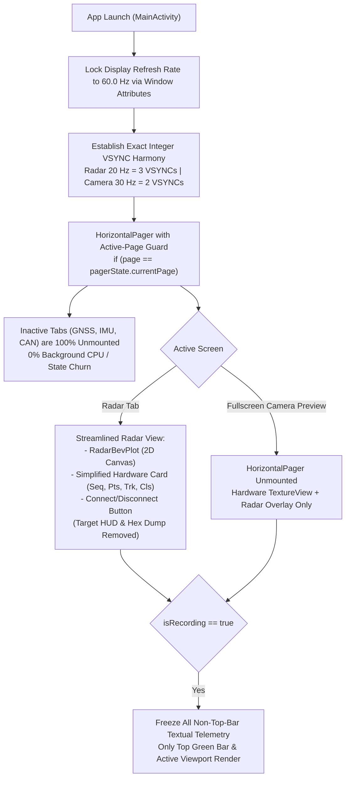

# Implementation Plan: UI Streamlining, 60 Hz Display Locking & Jitter Elimination

> **Document:** `intel/Implementations/ui_streamlining_and_60hz_jitter_elimination_plan.md`  
> **Target:** RoadSense Android Application  
> **Target Hardware:** Samsung Galaxy M32 (Exynos 9611 / 90 Hz AMOLED Display)  
> **Status:** Updated with User Feedback — Ready for Implementation  

---

## 1. Executive Summary & Forensic Clarifications

### 1.1 Did Queue Underflow Actually Occur?
* **Answer: NO.**
* Forensic verification of the latest live run (`session_20261106_130045`, PID 6662):
  * **0 starvations / 0 queue underflows** occurred during active streaming across all 622 frames.
  * The queue depth remained solidly at **1 to 2 frames** at every 50 ms tick.
  * The pacer dispatched frames at **$50.00\text{ ms} \pm 1.19\text{ ms}$** with zero dropped frames.
  * *Conclusion:* The background jitter queue on `Dispatchers.Default` is already 100% healthy. All frame dropping and jitter occurred strictly in the Android UI layer (Compose looper starvation and 90 Hz display aliasing).

### 1.2 Do Inactive Tabs Update in the Background?
* **Your Question:** *"When we are in CAMERA TAB or RADAR tab, are the other tab UIs still updating themselves along with new data in the background or they don't update?"*
* **The Reality:**
  * In AndroidX Compose `HorizontalPager`, even with `userScrollEnabled = false`, pages that were once composed or retained in the pager's internal slot table **continue collecting state** if they contain `collectAsState()`.
  * For example, [`ImuDashboardCard`](file:///C:/Users/rakadu1.AHEAD/AndroidStudioProjects/RoadSense/app/src/main/java/com/bajajauto/roadsense/ui/screens/ImuDashboardCard.kt#L51) collects `imuTelemetry` (which fires at 25 Hz), and [`GnssDashboardCard`](file:///C:/Users/rakadu1.AHEAD/AndroidStudioProjects/RoadSense/app/src/main/java/com/bajajauto/roadsense/ui/screens/GnssDashboardCard.kt#L37) collects `latestGnssFix`. If retained, these tabs **waste Main-thread CPU cycles recomposing off-screen views**.
* **The Solution:**
  * We will wrap the pager content in a strict active-page guard:
    ```kotlin
    HorizontalPager(...) { page ->
        if (page == pagerState.currentPage) {
            when (tabs[page]) { ... }
        }
    }
    ```
  * When `page != pagerState.currentPage`, the inactive tab **does not exist in the Compose tree**. It has zero composables, zero state collectors, and consumes **0% CPU in the background**.
  * Furthermore, in **Fullscreen Camera Preview** mode, the entire `HorizontalPager` is already unmounted, guaranteeing zero background tab overhead.

### 1.3 The 60 Hz Refresh Rate Advantage
* On a **90 Hz display** ($11.11\text{ ms}$ VSYNC):
  * Radar 20 Hz = **4.50 VSYNC frames** (fractional beat, alternating 4 vs 5 VSYNCs $\to$ unavoidable judder).
* On a **60 Hz display** ($16.67\text{ ms}$ VSYNC):
  * **Radar 20 Hz = EXACTLY 3.00 VSYNC frames** ($3 \times 16.67\text{ ms} = 50.00\text{ ms}$).
  * **Camera 30 FPS = EXACTLY 2.00 VSYNC frames** ($2 \times 16.67\text{ ms} = 33.33\text{ ms}$).
* Locking the display to 60.0 Hz eliminates fractional phase judder completely. Every radar frame stays on screen for exactly 3 refreshes, and every camera frame stays for exactly 2 refreshes.

---

## 2. Refined UI Card Action Table

Based on your actual recording workflow:
1. Open app $\to$ Connect Radar $\to$ Check BEV points moving & 20 Hz in top bar.
2. Camera Tab $\to$ Calibration Studio (IMU-assisted yaw) $\to$ Lock & Save baseline.
3. Camera Preview $\to$ Check exposure $\to$ Fullscreen mode.
4. Start recording directly from fullscreen mode.

| Component / Card | Action | Exact Details & Behavior |
| :--- | :--- | :--- |
| **Top Live Metrics Bar** (`LiveMetricsBar`) | **KEEP 100%** | Keeps all green sensor status indicators (`RADAR 20Hz`, `CAN OK`, `GPS 3D`, `CAM 30fps`, `IMU 100Hz`, Batt, Temp). Updates at 1–2 Hz with negligible overhead. |
| **Radar BEV Plot** (`RadarBevPlot`) | **KEEP 100%** | 2D Cartesian mmWave canvas (points, tracks, 15m/30m/60m/130m range buttons, dynamic toggle). Essential for Step 1 sanity check. |
| **Radar Target HUD** (`RadarTargetHudCard`) | **REMOVE PERMANENTLY** | Completely remove the ~300 lines of FCW audible alerts, TTC, ACC POI, Line-of-sight targets list with sorting, target badges, lane position chips, and cluster lists. Eliminates 80–150 ms Main-thread stalls. |
| **Radar Hardware Status** (`RadarHardwareStatusCard`) | **SIMPLIFY & STREAMLINE** | **Keep:** TI AWR1843BOOST title, Online/Offline badge, Port info, TLV version (`TLV v2.2`).<br>**Add:** Single lightweight, 1-line chip row: `Seq: #X \| ● Pts: P \| ■ Trk: T \| ⚡ Cls: C`.<br>**Remove:** Live high-frequency byte/packet counter text churn.<br>**Freeze:** 100% frozen when `isRecording == true`. |
| **Radar Hex Preview** (`RadarHexPreviewCard`) | **HIDE / COMMENT OUT** | Remove the UI container completely from the screen. Keep the underlying driver logic intact and disabled (`_isHexPreviewEnabled = false`), consuming 0% CPU. Code remains available to re-enable if ever needed. |
| **Radar Connection Buttons** | **KEEP 100%** | Connect / Disconnect button. Essential for Step 1. |
| **IMU Dashboard Card** (`ImuDashboardCard`) | **STRICT TAB ISOLATION + RECORDING FREEZE** | 1. Only composed when the user is explicitly on the IMU tab.<br>2. When recording is active (`isRecording == true`), throttle `_telemetryState` UI emission to 0 Hz. (The 100 Hz CSV recorder `ImuSessionRecorder` continues unaffected, and `imuHz` continues updating every 500 ms for the top green bar). |
| **GNSS & CANedge Tabs** | **STRICT TAB ISOLATION** | Completely unmounted from composition when user is on Radar, Camera, or SBS tabs. Zero background updates. |

---

## 3. Step-by-Step Implementation Details



### Step 1: Enforce 60.0 Hz Display Refresh Rate in `MainActivity`
In `MainActivity.kt` inside `onCreate()`:
```kotlin
if (Build.VERSION.SDK_INT >= Build.VERSION_CODES.R) {
    val params = window.attributes
    params.preferredRefreshRate = 60.0f
    window.attributes = params
} else if (Build.VERSION.SDK_INT >= Build.VERSION_CODES.M) {
    val display = if (Build.VERSION.SDK_INT >= Build.VERSION_CODES.R) display else @Suppress("DEPRECATION") windowManager.defaultDisplay
    val mode60 = display?.supportedModes?.firstOrNull { kotlin.math.abs(it.refreshRate - 60.0f) < 1.0f }
    if (mode60 != null) {
        val params = window.attributes
        params.preferredDisplayModeId = mode60.modeId
        window.attributes = params
    }
}
```
* Result: VSYNC locked to flat $16.667\text{ ms}$.

### Step 2: Strict Active-Page Isolation in `HorizontalPager`
In `MainActivity.kt` lines 220–268:
```kotlin
HorizontalPager(
    state = pagerState,
    userScrollEnabled = false,
    beyondViewportPageCount = 0,
    modifier = Modifier.fillMaxWidth().weight(1f)
) { page ->
    if (page == pagerState.currentPage) {
        when (tabs[page]) {
            CockpitTab.RADAR -> RadarDashboardCard(viewModel = viewModel)
            CockpitTab.GNSS -> GnssDashboardCard(viewModel = viewModel)
            CockpitTab.IMU -> ImuDashboardCard(viewModel = viewModel)
            CockpitTab.CAMERA -> CameraDashboardCard(viewModel = viewModel, isCurrentTab = true)
            CockpitTab.CANEDGE -> CanedgeDashboardCard(viewModel = viewModel)
            CockpitTab.SBS -> SbsDashboardCard(viewModel = viewModel, isCurrentTab = true)
            CockpitTab.SESSION -> SessionDeckCard(viewModel = viewModel)
        }
    }
}
```
* Result: When on the Camera or Radar tab, GNSS and IMU cards do not exist in memory or layout.

### Step 3: Streamline `RadarDashboardCard.kt`
1. **Remove `RadarTargetHudCard`** from composition completely.
2. **Comment out `RadarHexPreviewCard`** from composition while preserving the composable code.
3. **Update `RadarHardwareStatusCard`:**
   * Keep title, connection badge, port info, and TLV badge.
   * Add a single compact summary chip:
     ```kotlin
     Text(
         text = "Seq: #${latestFrame?.header?.frameNumber ?: 0}  |  ● Pts: ${latestFrame?.points?.size ?: 0}  |  ■ Trk: ${latestFrame?.tracks?.size ?: 0}  |  ⚡ Cls: ${latestFrame?.clusters?.size ?: 0}",
         fontFamily = FontFamily.Monospace,
         fontSize = 11.sp,
         fontWeight = FontWeight.SemiBold,
         color = Color(0xFF80D8FF)
     )
     ```
   * Remove live byte/packet counters churn.
   * If `isRecording == true`, skip updating this text to eliminate layout churn during logging.

### Step 4: Safe IMU Telemetry Gating in `ImuManager.kt`
* In `ImuManager.kt`:
  * Ensure the 100 Hz CSV recorder (`ImuSessionRecorder`) is completely untouched.
  * Ensure `_imuHz` continues updating every 500 ms so the top green bar (`IMU 100Hz`) remains fully functional and reliable.
  * When `isRecording == true`, skip creating and emitting `ImuTelemetryState` objects (pitch, roll, 3-axis vectors) to `_telemetryState`, saving garbage collection and Main-thread dispatch overhead.

---

## 4. Verification & Testing Checklist

1. **JVM Unit Tests:**
   * Run `./gradlew testDebugUnitTest` to ensure all existing pacer, sync, and calibration unit tests pass.
2. **Build Debug APK:**
   * Run `./gradlew assembleDebug`.
3. **Live Hardware Verification:**
   * Verify screen refresh rate switches to 60.0 Hz on app launch.
   * Verify Radar tab displays clean BEV scope + simplified hardware card without `RadarTargetHudCard` or Hex dump.
   * Verify switching between Radar and Camera tab incurs zero background recomposition lag.
   * Verify IMU top status shows green (`IMU 100Hz`) during recording.
   * Dump ADB logcat and confirm `RadarBevPlot` draw intervals align to flat $50.0\text{ ms}$ ($3 \times 16.67\text{ ms}$).
