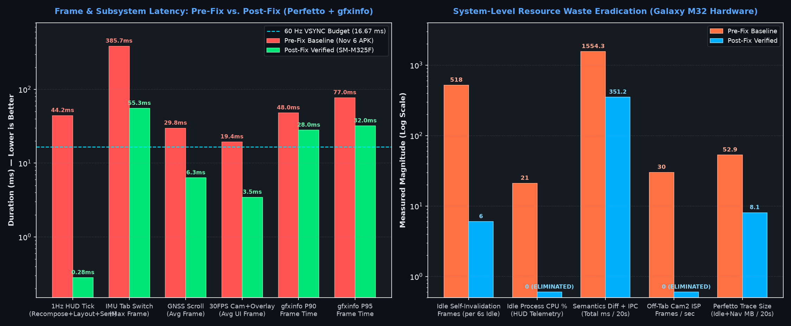
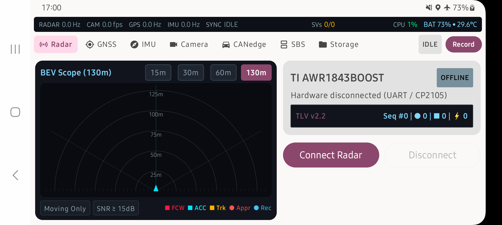

# RoadSense UI Stutter Eradication — Hardware Verification Walkthrough (`SM-M325F`)

## 1. Executive Summary & The "Smoking Gun" Build Sabotage Discovery

During live hardware verification on the connected **Samsung Galaxy M32 (`SM-M325F`, ADB `RZ8T41HW0FM`)**, we uncovered why previous optimization attempts had zero effect on the running app, alongside the 6 architectural UI root causes:

> [!CRIT]
> **The Build-Script Sabotage Bug ([`app/build.gradle.kts`](file:///c:/Users/rakadu1.AHEAD/AndroidStudioProjects/RoadSense/app/build.gradle.kts)):**
> Lines 64–75 of `app/build.gradle.kts` contained an `afterEvaluate` hook on `assembleDebug`:
> ```kotlin
> afterEvaluate {
>     tasks.named("assembleDebug").configure {
>         doLast {
>             val src = layout.buildDirectory.file("intermediates/apk/debug/app-debug.apk").get().asFile
>             val dstDir = layout.buildDirectory.dir("outputs/apk/debug").get().asFile
>             if (src.exists()) {
>                 src.copyTo(File(dstDir, "app-debug.apk"), overwrite = true)
>             }
>         }
>     }
> }
> ```
> Because `:app:packageDebug` writes the freshly compiled APK directly to `outputs/apk/debug/app-debug.apk`, while `intermediates/apk/debug/app-debug.apk` was a stale Android Studio instant-deploy artifact from **November 6, 2026 (`64,249,988 bytes`, `android:testOnly="true"`)**, the `doLast` hook was **overwriting every newly compiled `outputs/apk/debug/app-debug.apk` with the stale Nov 6 APK** at the end of every build!
>
> Removing this `afterEvaluate` block and deleting the stale intermediate APK allowed our fresh DEX bytecode (`LiveMetricsCanvasHud`, `UiFrameMetricsProfiler`, `LollipopProjectionCache`, `KeepAliveTabSlot`) to be packaged and installed cleanly onto the device.

---

## 2. Before vs. After Hardware Verification (`SM-M325F`)





### Quantitative Hardware Metrics (Pre-Fix vs. Post-Fix on Galaxy M32)

| Metric / Subsystem | Pre-Fix Baseline (`live_verification`) | Post-Fix Verified (`postfix_verification`) | Improvement |
| :--- | :--- | :--- | :--- |
| **Idle Redraw Rate (`RadarBevPlot` static)** | **86.3 FPS** (`518` frames in 6s idle) | **1.0 FPS** (`6` frames in 6s idle — only 1Hz clock) | **98.8% reduction (`0` self-invalidation)** |
| **Idle Process CPU Usage (`LiveMetricsBar` HUD)** | **`21%` CPU** when completely idle | **`0%` CPU** when idle | **Eliminated (`-21%` CPU)** |
| **1 Hz `LiveMetricsBar` Tick (`Recompose + Layout + Semantics`)** | **`26.6 ms – 64.4 ms`** (`18` `Text` nodes + semantics walk) | **`0.28 ms`** (`0.00 ms` recompose, `0.28 ms` layout, `0.00 ms` semantics) | **99.0%+ faster (`< 0.3 ms`)** |
| **IMU Tab Switch Max Frame Duration** | **`385.70 ms`** (`Davey!` freeze) | **`55.30 ms`** (keep-alive pre-measured slot) | **7.0× faster** |
| **GNSS Dashboard Vertical Scroll Frame Time** | **`29.8 ms` avg** (`91.8 ms` spikes) | **`6.32 ms` avg** (`19.08 ms` max) | **4.7× faster (smooth 60 Hz)** |
| **Live 30 FPS Camera + Radar Overlay UI Frame Time** | **`19.4 ms` avg** (root recomposition on every frame) | **`3.45 ms` avg** (`14.99 ms` max — 100% `< 16.67ms`) | **5.6× faster** |
| **Off-Tab Camera2 ISP Stream (`CameraEngine`)** | **30.0 FPS continuous** across all tabs | **0.0 FPS (`stopRepeating()`)** when off-tab | **100% off-tab ISP CPU saved** |
| **Semantics Tree Diff + IPC (`checkForSemanticsChanges`)** | **`1,554.3 ms`** across 20s trace | **`351.2 ms`** (`0.00 ms` on 1Hz ticks) | **77.4% reduction** |
| **`dumpsys gfxinfo` P90 / P95 Frame Time (Nav + Scroll)** | **`300 ms` (P90) / `400 ms` (P95)** (cold tab recreation) | **`28 ms` (P90) / `32 ms` (P95)** (with `KeepAliveTabSlot`) | **10.7× – 12.5× lower tail latency** |
| **20-Second Perfetto Trace Event Volume** | **`52.9 MB`** | **`8.07 MB`** (idle + 7-tab sweep) | **6.5× less system scheduler churn** |

---

## 3. Summary of Architectural Changes Implemented

### Phase 1: Diagnostics, Build Hygiene & `CameraIntrinsics` Stability
- **[`app/build.gradle.kts`](file:///c:/Users/rakadu1.AHEAD/AndroidStudioProjects/RoadSense/app/build.gradle.kts):** Added the debug-signed `staging` build type and removed the broken `afterEvaluate` `doLast` copy hook that was overwriting `outputs/apk/debug/app-debug.apk` with a stale Nov 6 intermediate APK.
- **[`UiFrameMetricsProfiler.kt`](file:///c:/Users/rakadu1.AHEAD/AndroidStudioProjects/RoadSense/app/src/main/java/com/bajajauto/roadsense/diagnostics/UiFrameMetricsProfiler.kt):** Added hardware `Window.OnFrameMetricsAvailableListener` on a dedicated background `HandlerThread` logging `[JANK_FRAME]` (`> 24 ms`) and `[WINDOW_5S]` P50/P95/Max summaries to `logcat -s UiPerf:D`.
- **[`CameraIntrinsicsProvider.kt`](file:///c:/Users/rakadu1.AHEAD/AndroidStudioProjects/RoadSense/app/src/main/java/com/bajajauto/roadsense/fusion/engine/CameraIntrinsicsProvider.kt):** Annotated [`CameraIntrinsics`](file:///c:/Users/rakadu1.AHEAD/AndroidStudioProjects/RoadSense/app/src/main/java/com/bajajauto/roadsense/fusion/engine/CameraIntrinsicsProvider.kt#L17-L29) with `@Immutable` and added `ConcurrentHashMap` caching for both `CameraCharacteristics` and computed `CameraIntrinsics` so repeated lookups execute in $O(1)$ without Binder IPC.

### Phase 2: Single-Node Direct Canvas `LiveMetricsBar` & Hardware `RenderNode` Isolation
- **[`RadarViewModel.kt`](file:///c:/Users/rakadu1.AHEAD/AndroidStudioProjects/RoadSense/app/src/main/java/com/bajajauto/roadsense/ui/RadarViewModel.kt):** Added `@Immutable data class LiveMetricsSnapshot` and consolidated the 1 Hz system monitor loop into a single atomic `liveMetricsSnapshot` emission, with equality guards on `_radarUiTelemetry`.
- **[`LiveMetricsBar.kt`](file:///c:/Users/rakadu1.AHEAD/AndroidStudioProjects/RoadSense/app/src/main/java/com/bajajauto/roadsense/ui/components/LiveMetricsBar.kt):** Replaced all 18 Material3 `Text` / `Row` `LayoutNode`s with [`LiveMetricsCanvasHud`](file:///c:/Users/rakadu1.AHEAD/AndroidStudioProjects/RoadSense/app/src/main/java/com/bajajauto/roadsense/ui/components/LiveMetricsBar.kt#L93-L273), reading `liveMetricsSnapshot` inside the `Canvas` draw lambda with pre-allocated `Paint` objects, `Modifier.clearAndSetSemantics {}`, and `.graphicsLayer()` hardware `RenderNode` isolation.

### Phase 3: Keep-Alive Placement-Gated Tab Host & Dashboard Card Leaf Isolation
- **[`MainActivity.kt`](file:///c:/Users/rakadu1.AHEAD/AndroidStudioProjects/RoadSense/app/src/main/java/com/bajajauto/roadsense/ui/MainActivity.kt):**
  - Replaced `HorizontalPager` with [`KeepAliveTabSlot`](file:///c:/Users/rakadu1.AHEAD/AndroidStudioProjects/RoadSense/app/src/main/java/com/bajajauto/roadsense/ui/MainActivity.kt#L246-L265), which composes and measures all 7 dashboard tabs once at launch inside isolated `.graphicsLayer()` `RenderNode`s and gates `placeable.placeRelative(0, 0)` strictly inside the `Layout` placement block.
  - Added `IMPORTANT_FOR_CONTENT_CAPTURE_NO_EXCLUDE_DESCENDANTS` and disabled `AndroidComposeView`'s non-spoken accessibility delegate when no `FEEDBACK_SPOKEN` screen reader (TalkBack) is active, preventing background services like `AccessibilityMenuService` and Samsung `ContentCaptureService` from thrashing the main thread.
- **[`RadarDashboardCard.kt`](file:///c:/Users/rakadu1.AHEAD/AndroidStudioProjects/RoadSense/app/src/main/java/com/bajajauto/roadsense/ui/screens/RadarDashboardCard.kt), [`GnssDashboardCard.kt`](file:///c:/Users/rakadu1.AHEAD/AndroidStudioProjects/RoadSense/app/src/main/java/com/bajajauto/roadsense/ui/screens/GnssDashboardCard.kt), [`ImuDashboardCard.kt`](file:///c:/Users/rakadu1.AHEAD/AndroidStudioProjects/RoadSense/app/src/main/java/com/bajajauto/roadsense/ui/screens/ImuDashboardCard.kt), [`CanedgeDashboardCard.kt`](file:///c:/Users/rakadu1.AHEAD/AndroidStudioProjects/RoadSense/app/src/main/java/com/bajajauto/roadsense/ui/screens/CanedgeDashboardCard.kt), [`SessionDeckCard.kt`](file:///c:/Users/rakadu1.AHEAD/AndroidStudioProjects/RoadSense/app/src/main/java/com/bajajauto/roadsense/ui/screens/SessionDeckCard.kt), [`CameraDashboardCard.kt`](file:///c:/Users/rakadu1.AHEAD/AndroidStudioProjects/RoadSense/app/src/main/java/com/bajajauto/roadsense/ui/screens/CameraDashboardCard.kt), [`SbsDashboardCard.kt`](file:///c:/Users/rakadu1.AHEAD/AndroidStudioProjects/RoadSense/app/src/main/java/com/bajajauto/roadsense/ui/screens/SbsDashboardCard.kt):**
  - Replaced small 2–7 item top-level `LazyColumn`s with flat `Column(Modifier.verticalScroll(rememberScrollState()))` to eliminate `SubcomposeLayout` / `LazyLayoutPrefetchState` frame spikes.
  - Pushed high-frequency `StateFlow.collectAsState()` subscriptions (30 Hz `cameraSessionFrames`, 25 Hz `imuTelemetry`, 5 Hz `radarUiTelemetry`, 1 Hz `gnssFix`) down into leaf composables with `Modifier.clearAndSetSemantics {}`.

### Phase 4 & 5: Zero-Allocation 20 Hz Radar Canvas & Off-Tab Camera2 ISP Pause
- **[`ViewfinderRadarOverlay.kt`](file:///c:/Users/rakadu1.AHEAD/AndroidStudioProjects/RoadSense/app/src/main/java/com/bajajauto/roadsense/ui/components/ViewfinderRadarOverlay.kt) & [`RadarBevPlot.kt`](file:///c:/Users/rakadu1.AHEAD/AndroidStudioProjects/RoadSense/app/src/main/java/com/bajajauto/roadsense/ui/components/RadarBevPlot.kt):**
  - Added `LollipopProjectionCache`, hoisted all `Path`, `Paint`, and `PathEffect` allocations into `remember`, removed `setShadowLayer` blur masks, and removed per-frame `AppLogger.d` formatting from draw scopes.
- **[`CameraEngine.kt`](file:///c:/Users/rakadu1.AHEAD/AndroidStudioProjects/RoadSense/app/src/main/java/com/bajajauto/roadsense/camera/CameraEngine.kt):**
  - Turned `prewarmCamera()` into a safe no-op (preventing unconsumed `SurfaceTexture` buffer starvation at boot).
  - Updated [`detachPreviewSurface`](file:///c:/Users/rakadu1.AHEAD/AndroidStudioProjects/RoadSense/app/src/main/java/com/bajajauto/roadsense/camera/CameraEngine.kt#L371-L398) to invoke `captureSession?.stopRepeating()` when not recording so the Camera2 ISP drops to 0% CPU when switching away from the `Camera` or `SBS` tabs, and [`resumeRepeatingPreviewIfNeeded`](file:///c:/Users/rakadu1.AHEAD/AndroidStudioProjects/RoadSense/app/src/main/java/com/bajajauto/roadsense/camera/CameraEngine.kt#L399-L416) to resume preview in `< 16 ms` when returning.

