# Walkthrough: Radar TLV MSS v1.0.1 Protocol Parity & Decoding

Synchronized RoadSense mmWave radar parsing pipeline and downstream tooling with commit [`e229fc434b02327a22244ad6d14dc6e70fb99e45`](file:///D:/Gitea/CAN_unified_radar_tracker_py) (*MSS v1.0.1 / Unified Master Specification v4.0*).

---

## 1. Key Protocol Changes Implemented

```mermaid
flowchart LR
    subgraph Input ["UART Binary Stream"]
        RAW["High-Speed UART (3.125 Mbps)"]
    end

    subgraph Assembly ["Frame Assembly & Validation"]
        ASM["RadarPacketAssembler\n- Bound Check (Len ≤ 16KB, 4B align)\n- numTLVs ≤ 10, subframe ≤ 7\n- numDetectedObj ≤ 2048"]
    end

    subgraph TLV_Parsing ["RadarTlvDecoder"]
        direction TB
        T1["TLV 1: Points (12B/10B)"]
        T2["TLV 2: Clusters (16B isInDeadZone)"]
        T3["TLV 3: Tracks (28B/20B)"]
        T4["TLV 4: Diagnostics (48B)"]
        T5["TLV 5: CAN Inputs (56B)"]
        T6["TLV 6: ADAS CAN Outputs (24B)\n[Byte 7 = ADAS FSM State 0..3]"]
        T7["TLV 7: Subsystem Version Info (12B)\n[DSS, MSS, Tracking SemVer]"]
    end

    subgraph Output ["Domain Models & Telemetry"]
        RF["RadarFrame\n- points, tracks, clusters\n- diagnostics, canInputs, canOutputs\n- versionInfo (DSS, MSS, Trk)\n- acc.adasFsmState ('IDLE'/'FCW'/'ACC'/'AEB')"]
        UI["RadarDashboardCard HUD\n- ACC Lead Badge with FSM State"]
    end

    RAW --> ASM --> TLV_Parsing --> RF --> UI
```



---

## 2. Changes Made by Subsystem

### 2.1 Domain Models
- [`RadarFrame.kt`](file:///C:/Users/rakadu1.AHEAD/AndroidStudioProjects/RoadSense/app/src/main/java/com/bajajauto/roadsense/models/RadarFrame.kt):
  - **`RadarAccTarget`**: Added `adasFsmState: Int = 0` and computed property `adasFsmStateName: String` (`IDLE`, `FCW`, `ACC`, `AEB`). Marked `aRefMps2: Float = 0f` with `@Deprecated` and default parameter for zero breaking changes across existing callers.
  - **`RadarCluster`**: Added `isInDeadZone: Boolean = isDeadZone` matching Master Spec terminology.
  - **`RadarVersionInfo`**: Created new data class storing semantic versions (`dssVersion`, `mssVersion`, `trackingVersion`) and raw `uint32` values.
  - **`RadarFrame`**: Attached `val versionInfo: RadarVersionInfo? = null`.

### 2.2 Radar TLV Parsing & Boundary Validation
- [`RadarTlvDecoder.kt`](file:///C:/Users/rakadu1.AHEAD/AndroidStudioProjects/RoadSense/app/src/main/java/com/bajajauto/roadsense/decoding/RadarTlvDecoder.kt):
  - Defined `const val TLV_VERSION_INFO = 7`.
  - Added TLV 7 decoding via `parseVersionInfo()`: unpacks 12 bytes via `<III` and converts to semantic strings using `(v ushr 24) and 0xFF`, `(v ushr 16) and 0xFF`, `(v ushr 8) and 0xFF`.
  - Updated TLV 6 `parseCanOutputs()`: decodes Byte 7 of ACC frame as `adasFsmState = acc7 and 0x03`.
- [`RadarPacketAssembler.kt`](file:///C:/Users/rakadu1.AHEAD/AndroidStudioProjects/RoadSense/app/src/main/java/com/bajajauto/roadsense/decoding/RadarPacketAssembler.kt):
  - Added physical header boundary safety gates matching Rule 18: `totalPacketLen in 40..65536`, `totalPacketLen % 4 == 0`, `numTLVs in 0..10`, `subFrameNumber in 0..7`, `numDetectedObj in 0..2048`. Corrupted headers are cleanly rejected while resynchronizing to the next valid frame.

### 2.3 Cockpit UI
- [`RadarDashboardCard.kt`](file:///C:/Users/rakadu1.AHEAD/AndroidStudioProjects/RoadSense/app/src/main/java/com/bajajauto/roadsense/ui/screens/RadarDashboardCard.kt):
  - Added dynamic ADAS FSM state badge (`ACC POI: #TID (X.Xm • ACC)`) to the active lead telemetry row.

### 2.4 Downstream Python Tooling
- [`tools/convert_session_to_mcap.py`](file:///C:/Users/rakadu1.AHEAD/AndroidStudioProjects/RoadSense/tools/convert_session_to_mcap.py):
  - Updated TLV 6 ACC parser to extract `fsm_state = int(acc7)`.
  - Added TLV 7 version info unpacker.
  - Registered `fsm_state` in the MCAP schema.
- [`tools/sync_and_process_sessions.py`](file:///C:/Users/rakadu1.AHEAD/AndroidStudioProjects/RoadSense/tools/sync_and_process_sessions.py):
  - Unpacks `fsm_state = int(acc[7])` and TLV 7 `version_info`.
- [`scripts/tests/test_verify_conversion_parity.py`](file:///C:/Users/rakadu1.AHEAD/AndroidStudioProjects/RoadSense/scripts/tests/test_verify_conversion_parity.py):
  - Updated synthetic session test vector to encode `fsm_state = 2` and verify parity.

---

## 3. Verification Results

### 3.1 JVM Unit Tests
Ran the full test suite and targeted decoding test suite with Android Studio JBR:
```powershell
$env:JAVA_HOME = "C:\Users\rakadu1.AHEAD\Android_Studio\android-studio-quail4-windows\android-studio\jbr"
./gradlew testDebugUnitTest
```
- **Result**: `BUILD SUCCESSFUL in 28s` (all 24 actionable tasks up-to-date or passing).
- **Targeted Suite**: `com.bajajauto.roadsense.decoding.*`:
  - `RadarTlvDecoderTest`:
    - `decode_24ByteCanOutputs_parsesFcwBsdAccCorrectly`: Verified `adasFsmState = 2` and `adasFsmStateName = "ACC"`.
    - `decode_12ByteVersionInfo_parsesDssMssTrackingVersionsCorrectly`: Verified DSS `"1.0.0"`, MSS `"1.0.1"`, Tracking `"1.0.0"`.
    - `decode_completeMultiTlvPacket_parsesAll7TlvsSimultaneously`: Verified simultaneous ingestion of TLVs 1 through 7.
  - `RadarPacketAssemblerTest` (6 new unit tests):
    - Rejection of out-of-bounds `numTLVs`, `subFrameNumber`, `numDetectedObj`, and unaligned `totalPacketLen`.
    - Verified clean re-alignment and synchronization on valid frames following corrupted streams.

### 3.2 Python Parity & Conversion Unit Tests
```powershell
conda run -n roadsense-mcap python -m unittest scripts/tests/test_verify_conversion_parity.py
```
- **Result**: `Ran 8 tests in 0.071s — OK`.

```powershell
conda run -n roadsense-mcap python -m unittest discover -s scripts/tests
```
- **Result**: `Ran 60 tests in 0.142s — OK (skipped=2)`.

### 3.3 Real Hardware Stream Validation
```powershell
python scripts/validate_radar_stream.py --latest
```
- **Stream**: `logs/session_20261023_111120/radar/radar_raw_stream.bin` (15,756,942 bytes).
- **Summary**:
  - Total valid frames: **23,340**.
  - Frame delivery rate: **99.99%** (only 2 dropped frames across 23,340 frames).
  - TLV 7 distribution: **23,338 occurrences** cleanly aligned with the 12-byte subsystem version structure (`DSS=1.0.0`, `MSS=1.0.0`, `Track=1.0.0`).
