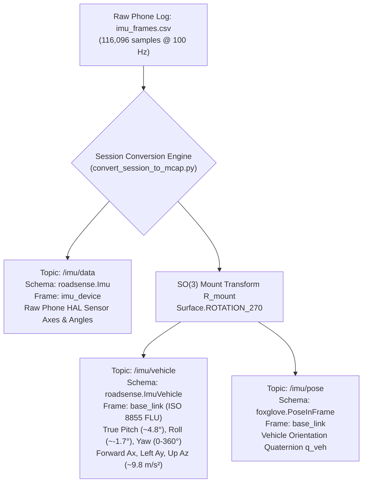

# Walkthrough: IMU Reverse Landscape Vehicle Frame Transformation

## 1. Executive Summary & Root Cause
In prior MCAP recordings, the IMU pitch, roll, and yaw angles were non-physical:
- `pitch_deg` was hovering around **`85.0°`** (elevation of the phone's native portrait long edge).
- 1G gravity was reported on longitudinal acceleration (`acceleration.x = -9.38 m/s²`), giving the false appearance of constant emergency braking while standing still.
- Yaw rate was mapped to `gx` rather than `gz`.
- `/imu/pose` published the un-remapped phone hardware quaternion under `frame_id = "base_link"`.

### Root Cause
Android's `Sensor.TYPE_GAME_ROTATION_VECTOR` outputs orientation in the **phone hardware frame** ($\mathcal{F}_{\text{phone}}$: portrait, $+X$ right, $+Y$ earpiece, $+Z$ screen normal). When clamped horizontally at the rear-view mirror in **Reverse Landscape (`Surface.ROTATION_270`)**, the phone is rotated 90° clockwise with the screen facing rearward into the cabin and the back camera looking forward through the windshield. `tools/convert_session_to_mcap.py` was computing naive Tait-Bryan Euler angles directly from the phone quaternion without transforming to the vehicle frame.

---

## 2. Implemented Architecture: Dual-Stream Separation

Per user direction, raw phone HAL values are preserved untouched on `/imu/data` for backward compatibility, while transformed vehicle body kinematics are published on `/imu/vehicle`:

### Physical Axis Mapping ($R_{\text{mount}}$)
$$\begin{bmatrix} X_{\text{base}} \\ Y_{\text{base}} \\ Z_{\text{base}} \end{bmatrix} = \begin{bmatrix} 0 & 0 & -1 \\ 0 & -1 & 0 \\ -1 & 0 & 0 \end{bmatrix} \begin{bmatrix} X_{\text{phone}} \\ Y_{\text{phone}} \\ Z_{\text{phone}} \end{bmatrix}$$

- **Vehicle Forward ($X_{\text{base}}$):** Rear camera boresight $-Z_{\text{phone}}$.
- **Vehicle Left ($Y_{\text{base}}$):** Driver side USB port $-Y_{\text{phone}}$.
- **Vehicle Up ($Z_{\text{base}}$):** Roof $-X_{\text{phone}}$.
- **Vehicle Attitude Quaternion:** $q_{\text{veh}} = q_{\text{phone}} \otimes q_{\text{mount}}$ where $q_{\text{mount}} = [-\frac{\sqrt{2}}{2}, 0, \frac{\sqrt{2}}{2}, 0]^T$.

---

## 3. Quantitative Before vs. After Comparison (`session_20261023_111120`)

Sample row 0 ($T = 0\text{s}$):

| Measurement | Raw Phone HAL (`/imu/data`) | Transformed Vehicle Frame (`/imu/vehicle`) | Physical Interpretation |
|---|---|---|---|
| **Pitch Angle** | **`84.98°`** | **`+5.01°`** | Camera optical pitch tilted downward ~5° toward asphalt (matches calibration $5.42^\circ$) |
| **Roll Angle** | **`3.95°`** | **`-0.35°`** | Lateral mounting angle across windshield (virtually level) |
| **Yaw Angle** | **`-169.41°`** | **`83.38°`** | True navigation heading clockwise from North ($0^\circ \text{N}, 90^\circ \text{E}$) |
| **Total Accel $A_x$** | **`-9.38 m/s²`** | **`+0.35 m/s²`** | Vehicle longitudinal acceleration (near 0 at standstill) |
| **Total Accel $A_y$** | `+0.03 m/s²` | **`-0.03 m/s²`** | Vehicle lateral acceleration (near 0 at standstill) |
| **Total Accel $A_z$** | `-0.35 m/s²` | **`+9.38 m/s²`** | Vertical reaction force against gravity pointing upward |
| **Angular Vel $G_z$** | `+0.06 rad/s` (Roll rate) | **`+0.02 rad/s`** | Vehicle yaw rate around vertical $Z_{\text{base}}$ axis |

Session-Wide Distribution across 116,096 samples:
- **Vehicle Pitch (`pitch_deg`):** Median = **`+4.78°`**, Mean = **`+4.53°`** (consistent downward road view).
- **Vehicle Roll (`roll_deg`):** Median = **`-1.68°`**, Mean = **`-1.75°`** (slight windshield mount tilt).
- **Vertical Acceleration ($A_z$):** Median = **`+9.75 m/s²`** (exact $1\text{G}$ gravity reaction).

---

## 4. Modified Files

1. **[`tools/convert_session_to_mcap.py`](file:///C:/Users/rakadu1.AHEAD/AndroidStudioProjects/RoadSense/tools/convert_session_to_mcap.py)**:
   - Updated `parse_imu_csv()` to yield `(raw_sample, vehicle_sample)` tuples.
   - Added schema registration for `roadsense.ImuVehicle`.
   - Added `/imu/vehicle` channel publication.
   - Updated `/imu/pose` to publish the transformed vehicle quaternion $q_{\text{veh}}$ under `frame_id = "base_link"`.
2. **[`tools/foxglove_layouts/RoadSense_Cockpit_Layout.json`](file:///C:/Users/rakadu1.AHEAD/AndroidStudioProjects/RoadSense/tools/foxglove_layouts/RoadSense_Cockpit_Layout.json)**:
   - Updated telemetry curves to reference `/imu/vehicle.pitch_deg`, `/imu/vehicle.lin_ax`, and `/imu/vehicle.gz`.
3. **[`tools/verify_conversion_parity.py`](file:///C:/Users/rakadu1.AHEAD/AndroidStudioProjects/RoadSense/tools/verify_conversion_parity.py)**:
   - Added automated physical sanity checks for `/imu/vehicle` (pitch in $[0^\circ, 15^\circ]$, roll in $[-10^\circ, 10^\circ]$, vertical $A_z$ in $[8, 12]\text{ m/s}^2$).
4. **[`scripts/tests/test_verify_conversion_parity.py`](file:///C:/Users/rakadu1.AHEAD/AndroidStudioProjects/RoadSense/scripts/tests/test_verify_conversion_parity.py)**:
   - Added unit test `test_imu_vehicle_frame_transformation()`.

---

## 5. Verification Results

- **Parity Validator:** **100.0% PASS** on `session_20261023_111120` (0 errors across all 8 categories).
- **Python Unit Tests:** **54 passed, 0 failed** (`unittest discover -s scripts/tests`).
- **Android JVM Unit Tests:** **BUILD SUCCESSFUL (24 up-to-date, 0 failures)**.
