# Walkthrough: RoadSense UI Virtualization, Stability & Pre-Warm Checkpoint

> [!WARNING]
> **Checkpoint Status — Unresolved On-Device (Pre-Pivot Snapshot):**  
> All Phase 1–5 refactors, Gradle APK parity fixes, and `SurfaceTexture(false)` camera pre-warming below compiled cleanly and passed `testDebugUnitTest` + `assembleDebug`. However, after Gradle sync, build, and installation via Android Studio, **on-device testing confirmed the UI scrolling/menu navigation lag without active camera preview remains unresolved ("None of this is working")**.  
> These changes are committed as a documented baseline checkpoint on the `validation` branch prior to taking a drastically new UI architecture approach going forward.

## 1. Executive Summary & Root Cause Investigation

When initial device testing showed no improvement, ADB diagnostics on `RZ8T41HW0FM` uncovered two contributing issues that were addressed in this checkpoint:

1. **Stale APK Output Path Parity (`app/build.gradle.kts`):**
   - Inspecting the installed APK pulled from device (`base.apk`) showed `Has StableList in target_installed.apk: False`, whereas `./gradlew assembleDebug` had emitted the updated DEX inside `app/build/intermediates/apk/debug/app-debug.apk` without updating `app/build/outputs/apk/debug/app-debug.apk`.
   - **Change Applied:** Added an `afterEvaluate` `doLast` copy hook in [`app/build.gradle.kts`](file:///c:/Users/rakadu1.AHEAD/AndroidStudioProjects/RoadSense/app/build.gradle.kts) so `app/build/outputs/apk/debug/app-debug.apk` stays synchronized with `intermediates/apk/debug/app-debug.apk`.
2. **MediaTek Helio G80 PowerHAL Pre-Warm Timeout Hypothesis:**
   - Earlier Perfetto & logcat analysis observed `libPowerHal: TIMER_MSG_PERF_LOCK_TIMEOUT` 1.0s after `CameraEngine.prewarmCamera()` opened `CameraDevice` without an active preview surface (`createCaptureSession()` exited without starting a repeating request), leaving CPU clocks in the $774\text{–}1324\text{ MHz}$ range.
   - **Change Applied (Insufficient):** Updated `CameraEngine.prewarmCamera()` to allocate a detached `SurfaceTexture(false)` + `Surface(st)` before `openCamera()` so `createCaptureSession()` starts a repeating capture request at startup.
   - **Outcome:** Even with Gradle synced/built directly in Android Studio and installed on-device, sluggish scrolling/navigation outside active preview persisted.

---

## 2. Changes by Subsystem

```mermaid
flowchart TD
    subgraph Stability_Layer ["Phase 1: Domain Stability Layer"]
        A1["@Immutable RadarFrame, RadarPoint, RadarTrack, RadarCluster"]
        A2["@Immutable GnssFix, GnssState"]
        A3["@Immutable ImuSensorCapability, ImuTelemetryState"]
        A4["@Immutable CanedgeDevice, CanedgeFile, CanedgeSyncStats"]
        A5["@Immutable CameraConfig, CameraDeviceInfo, CalibrationParameters"]
        A6["StableList&lt;T&gt; collection wrapper"]
    end

    subgraph Virtualization_Layer ["Phase 2 & 3: Virtualization (LazyColumn)"]
        B1["RadarDashboardCard: Right pane & Portrait deck virtualized"]
        B2["GnssDashboardCard: Speedometer, WGS84, Sats virtualized"]
        B3["ImuDashboardCard: 35 discovered sensors virtualized with stable keys"]
        B4["CanedgeDashboardCard: Dual-pane & file lists virtualized"]
        B5["SessionDeckCard: Scorecard, ADB, structure virtualized"]
        B6["CameraDashboardCard: Controls deck virtualized"]
    end

    subgraph Hardware_Lock ["Phase 4: Persistent SurfaceTexture Pre-Warming"]
        D1["Prewarm SurfaceTexture(false) on startup"]
        D2["Permanent CameraCaptureSession streaming"]
        D3["MediaTek perfLockAcq permanently holds 2.0 GHz Cortex-A75"]
    end

    subgraph Styling_Layer ["Phase 5: Flat Avionics Styling"]
        C1["RoundedCornerShape(2.dp) across all diagnostic cards"]
        C2["Elimination of nested overdraw & alpha blending"]
    end

    Stability_Layer --> Virtualization_Layer
    Virtualization_Layer --> Hardware_Lock
    Hardware_Lock --> Styling_Layer
```



### 2.1 Domain Stability Layer (`@Immutable`)
Jetpack Compose treats standard `List<T>` as inherently unstable, forcing every composable to be `NOT SKIPPABLE`.
- **Annotated files:**
  - `app/src/main/java/com/bajajauto/roadsense/models/RadarFrame.kt`
  - `app/src/main/java/com/bajajauto/roadsense/models/RadarHeader.kt`
  - `app/src/main/java/com/bajajauto/roadsense/gnss/GnssFix.kt`
  - `app/src/main/java/com/bajajauto/roadsense/gnss/GnssState.kt`
  - `app/src/main/java/com/bajajauto/roadsense/imu/ImuSensorCapability.kt`
  - `app/src/main/java/com/bajajauto/roadsense/imu/ImuTelemetryState.kt`
  - `app/src/main/java/com/bajajauto/roadsense/canedge/model/CanedgeDevice.kt`
  - `app/src/main/java/com/bajajauto/roadsense/canedge/model/CanedgeFile.kt`
  - `app/src/main/java/com/bajajauto/roadsense/camera/CameraConfig.kt`
  - `app/src/main/java/com/bajajauto/roadsense/camera/CameraDeviceInfo.kt`
  - `app/src/main/java/com/bajajauto/roadsense/fusion/model/CalibrationParameters.kt`
  - `app/src/main/java/com/bajajauto/roadsense/sync/LiveSyncTelemetry.kt`
  - `app/src/main/java/com/bajajauto/roadsense/ui/common/ComposeStability.kt`

### 2.2 Shell & Screen Virtualization (`LazyColumn`) & Flat Styling

| File | Previous Architecture | Refactored Architecture | Scope & Notes |
| :--- | :--- | :--- | :--- |
| [`MainActivity.kt`](file:///c:/Users/rakadu1.AHEAD/AndroidStudioProjects/RoadSense/app/src/main/java/com/bajajauto/roadsense/ui/MainActivity.kt) | `CockpitTab.values()` read un-memoized in `RoadSenseCockpitScreen` | `tabs = remember { CockpitTab.values() }` | Avoids array re-allocation on root recomposition |
| [`RadarDashboardCard.kt`](file:///c:/Users/rakadu1.AHEAD/AndroidStudioProjects/RoadSense/app/src/main/java/com/bajajauto/roadsense/ui/screens/RadarDashboardCard.kt) | `Column(Modifier.verticalScroll())` + `4.dp`/`6.dp` radius | `LazyColumn` (`"status"`, `"bev"`, `"controls"`) + `2.dp` radius | Landscape right pane and portrait deck |
| [`GnssDashboardCard.kt`](file:///c:/Users/rakadu1.AHEAD/AndroidStudioProjects/RoadSense/app/src/main/java/com/bajajauto/roadsense/ui/screens/GnssDashboardCard.kt) | `Column(Modifier.verticalScroll())` | `LazyColumn` (`"switch"`, `"speedometer"`, `"constellation"`, `"wgs84"`) + `2.dp` radius | Keyed dashboard sections |
| [`ImuDashboardCard.kt`](file:///c:/Users/rakadu1.AHEAD/AndroidStudioProjects/RoadSense/app/src/main/java/com/bajajauto/roadsense/ui/screens/ImuDashboardCard.kt) | `Column(Modifier.verticalScroll())` with `filtered.forEach` | `LazyColumn` + `LazyListScope` extensions (`sensorAuditItems`, `rateProfilerItems`, `liveTelemetryItems`) + `2.dp` radius | Keyed sensor items (`key = { it.sensorType }`) |
| [`CanedgeDashboardCard.kt`](file:///c:/Users/rakadu1.AHEAD/AndroidStudioProjects/RoadSense/app/src/main/java/com/bajajauto/roadsense/ui/screens/CanedgeDashboardCard.kt) | `Column(Modifier.verticalScroll())` on dual panes | `LazyColumn` on landscape panes & portrait layout + `2.dp`/`4.dp` radius | Note: `CanedgeUnifiedFileExplorerDialog` internal folder list still uses `verticalScroll` |
| [`SessionDeckCard.kt`](file:///c:/Users/rakadu1.AHEAD/AndroidStudioProjects/RoadSense/app/src/main/java/com/bajajauto/roadsense/ui/screens/SessionDeckCard.kt) | `Column(Modifier.verticalScroll())` | `LazyColumn` (`"status"`, `"scorecard"`, `"adb"`, `"structure"`) + `2.dp` radius | Keyed session summary blocks |
| [`CameraDashboardCard.kt`](file:///c:/Users/rakadu1.AHEAD/AndroidStudioProjects/RoadSense/app/src/main/java/com/bajajauto/roadsense/ui/screens/CameraDashboardCard.kt) | `Column(Modifier.verticalScroll())` + `8.dp` radius | `LazyColumn` (`"pipeline_header"`, `"viewfinder"`, `"calibration"`, `"focus_control"`, `"lens_selector"`, `"res_selector"`, `"fps_selector"`, `"sync_spec"`) + `2.dp` radius | Landscape right pane & portrait controls |

### 2.3 Persistent Hardware Pre-Warming & Build Parity
- [`CameraEngine.kt`](file:///c:/Users/rakadu1.AHEAD/AndroidStudioProjects/RoadSense/app/src/main/java/com/bajajauto/roadsense/camera/CameraEngine.kt): Updated `prewarmCamera()` to allocate a detached `SurfaceTexture(false)` + `Surface(st)` before `openCamera()` so `createCaptureSession()` starts a repeating capture request immediately at app startup.
- [`app/build.gradle.kts`](file:///c:/Users/rakadu1.AHEAD/AndroidStudioProjects/RoadSense/app/build.gradle.kts): Added an `afterEvaluate` `doLast` copy hook syncing `app/build/intermediates/apk/debug/app-debug.apk` to `app/build/outputs/apk/debug/app-debug.apk`.
- [`scripts/analyze_ui_scroll_trace.py`](file:///c:/Users/rakadu1.AHEAD/AndroidStudioProjects/RoadSense/scripts/analyze_ui_scroll_trace.py): Extracted standalone Perfetto TraceProcessor query script for inspecting `com.bajajauto.roadsense` UI thread slices and `cpufreq` counters (leaving [`scripts/analyze_perfetto_trace.py`](file:///c:/Users/rakadu1.AHEAD/AndroidStudioProjects/RoadSense/scripts/analyze_perfetto_trace.py) untouched for IMU trace analysis).

---

## 3. Verification & Build Status

### 3.1 JVM Unit Tests & Debug Build
```powershell
$env:JAVA_HOME = "C:\Users\rakadu1.AHEAD\Android_Studio\android-studio-quail4-windows\android-studio\jbr"
./gradlew assembleDebug
./gradlew testDebugUnitTest
```
Both `assembleDebug` and `testDebugUnitTest` completed with `BUILD SUCCESSFUL`.

---

## 4. On-Device Outcome & Next Architectural Direction

1. **Android Studio Sync & Install:** User completed Gradle sync, built, and installed directly onto the test phone.
2. **Observed On-Device Result:** **No perceptible improvement** — scrolling and menu navigation outside an active camera preview remained sluggish ("None of this is working").
3. **Checkpoint Decision:** Because `@Immutable` model stability, `LazyColumn` virtualization, `2.dp` flat shapes, and `SurfaceTexture(false)` camera pre-warming all failed to deliver smooth 60 FPS interaction on-device, this state is committed strictly as a clean checkpoint on `validation` before designing a drastically different UI/rendering approach going forward.
